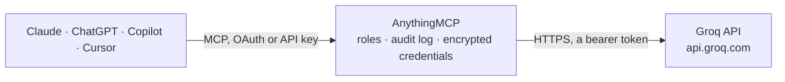

<!-- Generated by scripts/export-github-catalog.mjs in the anythingmcp-website repository. Do not edit by hand. -->

# Groq MCP connector

Let your AI use GroqCloud with your own API key: fast chat completions from open models such as Llama, GPT-OSS and Qwen, speech-to-text and translation of audio files from a link with Whisper, and … The AnythingMCP connector gives Claude, ChatGPT, Microsoft Copilot, Cursor and Gemini 9 MCP tools for Groq, all read-only.

**Category:** [Public Data](../data.md) · **Tools:** 9 · **Setup guide:** [anythingmcp.com](https://anythingmcp.com/guides/groq-to-mcp) · [Deutsch](https://anythingmcp.com/de/guides/groq-to-mcp) · [Italiano](https://anythingmcp.com/it/guides/groq-to-mcp) · [Español](https://anythingmcp.com/es/guides/groq-to-mcp) · [日本語](https://anythingmcp.com/ja/guides/groq-to-mcp) · [Русский](https://anythingmcp.com/ru/guides/groq-to-mcp) · [中文](https://anythingmcp.com/zh/guides/groq-to-mcp)

## Start without code

No installation and no terminal: AnythingMCP Cloud runs the Groq connector for you, operated by helpcode.ai in Frankfurt, Germany.

1. **Click the button above** and create an account or sign in. The Groq connector opens, ready to install.
2. **Paste the API key or token from your Groq account.** Every click is in the [step-by-step guide](https://anythingmcp.com/guides/groq-to-mcp).
3. **Click Install.** AnythingMCP shows the address of your MCP server.
4. **Add that address to your assistant:** [Claude](https://anythingmcp.com/guides/connect-groq-to-claude) · [ChatGPT](https://anythingmcp.com/guides/connect-groq-to-chatgpt) · [Microsoft Copilot](https://anythingmcp.com/guides/connect-groq-to-copilot) · [Cursor](https://anythingmcp.com/guides/connect-groq-to-cursor) · [Gemini CLI](https://anythingmcp.com/guides/connect-groq-to-gemini) · [Meta Muse](https://anythingmcp.com/guides/connect-groq-to-muse).
5. **Ask your first question**, for example: *What's the current status and progress of batch job batch-87c9 from July 14 2026?*

Prefer help with the setup? [Talk to us](https://anythingmcp.com/contact).

## How it works

- **The AI client** speaks MCP (Streamable HTTP) to AnythingMCP and only sees tool names, descriptions and results. It never gets the Groq credentials.
- **AnythingMCP** checks the client's role, builds the call from the tool definition, adds the credentials (a bearer token), calls Groq, logs the call and returns the result.
- **Groq** sees an ordinary API client with the rights of the account the credentials belong to.

## Tools

| Tool | What it does | Access |
|---|---|---|
| [`groq_list_models`](#groq_list_models) | List the models this Groq API key can use (chat, reasoning, Whisper speech-to-text, text-to-speech, safety), with owner, context window, maximum completion… | read |
| [`groq_get_model`](#groq_get_model) | Read one Groq model: owner, creation time, context window, maximum completion tokens and whether it is active. | read |
| [`groq_chat_completion`](#groq_chat_completion) | Send a conversation to a Groq-hosted model and return its reply (non-streaming). | read |
| [`groq_transcribe_audio`](#groq_transcribe_audio) | Transcribe speech in an audio file to text in its own language with Whisper. | read |
| [`groq_translate_audio`](#groq_translate_audio) | Translate speech in an audio file into English text with Whisper (only whisper-large-v3 translates). | read |
| [`groq_list_batches`](#groq_list_batches) | List the Batch API jobs of the Groq organization: endpoint, status (validating, in_progress, finalizing, completed, failed, expired, cancelling, cancelled),… | read |
| [`groq_get_batch`](#groq_get_batch) | Read one Groq batch job: status, timestamps of each stage, request counts (total, completed, failed), errors, metadata and the output_file_id and error_file_id. | read |
| [`groq_list_files`](#groq_list_files) | List the files stored in the Groq organization (batch inputs and batch outputs) with id, file name, size in bytes, purpose and creation time. | read |
| [`groq_get_file`](#groq_get_file) | Read the metadata of one Groq file: name, size in bytes, purpose (batch or batch_output) and creation time. | read |

## Tool reference

Every parameter as the AI client sees it in `tools/list`. Source: [`packages/backend/src/adapters/intl/groq.json`](../../../packages/backend/src/adapters/intl/groq.json).

### `groq_list_models`

List the models this Groq API key can use (chat, reasoning, Whisper speech-to-text, text-to-speech, safety), with owner, context window, maximum completion tokens and whether each is active. Free.

**Access:** read · **Call:** `GET /models`

No parameters.

### `groq_get_model`

Read one Groq model: owner, creation time, context window, maximum completion tokens and whether it is active. Answers 404 for a model id the key cannot use. Free.

**Access:** read · **Call:** `GET /models/{model}`

| Parameter | Type | Required | Description |
|---|---|---|---|
| `model` | string | yes | Model id as listed by groq_list_models, e.g. llama-3.3-70b-versatile or openai/gpt-oss-120b. |

### `groq_chat_completion`

Send a conversation to a Groq-hosted model and return its reply (non-streaming). COSTS MONEY on the Developer plan: billed per input and output token to the Groq organization (free plan: free within rate limits). Confirm with the user before larger or repeated calls and set max_completion_tokens to cap the cost. The result includes _headers with the remaining rate limit.

**Access:** read · **Call:** `POST /chat/completions`

| Parameter | Type | Required | Description |
|---|---|---|---|
| `model` | string | yes | Model id from groq_list_models, e.g. llama-3.3-70b-versatile, llama-3.1-8b-instant (cheapest), openai/gpt-oss-120b. |
| `messages` | object[] | yes | The conversation, oldest first: [{"role": "system", "content": "..."}, {"role": "user", "content": "..."}]. Roles: system, user, assistant, tool. For vision models content can be a list of parts such as {"type": "image_url", "image_url": {"url": "https://..."}}. |
| `max_completion_tokens` | integer | no | Upper bound on generated tokens, reasoning included. Set it to cap cost. |
| `temperature` | number | no | Sampling temperature 0-2; lower is more deterministic. |
| `top_p` | number | no | Nucleus sampling 0-1. |
| `stop` | string[] | no | Up to 4 sequences where generation stops. |
| `seed` | integer | no | Seed for best-effort repeatable sampling. |
| `response_format` | object | no | Structured output: {"type": "json_object"}, or {"type": "json_schema", "json_schema": {"name": "result", "strict": true, "schema": {...}}} on models that support it. |
| `tools` | object[] | no | Function definitions the model may call: [{"type": "function", "function": {"name": "...", "description": "...", "parameters": {...}}}]. The model answers with tool_calls; run them and send the results back as role tool messages. |
| `tool_choice` | any | no | none, auto, required, or {"type": "function", "function": {"name": "..."}} to force one function. |
| `reasoning_effort` | `none` \| `default` \| `low` \| `medium` \| `high` | no | Reasoning effort of reasoning models: low, medium or high for openai/gpt-oss-*; none or default for Qwen models. Other values are refused with 400. |
| `reasoning_format` | `hidden` \| `raw` \| `parsed` | no | How reasoning is returned: parsed (in message.reasoning), raw (inside the content) or hidden. |
| `service_tier` | `on_demand` \| `auto` \| `flex` | no | Service tier, default on_demand. flex answers or fails fast (error 498) when capacity is short. |

### `groq_transcribe_audio`

Transcribe speech in an audio file to text in its own language with Whisper. Pass a public link to the file; Groq downloads it itself (flac, mp3, mp4, mpeg, mpga, m4a, ogg, wav, webm). COSTS MONEY on the Developer plan: billed per hour of audio, at least 10 seconds per request. Confirm with the user before transcribing long recordings.

**Access:** read · **Call:** `POST /audio/transcriptions`

| Parameter | Type | Required | Description |
|---|---|---|---|
| `url` | string | yes | Public HTTPS link to the audio file. |
| `model` | `whisper-large-v3-turbo` \| `whisper-large-v3` | no | whisper-large-v3-turbo (default, cheaper and faster) or whisper-large-v3 (most accurate). |
| `language` | string | no | Language of the audio as an ISO-639-1 code, e.g. en, de, it. Improves accuracy and speed. |
| `prompt` | string | no | Optional text to guide spelling and style, in the language of the audio (names, terms, the previous segment). |
| `response_format` | `json` \| `text` \| `verbose_json` | no | json (default, {text}), text (plain text) or verbose_json (segments with timestamps). |
| `temperature` | number | no | Sampling temperature 0-1; 0 lets the model adapt it. |
| `timestamp_granularities` | `word` \| `segment` | no | With response_format verbose_json: word or segment timestamps (segments are included by default). |

### `groq_translate_audio`

Translate speech in an audio file into English text with Whisper (only whisper-large-v3 translates). Pass a public link to the file; Groq downloads it itself. COSTS MONEY on the Developer plan: billed per hour of audio, at least 10 seconds per request. Confirm with the user before translating long recordings.

**Access:** read · **Call:** `POST /audio/translations`

| Parameter | Type | Required | Description |
|---|---|---|---|
| `url` | string | yes | Public HTTPS link to the audio file (flac, mp3, mp4, mpeg, mpga, m4a, ogg, wav, webm). |
| `model` | `whisper-large-v3` | no | Translation model; only whisper-large-v3. |
| `prompt` | string | no | Optional English text to guide spelling and style. |
| `response_format` | `json` \| `text` \| `verbose_json` | no | json (default), text or verbose_json. |
| `temperature` | number | no | Sampling temperature 0-1. |

### `groq_list_batches`

List the Batch API jobs of the Groq organization: endpoint, status (validating, in_progress, finalizing, completed, failed, expired, cancelling, cancelled), request counts, completion window, input, output and error file ids and timestamps. Free.

**Access:** read · **Call:** `GET /batches`

No parameters.

### `groq_get_batch`

Read one Groq batch job: status, timestamps of each stage, request counts (total, completed, failed), errors, metadata and the output_file_id and error_file_id. Free.

**Access:** read · **Call:** `GET /batches/{batch_id}`

| Parameter | Type | Required | Description |
|---|---|---|---|
| `batch_id` | string | yes | Batch id (batch_...) from groq_list_batches. |

### `groq_list_files`

List the files stored in the Groq organization (batch inputs and batch outputs) with id, file name, size in bytes, purpose and creation time. Does not download content. Free.

**Access:** read · **Call:** `GET /files`

No parameters.

### `groq_get_file`

Read the metadata of one Groq file: name, size in bytes, purpose (batch or batch_output) and creation time. Does not download the content. Free.

**Access:** read · **Call:** `GET /files/{file_id}`

| Parameter | Type | Required | Description |
|---|---|---|---|
| `file_id` | string | yes | File id (file_...) from groq_list_files or a batch's output_file_id / error_file_id. |

## Run it yourself

AnythingMCP is open source (AGPL-3.0). [Run it with Docker](../../../README.md#run-it-yourself), open **Connectors → Store**, pick **Groq** and enter `GROQ_API_KEY`, then add your MCP server URL to the AI client.

[← Public Data connectors](../data.md) · [All categories](../README.md)
