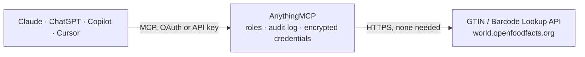

<!-- Generated by scripts/export-github-catalog.mjs in the anythingmcp-website repository. Do not edit by hand. -->

# GTIN / Barcode Lookup MCP connector

Resolve a GTIN / EAN / UPC / ISBN barcode to product information using free public product databases (Open Food Facts, UPCitemdb, Open Beauty Facts, Google Books). The AnythingMCP connector gives Claude, ChatGPT, Microsoft Copilot, Cursor and Gemini 6 MCP tools for GTIN / Barcode Lookup, all read-only.

**Category:** [Public Data](../data.md) · **Tools:** 6 · **Setup guide:** [anythingmcp.com](https://anythingmcp.com/guides/gtin-lookup-to-mcp) · [Deutsch](https://anythingmcp.com/de/guides/gtin-lookup-to-mcp) · [Italiano](https://anythingmcp.com/it/guides/gtin-lookup-to-mcp) · [Español](https://anythingmcp.com/es/guides/gtin-lookup-to-mcp) · [日本語](https://anythingmcp.com/ja/guides/gtin-lookup-to-mcp) · [Русский](https://anythingmcp.com/ru/guides/gtin-lookup-to-mcp) · [中文](https://anythingmcp.com/zh/guides/gtin-lookup-to-mcp)

## Start without code

No installation and no terminal: AnythingMCP Cloud runs the GTIN / Barcode Lookup connector for you, operated by helpcode.ai in Frankfurt, Germany.

1. **Click the button above** and create an account or sign in. The GTIN / Barcode Lookup connector opens, ready to install.
2. **Nothing to enter:** this connector needs no credentials. Every click is in the [step-by-step guide](https://anythingmcp.com/guides/gtin-lookup-to-mcp).
3. **Click Install.** AnythingMCP shows the address of your MCP server.
4. **Add that address to your assistant:** [Claude](https://anythingmcp.com/guides/connect-gtin-lookup-to-claude) · [ChatGPT](https://anythingmcp.com/guides/connect-gtin-lookup-to-chatgpt) · [Microsoft Copilot](https://anythingmcp.com/guides/connect-gtin-lookup-to-copilot) · [Cursor](https://anythingmcp.com/guides/connect-gtin-lookup-to-cursor) · [Gemini CLI](https://anythingmcp.com/guides/connect-gtin-lookup-to-gemini) · [Meta Muse](https://anythingmcp.com/guides/connect-gtin-lookup-to-muse).
5. **Ask your first question**, for example: *What's product info for barcode 0737629045234 — name, brand, quantity and Nutri-Score?*

Prefer help with the setup? [Talk to us](https://anythingmcp.com/contact).

## How it works

- **The AI client** speaks MCP (Streamable HTTP) to AnythingMCP and only sees tool names, descriptions and results. It never gets the GTIN / Barcode Lookup credentials.
- **AnythingMCP** checks the client's role, builds the call from the tool definition, adds the credentials (none needed), calls GTIN / Barcode Lookup, logs the call and returns the result.
- **GTIN / Barcode Lookup** sees an ordinary API client with the rights of the account the credentials belong to.

## Tools

| Tool | What it does | Access |
|---|---|---|
| [`gtin_lookup_food`](#gtin_lookup_food) | Look up a food, drink or packaged consumer product by its barcode (GTIN-13 / EAN / UPC) in Open Food Facts. | read |
| [`gtin_lookup_search_food`](#gtin_lookup_search_food) | Search Open Food Facts by product name or brand (no barcode needed). | read |
| [`gtin_lookup_retail`](#gtin_lookup_retail) | Look up a general retail product (electronics, household, toys, tools, etc.) by UPC/EAN barcode in UPCitemdb. | read |
| [`gtin_lookup_search_retail`](#gtin_lookup_search_retail) | Search UPCitemdb by keyword to find general retail products and their UPC/EAN barcodes. | read |
| [`gtin_lookup_beauty`](#gtin_lookup_beauty) | Look up a cosmetics or personal-care product by its barcode (GTIN-13 / EAN) in Open Beauty Facts. | read |
| [`gtin_lookup_book`](#gtin_lookup_book) | Look up a book by its ISBN-13 (which is the book's GTIN) via Google Books. | read |

## Tool reference

Every parameter as the AI client sees it in `tools/list`. Source: [`packages/backend/src/adapters/intl/gtin-lookup.json`](../../../packages/backend/src/adapters/intl/gtin-lookup.json).

### `gtin_lookup_food`

Look up a food, drink or packaged consumer product by its barcode (GTIN-13 / EAN / UPC) in Open Food Facts. Returns name, brands, categories, quantity, labels, Nutri-Score and image URL. status=0 means not found.

**Access:** read · **Call:** `GET /api/v2/product/{barcode}.json`

| Parameter | Type | Required | Description |
|---|---|---|---|
| `barcode` | string | yes | The product barcode (GTIN-13 / EAN-13 / UPC-A digits, keep leading zeros). |

### `gtin_lookup_search_food`

Search Open Food Facts by product name or brand (no barcode needed). Returns matching products with their barcode (code), name and brands — useful to find a GTIN from a description.

**Access:** read · **Call:** `GET /cgi/search.pl`

| Parameter | Type | Required | Description |
|---|---|---|---|
| `query` | string | yes | Search terms, e.g. a product name or brand ('nutella', 'coca cola zero'). |
| `pageSize` | number | no | Number of results to return (default 10, max 50). |

### `gtin_lookup_retail`

Look up a general retail product (electronics, household, toys, tools, etc.) by UPC/EAN barcode in UPCitemdb. Returns title, description, brand, model, images and known marketplace offers. Empty items array means not found.

**Access:** read · **Call:** `GET https://api.upcitemdb.com/prod/trial/lookup`

| Parameter | Type | Required | Description |
|---|---|---|---|
| `barcode` | string | yes | The product UPC-A (12 digits) or EAN/GTIN-13 (13 digits) barcode. |

### `gtin_lookup_search_retail`

Search UPCitemdb by keyword to find general retail products and their UPC/EAN barcodes. Returns matching items with title, brand, barcode and images — useful to find a GTIN from a product name.

**Access:** read · **Call:** `GET https://api.upcitemdb.com/prod/trial/search`

| Parameter | Type | Required | Description |
|---|---|---|---|
| `query` | string | yes | Keyword search, e.g. 'logitech mouse m100'. |

### `gtin_lookup_beauty`

Look up a cosmetics or personal-care product by its barcode (GTIN-13 / EAN) in Open Beauty Facts. Returns name, brands, ingredients and image URL. status=0 means not found.

**Access:** read · **Call:** `GET https://world.openbeautyfacts.org/api/v2/product/{barcode}.json`

| Parameter | Type | Required | Description |
|---|---|---|---|
| `barcode` | string | yes | The product barcode (GTIN-13 / EAN-13, keep leading zeros). |

### `gtin_lookup_book`

Look up a book by its ISBN-13 (which is the book's GTIN) via Google Books. Returns title, authors, publisher, published date, description and cover image.

**Access:** read · **Call:** `GET https://www.googleapis.com/books/v1/volumes`

| Parameter | Type | Required | Description |
|---|---|---|---|
| `isbn` | string | yes | The book's ISBN-13 (13 digits, the EAN/GTIN printed on the back cover). |

## Run it yourself

AnythingMCP is open source (AGPL-3.0). [Run it with Docker](../../../README.md#run-it-yourself), open **Connectors → Store**, pick **GTIN / Barcode Lookup**, then add your MCP server URL to the AI client.

[← Public Data connectors](../data.md) · [All categories](../README.md)
