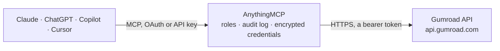

<!-- Generated by scripts/export-github-catalog.mjs in the anythingmcp-website repository. Do not edit by hand. -->

# Gumroad MCP connector

Let your AI read your Gumroad store: products, sales with filters, membership subscribers, offer codes, checkout fields, license keys and webhooks. The AnythingMCP connector gives Claude, ChatGPT, Microsoft Copilot, Cursor and Gemini 15 MCP tools for Gumroad: 11 read and 4 can change data.

**Category:** [E-commerce](../e-commerce.md) · **Tools:** 15 · **Setup guide:** [anythingmcp.com](https://anythingmcp.com/guides/gumroad-to-mcp) · [Deutsch](https://anythingmcp.com/de/guides/gumroad-to-mcp) · [Italiano](https://anythingmcp.com/it/guides/gumroad-to-mcp) · [Español](https://anythingmcp.com/es/guides/gumroad-to-mcp) · [日本語](https://anythingmcp.com/ja/guides/gumroad-to-mcp) · [Русский](https://anythingmcp.com/ru/guides/gumroad-to-mcp) · [中文](https://anythingmcp.com/zh/guides/gumroad-to-mcp)

## Start without code

No installation and no terminal: AnythingMCP Cloud runs the Gumroad connector for you, operated by helpcode.ai in Frankfurt, Germany.

1. **Click the button above** and create an account or sign in. The Gumroad connector opens, ready to install.
2. **Paste the API key or token from your Gumroad account.** Every click is in the [step-by-step guide](https://anythingmcp.com/guides/gumroad-to-mcp).
3. **Click Install.** AnythingMCP shows the address of your MCP server.
4. **Add that address to your assistant:** [Claude](https://anythingmcp.com/guides/connect-gumroad-to-claude) · [ChatGPT](https://anythingmcp.com/guides/connect-gumroad-to-chatgpt) · [Microsoft Copilot](https://anythingmcp.com/guides/connect-gumroad-to-copilot) · [Cursor](https://anythingmcp.com/guides/connect-gumroad-to-cursor) · [Gemini CLI](https://anythingmcp.com/guides/connect-gumroad-to-gemini) · [Meta Muse](https://anythingmcp.com/guides/connect-gumroad-to-muse).
5. **Ask your first question**, for example: *Get sale details for order GUM-2026-0147*

Prefer help with the setup? [Talk to us](https://anythingmcp.com/contact).

## How it works

- **The AI client** speaks MCP (Streamable HTTP) to AnythingMCP and only sees tool names, descriptions and results. It never gets the Gumroad credentials.
- **AnythingMCP** checks the client's role, builds the call from the tool definition, adds the credentials (a bearer token), calls Gumroad, logs the call and returns the result.
- **Gumroad** sees an ordinary API client with the rights of the account the credentials belong to.

## Tools

| Tool | What it does | Access |
|---|---|---|
| [`gumroad_get_user`](#gumroad_get_user) | Read the Gumroad account the token belongs to: name, user id, e-mail, profile URL, bio and profile picture. | read |
| [`gumroad_list_products`](#gumroad_list_products) | List all your Gumroad products: id, name, published, price in cents with currency and formatted price, membership details, URL, tags and sales count and… | read |
| [`gumroad_get_product`](#gumroad_get_product) | Read one product: name, description (HTML), price, currency, published, URL, membership recurrences, variants with their options and prices, custom fields,… | read |
| [`gumroad_enable_product`](#gumroad_enable_product) | Publish a product so it can be bought again (Gumroad calls this enable). | write |
| [`gumroad_disable_product`](#gumroad_disable_product) | Unpublish a product so it can no longer be bought (Gumroad calls this disable). | write |
| [`gumroad_list_sales`](#gumroad_list_sales) | List successful sales, newest first, 10 per page, with filters: after and before (YYYY-MM-DD), product_id, buyer email, order_id, buyer name or license_key. | read |
| [`gumroad_get_sale`](#gumroad_get_sale) | Read one sale by its id: product, buyer, price and fees in cents, quantity, variants, custom fields, offer code, refund, chargeback and dispute state,… | read |
| [`gumroad_list_subscribers`](#gumroad_list_subscribers) | List the subscribers of a membership or subscription product, 100 per page: subscriber id, buyer e-mail, status (alive, pending_cancellation,… | read |
| [`gumroad_get_subscriber`](#gumroad_get_subscriber) | Read one subscriber by id: product, buyer e-mail, status, recurrence, charges so far, purchase ids and the cancellation, end and failure dates. | read |
| [`gumroad_list_offer_codes`](#gumroad_list_offer_codes) | List the offer (discount) codes of a product, including universal codes valid for all products: id, code, amount off in cents or percent off, usage limit,… | read |
| [`gumroad_create_offer_code`](#gumroad_create_offer_code) | Create a discount code for a product (or for all products with universal true). | write |
| [`gumroad_list_custom_fields`](#gumroad_list_custom_fields) | List the custom fields a product asks for at checkout (for example a phone number or a terms checkbox): name, type and whether it is required. | read |
| [`gumroad_verify_license`](#gumroad_verify_license) | Check a license key for a product: whether it exists and is valid, how often it was used, and the purchase it belongs to (buyer e-mail, date, refund,… | read |
| [`gumroad_list_resource_subscriptions`](#gumroad_list_resource_subscriptions) | List the webhooks (resource subscriptions) set up for one event type: id, event and the URL Gumroad posts to. | read |
| [`gumroad_refund_sale`](#gumroad_refund_sale) | Refund a sale in full, or partly with amount_cents. | write |

## Tool reference

Every parameter as the AI client sees it in `tools/list`. Source: [`packages/backend/src/adapters/intl/gumroad.json`](../../../packages/backend/src/adapters/intl/gumroad.json).

### `gumroad_get_user`

Read the Gumroad account the token belongs to: name, user id, e-mail, profile URL, bio and profile picture. Use it first to check the connection.

**Access:** read · **Call:** `GET /user`

No parameters.

### `gumroad_list_products`

List all your Gumroad products: id, name, published, price in cents with currency and formatted price, membership details, URL, tags and sales count and revenue in USD cents. Descriptions are left out; read one with gumroad_get_product.

**Access:** read · **Call:** `GET /products`

No parameters.

### `gumroad_get_product`

Read one product: name, description (HTML), price, currency, published, URL, membership recurrences, variants with their options and prices, custom fields, tags and sales count.

**Access:** read · **Call:** `GET /products/{product_id}`

| Parameter | Type | Required | Description |
|---|---|---|---|
| `product_id` | string | yes | The product's id, e.g. A-m3CDDC5dlrSdKZp0RFhA== (from gumroad_list_products). |

### `gumroad_enable_product`

Publish a product so it can be bought again (Gumroad calls this enable). It goes on sale at once. Show the user which product will be published and confirm before calling.

**Access:** write · **Call:** `PUT /products/{product_id}/enable`

| Parameter | Type | Required | Description |
|---|---|---|---|
| `product_id` | string | yes | The product's id, e.g. A-m3CDDC5dlrSdKZp0RFhA== (from gumroad_list_products). |

### `gumroad_disable_product`

Unpublish a product so it can no longer be bought (Gumroad calls this disable). Existing buyers keep their access. Show the user which product will be taken off sale and confirm before calling.

**Access:** write · **Call:** `PUT /products/{product_id}/disable`

| Parameter | Type | Required | Description |
|---|---|---|---|
| `product_id` | string | yes | The product's id, e.g. A-m3CDDC5dlrSdKZp0RFhA== (from gumroad_list_products). |

### `gumroad_list_sales`

List successful sales, newest first, 10 per page, with filters: after and before (YYYY-MM-DD), product_id, buyer email, order_id, buyer name or license_key. Each sale has id, date, product, buyer e-mail, price and fee in cents, formatted total, quantity, variants, refund and dispute state, subscription and license key. More: call again with page_key = next_page_key until it is missing.

**Access:** read · **Call:** `GET /sales`

| Parameter | Type | Required | Description |
|---|---|---|---|
| `after` | string | no | Only sales after this date, YYYY-MM-DD. |
| `before` | string | no | Only sales before this date, YYYY-MM-DD. |
| `product_id` | string | no | Only sales of this product id. |
| `email` | string | no | Only sales to this buyer e-mail. |
| `order_id` | string | no | Only the sale with this order number (digits). |
| `name` | string | no | Only sales to buyers with this name. |
| `license_key` | string | no | Only the sale with this license key. |
| `page_key` | string | no | next_page_key from the previous page. |

### `gumroad_get_sale`

Read one sale by its id: product, buyer, price and fees in cents, quantity, variants, custom fields, offer code, refund, chargeback and dispute state, subscription, license key and shipping.

**Access:** read · **Call:** `GET /sales/{sale_id}`

| Parameter | Type | Required | Description |
|---|---|---|---|
| `sale_id` | string | yes | The sale id, e.g. B28UKN-dvxYabdavG97Y-Q==. |

### `gumroad_list_subscribers`

List the subscribers of a membership or subscription product, 100 per page: subscriber id, buyer e-mail, status (alive, pending_cancellation, failed_payment, cancelled and others), recurrence, start, cancellation, end and failure dates, and license key. Filter by email. More: call again with page_key = next_page_key until it is missing.

**Access:** read · **Call:** `GET /products/{product_id}/subscribers`

| Parameter | Type | Required | Description |
|---|---|---|---|
| `product_id` | string | yes | The product's id, e.g. A-m3CDDC5dlrSdKZp0RFhA== (from gumroad_list_products). |
| `email` | string | no | Only the subscriber with this e-mail. |
| `page_key` | string | no | next_page_key from the previous page. |

### `gumroad_get_subscriber`

Read one subscriber by id: product, buyer e-mail, status, recurrence, charges so far, purchase ids and the cancellation, end and failure dates.

**Access:** read · **Call:** `GET /subscribers/{subscriber_id}`

| Parameter | Type | Required | Description |
|---|---|---|---|
| `subscriber_id` | string | yes | The subscriber id from gumroad_list_subscribers. |

### `gumroad_list_offer_codes`

List the offer (discount) codes of a product, including universal codes valid for all products: id, code, amount off in cents or percent off, usage limit, minimum amount and how often it was used.

**Access:** read · **Call:** `GET /products/{product_id}/offer_codes`

| Parameter | Type | Required | Description |
|---|---|---|---|
| `product_id` | string | yes | The product's id, e.g. A-m3CDDC5dlrSdKZp0RFhA== (from gumroad_list_products). |

### `gumroad_create_offer_code`

Create a discount code for a product (or for all products with universal true). It works at checkout right away. offer_type cents takes amount_off in cents, percent takes a whole percentage. Show the user the code, discount and limits and confirm before calling.

**Access:** write · **Call:** `POST /products/{product_id}/offer_codes`

| Parameter | Type | Required | Description |
|---|---|---|---|
| `product_id` | string | yes | The product's id, e.g. A-m3CDDC5dlrSdKZp0RFhA== (from gumroad_list_products). |
| `name` | string | yes | The code customers type at checkout, e.g. SPRING20. |
| `amount_off` | integer | yes | Discount: cents off for offer_type cents, percent off (1 to 100) for percent. |
| `offer_type` | `cents` \| `percent` | no | cents (default) or percent. |
| `max_purchase_count` | integer | no | How many times the code can be used in total. Leave out for no limit. |
| `minimum_amount_cents` | integer | no | Minimum order amount in cents for the code to apply. |
| `universal` | boolean | no | true makes the code valid for all your products. Default false. |

### `gumroad_list_custom_fields`

List the custom fields a product asks for at checkout (for example a phone number or a terms checkbox): name, type and whether it is required.

**Access:** read · **Call:** `GET /products/{product_id}/custom_fields`

| Parameter | Type | Required | Description |
|---|---|---|---|
| `product_id` | string | yes | The product's id, e.g. A-m3CDDC5dlrSdKZp0RFhA== (from gumroad_list_products). |

### `gumroad_verify_license`

Check a license key for a product: whether it exists and is valid, how often it was used, and the purchase it belongs to (buyer e-mail, date, refund, chargeback and subscription state). Does not count a use unless increment_uses_count is true. 404 means the key is unknown for that product, disabled or its access was revoked.

**Access:** read · **Call:** `POST /licenses/verify`

| Parameter | Type | Required | Description |
|---|---|---|---|
| `product_id` | string | yes | The product's id, e.g. A-m3CDDC5dlrSdKZp0RFhA== (from gumroad_list_products). |
| `license_key` | string | yes | The license key the customer has, e.g. 83DB262A-C19D3B06-A5235A6B-8C079166. |
| `increment_uses_count` | boolean | no | true counts this check as one more use of the key. Default false. |

### `gumroad_list_resource_subscriptions`

List the webhooks (resource subscriptions) set up for one event type: id, event and the URL Gumroad posts to.

**Access:** read · **Call:** `GET /resource_subscriptions`

| Parameter | Type | Required | Description |
|---|---|---|---|
| `resource_name` | `sale` \| `refund` \| `dispute` \| `dispute_won` \| `cancellation` \| `subscription_updated` \| `subscription_ended` \| `subscription_restarted` | yes | Event type. |

### `gumroad_refund_sale`

Refund a sale in full, or partly with amount_cents. The money goes back to the buyer and this cannot be undone. Installed switched off. Only when the user explicitly asks; confirm the sale, buyer and amount first.

**Access:** write · **Call:** `PUT /sales/{sale_id}/refund`

| Parameter | Type | Required | Description |
|---|---|---|---|
| `sale_id` | string | yes | The sale id. |
| `amount_cents` | integer | no | Partial refund in cents. Leave out for a full refund. |

## Run it yourself

AnythingMCP is open source (AGPL-3.0). [Run it with Docker](../../../README.md#run-it-yourself), open **Connectors → Store**, pick **Gumroad** and enter `GUMROAD_ACCESS_TOKEN`, then add your MCP server URL to the AI client.

[← E-commerce connectors](../e-commerce.md) · [All categories](../README.md)
