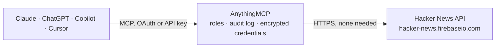

<!-- Generated by scripts/export-github-catalog.mjs in the anythingmcp-website repository. Do not edit by hand. -->

# Hacker News MCP connector

Read Hacker News (stories, comments, users, top/new/best/ask/show/job lists) from any AI agent via the official Firebase API. 8 tools, no auth. The AnythingMCP connector gives Claude, ChatGPT, Microsoft Copilot, Cursor and Gemini 8 MCP tools for Hacker News, all read-only.

**Category:** [Public Data](../data.md) · **Tools:** 8 · **Setup guide:** [anythingmcp.com](https://anythingmcp.com/guides/hackernews-to-mcp) · [Deutsch](https://anythingmcp.com/de/guides/hackernews-to-mcp) · [Italiano](https://anythingmcp.com/it/guides/hackernews-to-mcp) · [Español](https://anythingmcp.com/es/guides/hackernews-to-mcp) · [日本語](https://anythingmcp.com/ja/guides/hackernews-to-mcp) · [Русский](https://anythingmcp.com/ru/guides/hackernews-to-mcp) · [中文](https://anythingmcp.com/zh/guides/hackernews-to-mcp)

## Start without code

No installation and no terminal: AnythingMCP Cloud runs the Hacker News connector for you, operated by helpcode.ai in Frankfurt, Germany.

1. **Click the button above** and create an account or sign in. The Hacker News connector opens, ready to install.
2. **Nothing to enter:** this connector needs no credentials. Every click is in the [step-by-step guide](https://anythingmcp.com/guides/hackernews-to-mcp).
3. **Click Install.** AnythingMCP shows the address of your MCP server.
4. **Add that address to your assistant:** [Claude](https://anythingmcp.com/guides/connect-hackernews-to-claude) · [ChatGPT](https://anythingmcp.com/guides/connect-hackernews-to-chatgpt) · [Microsoft Copilot](https://anythingmcp.com/guides/connect-hackernews-to-copilot) · [Cursor](https://anythingmcp.com/guides/connect-hackernews-to-cursor) · [Gemini CLI](https://anythingmcp.com/guides/connect-hackernews-to-gemini) · [Meta Muse](https://anythingmcp.com/guides/connect-hackernews-to-muse).
5. **Ask your first question**, for example: *Show me the full Hacker News story item for ID 37648219.*

Prefer help with the setup? [Talk to us](https://anythingmcp.com/contact).

## How it works

- **The AI client** speaks MCP (Streamable HTTP) to AnythingMCP and only sees tool names, descriptions and results. It never gets the Hacker News credentials.
- **AnythingMCP** checks the client's role, builds the call from the tool definition, adds the credentials (none needed), calls Hacker News, logs the call and returns the result.
- **Hacker News** sees an ordinary API client with the rights of the account the credentials belong to.

## Tools

| Tool | What it does | Access |
|---|---|---|
| [`hackernews_top_stories`](#hackernews_top_stories) | Returns an array of up to 500 item IDs for the current front-page (top) stories. | read |
| [`hackernews_new_stories`](#hackernews_new_stories) | Returns an array of up to 500 newest story IDs. | read |
| [`hackernews_best_stories`](#hackernews_best_stories) | Returns an array of up to 500 'best' story IDs (HN's algorithmic top). | read |
| [`hackernews_ask_stories`](#hackernews_ask_stories) | Returns up to 200 Ask HN story IDs. | read |
| [`hackernews_show_stories`](#hackernews_show_stories) | Returns up to 200 Show HN story IDs. | read |
| [`hackernews_job_stories`](#hackernews_job_stories) | Returns up to 200 'Who is hiring / job' story IDs. | read |
| [`hackernews_get_item`](#hackernews_get_item) | Fetch a single item (story, comment, job, poll, pollopt) by ID. | read |
| [`hackernews_get_user`](#hackernews_get_user) | Fetch user profile by case-sensitive username: returns `id`, `created`, `karma`, `about`, `submitted` (array of recent item IDs). | read |

## Tool reference

Every parameter as the AI client sees it in `tools/list`. Source: [`packages/backend/src/adapters/intl/hackernews.json`](../../../packages/backend/src/adapters/intl/hackernews.json).

### `hackernews_top_stories`

Returns an array of up to 500 item IDs for the current front-page (top) stories. Use hackernews_get_item to resolve each ID into the actual story.

**Access:** read · **Call:** `GET /topstories.json`

No parameters.

### `hackernews_new_stories`

Returns an array of up to 500 newest story IDs.

**Access:** read · **Call:** `GET /newstories.json`

No parameters.

### `hackernews_best_stories`

Returns an array of up to 500 'best' story IDs (HN's algorithmic top).

**Access:** read · **Call:** `GET /beststories.json`

No parameters.

### `hackernews_ask_stories`

Returns up to 200 Ask HN story IDs.

**Access:** read · **Call:** `GET /askstories.json`

No parameters.

### `hackernews_show_stories`

Returns up to 200 Show HN story IDs.

**Access:** read · **Call:** `GET /showstories.json`

No parameters.

### `hackernews_job_stories`

Returns up to 200 'Who is hiring / job' story IDs.

**Access:** read · **Call:** `GET /jobstories.json`

No parameters.

### `hackernews_get_item`

Fetch a single item (story, comment, job, poll, pollopt) by ID. Returns the full payload including `type`, `by`, `time`, `title`, `url`, `text`, `score`, `kids` (child comment IDs), `parent`.

**Access:** read · **Call:** `GET /item/{id}.json`

| Parameter | Type | Required | Description |
|---|---|---|---|
| `id` | integer | yes | HN item ID. |

### `hackernews_get_user`

Fetch user profile by case-sensitive username: returns `id`, `created`, `karma`, `about`, `submitted` (array of recent item IDs).

**Access:** read · **Call:** `GET /user/{username}.json`

| Parameter | Type | Required | Description |
|---|---|---|---|
| `username` | string | yes | HN username, case-sensitive. |

## Run it yourself

AnythingMCP is open source (AGPL-3.0). [Run it with Docker](../../../README.md#run-it-yourself), open **Connectors → Store**, pick **Hacker News**, then add your MCP server URL to the AI client.

[← Public Data connectors](../data.md) · [All categories](../README.md)
