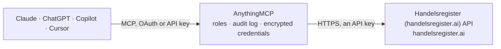

<!-- Generated by scripts/export-github-catalog.mjs in the anythingmcp-website repository. Do not edit by hand. -->

# Handelsregister (handelsregister.ai) MCP connector

Access the German commercial register (Handelsregister) data via handelsregister.ai — search companies by name, retrieve official entries, current/historical addresses, shareholders, managing … The AnythingMCP connector gives Claude, ChatGPT, Microsoft Copilot, Cursor and Gemini 4 MCP tools for Handelsregister (handelsregister.ai), all read-only.

**Category:** [Government](../government.md) · **Tools:** 4 · **Setup guide:** [anythingmcp.com](https://anythingmcp.com/guides/handelsregister-to-mcp) · [Deutsch](https://anythingmcp.com/de/guides/handelsregister-to-mcp) · [Italiano](https://anythingmcp.com/it/guides/handelsregister-to-mcp) · [Español](https://anythingmcp.com/es/guides/handelsregister-to-mcp) · [日本語](https://anythingmcp.com/ja/guides/handelsregister-to-mcp) · [Русский](https://anythingmcp.com/ru/guides/handelsregister-to-mcp) · [中文](https://anythingmcp.com/zh/guides/handelsregister-to-mcp)

## Start without code

No installation and no terminal: AnythingMCP Cloud runs the Handelsregister (handelsregister.ai) connector for you, operated by helpcode.ai in Frankfurt, Germany.

1. **Click the button above** and create an account or sign in. The Handelsregister (handelsregister.ai) connector opens, ready to install.
2. **Paste the API key or token from your Handelsregister (handelsregister.ai) account.** Every click is in the [step-by-step guide](https://anythingmcp.com/guides/handelsregister-to-mcp).
3. **Click Install.** AnythingMCP shows the address of your MCP server.
4. **Add that address to your assistant:** [Claude](https://anythingmcp.com/guides/connect-handelsregister-to-claude) · [ChatGPT](https://anythingmcp.com/guides/connect-handelsregister-to-chatgpt) · [Microsoft Copilot](https://anythingmcp.com/guides/connect-handelsregister-to-copilot) · [Cursor](https://anythingmcp.com/guides/connect-handelsregister-to-cursor) · [Gemini CLI](https://anythingmcp.com/guides/connect-handelsregister-to-gemini) · [Meta Muse](https://anythingmcp.com/guides/connect-handelsregister-to-muse).
5. **Ask your first question**, for example: *Lookup Handelsregister entry for Müller Maschinenbau GmbH in München*

Prefer help with the setup? [Talk to us](https://anythingmcp.com/contact).

## How it works

- **The AI client** speaks MCP (Streamable HTTP) to AnythingMCP and only sees tool names, descriptions and results. It never gets the Handelsregister (handelsregister.ai) credentials.
- **AnythingMCP** checks the client's role, builds the call from the tool definition, adds the credentials (an API key), calls Handelsregister (handelsregister.ai), logs the call and returns the result.
- **Handelsregister (handelsregister.ai)** sees an ordinary API client with the rights of the account the credentials belong to.

## Tools

| Tool | What it does | Access |
|---|---|---|
| [`hr_search_companies`](#hr_search_companies) | Search German companies in the Handelsregister by name or keyword. | read |
| [`hr_get_company`](#hr_get_company) | Retrieve the full Handelsregister record for a company by its company_id. | read |
| [`hr_get_documents`](#hr_get_documents) | List the official documents (SHD = Shareholder list, AD = current printout, CD = chronological printout, HD = historical printout) attached to a company in… | read |
| [`hr_get_shareholders`](#hr_get_shareholders) | Retrieve the shareholder list (Gesellschafterliste) from the most recent SHD filing for a GmbH or UG. | read |

## Tool reference

Every parameter as the AI client sees it in `tools/list`. Source: [`packages/backend/src/adapters/de/handelsregister.json`](../../../packages/backend/src/adapters/de/handelsregister.json).

### `hr_search_companies`

Search German companies in the Handelsregister by name or keyword. Returns a list of matches with company_id, legal name, registration court, Registernummer, and location. Use the returned company_id with hr_get_company for full details.

**Access:** read · **Call:** `GET /search`

| Parameter | Type | Required | Description |
|---|---|---|---|
| `q` | string | yes | Search query — company name, brand, or keyword (e.g. 'SAP SE', 'Koch Freiburg'). |
| `limit` | number | no | Max number of results (default: 10, max: 50). |

### `hr_get_company`

Retrieve the full Handelsregister record for a company by its company_id. Returns legal name, address, registration data (court + Registernummer), legal form, capital, purpose (Gegenstand), managing directors and Prokuristen, and recent changes.

**Access:** read · **Call:** `GET /companies/{company_id}`

| Parameter | Type | Required | Description |
|---|---|---|---|
| `company_id` | string | yes | The handelsregister.ai company_id returned by hr_search_companies. |

### `hr_get_documents`

List the official documents (SHD = Shareholder list, AD = current printout, CD = chronological printout, HD = historical printout) attached to a company in the Handelsregister. Each document has a document_id that can be used for download links.

**Access:** read · **Call:** `GET /companies/{company_id}/documents`

| Parameter | Type | Required | Description |
|---|---|---|---|
| `company_id` | string | yes | The handelsregister.ai company_id. |

### `hr_get_shareholders`

Retrieve the shareholder list (Gesellschafterliste) from the most recent SHD filing for a GmbH or UG. Returns each shareholder's name, address, share amount (Geschäftsanteil) and percentage.

**Access:** read · **Call:** `GET /companies/{company_id}/shareholders`

| Parameter | Type | Required | Description |
|---|---|---|---|
| `company_id` | string | yes | The handelsregister.ai company_id. |

## Run it yourself

AnythingMCP is open source (AGPL-3.0). [Run it with Docker](../../../README.md#run-it-yourself), open **Connectors → Store**, pick **Handelsregister (handelsregister.ai)** and enter `HANDELSREGISTER_API_KEY`, then add your MCP server URL to the AI client.

[← Government connectors](../government.md) · [All categories](../README.md)
