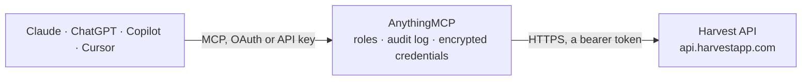

<!-- Generated by scripts/export-github-catalog.mjs in the anythingmcp-website repository. Do not edit by hand. -->

# Harvest MCP connector

Manage Harvest (time tracking, projects, clients, invoices, expenses) from any AI agent. 10 tools, Bearer auth with account-ID header. The AnythingMCP connector gives Claude, ChatGPT, Microsoft Copilot, Cursor and Gemini 10 MCP tools for Harvest: 7 read and 3 can change data.

**Category:** [Time Tracking](../time-tracking.md) · **Tools:** 10 · **Setup guide:** [anythingmcp.com](https://anythingmcp.com/guides/harvest-to-mcp) · [Deutsch](https://anythingmcp.com/de/guides/harvest-to-mcp) · [Italiano](https://anythingmcp.com/it/guides/harvest-to-mcp) · [Español](https://anythingmcp.com/es/guides/harvest-to-mcp) · [日本語](https://anythingmcp.com/ja/guides/harvest-to-mcp) · [Русский](https://anythingmcp.com/ru/guides/harvest-to-mcp) · [中文](https://anythingmcp.com/zh/guides/harvest-to-mcp)

## Start without code

No installation and no terminal: AnythingMCP Cloud runs the Harvest connector for you, operated by helpcode.ai in Frankfurt, Germany.

1. **Click the button above** and create an account or sign in. The Harvest connector opens, ready to install.
2. **Paste the API key or token from your Harvest account.** Every click is in the [step-by-step guide](https://anythingmcp.com/guides/harvest-to-mcp).
3. **Click Install.** AnythingMCP shows the address of your MCP server.
4. **Add that address to your assistant:** [Claude](https://anythingmcp.com/guides/connect-harvest-to-claude) · [ChatGPT](https://anythingmcp.com/guides/connect-harvest-to-chatgpt) · [Microsoft Copilot](https://anythingmcp.com/guides/connect-harvest-to-copilot) · [Cursor](https://anythingmcp.com/guides/connect-harvest-to-cursor) · [Gemini CLI](https://anythingmcp.com/guides/connect-harvest-to-gemini) · [Meta Muse](https://anythingmcp.com/guides/connect-harvest-to-muse).
5. **Ask your first question**, for example: *What's the status and amount for invoice INV-2026-118 for client Blue Harbor Ltd?*

Prefer help with the setup? [Talk to us](https://anythingmcp.com/contact).

## How it works

- **The AI client** speaks MCP (Streamable HTTP) to AnythingMCP and only sees tool names, descriptions and results. It never gets the Harvest credentials.
- **AnythingMCP** checks the client's role, builds the call from the tool definition, adds the credentials (a bearer token), calls Harvest, logs the call and returns the result.
- **Harvest** sees an ordinary API client with the rights of the account the credentials belong to.

## Tools

| Tool | What it does | Access |
|---|---|---|
| [`harvest_who_am_i`](#harvest_who_am_i) | Return the currently authenticated user: id, first_name, last_name, email, is_admin, default_hourly_rate, weekly_capacity. | read |
| [`harvest_list_clients`](#harvest_list_clients) | List clients. | read |
| [`harvest_list_projects`](#harvest_list_projects) | List projects. | read |
| [`harvest_list_tasks`](#harvest_list_tasks) | List task templates (the canonical Harvest 'task' types: 'Programming', 'Design', etc.) that can be assigned to projects. | read |
| [`harvest_list_time_entries`](#harvest_list_time_entries) | List time entries. | read |
| [`harvest_create_time_entry`](#harvest_create_time_entry) | Log time on a project + task. | write |
| [`harvest_update_time_entry`](#harvest_update_time_entry) | Update fields on an existing time entry (notes, hours, project, task). | write |
| [`harvest_stop_timer`](#harvest_stop_timer) | Stop a currently-running time entry timer. | write |
| [`harvest_list_invoices`](#harvest_list_invoices) | List invoices. | read |
| [`harvest_list_expenses`](#harvest_list_expenses) | List expenses. | read |

## Tool reference

Every parameter as the AI client sees it in `tools/list`. Source: [`packages/backend/src/adapters/intl/harvest.json`](../../../packages/backend/src/adapters/intl/harvest.json).

### `harvest_who_am_i`

Return the currently authenticated user: id, first_name, last_name, email, is_admin, default_hourly_rate, weekly_capacity.

**Access:** read · **Call:** `GET /users/me`

No parameters.

### `harvest_list_clients`

List clients. Each has id, name, is_active, address, currency.

**Access:** read · **Call:** `GET /clients`

| Parameter | Type | Required | Description |
|---|---|---|---|
| `is_active` | boolean | no | Filter to active only. |
| `updated_since` | string | no | ISO 8601 datetime — only clients updated after this. |
| `page` | integer | no | 1-based page index. |
| `per_page` | integer | no | Max 100. |

### `harvest_list_projects`

List projects. Most useful filter: `client_id` to drill into one client's projects. Returns id, name, code, is_active, is_billable, budget, hourly_rate, client info.

**Access:** read · **Call:** `GET /projects`

| Parameter | Type | Required | Description |
|---|---|---|---|
| `client_id` | integer | no | Filter to one client's projects. |
| `is_active` | boolean | no | Filter to active only. |
| `page` | integer | no | 1-based. |
| `per_page` | integer | no | Max 100. |

### `harvest_list_tasks`

List task templates (the canonical Harvest 'task' types: 'Programming', 'Design', etc.) that can be assigned to projects.

**Access:** read · **Call:** `GET /tasks`

| Parameter | Type | Required | Description |
|---|---|---|---|
| `is_active` | boolean | no | Filter to active only. |
| `page` | integer | no | 1-based. |
| `per_page` | integer | no | Max 100. |

### `harvest_list_time_entries`

List time entries. Most useful filters: `from`/`to` for date range, `user_id` for one user, `project_id` for one project. Returns each entry with hours, notes, billable status, dates, project, task.

**Access:** read · **Call:** `GET /time_entries`

| Parameter | Type | Required | Description |
|---|---|---|---|
| `user_id` | integer | no | Filter to one user. |
| `client_id` | integer | no | Filter to one client. |
| `project_id` | integer | no | Filter to one project. |
| `task_id` | integer | no | Filter to one task. |
| `from` | string | no | Start date (ISO 8601 YYYY-MM-DD). |
| `to` | string | no | End date (YYYY-MM-DD). |
| `is_billed` | boolean | no | Filter by billed status. |
| `is_running` | boolean | no | Only currently-running timers. |
| `page` | integer | no | 1-based. |
| `per_page` | integer | no | Max 100. |

### `harvest_create_time_entry`

Log time on a project + task. EITHER supply `hours` for a manual entry OR omit hours to start a running timer (you'll need to stop it later with harvest_stop_timer).

**Access:** write · **Call:** `POST /time_entries`

| Parameter | Type | Required | Description |
|---|---|---|---|
| `project_id` | integer | yes | Project ID. |
| `task_id` | integer | yes | Task ID assigned to this project. |
| `spent_date` | string | yes | Date worked (YYYY-MM-DD). |
| `hours` | number | no | Hours worked. Omit to start a running timer. |
| `notes` | string | no | Optional notes. |
| `user_id` | integer | no | Defaults to current user; admins can log for others. |
| `external_reference` | object | no | External system reference {id, group_id, account_id, permalink, service, service_icon_url}. |

### `harvest_update_time_entry`

Update fields on an existing time entry (notes, hours, project, task).

**Access:** write · **Call:** `PATCH /time_entries/{time_entry_id}`

| Parameter | Type | Required | Description |
|---|---|---|---|
| `time_entry_id` | integer | yes | Time entry ID. |
| `hours` | number | no | New hours. |
| `notes` | string | no | New notes. |
| `project_id` | integer | no | Move to a different project. |
| `task_id` | integer | no | Move to a different task. |

### `harvest_stop_timer`

Stop a currently-running time entry timer.

**Access:** write · **Call:** `PATCH /time_entries/{time_entry_id}/stop`

| Parameter | Type | Required | Description |
|---|---|---|---|
| `time_entry_id` | integer | yes | Running time entry ID. |

### `harvest_list_invoices`

List invoices. Filter by client_id, state ('draft', 'open', 'paid', 'closed'), date range. Returns each invoice's number, amount, due_date, paid_date, currency, line items count.

**Access:** read · **Call:** `GET /invoices`

| Parameter | Type | Required | Description |
|---|---|---|---|
| `client_id` | integer | no | Filter to one client. |
| `project_id` | integer | no | Filter to one project. |
| `state` | string | no | draft, open, paid, closed. |
| `from` | string | no | Issued from (YYYY-MM-DD). |
| `to` | string | no | Issued to (YYYY-MM-DD). |
| `page` | integer | no | 1-based. |
| `per_page` | integer | no | Max 100. |

### `harvest_list_expenses`

List expenses. Filter by client, project, user, date range. Returns each expense's amount, units, billable status, receipt URL.

**Access:** read · **Call:** `GET /expenses`

| Parameter | Type | Required | Description |
|---|---|---|---|
| `user_id` | integer | no | Filter to one user. |
| `client_id` | integer | no | Filter to one client. |
| `project_id` | integer | no | Filter to one project. |
| `is_billed` | boolean | no | Filter by billed status. |
| `from` | string | no | Spent from (YYYY-MM-DD). |
| `to` | string | no | Spent to (YYYY-MM-DD). |
| `page` | integer | no | 1-based. |
| `per_page` | integer | no | Max 100. |

## Run it yourself

AnythingMCP is open source (AGPL-3.0). [Run it with Docker](../../../README.md#run-it-yourself), open **Connectors → Store**, pick **Harvest** and enter `HARVEST_ACCESS_TOKEN`, `HARVEST_ACCOUNT_ID`, then add your MCP server URL to the AI client.

[← Time Tracking connectors](../time-tracking.md) · [All categories](../README.md)
