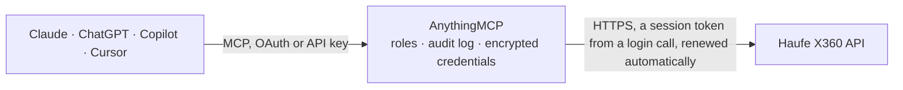

<!-- Generated by scripts/export-github-catalog.mjs in the anythingmcp-website repository. Do not edit by hand. -->

# Haufe X360 MCP connector

Haufe X360 cloud ERP (the German Acumatica edition): customers, vendors, stock items, sales orders, A/R invoices and shipments over the contract-based REST API. The AnythingMCP connector gives Claude, ChatGPT, Microsoft Copilot, Cursor and Gemini 7 MCP tools for Haufe X360, all read-only.

**Category:** [ERP](../erp.md) · **Tools:** 7 · **Setup guide:** [anythingmcp.com](https://anythingmcp.com/guides/haufe-x360-to-mcp) · [Deutsch](https://anythingmcp.com/de/guides/haufe-x360-to-mcp) · [Italiano](https://anythingmcp.com/it/guides/haufe-x360-to-mcp) · [Español](https://anythingmcp.com/es/guides/haufe-x360-to-mcp) · [日本語](https://anythingmcp.com/ja/guides/haufe-x360-to-mcp) · [Русский](https://anythingmcp.com/ru/guides/haufe-x360-to-mcp) · [中文](https://anythingmcp.com/zh/guides/haufe-x360-to-mcp)

## Start without code

No installation and no terminal: AnythingMCP Cloud runs the Haufe X360 connector for you, operated by helpcode.ai in Frankfurt, Germany.

1. **Click the button above** and create an account or sign in. The Haufe X360 connector opens, ready to install.
2. **Paste the API key or token from your Haufe X360 account.** Every click is in the [step-by-step guide](https://anythingmcp.com/guides/haufe-x360-to-mcp).
3. **Click Install.** AnythingMCP shows the address of your MCP server.
4. **Add that address to your assistant:** [Claude](https://anythingmcp.com/guides/connect-haufe-x360-to-claude) · [ChatGPT](https://anythingmcp.com/guides/connect-haufe-x360-to-chatgpt) · [Microsoft Copilot](https://anythingmcp.com/guides/connect-haufe-x360-to-copilot) · [Cursor](https://anythingmcp.com/guides/connect-haufe-x360-to-cursor) · [Gemini CLI](https://anythingmcp.com/guides/connect-haufe-x360-to-gemini) · [Meta Muse](https://anythingmcp.com/guides/connect-haufe-x360-to-muse).
5. **Ask your first question**, for example: *Show customer record for MULLER-GMBH, I need billing address and payment terms for invoicing.*

Prefer help with the setup? [Talk to us](https://anythingmcp.com/contact).

## How it works

- **The AI client** speaks MCP (Streamable HTTP) to AnythingMCP and only sees tool names, descriptions and results. It never gets the Haufe X360 credentials.
- **AnythingMCP** checks the client's role, builds the call from the tool definition, adds the credentials (a session token from a login call, renewed automatically), calls Haufe X360, logs the call and returns the result.
- **Haufe X360** sees an ordinary API client with the rights of the account the credentials belong to.

## Tools

| Tool | What it does | Access |
|---|---|---|
| [`haufe_x360_list_customers`](#haufe_x360_list_customers) | List customers with their customer id, name, status, customer class and payment terms. | read |
| [`haufe_x360_get_customer`](#haufe_x360_get_customer) | Read one customer by customer id. | read |
| [`haufe_x360_list_sales_orders`](#haufe_x360_list_sales_orders) | List sales orders with order type and number, customer, date, status and order total. | read |
| [`haufe_x360_list_stock_items`](#haufe_x360_list_stock_items) | List stock items with inventory id, description, item class, base unit, default price and item status. | read |
| [`haufe_x360_list_invoices`](#haufe_x360_list_invoices) | List A/R invoices and credit memos with type, reference number, customer, date, due date, status, amount and open balance: the answer to what is still open. | read |
| [`haufe_x360_list_shipments`](#haufe_x360_list_shipments) | List shipments with shipment number, type, customer, shipment date and status. | read |
| [`haufe_x360_list_vendors`](#haufe_x360_list_vendors) | List vendors with vendor id, name, status, vendor class and payment terms, for the purchasing side. | read |

## Tool reference

Every parameter as the AI client sees it in `tools/list`. Source: [`packages/backend/src/adapters/de/haufe-x360.json`](../../../packages/backend/src/adapters/de/haufe-x360.json).

### `haufe_x360_list_customers`

List customers with their customer id, name, status, customer class and payment terms.

**Access:** read · **Call:** `GET /Customer`

| Parameter | Type | Required | Description |
|---|---|---|---|
| `filter` | string | no | OData $filter expression, e.g. Status eq 'Active'. |
| `top` | number | no | Maximum rows to return. Always set it on a first call. |
| `skip` | number | no | Rows to skip, for paging. |
| `select` | string | no | Comma-separated fields to return, e.g. CustomerID,CustomerName,Status,CustomerClass. |
| `expand` | string | no | Related records to include, e.g. MainContact for the address and contact details. |

### `haufe_x360_get_customer`

Read one customer by customer id. Expand MainContact for the address, Contacts for the contact people and CreditVerificationRules for the credit settings.

**Access:** read · **Call:** `GET /Customer/{customerId}`

| Parameter | Type | Required | Description |
|---|---|---|---|
| `customerId` | string | yes | Customer id as the screen shows it, e.g. C000001. |
| `expand` | string | no | Related records to include, e.g. MainContact,Contacts,CreditVerificationRules. |

### `haufe_x360_list_sales_orders`

List sales orders with order type and number, customer, date, status and order total. expand=Details adds the lines.

**Access:** read · **Call:** `GET /SalesOrder`

| Parameter | Type | Required | Description |
|---|---|---|---|
| `filter` | string | no | OData $filter expression, e.g. Status eq 'Open'. |
| `top` | number | no | Maximum rows to return. Always set it on a first call. |
| `skip` | number | no | Rows to skip, for paging. |
| `select` | string | no | Comma-separated fields to return, e.g. OrderType,OrderNbr,CustomerID,Date,Status,OrderTotal. |
| `expand` | string | no | Related records to include; Details returns the line items. |

### `haufe_x360_list_stock_items`

List stock items with inventory id, description, item class, base unit, default price and item status.

**Access:** read · **Call:** `GET /StockItem`

| Parameter | Type | Required | Description |
|---|---|---|---|
| `filter` | string | no | OData $filter expression, e.g. ItemStatus eq 'Active'. |
| `top` | number | no | Maximum rows to return. Always set it on a first call. |
| `skip` | number | no | Rows to skip, for paging. |
| `select` | string | no | Comma-separated fields to return, e.g. InventoryID,Description,BaseUOM,DefaultPrice. |

### `haufe_x360_list_invoices`

List A/R invoices and credit memos with type, reference number, customer, date, due date, status, amount and open balance: the answer to what is still open.

**Access:** read · **Call:** `GET /Invoice`

| Parameter | Type | Required | Description |
|---|---|---|---|
| `filter` | string | no | OData $filter expression, e.g. Status eq 'Open'. |
| `top` | number | no | Maximum rows to return. Always set it on a first call. |
| `skip` | number | no | Rows to skip, for paging. |
| `select` | string | no | Comma-separated fields to return, e.g. Type,ReferenceNbr,Customer,Date,DueDate,Status,Amount,Balance. |
| `expand` | string | no | Related records to include; Details returns the lines. |

### `haufe_x360_list_shipments`

List shipments with shipment number, type, customer, shipment date and status. expand=Orders shows the sales orders each one fulfils.

**Access:** read · **Call:** `GET /Shipment`

| Parameter | Type | Required | Description |
|---|---|---|---|
| `filter` | string | no | OData $filter expression, e.g. Status eq 'Open'. |
| `top` | number | no | Maximum rows to return. Always set it on a first call. |
| `skip` | number | no | Rows to skip, for paging. |
| `select` | string | no | Comma-separated fields to return, e.g. ShipmentNbr,CustomerID,ShipmentDate,Status. |
| `expand` | string | no | Related records to include, e.g. Orders or Details. |

### `haufe_x360_list_vendors`

List vendors with vendor id, name, status, vendor class and payment terms, for the purchasing side.

**Access:** read · **Call:** `GET /Vendor`

| Parameter | Type | Required | Description |
|---|---|---|---|
| `filter` | string | no | OData $filter expression, e.g. Status eq 'Active'. |
| `top` | number | no | Maximum rows to return. Always set it on a first call. |
| `skip` | number | no | Rows to skip, for paging. |
| `select` | string | no | Comma-separated fields to return, e.g. VendorID,VendorName,Status,VendorClass. |
| `expand` | string | no | Related records to include, e.g. MainContact. |

## Run it yourself

AnythingMCP is open source (AGPL-3.0). [Run it with Docker](../../../README.md#run-it-yourself), open **Connectors → Store**, pick **Haufe X360** and enter `X360_URL`, `X360_TENANT`, `X360_ENDPOINT_VERSION`, `X360_USERNAME`, `X360_PASSWORD`, then add your MCP server URL to the AI client.

[← ERP connectors](../erp.md) · [All categories](../README.md)
