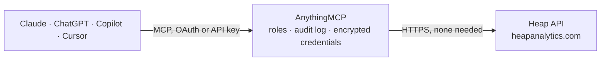

<!-- Generated by scripts/export-github-catalog.mjs in the anythingmcp-website repository. Do not edit by hand. -->

# Heap MCP connector

Send events, identify users and update properties in Heap (product analytics) from any AI agent. 5 tools, app_id-based auth. The AnythingMCP connector gives Claude, ChatGPT, Microsoft Copilot, Cursor and Gemini 5 MCP tools for Heap: 0 read and 5 can change data.

**Category:** [Analytics](../analytics.md) · **Tools:** 5 · **Setup guide:** [anythingmcp.com](https://anythingmcp.com/guides/heap-to-mcp) · [Deutsch](https://anythingmcp.com/de/guides/heap-to-mcp) · [Italiano](https://anythingmcp.com/it/guides/heap-to-mcp) · [Español](https://anythingmcp.com/es/guides/heap-to-mcp) · [日本語](https://anythingmcp.com/ja/guides/heap-to-mcp) · [Русский](https://anythingmcp.com/ru/guides/heap-to-mcp) · [中文](https://anythingmcp.com/zh/guides/heap-to-mcp)

## Start without code

No installation and no terminal: AnythingMCP Cloud runs the Heap connector for you, operated by helpcode.ai in Frankfurt, Germany.

1. **Click the button above** and create an account or sign in. The Heap connector opens, ready to install.
2. **Nothing to enter:** this connector needs no credentials. Every click is in the [step-by-step guide](https://anythingmcp.com/guides/heap-to-mcp).
3. **Click Install.** AnythingMCP shows the address of your MCP server.
4. **Add that address to your assistant:** [Claude](https://anythingmcp.com/guides/connect-heap-to-claude) · [ChatGPT](https://anythingmcp.com/guides/connect-heap-to-chatgpt) · [Microsoft Copilot](https://anythingmcp.com/guides/connect-heap-to-copilot) · [Cursor](https://anythingmcp.com/guides/connect-heap-to-cursor) · [Gemini CLI](https://anythingmcp.com/guides/connect-heap-to-gemini) · [Meta Muse](https://anythingmcp.com/guides/connect-heap-to-muse).
5. **Ask your first question**, for example: *Has identity emma.klein@solstice-energy.de been linked to account SOL-2026-71 in Heap?*

Prefer help with the setup? [Talk to us](https://anythingmcp.com/contact).

## How it works

- **The AI client** speaks MCP (Streamable HTTP) to AnythingMCP and only sees tool names, descriptions and results. It never gets the Heap credentials.
- **AnythingMCP** checks the client's role, builds the call from the tool definition, adds the credentials (none needed), calls Heap, logs the call and returns the result.
- **Heap** sees an ordinary API client with the rights of the account the credentials belong to.

## Tools

| Tool | What it does | Access |
|---|---|---|
| [`heap_track_event`](#heap_track_event) | Track a single behavioral event for a user. | write |
| [`heap_bulk_track`](#heap_bulk_track) | Bulk-track many events in one call (up to 1000 events, 1MB total). | write |
| [`heap_add_user_properties`](#heap_add_user_properties) | Set or update user-level properties (Heap merges with existing). | write |
| [`heap_add_account_properties`](#heap_add_account_properties) | Set or update properties on an account (B2B model — accounts group users). | write |
| [`heap_add_user_to_account`](#heap_add_user_to_account) | Associate a user (identity) with an account (account_id). | write |

## Tool reference

Every parameter as the AI client sees it in `tools/list`. Source: [`packages/backend/src/adapters/intl/heap.json`](../../../packages/backend/src/adapters/intl/heap.json).

### `heap_track_event`

Track a single behavioral event for a user. Required: app_id + identity + event. properties are arbitrary key/value.

**Access:** write · **Call:** `POST /track`

| Parameter | Type | Required | Description |
|---|---|---|---|
| `app_id` | string | yes | Heap app/project ID (use HEAP_APP_ID env var). |
| `identity` | string | yes | Stable user identifier (your UUID or email). |
| `event` | string | yes | Event name (e.g. 'Purchase Completed'). |
| `properties` | object | no | Event properties (any keys + values). |
| `idempotency_key` | string | no | Optional dedupe key — Heap drops duplicates within ~24h. |
| `timestamp` | string | no | ISO 8601 — defaults to now. |

### `heap_bulk_track`

Bulk-track many events in one call (up to 1000 events, 1MB total).

**Access:** write · **Call:** `POST /track`

| Parameter | Type | Required | Description |
|---|---|---|---|
| `app_id` | string | yes | Heap app ID. |
| `events` | any[] | yes | Array of event objects: [{identity, event, properties?, idempotency_key?, timestamp?}, ...]. |

### `heap_add_user_properties`

Set or update user-level properties (Heap merges with existing). User properties persist across all events for that identity.

**Access:** write · **Call:** `POST /add_user_properties`

| Parameter | Type | Required | Description |
|---|---|---|---|
| `app_id` | string | yes | Heap app ID. |
| `identity` | string | yes | User identifier. |
| `properties` | object | yes | User properties to set/merge. |

### `heap_add_account_properties`

Set or update properties on an account (B2B model — accounts group users). Required: account_id.

**Access:** write · **Call:** `POST /add_account_properties`

| Parameter | Type | Required | Description |
|---|---|---|---|
| `app_id` | string | yes | Heap app ID. |
| `account_id` | string | yes | Account identifier (your tenant/org ID). |
| `properties` | object | yes | Account properties. |

### `heap_add_user_to_account`

Associate a user (identity) with an account (account_id). Required: app_id + identity + account_id.

**Access:** write · **Call:** `POST /add_user_to_account`

| Parameter | Type | Required | Description |
|---|---|---|---|
| `app_id` | string | yes | Heap app ID. |
| `identity` | string | yes | User identifier. |
| `account_id` | string | yes | Account ID. |

## Run it yourself

AnythingMCP is open source (AGPL-3.0). [Run it with Docker](../../../README.md#run-it-yourself), open **Connectors → Store**, pick **Heap** and enter `HEAP_APP_ID`, then add your MCP server URL to the AI client.

[← Analytics connectors](../analytics.md) · [All categories](../README.md)
