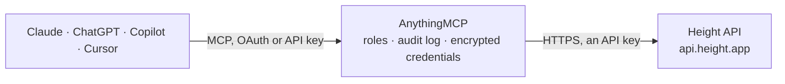

<!-- Generated by scripts/export-github-catalog.mjs in the anythingmcp-website repository. Do not edit by hand. -->

# Height MCP connector

Drive Height (modern AI-native project management) from any AI agent: tasks, lists, fields, users, activities. 9 tools, API-key Bearer auth. The AnythingMCP connector gives Claude, ChatGPT, Microsoft Copilot, Cursor and Gemini 9 MCP tools for Height: 7 read and 2 can change data.

**Category:** [Project Management](../project-management.md) · **Tools:** 9 · **Setup guide:** [anythingmcp.com](https://anythingmcp.com/guides/height-to-mcp) · [Deutsch](https://anythingmcp.com/de/guides/height-to-mcp) · [Italiano](https://anythingmcp.com/it/guides/height-to-mcp) · [Español](https://anythingmcp.com/es/guides/height-to-mcp) · [日本語](https://anythingmcp.com/ja/guides/height-to-mcp) · [Русский](https://anythingmcp.com/ru/guides/height-to-mcp) · [中文](https://anythingmcp.com/zh/guides/height-to-mcp)

## Start without code

No installation and no terminal: AnythingMCP Cloud runs the Height connector for you, operated by helpcode.ai in Frankfurt, Germany.

1. **Click the button above** and create an account or sign in. The Height connector opens, ready to install.
2. **Paste the API key or token from your Height account.** Every click is in the [step-by-step guide](https://anythingmcp.com/guides/height-to-mcp).
3. **Click Install.** AnythingMCP shows the address of your MCP server.
4. **Add that address to your assistant:** [Claude](https://anythingmcp.com/guides/connect-height-to-claude) · [ChatGPT](https://anythingmcp.com/guides/connect-height-to-chatgpt) · [Microsoft Copilot](https://anythingmcp.com/guides/connect-height-to-copilot) · [Cursor](https://anythingmcp.com/guides/connect-height-to-cursor) · [Gemini CLI](https://anythingmcp.com/guides/connect-height-to-gemini) · [Meta Muse](https://anythingmcp.com/guides/connect-height-to-muse).
5. **Ask your first question**, for example: *Show me task T-128 — I need current status, assignees and due date for the Solaris AG invoice issue*

Prefer help with the setup? [Talk to us](https://anythingmcp.com/contact).

## How it works

- **The AI client** speaks MCP (Streamable HTTP) to AnythingMCP and only sees tool names, descriptions and results. It never gets the Height credentials.
- **AnythingMCP** checks the client's role, builds the call from the tool definition, adds the credentials (an API key), calls Height, logs the call and returns the result.
- **Height** sees an ordinary API client with the rights of the account the credentials belong to.

## Tools

| Tool | What it does | Access |
|---|---|---|
| [`height_get_workspace`](#height_get_workspace) | Return workspace info: id, model, url, name. | read |
| [`height_list_lists`](#height_list_lists) | List all lists in the workspace. | read |
| [`height_list_tasks`](#height_list_tasks) | List tasks with a filter query. | read |
| [`height_search_tasks`](#height_search_tasks) | Full-text search tasks. | read |
| [`height_get_task`](#height_get_task) | Fetch a single task by ID OR index (e.g. 'T-42'). | read |
| [`height_create_task`](#height_create_task) | Create a task. | write |
| [`height_update_task`](#height_update_task) | Update a task (PATCH). | write |
| [`height_list_users`](#height_list_users) | List workspace users (members). | read |
| [`height_list_fields`](#height_list_fields) | List custom fields defined in the workspace. | read |

## Tool reference

Every parameter as the AI client sees it in `tools/list`. Source: [`packages/backend/src/adapters/intl/height.json`](../../../packages/backend/src/adapters/intl/height.json).

### `height_get_workspace`

Return workspace info: id, model, url, name.

**Access:** read · **Call:** `GET /workspace`

No parameters.

### `height_list_lists`

List all lists in the workspace. Returns id, name, key, type (list/smartlist/section), appearance, archivedAt.

**Access:** read · **Call:** `GET /lists`

No parameters.

### `height_list_tasks`

List tasks with a filter query. Filter examples: '{"listIds":{"values":["L-1"]}}' or '{"status":{"values":["backlog","started"]}}'. URL-encoded.

**Access:** read · **Call:** `GET /tasks`

| Parameter | Type | Required | Description |
|---|---|---|---|
| `filters` | string | no | URL-encoded JSON filter expression. |
| `order` | string | no | JSON-encoded sort, e.g. '[{"field":"createdAt","direction":"desc"}]'. |

### `height_search_tasks`

Full-text search tasks.

**Access:** read · **Call:** `GET /tasks/search`

| Parameter | Type | Required | Description |
|---|---|---|---|
| `query` | string | yes | Text query. |

### `height_get_task`

Fetch a single task by ID OR index (e.g. 'T-42').

**Access:** read · **Call:** `GET /tasks/{taskIdOrIndex}`

| Parameter | Type | Required | Description |
|---|---|---|---|
| `taskIdOrIndex` | string | yes | Task ID (UUID) or display index (e.g. 'T-42'). |

### `height_create_task`

Create a task. Required: listIds + name.

**Access:** write · **Call:** `POST /tasks`

| Parameter | Type | Required | Description |
|---|---|---|---|
| `listIds` | any[] | yes | Array of list IDs the task belongs to (at least 1). |
| `name` | string | yes | Task title. |
| `description` | string | no | Description (rich text, Markdown supported). |
| `assigneesIds` | any[] | no | Array of user IDs. |
| `status` | string | no | Status name (per workspace's status list: e.g. 'backlog', 'started', 'completed'). |
| `dueDate` | string | no | ISO 8601 date. |
| `parentTaskId` | string | no | If subtask, parent task ID. |
| `fields` | object | no | Custom fields: {fieldId: value, ...}. |

### `height_update_task`

Update a task (PATCH).

**Access:** write · **Call:** `PATCH /tasks/{taskId}`

| Parameter | Type | Required | Description |
|---|---|---|---|
| `taskId` | string | yes | Task ID. |
| `name` | string | no | New name. |
| `description` | string | no | New description. |
| `status` | string | no | Change status. |
| `assigneesIds` | any[] | no | Replace assignees. |
| `listIds` | any[] | no | Replace list memberships. |
| `dueDate` | string | no | Change due date. |
| `fields` | object | no | Update custom fields. |

### `height_list_users`

List workspace users (members).

**Access:** read · **Call:** `GET /users`

No parameters.

### `height_list_fields`

List custom fields defined in the workspace.

**Access:** read · **Call:** `GET /fields`

No parameters.

## Run it yourself

AnythingMCP is open source (AGPL-3.0). [Run it with Docker](../../../README.md#run-it-yourself), open **Connectors → Store**, pick **Height** and enter `HEIGHT_API_KEY`, then add your MCP server URL to the AI client.

[← Project Management connectors](../project-management.md) · [All categories](../README.md)
