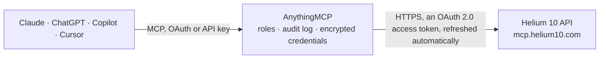

<!-- Generated by scripts/export-github-catalog.mjs in the anythingmcp-website repository. Do not edit by hand. -->

# Helium 10 MCP connector

Research Amazon keywords and products, track rankings, analyse listings and check profits and ad performance from Claude, ChatGPT or Copilot through Helium 10's official MCP server. The AnythingMCP connector gives Claude, ChatGPT, Microsoft Copilot, Cursor and Gemini 134 MCP tools for Helium 10: 106 read and 28 can change data.

**Category:** [E-commerce](../e-commerce.md) · **Tools:** 134 · **Setup guide:** [anythingmcp.com](https://anythingmcp.com/guides/helium10-to-mcp) · [Deutsch](https://anythingmcp.com/de/guides/helium10-to-mcp) · [Italiano](https://anythingmcp.com/it/guides/helium10-to-mcp) · [Español](https://anythingmcp.com/es/guides/helium10-to-mcp) · [日本語](https://anythingmcp.com/ja/guides/helium10-to-mcp) · [Русский](https://anythingmcp.com/ru/guides/helium10-to-mcp) · [中文](https://anythingmcp.com/zh/guides/helium10-to-mcp)

## Start without code

No installation and no terminal: AnythingMCP Cloud runs the Helium 10 connector for you, operated by helpcode.ai in Frankfurt, Germany.

1. **Click the button above** and create an account or sign in. The Helium 10 connector opens, ready to install.
2. **Sign in with your Helium 10 account** when AnythingMCP asks. The first time, an admin creates a small app in the Helium 10 developer console. Every click is in the [step-by-step guide](https://anythingmcp.com/guides/helium10-to-mcp).
3. **Click Install.** AnythingMCP shows the address of your MCP server.
4. **Add that address to your assistant:** [Claude](https://anythingmcp.com/guides/connect-helium10-to-claude) · [ChatGPT](https://anythingmcp.com/guides/connect-helium10-to-chatgpt) · [Microsoft Copilot](https://anythingmcp.com/guides/connect-helium10-to-copilot) · [Cursor](https://anythingmcp.com/guides/connect-helium10-to-cursor) · [Gemini CLI](https://anythingmcp.com/guides/connect-helium10-to-gemini) · [Meta Muse](https://anythingmcp.com/guides/connect-helium10-to-muse).
5. **Ask your first question**, for example: *Show P&L summary for ASIN B07ABC1234 on US marketplace for Oct 2026 (2026-10-01 to 2026-10-31).*

Prefer help with the setup? [Talk to us](https://anythingmcp.com/contact).

## How it works

- **The AI client** speaks MCP (Streamable HTTP) to AnythingMCP and only sees tool names, descriptions and results. It never gets the Helium 10 credentials.
- **AnythingMCP** checks the client's role, builds the call from the tool definition, adds the credentials (an OAuth 2.0 access token, refreshed automatically), calls Helium 10, logs the call and returns the result.
- **Helium 10** sees an ordinary API client with the rights of the account the credentials belong to.

## Tools

| Tool | What it does | Access |
|---|---|---|
| [`helium10_get_keywords_by_keyword`](#helium10_get_keywords_by_keyword) | Expand a seed keyword into a full list of related long-tail phrases (Magnet). | read |
| [`helium10_get_keywords_by_asin`](#helium10_get_keywords_by_asin) | Reverse-lookup an ASIN (Cerebro) to see every keyword it ranks for organically (with rank position), through sponsored ads and through Amazon's… | read |
| [`helium10_compare_asin_keywords`](#helium10_compare_asin_keywords) | Compare the keyword strategy of 2 to 3 competitor ASINs side by side to identify overlaps, gaps and unique keyword opportunities. | read |
| [`helium10_analyze_keywords`](#helium10_analyze_keywords) | Batch-score and enrich up to 200 keywords at once with search volume, CPC, IQ score, CPR and Amazon Brand Analytics data (keyword research and reverse-ASIN… | read |
| [`helium10_find_keywords_with_multi_source`](#helium10_find_keywords_with_multi_source) | Build a keyword bank by pulling keywords from multiple sources (Magnet seed expansion, Cerebro ASIN lookup, category research) into one deduplicated list,… | read |
| [`helium10_get_keywords_search_volume_history`](#helium10_get_keywords_search_volume_history) | Get keyword search volume history over time: how search volume for specific keywords changes day by day, week by week or month by month, to spot seasonality… | read |
| [`helium10_search_amazon_keywords`](#helium10_search_amazon_keywords) | Search the Helium 10 Amazon keyword database (formerly Black Box, Search Keywords) by criteria such as volume, competition and word count, to discover… | read |
| [`helium10_search_products`](#helium10_search_products) | Search active Amazon products (formerly Black Box, Products) with filters like category, price range, BSR, review count, revenue and profit margin, to find… | read |
| [`helium10_search_inactive_products`](#helium10_search_inactive_products) | Search inactive or delisted Amazon products with the same filters as search_products, to understand which products failed in the market and why. | read |
| [`helium10_search_niche_by_keyword`](#helium10_search_niche_by_keyword) | Use a keyword to discover the whole product niche it belongs to: market size, competition level, average price, review density and other niche metrics. | read |
| [`helium10_search_competitors_by_asin`](#helium10_search_competitors_by_asin) | Find the direct competitors of an ASIN within the same category, price range and review range, as the starting set for listing and keyword comparisons. | read |
| [`helium10_list_my_products`](#helium10_list_my_products) | Query your own seller-owned Amazon products by brand, product name, ASIN or SKU. | read |
| [`helium10_get_listing_details`](#helium10_get_listing_details) | Pull the full listing content and metadata for any ASIN (Listing Analyzer): title, bullets, description, A+ content, images, pricing, reviews, BSR and FBA… | read |
| [`helium10_get_listing_score`](#helium10_get_listing_score) | Get the Helium 10 listing quality audit score for any ASIN, with detailed feedback on title, bullets, description and keyword coverage. | read |
| [`helium10_compare_listings`](#helium10_compare_listings) | Compare 2 to 3 ASINs side by side to identify content gaps and weaknesses in keyword coverage between your listing and its competitors. | read |
| [`helium10_get_competitor_overview`](#helium10_get_competitor_overview) | Competitor benchmark overview for a listing (Listing Analyzer): how your ASIN compares with its competitors on content, keywords, price, reviews and rank. | read |
| [`helium10_search_product_targets_by_asin`](#helium10_search_product_targets_by_asin) | Find the products suitable for product targeting in Sponsored Products ads, based on a seed ASIN. | read |
| [`helium10_get_product_live_status`](#helium10_get_product_live_status) | Get a real-time snapshot of an ASIN's current status: price, FBA fee, Buy Box price, stock level, review count and BSR. | read |
| [`helium10_generate_listing`](#helium10_generate_listing) | AI-generate a complete Amazon listing (title, item highlight, bullets, description, enhanced content, backend keywords) from a keyword bank or a single… | write |
| [`helium10_rewrite_listing_section`](#helium10_rewrite_listing_section) | Rewrite one section of an existing listing (title, one bullet, description and so on) while keeping keyword optimization and Amazon compliance. | write |
| [`helium10_retrieve_listing_by_asin`](#helium10_retrieve_listing_by_asin) | Fetch the current Amazon catalog listing images, content and metadata for an ASIN to prepare it for optimization with the Listing Builder. | read |
| [`helium10_analyze_product_images`](#helium10_analyze_product_images) | Analyze product images to extract structured attributes (color, material, size, use case, brand elements) for listing generation. | write |
| [`helium10_request_image_upload_url`](#helium10_request_image_upload_url) | Request presigned upload credentials to upload local image files to Helium 10, for analyze_product_images. | write |
| [`helium10_sync_listing_to_amazon`](#helium10_sync_listing_to_amazon) | Destructive: push listing content (title, bullets, description, A+ content) from Helium 10 directly to your Amazon seller account, overwriting the live listing. | write |
| [`helium10_get_keyword_performance_with_competitors`](#helium10_get_keyword_performance_with_competitors) | Score how well a keyword set is written into listings, based on competitor analysis: which keywords your listing covers compared with competing ASINs. | read |
| [`helium10_get_keywords_rank_history`](#helium10_get_keywords_rank_history) | Pull rank history for keywords you track in Keyword Tracker: position over time (daily or weekly), rank changes and trends. | read |
| [`helium10_get_keywords_new_suggestion`](#helium10_get_keywords_new_suggestion) | Get new keyword suggestions to add to tracking, based on your current Keyword Tracker list. | read |
| [`helium10_list_tracked_keywords`](#helium10_list_tracked_keywords) | Get a paginated list of all keywords you track for an ASIN or brand, with current rank, BSR and search volume. | read |
| [`helium10_list_tracked_competitor_keywords`](#helium10_list_tracked_competitor_keywords) | View all keywords you track for competitors, with their current rank positions and tracking history. | read |
| [`helium10_get_account_profit_and_loss_summary`](#helium10_get_account_profit_and_loss_summary) | Get a summary of your whole Amazon account P&L for a period (point in time): revenue, COGS, fees, shipping, advertising spend and net profit. | read |
| [`helium10_get_account_profit_and_loss_summary_series`](#helium10_get_account_profit_and_loss_summary_series) | Get Amazon account P&L trend data over time (daily, weekly or monthly): revenue, costs and net profit per period. | read |
| [`helium10_get_account_profit_and_loss_breakdown`](#helium10_get_account_profit_and_loss_breakdown) | Get a detailed P&L breakdown for the whole Amazon account: revenue, costs and profit broken down by category, source or other dimensions. | read |
| [`helium10_get_account_profit_and_loss_breakdown_series`](#helium10_get_account_profit_and_loss_breakdown_series) | Get Amazon account P&L breakdown trends over time: each revenue and cost component per day, week or month. | read |
| [`helium10_get_product_profit_and_loss_summary`](#helium10_get_product_profit_and_loss_summary) | Get the P&L summary for one Amazon product (ASIN) over a period: revenue, COGS, fees, advertising and net profit. | read |
| [`helium10_get_product_profit_and_loss_summary_series`](#helium10_get_product_profit_and_loss_summary_series) | Get P&L trend data for one Amazon product (ASIN) over time, per day, week or month. | read |
| [`helium10_get_product_profit_and_loss_breakdown`](#helium10_get_product_profit_and_loss_breakdown) | Get a detailed P&L breakdown for one Amazon product (ASIN): every cost and profit component for the period. | read |
| [`helium10_get_product_profit_and_loss_breakdown_series`](#helium10_get_product_profit_and_loss_breakdown_series) | Get P&L breakdown trends for one Amazon product (ASIN) over time: each cost and profit component per day, week or month. | read |
| [`helium10_get_wmt_account_profit_and_loss_summary`](#helium10_get_wmt_account_profit_and_loss_summary) | Get a summary of your whole Walmart account P&L for a period: revenue, COGS, fees, advertising spend, indirect costs and net profit. | read |
| [`helium10_get_wmt_account_profit_and_loss_summary_series`](#helium10_get_wmt_account_profit_and_loss_summary_series) | Get Walmart account P&L trend data over time (daily, weekly or monthly): revenue, costs and net profit per period. | read |
| [`helium10_get_wmt_account_profit_and_loss_breakdown`](#helium10_get_wmt_account_profit_and_loss_breakdown) | Get a detailed P&L breakdown for the whole Walmart account: revenue, costs (including advertising and indirect costs) and profit by component. | read |
| [`helium10_get_wmt_account_profit_and_loss_breakdown_series`](#helium10_get_wmt_account_profit_and_loss_breakdown_series) | Get Walmart account P&L breakdown trends over time: each revenue and cost component per day, week or month. | read |
| [`helium10_get_wmt_product_profit_and_loss_summary`](#helium10_get_wmt_product_profit_and_loss_summary) | Get the P&L summary for one Walmart product over a period: revenue, COGS, fees, advertising and net profit. | read |
| [`helium10_get_wmt_product_profit_and_loss_summary_series`](#helium10_get_wmt_product_profit_and_loss_summary_series) | Get P&L trend data for one Walmart product over time, per day, week or month. | read |
| [`helium10_get_wmt_product_profit_and_loss_breakdown`](#helium10_get_wmt_product_profit_and_loss_breakdown) | Get a detailed P&L breakdown for one Walmart product: every cost and profit component for the period. | read |
| [`helium10_get_wmt_product_profit_and_loss_breakdown_series`](#helium10_get_wmt_product_profit_and_loss_breakdown_series) | Get Walmart P&L breakdown trends for one product over time: each cost and profit component per day, week or month. | read |
| [`helium10_get_sales_velocity`](#helium10_get_sales_velocity) | Get units sold over time for one or more Amazon products, bucketed by day, week or month, to see sales velocity trends and forecast restock needs. | read |
| [`helium10_get_inventory_values`](#helium10_get_inventory_values) | Get current inventory quantity metrics for Amazon products: units in stock, fulfillment type (FBA or FBM), warehouse location, age of inventory and… | read |
| [`helium10_get_fba_inventory_health_status`](#helium10_get_fba_inventory_health_status) | Get FBA inventory health per product: days of supply, IPI score, excess, stranded and aged inventory, and stock-out risk. | read |
| [`helium10_get_wmt_inventory_values`](#helium10_get_wmt_inventory_values) | Get current Walmart inventory quantity metrics: units in stock by fulfillment type (WFS, Walmart Fulfillment Services, and seller fulfilled). | read |
| [`helium10_get_wmt_sales_velocity`](#helium10_get_wmt_sales_velocity) | Get units sold over time for Walmart products, bucketed by day, week or month, to follow sales velocity and plan restocks. | read |
| [`helium10_get_my_wmt_seller_accounts`](#helium10_get_my_wmt_seller_accounts) | Discover which Walmart seller accounts are connected to your Helium 10 account. | read |
| [`helium10_get_search_query_performance`](#helium10_get_search_query_performance) | See how your listings perform for real Amazon search queries: impressions, clicks, click-through rate and conversions per query. | read |
| [`helium10_search_amazon_brand_analytics`](#helium10_search_amazon_brand_analytics) | Query Amazon Brand Analytics (formerly Black Box, ABA): top search terms, market basket analysis, repeat purchase behaviour and demographics. | read |
| [`helium10_get_brand_seller_profiles`](#helium10_get_brand_seller_profiles) | Discover and disambiguate a Brand-Registered Amazon seller account: its shop page, catalog size, seller rating and Sponsored Brands metrics. | read |
| [`helium10_get_ads_query_platforms`](#helium10_get_ads_query_platforms) | Step 1 of Ads Query: list the ad platforms (Amazon, Walmart) and connected profiles available to you for querying ad data. | read |
| [`helium10_get_ads_query_list`](#helium10_get_ads_query_list) | Step 2 of Ads Query: explore the data hierarchy for a platform (account, campaigns, ad groups, keywords or targets, performance metrics). | read |
| [`helium10_get_ads_query_schema`](#helium10_get_ads_query_schema) | Step 3 of Ads Query: get the self-describing schema for the chosen level: dimensions, measures, filters and granularities you can query. | read |
| [`helium10_get_ads_query_materials`](#helium10_get_ads_query_materials) | Step 4 of Ads Query: resolve names of profiles, campaigns, ad groups, keywords or targets into the IDs the query expects. | read |
| [`helium10_execute_ads_query`](#helium10_execute_ads_query) | Step 5 (terminal) of Ads Query: run the ad data query with filters and aggregations and return columns and rows inline: spend, clicks, impressions,… | read |
| [`helium10_get_ads_campaign_mgmt_platforms`](#helium10_get_ads_campaign_mgmt_platforms) | Step 1 of campaign management: list the platforms and ad profiles available for managing campaigns. | read |
| [`helium10_get_ads_campaign_mgmt_schema`](#helium10_get_ads_campaign_mgmt_schema) | Step 2 of campaign management: get the schema of available actions, fields and constraints for managing campaigns. | read |
| [`helium10_execute_ads_campaign_mgmt_actions`](#helium10_execute_ads_campaign_mgmt_actions) | Step 3 (terminal) of campaign management: execute actions on live ad accounts (pause, resume, create campaigns, adjust bids and budgets). | write |
| [`helium10_get_ads_rule_platforms`](#helium10_get_ads_rule_platforms) | Step 1 of Ads Rules: list the ad platforms and profiles available for building bid automation rules. | read |
| [`helium10_get_ads_rule_schema`](#helium10_get_ads_rule_schema) | Step 2 of Ads Rules: get the schema for building automation rules: metrics, bid actions, guardrails and schedules. | read |
| [`helium10_manage_ads_rule`](#helium10_manage_ads_rule) | Step 3 (terminal) of Ads Rules: build, edit and manage Amazon Bid Rules automation in plain English. | write |
| [`helium10_get_ads_changelog_platforms`](#helium10_get_ads_changelog_platforms) | Step 1 of Change Log: list the ad platforms (Amazon, Walmart) available for querying campaign change history. | read |
| [`helium10_get_ads_changelog_schema`](#helium10_get_ads_changelog_schema) | Step 2 of Change Log: get the schema for change log queries, including the available change types and filters. | read |
| [`helium10_execute_ads_changelog_query`](#helium10_execute_ads_changelog_query) | Step 3 (terminal) of Change Log: query bid, budget, keyword, negative, campaign status and placement changes with old value, new value, who made it and… | read |
| [`helium10_get_seller_account_health`](#helium10_get_seller_account_health) | Get account-level health metrics for connected Amazon seller accounts: account standing, feedback rating, suspension risks and overall health status. | read |
| [`helium10_search_alert_events`](#helium10_search_alert_events) | Query listing change alert events for your seller account: price, review count, ranking, Buy Box and other product changes. | read |
| [`helium10_get_monitoring_status`](#helium10_get_monitoring_status) | Get your account's monitoring setup: which products are monitored, which alert rules are configured and the notification settings. | read |
| [`helium10_search_b2b_offer_change_notifications`](#helium10_search_b2b_offer_change_notifications) | Search Amazon B2B Any Offer Changed notification events, to track when B2B offers on your products change. | read |
| [`helium10_search_fee_promotion_notifications`](#helium10_search_fee_promotion_notifications) | Search Amazon fee and promotion notification events: fee changes, promotion eligibility and other cost-related updates. | read |
| [`helium10_get_asin_price_history`](#helium10_get_asin_price_history) | Pull the price history of any ASIN over time: how your price and competitor prices changed. | read |
| [`helium10_get_asin_bsr_history`](#helium10_get_asin_bsr_history) | Pull the BSR (Best Seller Rank) history of any ASIN, to see how its rank changed over time. | read |
| [`helium10_get_asin_reviews_history`](#helium10_get_asin_reviews_history) | Get the review count history of any ASIN over time, to follow review velocity and spot sudden drops. | read |
| [`helium10_get_change_rollup`](#helium10_get_change_rollup) | Get an account-level rollup of what changed in the last 24 hours or 7 days across your portfolio: price changes, review changes, rank movements and Buy Box… | read |
| [`helium10_get_asin_review_analysis`](#helium10_get_asin_review_analysis) | Get detailed review insights for any ASIN: rating distribution, sentiment analysis, keywords extracted from reviews and common complaint themes. | read |
| [`helium10_get_category_review_analysis`](#helium10_get_category_review_analysis) | Get category-level and niche-level review insights: common complaint themes, sentiment trends and improvement priorities across a whole category. | read |
| [`helium10_search_browse_nodes`](#helium10_search_browse_nodes) | Search Amazon browse nodes (the category hierarchy) by category name or node ID, for category-level research and filtering. | read |
| [`helium10_get_buybox_summary`](#helium10_get_buybox_summary) | Get your current Buy Box standing across all monitored ASINs: where you hold the Buy Box, where you are losing it, and who holds it. | read |
| [`helium10_search_buybox_history`](#helium10_search_buybox_history) | Get the Buy Box ownership history of any ASIN over a date range: who owned the Buy Box when, including your account and competitors. | read |
| [`helium10_get_seller_feedback`](#helium10_get_seller_feedback) | Get your brand or seller feedback rating and a summary of recent negative feedback, to track seller reputation across your account. | read |
| [`helium10_get_size_tier_suggestions`](#helium10_get_size_tier_suggestions) | Get FBA size tier optimization suggestions: products that could move to a different size tier to reduce FBA fees. | read |
| [`helium10_list_amazon_cogs`](#helium10_list_amazon_cogs) | Get a paginated list of all COGS (Cost of Goods Sold) records configured for your Amazon account, as used by Profits. | read |
| [`helium10_create_amazon_cogs`](#helium10_create_amazon_cogs) | Create a new COGS entry for an Amazon product or SKU: unit cost and effective date. | write |
| [`helium10_edit_amazon_cogs`](#helium10_edit_amazon_cogs) | Update an existing Amazon COGS entry: unit cost, effective date or other COGS parameters. | write |
| [`helium10_delete_amazon_cogs`](#helium10_delete_amazon_cogs) | Delete one or more Amazon COGS records by cogs_id (batch delete, up to 100). | write |
| [`helium10_list_amazon_indirect_cost_settings`](#helium10_list_amazon_indirect_cost_settings) | Get a paginated list of all indirect cost settings (the configuration rules for recurring costs such as payroll, software or photography) for your Amazon… | read |
| [`helium10_create_amazon_indirect_cost`](#helium10_create_amazon_indirect_cost) | Create a new indirect cost setting (a configuration rule) for automated cost tracking in Amazon Profits. | write |
| [`helium10_edit_amazon_indirect_cost`](#helium10_edit_amazon_indirect_cost) | Update an existing Amazon indirect cost setting: cost formula, effective date or calculation parameters. | write |
| [`helium10_delete_amazon_indirect_costs`](#helium10_delete_amazon_indirect_costs) | Delete one or more Amazon indirect cost settings by cost_id (batch delete, up to 100). | write |
| [`helium10_list_amazon_indirect_costs`](#helium10_list_amazon_indirect_costs) | Get a paginated list of expanded (materialized) Amazon indirect costs: the actual charges calculated from the settings. | read |
| [`helium10_list_wmt_cogs`](#helium10_list_wmt_cogs) | Get a paginated list of all COGS (Cost of Goods Sold) records configured for your Walmart account. | read |
| [`helium10_edit_wmt_cogs`](#helium10_edit_wmt_cogs) | Update an existing Walmart COGS entry: unit cost or effective date, which changes the Walmart profit figures. | write |
| [`helium10_delete_wmt_cogs`](#helium10_delete_wmt_cogs) | Delete one or more Walmart COGS records by cogs_id (batch delete, up to 100). | write |
| [`helium10_list_wmt_indirect_cost_settings`](#helium10_list_wmt_indirect_cost_settings) | Get a paginated list of all indirect cost settings (configuration rules) for your Walmart account. | read |
| [`helium10_list_wmt_indirect_costs`](#helium10_list_wmt_indirect_costs) | Get a paginated list of expanded (materialized) Walmart indirect costs: the actual charges calculated from the settings. | read |
| [`helium10_create_wmt_indirect_cost`](#helium10_create_wmt_indirect_cost) | Create a new Walmart indirect cost setting (a configuration rule), e.g. payroll, brand fees, photography or offline promotion. | write |
| [`helium10_edit_wmt_indirect_cost`](#helium10_edit_wmt_indirect_cost) | Update an existing Walmart indirect cost setting: amount, formula, effective date or calculation parameters. | write |
| [`helium10_delete_wmt_indirect_costs`](#helium10_delete_wmt_indirect_costs) | Delete one or more Walmart indirect cost settings by cost_id (batch delete, up to 100). | write |
| [`helium10_get_mcp_usage_info`](#helium10_get_mcp_usage_info) | Get your current Helium 10 MCP usage for this month: API calls used out of the monthly limit (1,000 on Diamond), reset date, remaining quota and top-up status. | read |
| [`helium10_get_my_amazon_seller_accounts`](#helium10_get_my_amazon_seller_accounts) | Get the list of authenticated Amazon seller accounts linked to your Helium 10 account, with their IDs and marketplaces. | read |
| [`helium10_get_top_keywords`](#helium10_get_top_keywords) | Get the top keywords for a specific listing: which keywords drive the most traffic, ranked by search volume and relevance. | read |
| [`helium10_check_asin_keyword_index`](#helium10_check_asin_keyword_index) | Check whether an ASIN is indexed on Amazon for specific keywords. | read |
| [`helium10_get_google_trends_history`](#helium10_get_google_trends_history) | Get Google Trends search interest history for a keyword over time, to identify seasonal demand and validate the market viability of keywords. | read |
| [`helium10_search_tiktok_products`](#helium10_search_tiktok_products) | Search TikTok Shop products (US) by keyword, brand, category, price, rating, shipping, listing recency, units sold, GMV, GMV trend and commission rate. | read |
| [`helium10_search_tiktok_influencers`](#helium10_search_tiktok_influencers) | Search TikTok creators (US) by keyword, category, follower count, video and live engagement rates, GMV band and units-sold band. | read |
| [`helium10_get_tiktok_product_influencers`](#helium10_get_tiktok_product_influencers) | Given a TikTok Shop product ID, get all creators promoting or selling that product, with their GMV, units sold and video count for it. | read |
| [`helium10_search_tiktok_hot_videos`](#helium10_search_tiktok_hot_videos) | Search trending TikTok Shop videos (US) by keyword, category and time window (7, 14 or 30 days). | read |
| [`helium10_list_tracked_products`](#helium10_list_tracked_products) | Get a paginated list of all products you track in Keyword Tracker, with their current metrics and tracking status. | read |
| [`helium10_add_untracked_product_keywords`](#helium10_add_untracked_product_keywords) | Add new keywords to Keyword Tracker for a product (ASIN). | write |
| [`helium10_delete_tracked_keywords`](#helium10_delete_tracked_keywords) | Remove keywords from Keyword Tracker for a product (batch, up to 100). | write |
| [`helium10_delete_tracked_product`](#helium10_delete_tracked_product) | Remove an entire product from Keyword Tracker, which stops all rank tracking for that ASIN. | write |
| [`helium10_link_keyword_tag`](#helium10_link_keyword_tag) | Attach tags to tracked keywords for organization and categorization, for example "high-priority". | write |
| [`helium10_unlink_keyword_tag`](#helium10_unlink_keyword_tag) | Remove tags from tracked keywords. | write |
| [`helium10_add_keyword_note`](#helium10_add_keyword_note) | Add a note to tracked keywords for observations, strategy notes or follow-up items in Keyword Tracker. | write |
| [`helium10_update_keyword_note`](#helium10_update_keyword_note) | Update the existing note on tracked keywords in Keyword Tracker with new text. | write |
| [`helium10_remove_keyword_note`](#helium10_remove_keyword_note) | Remove the note from tracked keywords in Keyword Tracker. | write |
| [`helium10_list_keyword_folders`](#helium10_list_keyword_folders) | Browse your keyword folders in My List (Keyword Manager), with their folder structure and organization. | read |
| [`helium10_list_folder_keywords`](#helium10_list_folder_keywords) | Get all keywords inside one folder of Keyword Manager (My List), with their saved metrics. | read |
| [`helium10_add_keywords_to_folder`](#helium10_add_keywords_to_folder) | Add keywords to a folder in Keyword Manager (My List). | write |
| [`helium10_list_saved_products`](#helium10_list_saved_products) | Get all products saved in My List (Black Box saved products), your saved product library with current metrics. | read |
| [`helium10_search_amazon_influencers`](#helium10_search_amazon_influencers) | Search Amazon influencers by niche, follower count, engagement metrics and content type, to find creators relevant to your products. | read |
| [`helium10_get_amazon_influencer_profile`](#helium10_get_amazon_influencer_profile) | Get the detailed profile of one Amazon influencer: followers, engagement rates, content categories, past promotions and contact info. | read |
| [`helium10_search_amazon_influencer_videos`](#helium10_search_amazon_influencer_videos) | Get the videos of one Amazon influencer: topics, engagement metrics, product mentions and audience demographics. | read |
| [`helium10_list_amazon_influencer_folders`](#helium10_list_amazon_influencer_folders) | Browse the folders in your Amazon Influencer Finder My List, where saved creators are organized. | read |
| [`helium10_list_amazon_influencers_in_folder`](#helium10_list_amazon_influencers_in_folder) | Get all Amazon influencers saved in one Influencer Finder folder, with their key metrics. | read |
| [`helium10_add_amazon_influencers_to_folder`](#helium10_add_amazon_influencers_to_folder) | Add Amazon influencers to an Influencer Finder folder for organization. | write |
| [`helium10_list_user_markets`](#helium10_list_user_markets) | List the Market Tracker 360 (MT360) markets of your account. | read |
| [`helium10_get_market_overall`](#helium10_get_market_overall) | Get the overall Market Tracker 360 historical series for one MT360 market (optionally compared): market size, growth trends and changes in the competitive… | read |
| [`helium10_get_market_statistics`](#helium10_get_market_statistics) | Get headline Market Performance statistics for one MT360 market: your share, market share by category, competitive metrics and performance indicators. | read |
| [`helium10_get_market_leaderboard`](#helium10_get_market_leaderboard) | Get the ranked leaderboard of one MT360 market: top categories, brands or sellers by the chosen metric. | read |
| [`helium10_get_market_products`](#helium10_get_market_products) | Get paginated current product rows for one MT360 market: ASIN attributes, BSR, pricing, reviews and sales data. | read |

## Tool reference

Every parameter as the AI client sees it in `tools/list`. Source: [`packages/backend/src/adapters/intl/helium10.json`](../../../packages/backend/src/adapters/intl/helium10.json).

### `helium10_get_keywords_by_keyword`

Expand a seed keyword into a full list of related long-tail phrases (Magnet). Returns search volume, CPC, IQ score, CPR, title density and Amazon Brand Analytics data, to build keyword banks for listings and PPC campaigns.

**Access:** read · **Call:** `get_keywords_by_keyword /mcp`

| Parameter | Type | Required | Description |
|---|---|---|---|
| `keyword` | string | yes | Seed keyword or search phrase. |
| `marketplace` | string[] | no | Amazon marketplace code: US (default), UK, DE, JP, CA, AU, FR, ES, IT, NL, PL, SE or MX. A single value is accepted as well as a list. |
| `filters` | object | no | Filters on volume, CPC, competition or word count. The server publishes the exact filter fields in its live tool schema. |

### `helium10_get_keywords_by_asin`

Reverse-lookup an ASIN (Cerebro) to see every keyword it ranks for organically (with rank position), through sponsored ads and through Amazon's recommendation engine, to understand a competitor's keyword strategy and find gaps.

**Access:** read · **Call:** `get_keywords_by_asin /mcp`

| Parameter | Type | Required | Description |
|---|---|---|---|
| `asin` | string | yes | Amazon ASIN, the 10-character product identifier (e.g. B0XXXXXXXX), not a SKU, UPC or EAN. |
| `marketplace` | string[] | no | Amazon marketplace code: US (default), UK, DE, JP, CA, AU, FR, ES, IT, NL, PL, SE or MX. A single value is accepted as well as a list. |
| `filters` | object | no | Filters on volume, rank position or match type. The server publishes the exact filter fields in its live tool schema. |

### `helium10_compare_asin_keywords`

Compare the keyword strategy of 2 to 3 competitor ASINs side by side to identify overlaps, gaps and unique keyword opportunities.

**Access:** read · **Call:** `compare_asin_keywords /mcp`

| Parameter | Type | Required | Description |
|---|---|---|---|
| `asins` | string[] | yes | Amazon ASINs (10 characters each), 2 to 3. |
| `marketplace` | string[] | no | Amazon marketplace code: US (default), UK, DE, JP, CA, AU, FR, ES, IT, NL, PL, SE or MX. A single value is accepted as well as a list. |

### `helium10_analyze_keywords`

Batch-score and enrich up to 200 keywords at once with search volume, CPC, IQ score, CPR and Amazon Brand Analytics data (keyword research and reverse-ASIN analysis, formerly Cerebro). Split larger lists into batches of 200.

**Access:** read · **Call:** `analyze_keywords /mcp`

| Parameter | Type | Required | Description |
|---|---|---|---|
| `keywords` | string[] | yes | Keywords (up to 200). |
| `marketplace` | string[] | no | Amazon marketplace code: US (default), UK, DE, JP, CA, AU, FR, ES, IT, NL, PL, SE or MX. A single value is accepted as well as a list. |

### `helium10_find_keywords_with_multi_source`

Build a keyword bank by pulling keywords from multiple sources (Magnet seed expansion, Cerebro ASIN lookup, category research) into one deduplicated list, for example as the input of generate_listing.

**Access:** read · **Call:** `find_keywords_with_multi_source /mcp`

| Parameter | Type | Required | Description |
|---|---|---|---|
| `sources` | object[] | no | The sources to combine, e.g. seed keywords, competitor ASINs, category research. |
| `keyword` | string | no | Seed keyword for Magnet expansion. |
| `asins` | string[] | no | Amazon ASINs (10 characters each), for Cerebro lookup. |
| `marketplace` | string[] | no | Amazon marketplace code: US (default), UK, DE, JP, CA, AU, FR, ES, IT, NL, PL, SE or MX. A single value is accepted as well as a list. |

### `helium10_get_keywords_search_volume_history`

Get keyword search volume history over time: how search volume for specific keywords changes day by day, week by week or month by month, to spot seasonality and trends.

**Access:** read · **Call:** `get_keywords_search_volume_history /mcp`

| Parameter | Type | Required | Description |
|---|---|---|---|
| `keywords` | string[] | yes | Keywords. |
| `marketplace` | string[] | no | Amazon marketplace code: US (default), UK, DE, JP, CA, AU, FR, ES, IT, NL, PL, SE or MX. A single value is accepted as well as a list. |
| `start_date` | string | no | Start of the period, YYYY-MM-DD. |
| `end_date` | string | no | End of the period, YYYY-MM-DD (dates after today are clamped to today). |
| `granularity` | `day` \| `week` \| `month` | no | Time bucket of the series. |

### `helium10_search_amazon_keywords`

Search the Helium 10 Amazon keyword database (formerly Black Box, Search Keywords) by criteria such as volume, competition and word count, to discover keyword opportunities and research keyword metrics at scale.

**Access:** read · **Call:** `search_amazon_keywords /mcp`

| Parameter | Type | Required | Description |
|---|---|---|---|
| `keyword` | string | no | Phrase the keywords should contain (optional). |
| `marketplace` | string[] | no | Amazon marketplace code: US (default), UK, DE, JP, CA, AU, FR, ES, IT, NL, PL, SE or MX. A single value is accepted as well as a list. |
| `filters` | object | no | Filters on search volume, CPC, competing products, word count or category. The server publishes the exact filter fields in its live tool schema. |
| `page` | integer | no | Page number for paginated results (each extra page counts as one API call). |
| `page_size` | integer | no | Rows per page. |

### `helium10_search_products`

Search active Amazon products (formerly Black Box, Products) with filters like category, price range, BSR, review count, revenue and profit margin, to find sourcing opportunities and validate market demand.

**Access:** read · **Call:** `search_products /mcp`

| Parameter | Type | Required | Description |
|---|---|---|---|
| `marketplace` | string[] | no | Amazon marketplace code: US (default), UK, DE, JP, CA, AU, FR, ES, IT, NL, PL, SE or MX. A single value is accepted as well as a list. |
| `filters` | object | no | Filters on category, price, BSR, reviews, monthly revenue, sales or margin. The server publishes the exact filter fields in its live tool schema. |
| `page` | integer | no | Page number for paginated results (each extra page counts as one API call). |
| `page_size` | integer | no | Rows per page. |

### `helium10_search_inactive_products`

Search inactive or delisted Amazon products with the same filters as search_products, to understand which products failed in the market and why.

**Access:** read · **Call:** `search_inactive_products /mcp`

| Parameter | Type | Required | Description |
|---|---|---|---|
| `marketplace` | string[] | no | Amazon marketplace code: US (default), UK, DE, JP, CA, AU, FR, ES, IT, NL, PL, SE or MX. A single value is accepted as well as a list. |
| `filters` | object | no | Filters on category, price, BSR, reviews or revenue. The server publishes the exact filter fields in its live tool schema. |
| `page` | integer | no | Page number for paginated results (each extra page counts as one API call). |
| `page_size` | integer | no | Rows per page. |

### `helium10_search_niche_by_keyword`

Use a keyword to discover the whole product niche it belongs to: market size, competition level, average price, review density and other niche metrics.

**Access:** read · **Call:** `search_niche_by_keyword /mcp`

| Parameter | Type | Required | Description |
|---|---|---|---|
| `keyword` | string | yes | Seed keyword or search phrase. |
| `marketplace` | string[] | no | Amazon marketplace code: US (default), UK, DE, JP, CA, AU, FR, ES, IT, NL, PL, SE or MX. A single value is accepted as well as a list. |

### `helium10_search_competitors_by_asin`

Find the direct competitors of an ASIN within the same category, price range and review range, as the starting set for listing and keyword comparisons.

**Access:** read · **Call:** `search_competitors_by_asin /mcp`

| Parameter | Type | Required | Description |
|---|---|---|---|
| `asin` | string | yes | Amazon ASIN, the 10-character product identifier (e.g. B0XXXXXXXX), not a SKU, UPC or EAN. |
| `marketplace` | string[] | no | Amazon marketplace code: US (default), UK, DE, JP, CA, AU, FR, ES, IT, NL, PL, SE or MX. A single value is accepted as well as a list. |

### `helium10_list_my_products`

Query your own seller-owned Amazon products by brand, product name, ASIN or SKU. Use it first when you do not have an ASIN at hand.

**Access:** read · **Call:** `list_my_products /mcp`

| Parameter | Type | Required | Description |
|---|---|---|---|
| `query` | string | no | Brand, product name, ASIN or SKU to look for. |
| `marketplace` | string[] | no | Amazon marketplace code: US (default), UK, DE, JP, CA, AU, FR, ES, IT, NL, PL, SE or MX. A single value is accepted as well as a list. |
| `page` | integer | no | Page number for paginated results (each extra page counts as one API call). |
| `page_size` | integer | no | Rows per page. |

### `helium10_get_listing_details`

Pull the full listing content and metadata for any ASIN (Listing Analyzer): title, bullets, description, A+ content, images, pricing, reviews, BSR and FBA status.

**Access:** read · **Call:** `get_listing_details /mcp`

| Parameter | Type | Required | Description |
|---|---|---|---|
| `asin` | string | yes | Amazon ASIN, the 10-character product identifier (e.g. B0XXXXXXXX), not a SKU, UPC or EAN. |
| `marketplace` | string[] | no | Amazon marketplace code: US (default), UK, DE, JP, CA, AU, FR, ES, IT, NL, PL, SE or MX. A single value is accepted as well as a list. |

### `helium10_get_listing_score`

Get the Helium 10 listing quality audit score for any ASIN, with detailed feedback on title, bullets, description and keyword coverage.

**Access:** read · **Call:** `get_listing_score /mcp`

| Parameter | Type | Required | Description |
|---|---|---|---|
| `asin` | string | yes | Amazon ASIN, the 10-character product identifier (e.g. B0XXXXXXXX), not a SKU, UPC or EAN. |
| `marketplace` | string[] | no | Amazon marketplace code: US (default), UK, DE, JP, CA, AU, FR, ES, IT, NL, PL, SE or MX. A single value is accepted as well as a list. |

### `helium10_compare_listings`

Compare 2 to 3 ASINs side by side to identify content gaps and weaknesses in keyword coverage between your listing and its competitors.

**Access:** read · **Call:** `compare_listings /mcp`

| Parameter | Type | Required | Description |
|---|---|---|---|
| `asins` | string[] | yes | Amazon ASINs (10 characters each), 2 to 3. |
| `marketplace` | string[] | no | Amazon marketplace code: US (default), UK, DE, JP, CA, AU, FR, ES, IT, NL, PL, SE or MX. A single value is accepted as well as a list. |

### `helium10_get_competitor_overview`

Competitor benchmark overview for a listing (Listing Analyzer): how your ASIN compares with its competitors on content, keywords, price, reviews and rank.

**Access:** read · **Call:** `get_competitor_overview /mcp`

| Parameter | Type | Required | Description |
|---|---|---|---|
| `asin` | string | yes | Amazon ASIN, the 10-character product identifier (e.g. B0XXXXXXXX), not a SKU, UPC or EAN. |
| `competitor_asins` | string[] | no | Amazon ASINs (10 characters each), to benchmark against (optional). |
| `marketplace` | string[] | no | Amazon marketplace code: US (default), UK, DE, JP, CA, AU, FR, ES, IT, NL, PL, SE or MX. A single value is accepted as well as a list. |

### `helium10_search_product_targets_by_asin`

Find the products suitable for product targeting in Sponsored Products ads, based on a seed ASIN.

**Access:** read · **Call:** `search_product_targets_by_asin /mcp`

| Parameter | Type | Required | Description |
|---|---|---|---|
| `asin` | string | yes | Amazon ASIN, the 10-character product identifier (e.g. B0XXXXXXXX), not a SKU, UPC or EAN. |
| `marketplace` | string[] | no | Amazon marketplace code: US (default), UK, DE, JP, CA, AU, FR, ES, IT, NL, PL, SE or MX. A single value is accepted as well as a list. |

### `helium10_get_product_live_status`

Get a real-time snapshot of an ASIN's current status: price, FBA fee, Buy Box price, stock level, review count and BSR.

**Access:** read · **Call:** `get_product_live_status /mcp`

| Parameter | Type | Required | Description |
|---|---|---|---|
| `asin` | string | yes | Amazon ASIN, the 10-character product identifier (e.g. B0XXXXXXXX), not a SKU, UPC or EAN. |
| `marketplace` | string[] | no | Amazon marketplace code: US (default), UK, DE, JP, CA, AU, FR, ES, IT, NL, PL, SE or MX. A single value is accepted as well as a list. |

### `helium10_generate_listing`

AI-generate a complete Amazon listing (title, item highlight, bullets, description, enhanced content, backend keywords) from a keyword bank or a single keyword, in Helium 10. Nothing is published until sync_listing_to_amazon.

**Access:** write · **Call:** `generate_listing /mcp`

| Parameter | Type | Required | Description |
|---|---|---|---|
| `keywords` | string[] | no | Keywords. |
| `keyword` | string | no | Single keyword, when no keyword bank is given. |
| `product_info` | object | no | Facts about the product: name, brand, key features, target audience, analyzed images. |
| `marketplace` | string[] | no | Amazon marketplace code: US (default), UK, DE, JP, CA, AU, FR, ES, IT, NL, PL, SE or MX. A single value is accepted as well as a list. |

### `helium10_rewrite_listing_section`

Rewrite one section of an existing listing (title, one bullet, description and so on) while keeping keyword optimization and Amazon compliance. The rest of the listing is left as it is.

**Access:** write · **Call:** `rewrite_listing_section /mcp`

| Parameter | Type | Required | Description |
|---|---|---|---|
| `section` | string | yes | The section to rewrite, e.g. title, item_highlight, a bullet or description. |
| `content` | string | no | Current text of the section. |
| `user_feedback` | string | no | What should change. |
| `keywords` | string[] | no | Keywords. |
| `marketplace` | string[] | no | Amazon marketplace code: US (default), UK, DE, JP, CA, AU, FR, ES, IT, NL, PL, SE or MX. A single value is accepted as well as a list. |

### `helium10_retrieve_listing_by_asin`

Fetch the current Amazon catalog listing images, content and metadata for an ASIN to prepare it for optimization with the Listing Builder.

**Access:** read · **Call:** `retrieve_listing_by_asin /mcp`

| Parameter | Type | Required | Description |
|---|---|---|---|
| `asin` | string | yes | Amazon ASIN, the 10-character product identifier (e.g. B0XXXXXXXX), not a SKU, UPC or EAN. |
| `marketplace` | string[] | no | Amazon marketplace code: US (default), UK, DE, JP, CA, AU, FR, ES, IT, NL, PL, SE or MX. A single value is accepted as well as a list. |

### `helium10_analyze_product_images`

Analyze product images to extract structured attributes (color, material, size, use case, brand elements) for listing generation.

**Access:** write · **Call:** `analyze_product_images /mcp`

| Parameter | Type | Required | Description |
|---|---|---|---|
| `image_urls` | string[] | no | Public URLs of the product images. |
| `image_refs` | string[] | no | References of images uploaded with request_image_upload_url. |

### `helium10_request_image_upload_url`

Request presigned upload credentials to upload local image files to Helium 10, for analyze_product_images. The upload URL expires after a short time.

**Access:** write · **Call:** `request_image_upload_url /mcp`

| Parameter | Type | Required | Description |
|---|---|---|---|
| `filename` | string | no | Name of the image file. |
| `content_type` | string | no | MIME type, e.g. image/jpeg. |

### `helium10_sync_listing_to_amazon`

Destructive: push listing content (title, bullets, description, A+ content) from Helium 10 directly to your Amazon seller account, overwriting the live listing. Switched off by default.

**Access:** write · **Call:** `sync_listing_to_amazon /mcp`

| Parameter | Type | Required | Description |
|---|---|---|---|
| `asin` | string | yes | Amazon ASIN, the 10-character product identifier (e.g. B0XXXXXXXX), not a SKU, UPC or EAN. |
| `marketplace` | string[] | no | Amazon marketplace code: US (default), UK, DE, JP, CA, AU, FR, ES, IT, NL, PL, SE or MX. A single value is accepted as well as a list. |
| `request_id` | string | no | ID of the generated or rewritten listing to publish. |

### `helium10_get_keyword_performance_with_competitors`

Score how well a keyword set is written into listings, based on competitor analysis: which keywords your listing covers compared with competing ASINs.

**Access:** read · **Call:** `get_keyword_performance_with_competitors /mcp`

| Parameter | Type | Required | Description |
|---|---|---|---|
| `asin` | string | no | Amazon ASIN, the 10-character product identifier (e.g. B0XXXXXXXX), not a SKU, UPC or EAN. |
| `keywords` | string[] | yes | Keywords. |
| `competitor_asins` | string[] | no | Amazon ASINs (10 characters each), to compare with. |
| `marketplace` | string[] | no | Amazon marketplace code: US (default), UK, DE, JP, CA, AU, FR, ES, IT, NL, PL, SE or MX. A single value is accepted as well as a list. |

### `helium10_get_keywords_rank_history`

Pull rank history for keywords you track in Keyword Tracker: position over time (daily or weekly), rank changes and trends.

**Access:** read · **Call:** `get_keywords_rank_history /mcp`

| Parameter | Type | Required | Description |
|---|---|---|---|
| `asin` | string | yes | Amazon ASIN, the 10-character product identifier (e.g. B0XXXXXXXX), not a SKU, UPC or EAN. |
| `keywords` | string[] | no | Keywords. |
| `marketplace` | string[] | no | Amazon marketplace code: US (default), UK, DE, JP, CA, AU, FR, ES, IT, NL, PL, SE or MX. A single value is accepted as well as a list. |
| `start_date` | string | no | Start of the period, YYYY-MM-DD. |
| `end_date` | string | no | End of the period, YYYY-MM-DD (dates after today are clamped to today). |

### `helium10_get_keywords_new_suggestion`

Get new keyword suggestions to add to tracking, based on your current Keyword Tracker list.

**Access:** read · **Call:** `get_keywords_new_suggestion /mcp`

| Parameter | Type | Required | Description |
|---|---|---|---|
| `asin` | string | no | Amazon ASIN, the 10-character product identifier (e.g. B0XXXXXXXX), not a SKU, UPC or EAN. |
| `marketplace` | string[] | no | Amazon marketplace code: US (default), UK, DE, JP, CA, AU, FR, ES, IT, NL, PL, SE or MX. A single value is accepted as well as a list. |

### `helium10_list_tracked_keywords`

Get a paginated list of all keywords you track for an ASIN or brand, with current rank, BSR and search volume.

**Access:** read · **Call:** `list_tracked_keywords /mcp`

| Parameter | Type | Required | Description |
|---|---|---|---|
| `asin` | string | no | Amazon ASIN, the 10-character product identifier (e.g. B0XXXXXXXX), not a SKU, UPC or EAN. |
| `brand` | string | no | Brand name, instead of an ASIN. |
| `marketplace` | string[] | no | Amazon marketplace code: US (default), UK, DE, JP, CA, AU, FR, ES, IT, NL, PL, SE or MX. A single value is accepted as well as a list. |
| `page` | integer | no | Page number for paginated results (each extra page counts as one API call). |
| `page_size` | integer | no | Rows per page. |

### `helium10_list_tracked_competitor_keywords`

View all keywords you track for competitors, with their current rank positions and tracking history.

**Access:** read · **Call:** `list_tracked_competitor_keywords /mcp`

| Parameter | Type | Required | Description |
|---|---|---|---|
| `asin` | string | no | Competitor ASIN (optional). |
| `marketplace` | string[] | no | Amazon marketplace code: US (default), UK, DE, JP, CA, AU, FR, ES, IT, NL, PL, SE or MX. A single value is accepted as well as a list. |
| `page` | integer | no | Page number for paginated results (each extra page counts as one API call). |
| `page_size` | integer | no | Rows per page. |

### `helium10_get_account_profit_and_loss_summary`

Get a summary of your whole Amazon account P&L for a period (point in time): revenue, COGS, fees, shipping, advertising spend and net profit.

**Access:** read · **Call:** `get_account_profit_and_loss_summary /mcp`

| Parameter | Type | Required | Description |
|---|---|---|---|
| `marketplace` | string[] | no | Amazon marketplace code: US (default), UK, DE, JP, CA, AU, FR, ES, IT, NL, PL, SE or MX. A single value is accepted as well as a list. |
| `start_date` | string | yes | Start of the period, YYYY-MM-DD. |
| `end_date` | string | yes | End of the period, YYYY-MM-DD (dates after today are clamped to today). |

### `helium10_get_account_profit_and_loss_summary_series`

Get Amazon account P&L trend data over time (daily, weekly or monthly): revenue, costs and net profit per period.

**Access:** read · **Call:** `get_account_profit_and_loss_summary_series /mcp`

| Parameter | Type | Required | Description |
|---|---|---|---|
| `marketplace` | string[] | no | Amazon marketplace code: US (default), UK, DE, JP, CA, AU, FR, ES, IT, NL, PL, SE or MX. A single value is accepted as well as a list. |
| `start_date` | string | yes | Start of the period, YYYY-MM-DD. |
| `end_date` | string | yes | End of the period, YYYY-MM-DD (dates after today are clamped to today). |
| `granularity` | `day` \| `week` \| `month` | no | Time bucket of the series. |

### `helium10_get_account_profit_and_loss_breakdown`

Get a detailed P&L breakdown for the whole Amazon account: revenue, costs and profit broken down by category, source or other dimensions.

**Access:** read · **Call:** `get_account_profit_and_loss_breakdown /mcp`

| Parameter | Type | Required | Description |
|---|---|---|---|
| `marketplace` | string[] | no | Amazon marketplace code: US (default), UK, DE, JP, CA, AU, FR, ES, IT, NL, PL, SE or MX. A single value is accepted as well as a list. |
| `start_date` | string | yes | Start of the period, YYYY-MM-DD. |
| `end_date` | string | yes | End of the period, YYYY-MM-DD (dates after today are clamped to today). |

### `helium10_get_account_profit_and_loss_breakdown_series`

Get Amazon account P&L breakdown trends over time: each revenue and cost component per day, week or month.

**Access:** read · **Call:** `get_account_profit_and_loss_breakdown_series /mcp`

| Parameter | Type | Required | Description |
|---|---|---|---|
| `marketplace` | string[] | no | Amazon marketplace code: US (default), UK, DE, JP, CA, AU, FR, ES, IT, NL, PL, SE or MX. A single value is accepted as well as a list. |
| `start_date` | string | yes | Start of the period, YYYY-MM-DD. |
| `end_date` | string | yes | End of the period, YYYY-MM-DD (dates after today are clamped to today). |
| `granularity` | `day` \| `week` \| `month` | no | Time bucket of the series. |

### `helium10_get_product_profit_and_loss_summary`

Get the P&L summary for one Amazon product (ASIN) over a period: revenue, COGS, fees, advertising and net profit.

**Access:** read · **Call:** `get_product_profit_and_loss_summary /mcp`

| Parameter | Type | Required | Description |
|---|---|---|---|
| `asin` | string | yes | Amazon ASIN, the 10-character product identifier (e.g. B0XXXXXXXX), not a SKU, UPC or EAN. |
| `marketplace` | string[] | no | Amazon marketplace code: US (default), UK, DE, JP, CA, AU, FR, ES, IT, NL, PL, SE or MX. A single value is accepted as well as a list. |
| `start_date` | string | yes | Start of the period, YYYY-MM-DD. |
| `end_date` | string | yes | End of the period, YYYY-MM-DD (dates after today are clamped to today). |

### `helium10_get_product_profit_and_loss_summary_series`

Get P&L trend data for one Amazon product (ASIN) over time, per day, week or month.

**Access:** read · **Call:** `get_product_profit_and_loss_summary_series /mcp`

| Parameter | Type | Required | Description |
|---|---|---|---|
| `asin` | string | yes | Amazon ASIN, the 10-character product identifier (e.g. B0XXXXXXXX), not a SKU, UPC or EAN. |
| `marketplace` | string[] | no | Amazon marketplace code: US (default), UK, DE, JP, CA, AU, FR, ES, IT, NL, PL, SE or MX. A single value is accepted as well as a list. |
| `start_date` | string | yes | Start of the period, YYYY-MM-DD. |
| `end_date` | string | yes | End of the period, YYYY-MM-DD (dates after today are clamped to today). |
| `granularity` | `day` \| `week` \| `month` | no | Time bucket of the series. |

### `helium10_get_product_profit_and_loss_breakdown`

Get a detailed P&L breakdown for one Amazon product (ASIN): every cost and profit component for the period.

**Access:** read · **Call:** `get_product_profit_and_loss_breakdown /mcp`

| Parameter | Type | Required | Description |
|---|---|---|---|
| `asin` | string | yes | Amazon ASIN, the 10-character product identifier (e.g. B0XXXXXXXX), not a SKU, UPC or EAN. |
| `marketplace` | string[] | no | Amazon marketplace code: US (default), UK, DE, JP, CA, AU, FR, ES, IT, NL, PL, SE or MX. A single value is accepted as well as a list. |
| `start_date` | string | yes | Start of the period, YYYY-MM-DD. |
| `end_date` | string | yes | End of the period, YYYY-MM-DD (dates after today are clamped to today). |

### `helium10_get_product_profit_and_loss_breakdown_series`

Get P&L breakdown trends for one Amazon product (ASIN) over time: each cost and profit component per day, week or month.

**Access:** read · **Call:** `get_product_profit_and_loss_breakdown_series /mcp`

| Parameter | Type | Required | Description |
|---|---|---|---|
| `asin` | string | yes | Amazon ASIN, the 10-character product identifier (e.g. B0XXXXXXXX), not a SKU, UPC or EAN. |
| `marketplace` | string[] | no | Amazon marketplace code: US (default), UK, DE, JP, CA, AU, FR, ES, IT, NL, PL, SE or MX. A single value is accepted as well as a list. |
| `start_date` | string | yes | Start of the period, YYYY-MM-DD. |
| `end_date` | string | yes | End of the period, YYYY-MM-DD (dates after today are clamped to today). |
| `granularity` | `day` \| `week` \| `month` | no | Time bucket of the series. |

### `helium10_get_wmt_account_profit_and_loss_summary`

Get a summary of your whole Walmart account P&L for a period: revenue, COGS, fees, advertising spend, indirect costs and net profit.

**Access:** read · **Call:** `get_wmt_account_profit_and_loss_summary /mcp`

| Parameter | Type | Required | Description |
|---|---|---|---|
| `seller_id` | string | no | Walmart seller account ID, from get_my_wmt_seller_accounts. |
| `start_date` | string | yes | Start of the period, YYYY-MM-DD. |
| `end_date` | string | yes | End of the period, YYYY-MM-DD (dates after today are clamped to today). |

### `helium10_get_wmt_account_profit_and_loss_summary_series`

Get Walmart account P&L trend data over time (daily, weekly or monthly): revenue, costs and net profit per period.

**Access:** read · **Call:** `get_wmt_account_profit_and_loss_summary_series /mcp`

| Parameter | Type | Required | Description |
|---|---|---|---|
| `seller_id` | string | no | Walmart seller account ID, from get_my_wmt_seller_accounts. |
| `start_date` | string | yes | Start of the period, YYYY-MM-DD. |
| `end_date` | string | yes | End of the period, YYYY-MM-DD (dates after today are clamped to today). |
| `granularity` | `day` \| `week` \| `month` | no | Time bucket of the series. |

### `helium10_get_wmt_account_profit_and_loss_breakdown`

Get a detailed P&L breakdown for the whole Walmart account: revenue, costs (including advertising and indirect costs) and profit by component.

**Access:** read · **Call:** `get_wmt_account_profit_and_loss_breakdown /mcp`

| Parameter | Type | Required | Description |
|---|---|---|---|
| `seller_id` | string | no | Walmart seller account ID, from get_my_wmt_seller_accounts. |
| `start_date` | string | yes | Start of the period, YYYY-MM-DD. |
| `end_date` | string | yes | End of the period, YYYY-MM-DD (dates after today are clamped to today). |

### `helium10_get_wmt_account_profit_and_loss_breakdown_series`

Get Walmart account P&L breakdown trends over time: each revenue and cost component per day, week or month.

**Access:** read · **Call:** `get_wmt_account_profit_and_loss_breakdown_series /mcp`

| Parameter | Type | Required | Description |
|---|---|---|---|
| `seller_id` | string | no | Walmart seller account ID, from get_my_wmt_seller_accounts. |
| `start_date` | string | yes | Start of the period, YYYY-MM-DD. |
| `end_date` | string | yes | End of the period, YYYY-MM-DD (dates after today are clamped to today). |
| `granularity` | `day` \| `week` \| `month` | no | Time bucket of the series. |

### `helium10_get_wmt_product_profit_and_loss_summary`

Get the P&L summary for one Walmart product over a period: revenue, COGS, fees, advertising and net profit.

**Access:** read · **Call:** `get_wmt_product_profit_and_loss_summary /mcp`

| Parameter | Type | Required | Description |
|---|---|---|---|
| `asin` | string | yes | Amazon ASIN, the 10-character product identifier (e.g. B0XXXXXXXX), not a SKU, UPC or EAN. |
| `seller_id` | string | no | Walmart seller account ID, from get_my_wmt_seller_accounts. |
| `start_date` | string | yes | Start of the period, YYYY-MM-DD. |
| `end_date` | string | yes | End of the period, YYYY-MM-DD (dates after today are clamped to today). |

### `helium10_get_wmt_product_profit_and_loss_summary_series`

Get P&L trend data for one Walmart product over time, per day, week or month.

**Access:** read · **Call:** `get_wmt_product_profit_and_loss_summary_series /mcp`

| Parameter | Type | Required | Description |
|---|---|---|---|
| `asin` | string | yes | Amazon ASIN, the 10-character product identifier (e.g. B0XXXXXXXX), not a SKU, UPC or EAN. |
| `seller_id` | string | no | Walmart seller account ID, from get_my_wmt_seller_accounts. |
| `start_date` | string | yes | Start of the period, YYYY-MM-DD. |
| `end_date` | string | yes | End of the period, YYYY-MM-DD (dates after today are clamped to today). |
| `granularity` | `day` \| `week` \| `month` | no | Time bucket of the series. |

### `helium10_get_wmt_product_profit_and_loss_breakdown`

Get a detailed P&L breakdown for one Walmart product: every cost and profit component for the period.

**Access:** read · **Call:** `get_wmt_product_profit_and_loss_breakdown /mcp`

| Parameter | Type | Required | Description |
|---|---|---|---|
| `asin` | string | yes | Amazon ASIN, the 10-character product identifier (e.g. B0XXXXXXXX), not a SKU, UPC or EAN. |
| `seller_id` | string | no | Walmart seller account ID, from get_my_wmt_seller_accounts. |
| `start_date` | string | yes | Start of the period, YYYY-MM-DD. |
| `end_date` | string | yes | End of the period, YYYY-MM-DD (dates after today are clamped to today). |

### `helium10_get_wmt_product_profit_and_loss_breakdown_series`

Get Walmart P&L breakdown trends for one product over time: each cost and profit component per day, week or month.

**Access:** read · **Call:** `get_wmt_product_profit_and_loss_breakdown_series /mcp`

| Parameter | Type | Required | Description |
|---|---|---|---|
| `asin` | string | yes | Amazon ASIN, the 10-character product identifier (e.g. B0XXXXXXXX), not a SKU, UPC or EAN. |
| `seller_id` | string | no | Walmart seller account ID, from get_my_wmt_seller_accounts. |
| `start_date` | string | yes | Start of the period, YYYY-MM-DD. |
| `end_date` | string | yes | End of the period, YYYY-MM-DD (dates after today are clamped to today). |
| `granularity` | `day` \| `week` \| `month` | no | Time bucket of the series. |

### `helium10_get_sales_velocity`

Get units sold over time for one or more Amazon products, bucketed by day, week or month, to see sales velocity trends and forecast restock needs.

**Access:** read · **Call:** `get_sales_velocity /mcp`

| Parameter | Type | Required | Description |
|---|---|---|---|
| `asins` | string[] | no | Amazon ASINs (10 characters each). |
| `marketplace` | string[] | no | Amazon marketplace code: US (default), UK, DE, JP, CA, AU, FR, ES, IT, NL, PL, SE or MX. A single value is accepted as well as a list. |
| `start_date` | string | no | Start of the period, YYYY-MM-DD. |
| `end_date` | string | no | End of the period, YYYY-MM-DD (dates after today are clamped to today). |
| `granularity` | `day` \| `week` \| `month` | no | Time bucket of the series. |

### `helium10_get_inventory_values`

Get current inventory quantity metrics for Amazon products: units in stock, fulfillment type (FBA or FBM), warehouse location, age of inventory and estimated value.

**Access:** read · **Call:** `get_inventory_values /mcp`

| Parameter | Type | Required | Description |
|---|---|---|---|
| `asins` | string[] | no | Amazon ASINs (10 characters each), (optional, all products when omitted). |
| `marketplace` | string[] | no | Amazon marketplace code: US (default), UK, DE, JP, CA, AU, FR, ES, IT, NL, PL, SE or MX. A single value is accepted as well as a list. |

### `helium10_get_fba_inventory_health_status`

Get FBA inventory health per product: days of supply, IPI score, excess, stranded and aged inventory, and stock-out risk.

**Access:** read · **Call:** `get_fba_inventory_health_status /mcp`

| Parameter | Type | Required | Description |
|---|---|---|---|
| `asins` | string[] | no | Amazon ASINs (10 characters each), (optional). |
| `marketplace` | string[] | no | Amazon marketplace code: US (default), UK, DE, JP, CA, AU, FR, ES, IT, NL, PL, SE or MX. A single value is accepted as well as a list. |

### `helium10_get_wmt_inventory_values`

Get current Walmart inventory quantity metrics: units in stock by fulfillment type (WFS, Walmart Fulfillment Services, and seller fulfilled).

**Access:** read · **Call:** `get_wmt_inventory_values /mcp`

| Parameter | Type | Required | Description |
|---|---|---|---|
| `seller_id` | string | no | Walmart seller account ID, from get_my_wmt_seller_accounts. |
| `skus` | string[] | no | Walmart SKUs (optional). |

### `helium10_get_wmt_sales_velocity`

Get units sold over time for Walmart products, bucketed by day, week or month, to follow sales velocity and plan restocks.

**Access:** read · **Call:** `get_wmt_sales_velocity /mcp`

| Parameter | Type | Required | Description |
|---|---|---|---|
| `seller_id` | string | no | Walmart seller account ID, from get_my_wmt_seller_accounts. |
| `skus` | string[] | no | Walmart SKUs (optional). |
| `start_date` | string | no | Start of the period, YYYY-MM-DD. |
| `end_date` | string | no | End of the period, YYYY-MM-DD (dates after today are clamped to today). |
| `granularity` | `day` \| `week` \| `month` | no | Time bucket of the series. |

### `helium10_get_my_wmt_seller_accounts`

Discover which Walmart seller accounts are connected to your Helium 10 account. Use it before the Walmart P&L and inventory tools.

**Access:** read · **Call:** `get_my_wmt_seller_accounts /mcp`

No parameters.

### `helium10_get_search_query_performance`

See how your listings perform for real Amazon search queries: impressions, clicks, click-through rate and conversions per query.

**Access:** read · **Call:** `get_search_query_performance /mcp`

| Parameter | Type | Required | Description |
|---|---|---|---|
| `asins` | string[] | no | Amazon ASINs (10 characters each). |
| `marketplace` | string[] | no | Amazon marketplace code: US (default), UK, DE, JP, CA, AU, FR, ES, IT, NL, PL, SE or MX. A single value is accepted as well as a list. |
| `start_date` | string | no | Start of the period, YYYY-MM-DD. |
| `end_date` | string | no | End of the period, YYYY-MM-DD (dates after today are clamped to today). |

### `helium10_search_amazon_brand_analytics`

Query Amazon Brand Analytics (formerly Black Box, ABA): top search terms, market basket analysis, repeat purchase behaviour and demographics. Requires Brand Registry.

**Access:** read · **Call:** `search_amazon_brand_analytics /mcp`

| Parameter | Type | Required | Description |
|---|---|---|---|
| `keyword` | string | no | Search term to look up (optional). |
| `marketplace` | string[] | no | Amazon marketplace code: US (default), UK, DE, JP, CA, AU, FR, ES, IT, NL, PL, SE or MX. A single value is accepted as well as a list. |
| `filters` | object | no | Filters on search frequency rank, click share or conversion share. The server publishes the exact filter fields in its live tool schema. |
| `page` | integer | no | Page number for paginated results (each extra page counts as one API call). |
| `page_size` | integer | no | Rows per page. |

### `helium10_get_brand_seller_profiles`

Discover and disambiguate a Brand-Registered Amazon seller account: its shop page, catalog size, seller rating and Sponsored Brands metrics.

**Access:** read · **Call:** `get_brand_seller_profiles /mcp`

| Parameter | Type | Required | Description |
|---|---|---|---|
| `brand` | string | yes | Brand name to look up. |
| `marketplace` | string[] | no | Amazon marketplace code: US (default), UK, DE, JP, CA, AU, FR, ES, IT, NL, PL, SE or MX. A single value is accepted as well as a list. |

### `helium10_get_ads_query_platforms`

Step 1 of Ads Query: list the ad platforms (Amazon, Walmart) and connected profiles available to you for querying ad data.

**Access:** read · **Call:** `get_ads_query_platforms /mcp`

No parameters.

### `helium10_get_ads_query_list`

Step 2 of Ads Query: explore the data hierarchy for a platform (account, campaigns, ad groups, keywords or targets, performance metrics).

**Access:** read · **Call:** `get_ads_query_list /mcp`

| Parameter | Type | Required | Description |
|---|---|---|---|
| `platform` | string | yes | Ad platform, e.g. Amazon or Walmart, as returned by the matching *_platforms tool. |
| `profile_id` | string | no | Ads profile ID, as returned by the matching *_platforms tool. |

### `helium10_get_ads_query_schema`

Step 3 of Ads Query: get the self-describing schema for the chosen level: dimensions, measures, filters and granularities you can query.

**Access:** read · **Call:** `get_ads_query_schema /mcp`

| Parameter | Type | Required | Description |
|---|---|---|---|
| `platform` | string | yes | Ad platform, e.g. Amazon or Walmart, as returned by the matching *_platforms tool. |
| `level` | string | no | Level of the hierarchy chosen in step 2, e.g. campaign or keyword. |

### `helium10_get_ads_query_materials`

Step 4 of Ads Query: resolve names of profiles, campaigns, ad groups, keywords or targets into the IDs the query expects.

**Access:** read · **Call:** `get_ads_query_materials /mcp`

| Parameter | Type | Required | Description |
|---|---|---|---|
| `platform` | string | yes | Ad platform, e.g. Amazon or Walmart, as returned by the matching *_platforms tool. |
| `profile_id` | string | no | Ads profile ID, as returned by the matching *_platforms tool. |
| `level` | string | no | Kind of object to look up. |
| `query` | string | no | Name or part of a name to resolve. |

### `helium10_execute_ads_query`

Step 5 (terminal) of Ads Query: run the ad data query with filters and aggregations and return columns and rows inline: spend, clicks, impressions, conversions, ACoS, ROAS and more.

**Access:** read · **Call:** `execute_ads_query /mcp`

| Parameter | Type | Required | Description |
|---|---|---|---|
| `platform` | string | yes | Ad platform, e.g. Amazon or Walmart, as returned by the matching *_platforms tool. |
| `profile_id` | string | no | Ads profile ID, as returned by the matching *_platforms tool. |
| `query` | object | yes | The query built from the schema of step 3: dimensions, measures, filters, granularity and date range. |

### `helium10_get_ads_campaign_mgmt_platforms`

Step 1 of campaign management: list the platforms and ad profiles available for managing campaigns. Read-only.

**Access:** read · **Call:** `get_ads_campaign_mgmt_platforms /mcp`

No parameters.

### `helium10_get_ads_campaign_mgmt_schema`

Step 2 of campaign management: get the schema of available actions, fields and constraints for managing campaigns. Read-only.

**Access:** read · **Call:** `get_ads_campaign_mgmt_schema /mcp`

| Parameter | Type | Required | Description |
|---|---|---|---|
| `platform` | string | yes | Ad platform, e.g. Amazon or Walmart, as returned by the matching *_platforms tool. |
| `profile_id` | string | no | Ads profile ID, as returned by the matching *_platforms tool. |

### `helium10_execute_ads_campaign_mgmt_actions`

Step 3 (terminal) of campaign management: execute actions on live ad accounts (pause, resume, create campaigns, adjust bids and budgets). Changes real ad spend, so it ships switched off.

**Access:** write · **Call:** `execute_ads_campaign_mgmt_actions /mcp`

| Parameter | Type | Required | Description |
|---|---|---|---|
| `platform` | string | yes | Ad platform, e.g. Amazon or Walmart, as returned by the matching *_platforms tool. |
| `profile_id` | string | no | Ads profile ID, as returned by the matching *_platforms tool. |
| `actions` | object[] | yes | The actions to execute, as described by get_ads_campaign_mgmt_schema. |

### `helium10_get_ads_rule_platforms`

Step 1 of Ads Rules: list the ad platforms and profiles available for building bid automation rules. Read-only.

**Access:** read · **Call:** `get_ads_rule_platforms /mcp`

No parameters.

### `helium10_get_ads_rule_schema`

Step 2 of Ads Rules: get the schema for building automation rules: metrics, bid actions, guardrails and schedules. Read-only.

**Access:** read · **Call:** `get_ads_rule_schema /mcp`

| Parameter | Type | Required | Description |
|---|---|---|---|
| `platform` | string | yes | Ad platform, e.g. Amazon or Walmart, as returned by the matching *_platforms tool. |
| `profile_id` | string | no | Ads profile ID, as returned by the matching *_platforms tool. |

### `helium10_manage_ads_rule`

Step 3 (terminal) of Ads Rules: build, edit and manage Amazon Bid Rules automation in plain English. Draft first and approval-gated in Helium 10, but an approved rule changes bids on its own, so it ships switched off.

**Access:** write · **Call:** `manage_ads_rule /mcp`

| Parameter | Type | Required | Description |
|---|---|---|---|
| `platform` | string | no | Ad platform, e.g. Amazon or Walmart, as returned by the matching *_platforms tool. |
| `profile_id` | string | no | Ads profile ID, as returned by the matching *_platforms tool. |
| `instruction` | string | yes | The rule in plain English, or the change to an existing rule. |
| `rule_id` | string | no | ID of an existing rule to edit. |

### `helium10_get_ads_changelog_platforms`

Step 1 of Change Log: list the ad platforms (Amazon, Walmart) available for querying campaign change history.

**Access:** read · **Call:** `get_ads_changelog_platforms /mcp`

No parameters.

### `helium10_get_ads_changelog_schema`

Step 2 of Change Log: get the schema for change log queries, including the available change types and filters.

**Access:** read · **Call:** `get_ads_changelog_schema /mcp`

| Parameter | Type | Required | Description |
|---|---|---|---|
| `platform` | string | yes | Ad platform, e.g. Amazon or Walmart, as returned by the matching *_platforms tool. |

### `helium10_execute_ads_changelog_query`

Step 3 (terminal) of Change Log: query bid, budget, keyword, negative, campaign status and placement changes with old value, new value, who made it and when, filterable by actor (rules, schedules, AI bidding, MCP agent, manual Helium 10 edits, Seller Central).

**Access:** read · **Call:** `execute_ads_changelog_query /mcp`

| Parameter | Type | Required | Description |
|---|---|---|---|
| `platform` | string | yes | Ad platform, e.g. Amazon or Walmart, as returned by the matching *_platforms tool. |
| `profile_id` | string | no | Ads profile ID, as returned by the matching *_platforms tool. |
| `query` | object | no | Filters from the change log schema: change types, actors, date range. |

### `helium10_get_seller_account_health`

Get account-level health metrics for connected Amazon seller accounts: account standing, feedback rating, suspension risks and overall health status.

**Access:** read · **Call:** `get_seller_account_health /mcp`

| Parameter | Type | Required | Description |
|---|---|---|---|
| `seller_account_id` | string | no | Amazon seller account ID, from get_my_amazon_seller_accounts (defaults to the account you authorized). |
| `marketplace` | string[] | no | Amazon marketplace code: US (default), UK, DE, JP, CA, AU, FR, ES, IT, NL, PL, SE or MX. A single value is accepted as well as a list. |

### `helium10_search_alert_events`

Query listing change alert events for your seller account: price, review count, ranking, Buy Box and other product changes.

**Access:** read · **Call:** `search_alert_events /mcp`

| Parameter | Type | Required | Description |
|---|---|---|---|
| `asins` | string[] | no | Amazon ASINs (10 characters each), (optional). |
| `marketplace` | string[] | no | Amazon marketplace code: US (default), UK, DE, JP, CA, AU, FR, ES, IT, NL, PL, SE or MX. A single value is accepted as well as a list. |
| `start_date` | string | no | Start of the period, YYYY-MM-DD. |
| `end_date` | string | no | End of the period, YYYY-MM-DD (dates after today are clamped to today). |
| `event_types` | string[] | no | Kinds of alert events to include (optional). |
| `page` | integer | no | Page number for paginated results (each extra page counts as one API call). |

### `helium10_get_monitoring_status`

Get your account's monitoring setup: which products are monitored, which alert rules are configured and the notification settings.

**Access:** read · **Call:** `get_monitoring_status /mcp`

No parameters.

### `helium10_search_b2b_offer_change_notifications`

Search Amazon B2B Any Offer Changed notification events, to track when B2B offers on your products change.

**Access:** read · **Call:** `search_b2b_offer_change_notifications /mcp`

| Parameter | Type | Required | Description |
|---|---|---|---|
| `asins` | string[] | no | Amazon ASINs (10 characters each), (optional). |
| `marketplace` | string[] | no | Amazon marketplace code: US (default), UK, DE, JP, CA, AU, FR, ES, IT, NL, PL, SE or MX. A single value is accepted as well as a list. |
| `start_date` | string | no | Start of the period, YYYY-MM-DD. |
| `end_date` | string | no | End of the period, YYYY-MM-DD (dates after today are clamped to today). |

### `helium10_search_fee_promotion_notifications`

Search Amazon fee and promotion notification events: fee changes, promotion eligibility and other cost-related updates.

**Access:** read · **Call:** `search_fee_promotion_notifications /mcp`

| Parameter | Type | Required | Description |
|---|---|---|---|
| `asins` | string[] | no | Amazon ASINs (10 characters each), (optional). |
| `marketplace` | string[] | no | Amazon marketplace code: US (default), UK, DE, JP, CA, AU, FR, ES, IT, NL, PL, SE or MX. A single value is accepted as well as a list. |
| `start_date` | string | no | Start of the period, YYYY-MM-DD. |
| `end_date` | string | no | End of the period, YYYY-MM-DD (dates after today are clamped to today). |

### `helium10_get_asin_price_history`

Pull the price history of any ASIN over time: how your price and competitor prices changed.

**Access:** read · **Call:** `get_asin_price_history /mcp`

| Parameter | Type | Required | Description |
|---|---|---|---|
| `asin` | string | yes | Amazon ASIN, the 10-character product identifier (e.g. B0XXXXXXXX), not a SKU, UPC or EAN. |
| `marketplace` | string[] | no | Amazon marketplace code: US (default), UK, DE, JP, CA, AU, FR, ES, IT, NL, PL, SE or MX. A single value is accepted as well as a list. |
| `start_date` | string | no | Start of the period, YYYY-MM-DD. |
| `end_date` | string | no | End of the period, YYYY-MM-DD (dates after today are clamped to today). |

### `helium10_get_asin_bsr_history`

Pull the BSR (Best Seller Rank) history of any ASIN, to see how its rank changed over time.

**Access:** read · **Call:** `get_asin_bsr_history /mcp`

| Parameter | Type | Required | Description |
|---|---|---|---|
| `asin` | string | yes | Amazon ASIN, the 10-character product identifier (e.g. B0XXXXXXXX), not a SKU, UPC or EAN. |
| `marketplace` | string[] | no | Amazon marketplace code: US (default), UK, DE, JP, CA, AU, FR, ES, IT, NL, PL, SE or MX. A single value is accepted as well as a list. |
| `start_date` | string | no | Start of the period, YYYY-MM-DD. |
| `end_date` | string | no | End of the period, YYYY-MM-DD (dates after today are clamped to today). |

### `helium10_get_asin_reviews_history`

Get the review count history of any ASIN over time, to follow review velocity and spot sudden drops.

**Access:** read · **Call:** `get_asin_reviews_history /mcp`

| Parameter | Type | Required | Description |
|---|---|---|---|
| `asin` | string | yes | Amazon ASIN, the 10-character product identifier (e.g. B0XXXXXXXX), not a SKU, UPC or EAN. |
| `marketplace` | string[] | no | Amazon marketplace code: US (default), UK, DE, JP, CA, AU, FR, ES, IT, NL, PL, SE or MX. A single value is accepted as well as a list. |
| `start_date` | string | no | Start of the period, YYYY-MM-DD. |
| `end_date` | string | no | End of the period, YYYY-MM-DD (dates after today are clamped to today). |

### `helium10_get_change_rollup`

Get an account-level rollup of what changed in the last 24 hours or 7 days across your portfolio: price changes, review changes, rank movements and Buy Box changes.

**Access:** read · **Call:** `get_change_rollup /mcp`

| Parameter | Type | Required | Description |
|---|---|---|---|
| `window` | `24h` \| `7d` | no | Period to summarize. |
| `marketplace` | string[] | no | Amazon marketplace code: US (default), UK, DE, JP, CA, AU, FR, ES, IT, NL, PL, SE or MX. A single value is accepted as well as a list. |

### `helium10_get_asin_review_analysis`

Get detailed review insights for any ASIN: rating distribution, sentiment analysis, keywords extracted from reviews and common complaint themes.

**Access:** read · **Call:** `get_asin_review_analysis /mcp`

| Parameter | Type | Required | Description |
|---|---|---|---|
| `asin` | string | yes | Amazon ASIN, the 10-character product identifier (e.g. B0XXXXXXXX), not a SKU, UPC or EAN. |
| `marketplace` | string[] | no | Amazon marketplace code: US (default), UK, DE, JP, CA, AU, FR, ES, IT, NL, PL, SE or MX. A single value is accepted as well as a list. |

### `helium10_get_category_review_analysis`

Get category-level and niche-level review insights: common complaint themes, sentiment trends and improvement priorities across a whole category.

**Access:** read · **Call:** `get_category_review_analysis /mcp`

| Parameter | Type | Required | Description |
|---|---|---|---|
| `category` | string | no | Category name or browse node ID (see search_browse_nodes). |
| `keyword` | string | no | Niche keyword, instead of a category. |
| `marketplace` | string[] | no | Amazon marketplace code: US (default), UK, DE, JP, CA, AU, FR, ES, IT, NL, PL, SE or MX. A single value is accepted as well as a list. |

### `helium10_search_browse_nodes`

Search Amazon browse nodes (the category hierarchy) by category name or node ID, for category-level research and filtering.

**Access:** read · **Call:** `search_browse_nodes /mcp`

| Parameter | Type | Required | Description |
|---|---|---|---|
| `query` | string | yes | Category name or browse node ID. |
| `marketplace` | string[] | no | Amazon marketplace code: US (default), UK, DE, JP, CA, AU, FR, ES, IT, NL, PL, SE or MX. A single value is accepted as well as a list. |

### `helium10_get_buybox_summary`

Get your current Buy Box standing across all monitored ASINs: where you hold the Buy Box, where you are losing it, and who holds it.

**Access:** read · **Call:** `get_buybox_summary /mcp`

| Parameter | Type | Required | Description |
|---|---|---|---|
| `marketplace` | string[] | no | Amazon marketplace code: US (default), UK, DE, JP, CA, AU, FR, ES, IT, NL, PL, SE or MX. A single value is accepted as well as a list. |

### `helium10_search_buybox_history`

Get the Buy Box ownership history of any ASIN over a date range: who owned the Buy Box when, including your account and competitors.

**Access:** read · **Call:** `search_buybox_history /mcp`

| Parameter | Type | Required | Description |
|---|---|---|---|
| `asin` | string | yes | Amazon ASIN, the 10-character product identifier (e.g. B0XXXXXXXX), not a SKU, UPC or EAN. |
| `marketplace` | string[] | no | Amazon marketplace code: US (default), UK, DE, JP, CA, AU, FR, ES, IT, NL, PL, SE or MX. A single value is accepted as well as a list. |
| `start_date` | string | no | Start of the period, YYYY-MM-DD. |
| `end_date` | string | no | End of the period, YYYY-MM-DD (dates after today are clamped to today). |

### `helium10_get_seller_feedback`

Get your brand or seller feedback rating and a summary of recent negative feedback, to track seller reputation across your account.

**Access:** read · **Call:** `get_seller_feedback /mcp`

| Parameter | Type | Required | Description |
|---|---|---|---|
| `seller_account_id` | string | no | Amazon seller account ID, from get_my_amazon_seller_accounts (defaults to the account you authorized). |
| `marketplace` | string[] | no | Amazon marketplace code: US (default), UK, DE, JP, CA, AU, FR, ES, IT, NL, PL, SE or MX. A single value is accepted as well as a list. |

### `helium10_get_size_tier_suggestions`

Get FBA size tier optimization suggestions: products that could move to a different size tier to reduce FBA fees.

**Access:** read · **Call:** `get_size_tier_suggestions /mcp`

| Parameter | Type | Required | Description |
|---|---|---|---|
| `asins` | string[] | no | Amazon ASINs (10 characters each), (optional). |
| `marketplace` | string[] | no | Amazon marketplace code: US (default), UK, DE, JP, CA, AU, FR, ES, IT, NL, PL, SE or MX. A single value is accepted as well as a list. |

### `helium10_list_amazon_cogs`

Get a paginated list of all COGS (Cost of Goods Sold) records configured for your Amazon account, as used by Profits.

**Access:** read · **Call:** `list_amazon_cogs /mcp`

| Parameter | Type | Required | Description |
|---|---|---|---|
| `asin` | string | no | Only COGS of this ASIN (optional). |
| `marketplace` | string[] | no | Amazon marketplace code: US (default), UK, DE, JP, CA, AU, FR, ES, IT, NL, PL, SE or MX. A single value is accepted as well as a list. |
| `page` | integer | no | Page number for paginated results (each extra page counts as one API call). |
| `page_size` | integer | no | Rows per page. |

### `helium10_create_amazon_cogs`

Create a new COGS entry for an Amazon product or SKU: unit cost and effective date. Changes the profit figures from that date on.

**Access:** write · **Call:** `create_amazon_cogs /mcp`

| Parameter | Type | Required | Description |
|---|---|---|---|
| `asin` | string | no | Amazon ASIN, the 10-character product identifier (e.g. B0XXXXXXXX), not a SKU, UPC or EAN. |
| `sku` | string | no | Seller SKU. |
| `marketplace` | string[] | no | Amazon marketplace code: US (default), UK, DE, JP, CA, AU, FR, ES, IT, NL, PL, SE or MX. A single value is accepted as well as a list. |
| `unit_cost` | number | yes | Unit cost in the marketplace currency. |
| `effective_date` | string | no | Date the cost applies from, YYYY-MM-DD. |

### `helium10_edit_amazon_cogs`

Update an existing Amazon COGS entry: unit cost, effective date or other COGS parameters.

**Access:** write · **Call:** `edit_amazon_cogs /mcp`

| Parameter | Type | Required | Description |
|---|---|---|---|
| `cogs_id` | string | yes | ID of the COGS record, from list_amazon_cogs. |
| `unit_cost` | number | no | New unit cost. |
| `effective_date` | string | no | New effective date, YYYY-MM-DD. |

### `helium10_delete_amazon_cogs`

Delete one or more Amazon COGS records by cogs_id (batch delete, up to 100). Removes the costs from Profits, so it ships switched off.

**Access:** write · **Call:** `delete_amazon_cogs /mcp`

| Parameter | Type | Required | Description |
|---|---|---|---|
| `cogs_ids` | string[] | yes | IDs of the COGS records to delete (up to 100). |

### `helium10_list_amazon_indirect_cost_settings`

Get a paginated list of all indirect cost settings (the configuration rules for recurring costs such as payroll, software or photography) for your Amazon account.

**Access:** read · **Call:** `list_amazon_indirect_cost_settings /mcp`

| Parameter | Type | Required | Description |
|---|---|---|---|
| `page` | integer | no | Page number for paginated results (each extra page counts as one API call). |
| `page_size` | integer | no | Rows per page. |

### `helium10_create_amazon_indirect_cost`

Create a new indirect cost setting (a configuration rule) for automated cost tracking in Amazon Profits.

**Access:** write · **Call:** `create_amazon_indirect_cost /mcp`

| Parameter | Type | Required | Description |
|---|---|---|---|
| `name` | string | yes | Name of the cost. |
| `amount` | number | yes | Amount in the account currency. |
| `frequency` | string | no | How often the cost occurs, e.g. one-time or monthly. |
| `start_date` | string | no | Start of the period, YYYY-MM-DD. |
| `end_date` | string | no | End of the period, YYYY-MM-DD (dates after today are clamped to today). |

### `helium10_edit_amazon_indirect_cost`

Update an existing Amazon indirect cost setting: cost formula, effective date or calculation parameters.

**Access:** write · **Call:** `edit_amazon_indirect_cost /mcp`

| Parameter | Type | Required | Description |
|---|---|---|---|
| `cost_id` | string | yes | ID of the setting, from list_amazon_indirect_cost_settings. |
| `name` | string | no | New name. |
| `amount` | number | no | New amount. |
| `start_date` | string | no | Start of the period, YYYY-MM-DD. |
| `end_date` | string | no | End of the period, YYYY-MM-DD (dates after today are clamped to today). |

### `helium10_delete_amazon_indirect_costs`

Delete one or more Amazon indirect cost settings by cost_id (batch delete, up to 100). Switched off by default.

**Access:** write · **Call:** `delete_amazon_indirect_costs /mcp`

| Parameter | Type | Required | Description |
|---|---|---|---|
| `cost_ids` | string[] | yes | IDs of the settings to delete (up to 100). |

### `helium10_list_amazon_indirect_costs`

Get a paginated list of expanded (materialized) Amazon indirect costs: the actual charges calculated from the settings.

**Access:** read · **Call:** `list_amazon_indirect_costs /mcp`

| Parameter | Type | Required | Description |
|---|---|---|---|
| `start_date` | string | no | Start of the period, YYYY-MM-DD. |
| `end_date` | string | no | End of the period, YYYY-MM-DD (dates after today are clamped to today). |
| `page` | integer | no | Page number for paginated results (each extra page counts as one API call). |
| `page_size` | integer | no | Rows per page. |

### `helium10_list_wmt_cogs`

Get a paginated list of all COGS (Cost of Goods Sold) records configured for your Walmart account.

**Access:** read · **Call:** `list_wmt_cogs /mcp`

| Parameter | Type | Required | Description |
|---|---|---|---|
| `seller_id` | string | no | Walmart seller account ID, from get_my_wmt_seller_accounts. |
| `page` | integer | no | Page number for paginated results (each extra page counts as one API call). |
| `page_size` | integer | no | Rows per page. |

### `helium10_edit_wmt_cogs`

Update an existing Walmart COGS entry: unit cost or effective date, which changes the Walmart profit figures.

**Access:** write · **Call:** `edit_wmt_cogs /mcp`

| Parameter | Type | Required | Description |
|---|---|---|---|
| `cogs_id` | string | yes | ID of the COGS record, from list_wmt_cogs. |
| `unit_cost` | number | no | New unit cost. |
| `effective_date` | string | no | New effective date, YYYY-MM-DD. |

### `helium10_delete_wmt_cogs`

Delete one or more Walmart COGS records by cogs_id (batch delete, up to 100). Switched off by default.

**Access:** write · **Call:** `delete_wmt_cogs /mcp`

| Parameter | Type | Required | Description |
|---|---|---|---|
| `cogs_ids` | string[] | yes | IDs of the COGS records to delete (up to 100). |

### `helium10_list_wmt_indirect_cost_settings`

Get a paginated list of all indirect cost settings (configuration rules) for your Walmart account.

**Access:** read · **Call:** `list_wmt_indirect_cost_settings /mcp`

| Parameter | Type | Required | Description |
|---|---|---|---|
| `seller_id` | string | no | Walmart seller account ID, from get_my_wmt_seller_accounts. |
| `page` | integer | no | Page number for paginated results (each extra page counts as one API call). |
| `page_size` | integer | no | Rows per page. |

### `helium10_list_wmt_indirect_costs`

Get a paginated list of expanded (materialized) Walmart indirect costs: the actual charges calculated from the settings.

**Access:** read · **Call:** `list_wmt_indirect_costs /mcp`

| Parameter | Type | Required | Description |
|---|---|---|---|
| `seller_id` | string | no | Walmart seller account ID, from get_my_wmt_seller_accounts. |
| `start_date` | string | no | Start of the period, YYYY-MM-DD. |
| `end_date` | string | no | End of the period, YYYY-MM-DD (dates after today are clamped to today). |
| `page` | integer | no | Page number for paginated results (each extra page counts as one API call). |
| `page_size` | integer | no | Rows per page. |

### `helium10_create_wmt_indirect_cost`

Create a new Walmart indirect cost setting (a configuration rule), e.g. payroll, brand fees, photography or offline promotion.

**Access:** write · **Call:** `create_wmt_indirect_cost /mcp`

| Parameter | Type | Required | Description |
|---|---|---|---|
| `seller_id` | string | no | Walmart seller account ID, from get_my_wmt_seller_accounts. |
| `name` | string | yes | Name of the cost. |
| `amount` | number | yes | Amount in the account currency. |
| `frequency` | string | no | How often the cost occurs, e.g. one-time or monthly. |
| `start_date` | string | no | Start of the period, YYYY-MM-DD. |
| `end_date` | string | no | End of the period, YYYY-MM-DD (dates after today are clamped to today). |

### `helium10_edit_wmt_indirect_cost`

Update an existing Walmart indirect cost setting: amount, formula, effective date or calculation parameters.

**Access:** write · **Call:** `edit_wmt_indirect_cost /mcp`

| Parameter | Type | Required | Description |
|---|---|---|---|
| `cost_id` | string | yes | ID of the setting, from list_wmt_indirect_cost_settings. |
| `name` | string | no | New name. |
| `amount` | number | no | New amount. |
| `start_date` | string | no | Start of the period, YYYY-MM-DD. |
| `end_date` | string | no | End of the period, YYYY-MM-DD (dates after today are clamped to today). |

### `helium10_delete_wmt_indirect_costs`

Delete one or more Walmart indirect cost settings by cost_id (batch delete, up to 100). Switched off by default.

**Access:** write · **Call:** `delete_wmt_indirect_costs /mcp`

| Parameter | Type | Required | Description |
|---|---|---|---|
| `cost_ids` | string[] | yes | IDs of the settings to delete (up to 100). |

### `helium10_get_mcp_usage_info`

Get your current Helium 10 MCP usage for this month: API calls used out of the monthly limit (1,000 on Diamond), reset date, remaining quota and top-up status.

**Access:** read · **Call:** `get_mcp_usage_info /mcp`

No parameters.

### `helium10_get_my_amazon_seller_accounts`

Get the list of authenticated Amazon seller accounts linked to your Helium 10 account, with their IDs and marketplaces.

**Access:** read · **Call:** `get_my_amazon_seller_accounts /mcp`

No parameters.

### `helium10_get_top_keywords`

Get the top keywords for a specific listing: which keywords drive the most traffic, ranked by search volume and relevance.

**Access:** read · **Call:** `get_top_keywords /mcp`

| Parameter | Type | Required | Description |
|---|---|---|---|
| `asin` | string | yes | Amazon ASIN, the 10-character product identifier (e.g. B0XXXXXXXX), not a SKU, UPC or EAN. |
| `marketplace` | string[] | no | Amazon marketplace code: US (default), UK, DE, JP, CA, AU, FR, ES, IT, NL, PL, SE or MX. A single value is accepted as well as a list. |

### `helium10_check_asin_keyword_index`

Check whether an ASIN is indexed on Amazon for specific keywords. Returns indexed or not-indexed status per keyword.

**Access:** read · **Call:** `check_asin_keyword_index /mcp`

| Parameter | Type | Required | Description |
|---|---|---|---|
| `asin` | string | yes | Amazon ASIN, the 10-character product identifier (e.g. B0XXXXXXXX), not a SKU, UPC or EAN. |
| `keywords` | string[] | yes | Keywords. |
| `marketplace` | string[] | no | Amazon marketplace code: US (default), UK, DE, JP, CA, AU, FR, ES, IT, NL, PL, SE or MX. A single value is accepted as well as a list. |

### `helium10_get_google_trends_history`

Get Google Trends search interest history for a keyword over time, to identify seasonal demand and validate the market viability of keywords.

**Access:** read · **Call:** `get_google_trends_history /mcp`

| Parameter | Type | Required | Description |
|---|---|---|---|
| `keyword` | string | yes | Seed keyword or search phrase. |
| `start_date` | string | no | Start of the period, YYYY-MM-DD. |
| `end_date` | string | no | End of the period, YYYY-MM-DD (dates after today are clamped to today). |
| `geo` | string | no | Country code for the trend, e.g. US (optional). |

### `helium10_search_tiktok_products`

Search TikTok Shop products (US) by keyword, brand, category, price, rating, shipping, listing recency, units sold, GMV, GMV trend and commission rate. Returns sales metrics, affiliate share and creator counts.

**Access:** read · **Call:** `search_tiktok_products /mcp`

| Parameter | Type | Required | Description |
|---|---|---|---|
| `keyword` | string | no | Keyword (optional). |
| `category` | string | no | Category in plain words, e.g. "beauty" or "fashion" (mapped to the TikTok Shop taxonomy). |
| `filters` | object | no | Filters on price, rating, units sold, GMV, GMV trend or commission rate. The server publishes the exact filter fields in its live tool schema. |
| `page` | integer | no | Page number for paginated results (each extra page counts as one API call). |
| `page_size` | integer | no | Rows per page. |

### `helium10_search_tiktok_influencers`

Search TikTok creators (US) by keyword, category, follower count, video and live engagement rates, GMV band and units-sold band. Returns follower data and performance metrics.

**Access:** read · **Call:** `search_tiktok_influencers /mcp`

| Parameter | Type | Required | Description |
|---|---|---|---|
| `keyword` | string | no | Keyword (optional). |
| `category` | string | no | Category in plain words, e.g. "beauty" or "fashion" (mapped to the TikTok Shop taxonomy). |
| `filters` | object | no | Filters on followers, engagement rate, GMV band or units-sold band. The server publishes the exact filter fields in its live tool schema. |
| `page` | integer | no | Page number for paginated results (each extra page counts as one API call). |
| `page_size` | integer | no | Rows per page. |

### `helium10_get_tiktok_product_influencers`

Given a TikTok Shop product ID, get all creators promoting or selling that product, with their GMV, units sold and video count for it.

**Access:** read · **Call:** `get_tiktok_product_influencers /mcp`

| Parameter | Type | Required | Description |
|---|---|---|---|
| `product_id` | string | yes | TikTok Shop product ID, from search_tiktok_products. |

### `helium10_search_tiktok_hot_videos`

Search trending TikTok Shop videos (US) by keyword, category and time window (7, 14 or 30 days). Returns each video with the product it promotes, the creator and engagement metrics.

**Access:** read · **Call:** `search_tiktok_hot_videos /mcp`

| Parameter | Type | Required | Description |
|---|---|---|---|
| `keyword` | string | no | Keyword (optional). |
| `category` | string | no | Category in plain words, e.g. "beauty" or "fashion" (mapped to the TikTok Shop taxonomy). |
| `time_window` | `7` \| `14` \| `30` | no | Look-back window in days: 7, 14 or 30. |
| `sort` | string | no | Sort order, e.g. by GMV or views. |

### `helium10_list_tracked_products`

Get a paginated list of all products you track in Keyword Tracker, with their current metrics and tracking status.

**Access:** read · **Call:** `list_tracked_products /mcp`

| Parameter | Type | Required | Description |
|---|---|---|---|
| `marketplace` | string[] | no | Amazon marketplace code: US (default), UK, DE, JP, CA, AU, FR, ES, IT, NL, PL, SE or MX. A single value is accepted as well as a list. |
| `page` | integer | no | Page number for paginated results (each extra page counts as one API call). |
| `page_size` | integer | no | Rows per page. |

### `helium10_add_untracked_product_keywords`

Add new keywords to Keyword Tracker for a product (ASIN). Several keywords can be added in one call.

**Access:** write · **Call:** `add_untracked_product_keywords /mcp`

| Parameter | Type | Required | Description |
|---|---|---|---|
| `asin` | string | yes | Amazon ASIN, the 10-character product identifier (e.g. B0XXXXXXXX), not a SKU, UPC or EAN. |
| `keywords` | string[] | yes | Keywords. |
| `marketplace` | string[] | no | Amazon marketplace code: US (default), UK, DE, JP, CA, AU, FR, ES, IT, NL, PL, SE or MX. A single value is accepted as well as a list. |

### `helium10_delete_tracked_keywords`

Remove keywords from Keyword Tracker for a product (batch, up to 100). Their rank history stops; switched off by default.

**Access:** write · **Call:** `delete_tracked_keywords /mcp`

| Parameter | Type | Required | Description |
|---|---|---|---|
| `asin` | string | yes | Amazon ASIN, the 10-character product identifier (e.g. B0XXXXXXXX), not a SKU, UPC or EAN. |
| `keywords` | string[] | yes | Keywords (up to 100). |
| `marketplace` | string[] | no | Amazon marketplace code: US (default), UK, DE, JP, CA, AU, FR, ES, IT, NL, PL, SE or MX. A single value is accepted as well as a list. |

### `helium10_delete_tracked_product`

Remove an entire product from Keyword Tracker, which stops all rank tracking for that ASIN. Switched off by default.

**Access:** write · **Call:** `delete_tracked_product /mcp`

| Parameter | Type | Required | Description |
|---|---|---|---|
| `asin` | string | yes | Amazon ASIN, the 10-character product identifier (e.g. B0XXXXXXXX), not a SKU, UPC or EAN. |
| `marketplace` | string[] | no | Amazon marketplace code: US (default), UK, DE, JP, CA, AU, FR, ES, IT, NL, PL, SE or MX. A single value is accepted as well as a list. |

### `helium10_link_keyword_tag`

Attach tags to tracked keywords for organization and categorization, for example "high-priority". Batch operations supported.

**Access:** write · **Call:** `link_keyword_tag /mcp`

| Parameter | Type | Required | Description |
|---|---|---|---|
| `asin` | string | no | Amazon ASIN, the 10-character product identifier (e.g. B0XXXXXXXX), not a SKU, UPC or EAN. |
| `keywords` | string[] | yes | Keywords. |
| `tags` | string[] | yes | Tags to attach. |
| `marketplace` | string[] | no | Amazon marketplace code: US (default), UK, DE, JP, CA, AU, FR, ES, IT, NL, PL, SE or MX. A single value is accepted as well as a list. |

### `helium10_unlink_keyword_tag`

Remove tags from tracked keywords. The keywords and their tracking stay; only the tag link is removed. Batch operations supported.

**Access:** write · **Call:** `unlink_keyword_tag /mcp`

| Parameter | Type | Required | Description |
|---|---|---|---|
| `asin` | string | no | Amazon ASIN, the 10-character product identifier (e.g. B0XXXXXXXX), not a SKU, UPC or EAN. |
| `keywords` | string[] | yes | Keywords. |
| `tags` | string[] | yes | Tags to remove. |
| `marketplace` | string[] | no | Amazon marketplace code: US (default), UK, DE, JP, CA, AU, FR, ES, IT, NL, PL, SE or MX. A single value is accepted as well as a list. |

### `helium10_add_keyword_note`

Add a note to tracked keywords for observations, strategy notes or follow-up items in Keyword Tracker.

**Access:** write · **Call:** `add_keyword_note /mcp`

| Parameter | Type | Required | Description |
|---|---|---|---|
| `asin` | string | no | Amazon ASIN, the 10-character product identifier (e.g. B0XXXXXXXX), not a SKU, UPC or EAN. |
| `keywords` | string[] | yes | Keywords. |
| `note` | string | yes | Text of the note. |
| `marketplace` | string[] | no | Amazon marketplace code: US (default), UK, DE, JP, CA, AU, FR, ES, IT, NL, PL, SE or MX. A single value is accepted as well as a list. |

### `helium10_update_keyword_note`

Update the existing note on tracked keywords in Keyword Tracker with new text.

**Access:** write · **Call:** `update_keyword_note /mcp`

| Parameter | Type | Required | Description |
|---|---|---|---|
| `asin` | string | no | Amazon ASIN, the 10-character product identifier (e.g. B0XXXXXXXX), not a SKU, UPC or EAN. |
| `keywords` | string[] | yes | Keywords. |
| `note` | string | yes | New text of the note. |
| `marketplace` | string[] | no | Amazon marketplace code: US (default), UK, DE, JP, CA, AU, FR, ES, IT, NL, PL, SE or MX. A single value is accepted as well as a list. |

### `helium10_remove_keyword_note`

Remove the note from tracked keywords in Keyword Tracker. The note text is deleted, so it ships switched off.

**Access:** write · **Call:** `remove_keyword_note /mcp`

| Parameter | Type | Required | Description |
|---|---|---|---|
| `asin` | string | no | Amazon ASIN, the 10-character product identifier (e.g. B0XXXXXXXX), not a SKU, UPC or EAN. |
| `keywords` | string[] | yes | Keywords. |
| `marketplace` | string[] | no | Amazon marketplace code: US (default), UK, DE, JP, CA, AU, FR, ES, IT, NL, PL, SE or MX. A single value is accepted as well as a list. |

### `helium10_list_keyword_folders`

Browse your keyword folders in My List (Keyword Manager), with their folder structure and organization.

**Access:** read · **Call:** `list_keyword_folders /mcp`

No parameters.

### `helium10_list_folder_keywords`

Get all keywords inside one folder of Keyword Manager (My List), with their saved metrics.

**Access:** read · **Call:** `list_folder_keywords /mcp`

| Parameter | Type | Required | Description |
|---|---|---|---|
| `folder_id` | string | yes | ID of the folder, from list_keyword_folders. |
| `page` | integer | no | Page number for paginated results (each extra page counts as one API call). |

### `helium10_add_keywords_to_folder`

Add keywords to a folder in Keyword Manager (My List). Several keywords can be added in one call.

**Access:** write · **Call:** `add_keywords_to_folder /mcp`

| Parameter | Type | Required | Description |
|---|---|---|---|
| `folder_id` | string | yes | ID of the folder, from list_keyword_folders. |
| `keywords` | string[] | yes | Keywords. |

### `helium10_list_saved_products`

Get all products saved in My List (Black Box saved products), your saved product library with current metrics.

**Access:** read · **Call:** `list_saved_products /mcp`

| Parameter | Type | Required | Description |
|---|---|---|---|
| `page` | integer | no | Page number for paginated results (each extra page counts as one API call). |
| `page_size` | integer | no | Rows per page. |

### `helium10_search_amazon_influencers`

Search Amazon influencers by niche, follower count, engagement metrics and content type, to find creators relevant to your products.

**Access:** read · **Call:** `search_amazon_influencers /mcp`

| Parameter | Type | Required | Description |
|---|---|---|---|
| `keyword` | string | no | Niche or keyword (optional). |
| `filters` | object | no | Filters on followers, engagement or content type. The server publishes the exact filter fields in its live tool schema. |
| `page` | integer | no | Page number for paginated results (each extra page counts as one API call). |
| `page_size` | integer | no | Rows per page. |

### `helium10_get_amazon_influencer_profile`

Get the detailed profile of one Amazon influencer: followers, engagement rates, content categories, past promotions and contact info.

**Access:** read · **Call:** `get_amazon_influencer_profile /mcp`

| Parameter | Type | Required | Description |
|---|---|---|---|
| `influencer_id` | string | yes | Influencer ID, from search_amazon_influencers. |

### `helium10_search_amazon_influencer_videos`

Get the videos of one Amazon influencer: topics, engagement metrics, product mentions and audience demographics.

**Access:** read · **Call:** `search_amazon_influencer_videos /mcp`

| Parameter | Type | Required | Description |
|---|---|---|---|
| `influencer_id` | string | yes | Influencer ID, from search_amazon_influencers. |
| `page` | integer | no | Page number for paginated results (each extra page counts as one API call). |

### `helium10_list_amazon_influencer_folders`

Browse the folders in your Amazon Influencer Finder My List, where saved creators are organized.

**Access:** read · **Call:** `list_amazon_influencer_folders /mcp`

No parameters.

### `helium10_list_amazon_influencers_in_folder`

Get all Amazon influencers saved in one Influencer Finder folder, with their key metrics.

**Access:** read · **Call:** `list_amazon_influencers_in_folder /mcp`

| Parameter | Type | Required | Description |
|---|---|---|---|
| `folder_id` | string | yes | ID of the folder, from list_amazon_influencer_folders. |
| `page` | integer | no | Page number for paginated results (each extra page counts as one API call). |

### `helium10_add_amazon_influencers_to_folder`

Add Amazon influencers to an Influencer Finder folder for organization. Several influencers can be added in one call.

**Access:** write · **Call:** `add_amazon_influencers_to_folder /mcp`

| Parameter | Type | Required | Description |
|---|---|---|---|
| `folder_id` | string | yes | ID of the folder. |
| `influencer_ids` | string[] | yes | Influencer IDs to add. |

### `helium10_list_user_markets`

List the Market Tracker 360 (MT360) markets of your account. Only available with the MT360 add-on.

**Access:** read · **Call:** `list_user_markets /mcp`

No parameters.

### `helium10_get_market_overall`

Get the overall Market Tracker 360 historical series for one MT360 market (optionally compared): market size, growth trends and changes in the competitive landscape.

**Access:** read · **Call:** `get_market_overall /mcp`

| Parameter | Type | Required | Description |
|---|---|---|---|
| `market_id` | string | yes | MT360 market ID, from list_user_markets. |
| `start_date` | string | no | Start of the period, YYYY-MM-DD. |
| `end_date` | string | no | End of the period, YYYY-MM-DD (dates after today are clamped to today). |
| `compare` | boolean | no | Include the comparison period. |

### `helium10_get_market_statistics`

Get headline Market Performance statistics for one MT360 market: your share, market share by category, competitive metrics and performance indicators.

**Access:** read · **Call:** `get_market_statistics /mcp`

| Parameter | Type | Required | Description |
|---|---|---|---|
| `market_id` | string | yes | MT360 market ID, from list_user_markets. |
| `start_date` | string | no | Start of the period, YYYY-MM-DD. |
| `end_date` | string | no | End of the period, YYYY-MM-DD (dates after today are clamped to today). |

### `helium10_get_market_leaderboard`

Get the ranked leaderboard of one MT360 market: top categories, brands or sellers by the chosen metric.

**Access:** read · **Call:** `get_market_leaderboard /mcp`

| Parameter | Type | Required | Description |
|---|---|---|---|
| `market_id` | string | yes | MT360 market ID, from list_user_markets. |
| `dimension` | string | no | What to rank: categories, brands or sellers. |
| `metric` | string | no | Metric to rank by, e.g. revenue or units. |

### `helium10_get_market_products`

Get paginated current product rows for one MT360 market: ASIN attributes, BSR, pricing, reviews and sales data.

**Access:** read · **Call:** `get_market_products /mcp`

| Parameter | Type | Required | Description |
|---|---|---|---|
| `market_id` | string | yes | MT360 market ID, from list_user_markets. |
| `page` | integer | no | Page number for paginated results (each extra page counts as one API call). |
| `page_size` | integer | no | Rows per page. |

## Run it yourself

AnythingMCP is open source (AGPL-3.0). [Run it with Docker](../../../README.md#run-it-yourself), open **Connectors → Store**, pick **Helium 10**, then add your MCP server URL to the AI client.

[← E-commerce connectors](../e-commerce.md) · [All categories](../README.md)
