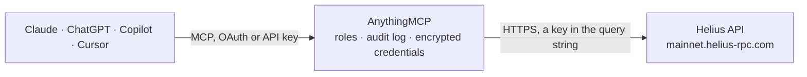

<!-- Generated by scripts/export-github-catalog.mjs in the anythingmcp-website repository. Do not edit by hand. -->

# Helius MCP connector

Solana blockchain data through Helius: SOL and token balances, NFTs and tokens of a wallet (DAS API), readable transaction history, single transactions, wallet identity and funding source. The AnythingMCP connector gives Claude, ChatGPT, Microsoft Copilot, Cursor and Gemini 14 MCP tools for Helius, all read-only.

**Category:** [Public Data](../data.md) · **Tools:** 14 · **Setup guide:** [anythingmcp.com](https://anythingmcp.com/guides/helius-to-mcp) · [Deutsch](https://anythingmcp.com/de/guides/helius-to-mcp) · [Italiano](https://anythingmcp.com/it/guides/helius-to-mcp) · [Español](https://anythingmcp.com/es/guides/helius-to-mcp) · [日本語](https://anythingmcp.com/ja/guides/helius-to-mcp) · [Русский](https://anythingmcp.com/ru/guides/helius-to-mcp) · [中文](https://anythingmcp.com/zh/guides/helius-to-mcp)

## Start without code

No installation and no terminal: AnythingMCP Cloud runs the Helius connector for you, operated by helpcode.ai in Frankfurt, Germany.

1. **Click the button above** and create an account or sign in. The Helius connector opens, ready to install.
2. **Paste the API key or token from your Helius account.** Every click is in the [step-by-step guide](https://anythingmcp.com/guides/helius-to-mcp).
3. **Click Install.** AnythingMCP shows the address of your MCP server.
4. **Add that address to your assistant:** [Claude](https://anythingmcp.com/guides/connect-helius-to-claude) · [ChatGPT](https://anythingmcp.com/guides/connect-helius-to-chatgpt) · [Microsoft Copilot](https://anythingmcp.com/guides/connect-helius-to-copilot) · [Cursor](https://anythingmcp.com/guides/connect-helius-to-cursor) · [Gemini CLI](https://anythingmcp.com/guides/connect-helius-to-gemini) · [Meta Muse](https://anythingmcp.com/guides/connect-helius-to-muse).
5. **Ask your first question**, for example: *What's the SOL balance (in SOL) for customer wallet 7Fh3yQ9zvX2s4LkP1b8a6MZc9TqR5nUwVxJd2EeF on latest slot?*

Prefer help with the setup? [Talk to us](https://anythingmcp.com/contact).

## How it works

- **The AI client** speaks MCP (Streamable HTTP) to AnythingMCP and only sees tool names, descriptions and results. It never gets the Helius credentials.
- **AnythingMCP** checks the client's role, builds the call from the tool definition, adds the credentials (a key in the query string), calls Helius, logs the call and returns the result.
- **Helius** sees an ordinary API client with the rights of the account the credentials belong to.

## Tools

| Tool | What it does | Access |
|---|---|---|
| [`helius_get_epoch_info`](#helius_get_epoch_info) | Get the current Solana epoch: epoch number, slot index and slots in the epoch, absolute slot, block height and transaction count. | read |
| [`helius_get_balance`](#helius_get_balance) | Get the native SOL balance of an account in lamports (value; 1 SOL = 1,000,000,000 lamports) with the slot it was read at. | read |
| [`helius_get_assets_by_owner`](#helius_get_assets_by_owner) | List the digital assets a wallet owns through the DAS API: NFTs, compressed NFTs and, with show_fungible, SPL and Token-2022 tokens with balance, decimals… | read |
| [`helius_get_asset`](#helius_get_asset) | Get one digital asset (NFT, compressed NFT or token) by its id (mint address) through the DAS API: interface, name, symbol, metadata and image links,… | read |
| [`helius_get_token_accounts`](#helius_get_token_accounts) | List SPL token accounts by owner or by mint through the DAS API: token account address, mint, owner, amount (raw, apply the mint decimals) and frozen state. | read |
| [`helius_get_signatures_for_address`](#helius_get_signatures_for_address) | List transaction signatures that touched an address, newest first: signature, slot, blockTime (Unix seconds), err (null on success) and memo. | read |
| [`helius_get_transaction`](#helius_get_transaction) | Get one confirmed transaction by signature with parsed instructions (jsonParsed): slot, blockTime, fee, status, account keys, pre and post SOL and token… | read |
| [`helius_get_address_transactions`](#helius_get_address_transactions) | Get the human-readable transaction history of an address (Enhanced Transactions): type (TRANSFER, SWAP, NFT_SALE...), source, description, fee, timestamp,… | read |
| [`helius_parse_transactions`](#helius_parse_transactions) | Turn up to 100 transaction signatures into human-readable transactions (Enhanced Transactions): type, source, description, fee, native and token transfers… | read |
| [`helius_get_wallet_balances`](#helius_get_wallet_balances) | Get the token balances of a wallet with USD values (Wallet API, beta): mint, symbol, balance, pricePerToken, usdValue and totalUsdValue for the page, sorted… | read |
| [`helius_get_wallet_history`](#helius_get_wallet_history) | Get the transaction history of a wallet with its balance changes per transaction (Wallet API, beta): signature, timestamp, fee and balanceChanges (mint,… | read |
| [`helius_get_wallet_transfers`](#helius_get_wallet_transfers) | List incoming and outgoing transfers of a wallet (Wallet API, beta): signature, timestamp, direction (in or out), counterparty, mint and amount. | read |
| [`helius_get_wallet_identity`](#helius_get_wallet_identity) | Identify a known wallet (Wallet API, beta): name and category such as a centralized exchange, protocol or institution. | read |
| [`helius_get_wallet_funded_by`](#helius_get_wallet_funded_by) | Find who first funded a wallet with SOL (Wallet API, beta): funder address, funderName and funderType (exchange or null), amount, timestamp and signature. | read |

## Tool reference

Every parameter as the AI client sees it in `tools/list`. Source: [`packages/backend/src/adapters/intl/helius.json`](../../../packages/backend/src/adapters/intl/helius.json).

### `helius_get_epoch_info`

Get the current Solana epoch: epoch number, slot index and slots in the epoch, absolute slot, block height and transaction count. Costs one RPC credit; use it to check the connection and to know the current slot.

**Access:** read · **Call:** `POST /`

No parameters.

### `helius_get_balance`

Get the native SOL balance of an account in lamports (value; 1 SOL = 1,000,000,000 lamports) with the slot it was read at.

**Access:** read · **Call:** `POST /`

| Parameter | Type | Required | Description |
|---|---|---|---|
| `address` | string | yes | Solana address (base58), e.g. 86xCnPeV69n6t3DnyGvkKobf9FdN2H9oiVDdaMpo2MMY. |

### `helius_get_assets_by_owner`

List the digital assets a wallet owns through the DAS API: NFTs, compressed NFTs and, with show_fungible, SPL and Token-2022 tokens with balance, decimals and price where known; show_native_balance adds the SOL balance. Paged: page starts at 1, limit up to 1000.

**Access:** read · **Call:** `POST /`

| Parameter | Type | Required | Description |
|---|---|---|---|
| `owner_address` | string | yes | Wallet address (base58). |
| `page` | integer | no | Page number, starting at 1. |
| `limit` | integer | no | Assets per page, up to 1000. |
| `show_fungible` | boolean | no | Include fungible tokens (SPL, Token-2022) with balances. |
| `show_native_balance` | boolean | no | Include the SOL balance of the wallet. |
| `show_zero_balance` | boolean | no | Include token accounts with a zero balance. |

### `helius_get_asset`

Get one digital asset (NFT, compressed NFT or token) by its id (mint address) through the DAS API: interface, name, symbol, metadata and image links, ownership, collection grouping, royalties, creators, supply and, for tokens, decimals and price info.

**Access:** read · **Call:** `POST /`

| Parameter | Type | Required | Description |
|---|---|---|---|
| `asset_id` | string | yes | Asset id: the mint address (base58). |

### `helius_get_token_accounts`

List SPL token accounts by owner or by mint through the DAS API: token account address, mint, owner, amount (raw, apply the mint decimals) and frozen state. Give owner, mint or both. Paged with page and limit.

**Access:** read · **Call:** `POST /`

| Parameter | Type | Required | Description |
|---|---|---|---|
| `owner` | string | no | Owner wallet address (base58). |
| `mint` | string | no | Token mint address (base58), e.g. EPjFWdd5AufqSSqeM2qN1xzybapC8G4wEGGkZwyTDt1v for USDC. |
| `page` | integer | no | Page number, starting at 1. |
| `limit` | integer | no | Accounts per page. |

### `helius_get_signatures_for_address`

List transaction signatures that touched an address, newest first: signature, slot, blockTime (Unix seconds), err (null on success) and memo. Default and maximum 1000; page with before = the last signature received. Fetch the details with helius_get_transaction.

**Access:** read · **Call:** `POST /`

| Parameter | Type | Required | Description |
|---|---|---|---|
| `address` | string | yes | Solana address (base58), e.g. 86xCnPeV69n6t3DnyGvkKobf9FdN2H9oiVDdaMpo2MMY. |
| `limit` | integer | no | Number of signatures, 1 to 1000. |
| `before` | string | no | Start before this signature (paging backwards). |
| `until` | string | no | Stop at this signature (fetch only newer ones). |

### `helius_get_transaction`

Get one confirmed transaction by signature with parsed instructions (jsonParsed): slot, blockTime, fee, status, account keys, pre and post SOL and token balances and log messages. Transaction versions legacy, 0 and 1 are accepted.

**Access:** read · **Call:** `POST /`

| Parameter | Type | Required | Description |
|---|---|---|---|
| `signature` | string | yes | Transaction signature (base58). |

### `helius_get_address_transactions`

Get the human-readable transaction history of an address (Enhanced Transactions): type (TRANSFER, SWAP, NFT_SALE...), source, description, fee, timestamp, nativeTransfers and tokenTransfers. Newest first, up to 100 per call; page with before_signature = the last signature received. token_accounts=balanceChanged also includes transfers that only touched the wallet token accounts.

**Access:** read · **Call:** `GET /v0/addresses/{address}/transactions`

| Parameter | Type | Required | Description |
|---|---|---|---|
| `address` | string | yes | Solana address (base58), e.g. 86xCnPeV69n6t3DnyGvkKobf9FdN2H9oiVDdaMpo2MMY. |
| `limit` | integer | no | Number of transactions, 1 to 100. |
| `before_signature` | string | no | Return transactions older than this signature (paging). |
| `after_signature` | string | no | Return transactions newer than this signature. |
| `type` | string | no | Only this transaction type, e.g. TRANSFER, SWAP, NFT_SALE. |
| `token_accounts` | `none` \| `balanceChanged` \| `all` | no | none (default), balanceChanged or all: include activity of token accounts the address owns. |
| `gte_time` | integer | no | Only transactions at or after this block time (Unix seconds). |
| `lte_time` | integer | no | Only transactions at or before this block time (Unix seconds). |

### `helius_parse_transactions`

Turn up to 100 transaction signatures into human-readable transactions (Enhanced Transactions): type, source, description, fee, native and token transfers and events. Reads only; nothing is sent to the chain.

**Access:** read · **Call:** `POST /v0/transactions`

| Parameter | Type | Required | Description |
|---|---|---|---|
| `signatures` | string[] | yes | Transaction signatures (base58), at most 100. |

### `helius_get_wallet_balances`

Get the token balances of a wallet with USD values (Wallet API, beta): mint, symbol, balance, pricePerToken, usdValue and totalUsdValue for the page, sorted by value. Prices are hourly estimates for about the top 10,000 tokens and may be null. 100 per page. Costs 100 credits.

**Access:** read · **Call:** `GET https://api.helius.xyz/v1/wallet/{address}/balances`

| Parameter | Type | Required | Description |
|---|---|---|---|
| `address` | string | yes | Wallet address (base58). |
| `page` | integer | no | Page number, starting at 1. |
| `limit` | integer | no | Tokens per page, 1 to 100. |
| `show_zero_balance` | boolean | no | Include tokens with a zero balance. |
| `show_nfts` | boolean | no | Also list NFTs (first page only, at most 100). |

### `helius_get_wallet_history`

Get the transaction history of a wallet with its balance changes per transaction (Wallet API, beta): signature, timestamp, fee and balanceChanges (mint, amount, decimals), newest first. Up to 100 per call; page with before = pagination cursor from the previous answer. Costs 100 credits.

**Access:** read · **Call:** `GET https://api.helius.xyz/v1/wallet/{address}/history`

| Parameter | Type | Required | Description |
|---|---|---|---|
| `address` | string | yes | Wallet address (base58). |
| `limit` | integer | no | Number of transactions, 1 to 100. |
| `before` | string | no | Pagination cursor from the previous answer. |
| `type` | string | no | Only this transaction type, e.g. SWAP, TRANSFER, NFT_SALE. |

### `helius_get_wallet_transfers`

List incoming and outgoing transfers of a wallet (Wallet API, beta): signature, timestamp, direction (in or out), counterparty, mint and amount. Default 50, up to 100 per call; page with cursor from the previous answer. Costs 100 credits.

**Access:** read · **Call:** `GET https://api.helius.xyz/v1/wallet/{address}/transfers`

| Parameter | Type | Required | Description |
|---|---|---|---|
| `address` | string | yes | Wallet address (base58). |
| `limit` | integer | no | Number of transfers, 1 to 100. |
| `cursor` | string | no | Pagination cursor from the previous answer. |

### `helius_get_wallet_identity`

Identify a known wallet (Wallet API, beta): name and category such as a centralized exchange, protocol or institution. Also accepts a .sol domain. Unknown wallets answer 404. Costs 100 credits.

**Access:** read · **Call:** `GET https://api.helius.xyz/v1/wallet/{address}/identity`

| Parameter | Type | Required | Description |
|---|---|---|---|
| `address` | string | yes | Wallet address (base58) or .sol domain, e.g. toly.sol. |

### `helius_get_wallet_funded_by`

Find who first funded a wallet with SOL (Wallet API, beta): funder address, funderName and funderType (exchange or null), amount, timestamp and signature. 404 means no funding transfer was found. Costs 100 credits.

**Access:** read · **Call:** `GET https://api.helius.xyz/v1/wallet/{address}/funded-by`

| Parameter | Type | Required | Description |
|---|---|---|---|
| `address` | string | yes | Wallet address (base58). |

## Run it yourself

AnythingMCP is open source (AGPL-3.0). [Run it with Docker](../../../README.md#run-it-yourself), open **Connectors → Store**, pick **Helius** and enter `HELIUS_API_KEY`, then add your MCP server URL to the AI client.

[← Public Data connectors](../data.md) · [All categories](../README.md)
