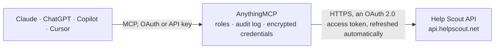

<!-- Generated by scripts/export-github-catalog.mjs in the anythingmcp-website repository. Do not edit by hand. -->

# Help Scout MCP connector

Drive Help Scout (shared inbox + helpdesk) from any AI agent: conversations, customers, mailboxes, tags, threads. 13 tools, OAuth2 client_credentials auth (auto-refreshed). The AnythingMCP connector gives Claude, ChatGPT, Microsoft Copilot, Cursor and Gemini 13 MCP tools for Help Scout: 8 read and 5 can change data.

**Category:** [Customer Support](../support.md) · **Tools:** 13 · **Setup guide:** [anythingmcp.com](https://anythingmcp.com/guides/help-scout-to-mcp) · [Deutsch](https://anythingmcp.com/de/guides/help-scout-to-mcp) · [Italiano](https://anythingmcp.com/it/guides/help-scout-to-mcp) · [Español](https://anythingmcp.com/es/guides/help-scout-to-mcp) · [日本語](https://anythingmcp.com/ja/guides/help-scout-to-mcp) · [Русский](https://anythingmcp.com/ru/guides/help-scout-to-mcp) · [中文](https://anythingmcp.com/zh/guides/help-scout-to-mcp)

## Start without code

No installation and no terminal: AnythingMCP Cloud runs the Help Scout connector for you, operated by helpcode.ai in Frankfurt, Germany.

1. **Click the button above** and create an account or sign in. The Help Scout connector opens, ready to install.
2. **Sign in with your Help Scout account** when AnythingMCP asks. The first time, an admin creates a small app in the Help Scout developer console. Every click is in the [step-by-step guide](https://anythingmcp.com/guides/help-scout-to-mcp).
3. **Click Install.** AnythingMCP shows the address of your MCP server.
4. **Add that address to your assistant:** [Claude](https://anythingmcp.com/guides/connect-help-scout-to-claude) · [ChatGPT](https://anythingmcp.com/guides/connect-help-scout-to-chatgpt) · [Microsoft Copilot](https://anythingmcp.com/guides/connect-help-scout-to-copilot) · [Cursor](https://anythingmcp.com/guides/connect-help-scout-to-cursor) · [Gemini CLI](https://anythingmcp.com/guides/connect-help-scout-to-gemini) · [Meta Muse](https://anythingmcp.com/guides/connect-help-scout-to-muse).
5. **Ask your first question**, for example: *Find the Help Scout conversation for invoice INV-2026-113 from customer Kallio Rakennus Oy in Billing mailbox*

Prefer help with the setup? [Talk to us](https://anythingmcp.com/contact).

## How it works

- **The AI client** speaks MCP (Streamable HTTP) to AnythingMCP and only sees tool names, descriptions and results. It never gets the Help Scout credentials.
- **AnythingMCP** checks the client's role, builds the call from the tool definition, adds the credentials (an OAuth 2.0 access token, refreshed automatically), calls Help Scout, logs the call and returns the result.
- **Help Scout** sees an ordinary API client with the rights of the account the credentials belong to.

## Tools

| Tool | What it does | Access |
|---|---|---|
| [`help_scout_list_mailboxes`](#help_scout_list_mailboxes) | List mailboxes (shared inboxes). | read |
| [`help_scout_list_conversations`](#help_scout_list_conversations) | List conversations with filters. | read |
| [`help_scout_get_conversation`](#help_scout_get_conversation) | Fetch a single conversation with full details. | read |
| [`help_scout_create_conversation`](#help_scout_create_conversation) | Create a new conversation (ticket). | write |
| [`help_scout_update_conversation_status`](#help_scout_update_conversation_status) | Change conversation status (close, reopen, snooze). | write |
| [`help_scout_add_reply`](#help_scout_add_reply) | Add a public reply (emails the customer) to a conversation. | write |
| [`help_scout_add_note`](#help_scout_add_note) | Add an internal note (not visible to customer). | write |
| [`help_scout_list_conversation_threads`](#help_scout_list_conversation_threads) | List all threads (replies, notes, status changes) in a conversation. | read |
| [`help_scout_list_customers`](#help_scout_list_customers) | List customers (people the business interacts with). | read |
| [`help_scout_get_customer`](#help_scout_get_customer) | Fetch a customer's full profile including emails[], phones[], chats[], social_profiles[], address. | read |
| [`help_scout_create_customer`](#help_scout_create_customer) | Create a customer. | write |
| [`help_scout_list_tags`](#help_scout_list_tags) | List tags on the account. | read |
| [`help_scout_list_users`](#help_scout_list_users) | List Help Scout agents. | read |

## Tool reference

Every parameter as the AI client sees it in `tools/list`. Source: [`packages/backend/src/adapters/intl/help-scout.json`](../../../packages/backend/src/adapters/intl/help-scout.json).

### `help_scout_list_mailboxes`

List mailboxes (shared inboxes). Each has id, name, slug, email, createdAt.

**Access:** read · **Call:** `GET /mailboxes`

| Parameter | Type | Required | Description |
|---|---|---|---|
| `page` | integer | no | Page (1-based). |
| `size` | integer | no | Per page (default 10, max 50). |

### `help_scout_list_conversations`

List conversations with filters.

**Access:** read · **Call:** `GET /conversations`

| Parameter | Type | Required | Description |
|---|---|---|---|
| `mailbox` | integer | no | Filter by mailbox ID. |
| `folder` | integer | no | Filter by folder ID (mailbox sub-folders). |
| `status` | string | no | active, pending, closed, spam, open, all. |
| `tag` | string | no | Comma-separated tag names. |
| `assigned_to` | integer | no | Assignee user ID. |
| `modifiedSince` | string | no | ISO 8601 — only conversations modified after. |
| `embed` | string | no | threads — include threads inline (saves N+1). |
| `query` | string | no | Search query (Help Scout supports advanced syntax like 'subject:foo' AND 'body:bar'). |
| `sortField` | string | no | createdAt, customerEmail, customerName, status, subject, modifiedAt, etc. |
| `sortOrder` | string | no | asc or desc. |
| `page` | integer | no | Page. |
| `size` | integer | no | Per page (max 50). |

### `help_scout_get_conversation`

Fetch a single conversation with full details. Pass embed=threads to also fetch the thread history.

**Access:** read · **Call:** `GET /conversations/{conversationId}`

| Parameter | Type | Required | Description |
|---|---|---|---|
| `conversationId` | integer | yes | Conversation ID. |
| `embed` | string | no | threads to include the conversation history. |

### `help_scout_create_conversation`

Create a new conversation (ticket). Required: subject + customer (id OR email) + mailboxId + status + type + threads (at least one initial thread).

**Access:** write · **Call:** `POST /conversations`

| Parameter | Type | Required | Description |
|---|---|---|---|
| `subject` | string | yes | Conversation subject. |
| `customer` | object | yes | {id?:N, email?:'a@b'} — at least one required. |
| `mailboxId` | integer | yes | Target mailbox ID. |
| `type` | string | yes | email, chat, phone. |
| `status` | string | yes | active, pending, closed. |
| `threads` | any[] | yes | Array of thread objects: [{type:'customer'\|'reply'\|'note', text:'...', customer?:{...}, user?:N}]. Must have at least 1. |
| `assignTo` | integer | no | User ID to assign. |
| `tags` | any[] | no | Tag name strings. |
| `fields` | any[] | no | Custom fields: [{id:N, value:'X'}]. |

### `help_scout_update_conversation_status`

Change conversation status (close, reopen, snooze). Uses JSON Patch semantics.

**Access:** write · **Call:** `PATCH /conversations/{conversationId}`

| Parameter | Type | Required | Description |
|---|---|---|---|
| `conversationId` | integer | yes | Conversation ID. |
| `op` | string | yes | replace. |
| `path` | string | yes | /status. |
| `value` | string | yes | active, pending, closed, spam. |

### `help_scout_add_reply`

Add a public reply (emails the customer) to a conversation.

**Access:** write · **Call:** `POST /conversations/{conversationId}/reply`

| Parameter | Type | Required | Description |
|---|---|---|---|
| `conversationId` | integer | yes | Conversation ID. |
| `text` | string | yes | Reply body (HTML supported). |
| `user` | integer | no | User ID sending the reply. |
| `cc` | any[] | no | CC email addresses. |
| `bcc` | any[] | no | BCC email addresses. |
| `attachments` | any[] | no | Attachment IDs (must upload first). |

### `help_scout_add_note`

Add an internal note (not visible to customer).

**Access:** write · **Call:** `POST /conversations/{conversationId}/notes`

| Parameter | Type | Required | Description |
|---|---|---|---|
| `conversationId` | integer | yes | Conversation ID. |
| `text` | string | yes | Note body. |
| `user` | integer | no | User ID. |

### `help_scout_list_conversation_threads`

List all threads (replies, notes, status changes) in a conversation.

**Access:** read · **Call:** `GET /conversations/{conversationId}/threads`

| Parameter | Type | Required | Description |
|---|---|---|---|
| `conversationId` | integer | yes | Conversation ID. |
| `page` | integer | no | Page. |

### `help_scout_list_customers`

List customers (people the business interacts with).

**Access:** read · **Call:** `GET /customers`

| Parameter | Type | Required | Description |
|---|---|---|---|
| `firstName` | string | no | Filter by first name. |
| `lastName` | string | no | Filter by last name. |
| `email` | string | no | Filter by email exact-match. |
| `modifiedSince` | string | no | ISO 8601. |
| `query` | string | no | Search query. |
| `page` | integer | no | Page. |
| `size` | integer | no | Per page (max 50). |

### `help_scout_get_customer`

Fetch a customer's full profile including emails[], phones[], chats[], social_profiles[], address.

**Access:** read · **Call:** `GET /customers/{customerId}`

| Parameter | Type | Required | Description |
|---|---|---|---|
| `customerId` | integer | yes | Customer ID. |

### `help_scout_create_customer`

Create a customer. Required: firstName or lastName.

**Access:** write · **Call:** `POST /customers`

| Parameter | Type | Required | Description |
|---|---|---|---|
| `firstName` | string | no | First name. |
| `lastName` | string | no | Last name. |
| `emails` | any[] | no | [{type:'work'\|'home'\|'other', value:'a@b'}]. |
| `phones` | any[] | no | [{type, value}]. |
| `address` | object | no | {city, country, lines:[], postalCode, state}. |
| `organization` | string | no | Company name. |
| `jobTitle` | string | no | Job title. |
| `background` | string | no | Notes about the customer. |

### `help_scout_list_tags`

List tags on the account.

**Access:** read · **Call:** `GET /tags`

| Parameter | Type | Required | Description |
|---|---|---|---|
| `page` | integer | no | Page. |
| `size` | integer | no | Per page. |

### `help_scout_list_users`

List Help Scout agents.

**Access:** read · **Call:** `GET /users`

| Parameter | Type | Required | Description |
|---|---|---|---|
| `email` | string | no | Filter by email. |
| `mailbox` | integer | no | Filter to users in this mailbox. |
| `page` | integer | no | Page. |
| `size` | integer | no | Per page. |

## Run it yourself

AnythingMCP is open source (AGPL-3.0). [Run it with Docker](../../../README.md#run-it-yourself), open **Connectors → Store**, pick **Help Scout** and enter `HELPSCOUT_CLIENT_ID`, `HELPSCOUT_CLIENT_SECRET`, then add your MCP server URL to the AI client.

[← Customer Support connectors](../support.md) · [All categories](../README.md)
