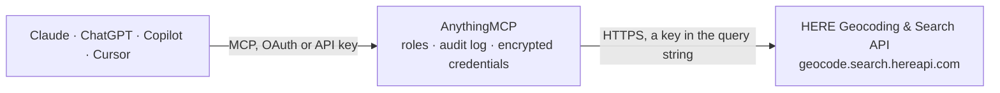

<!-- Generated by scripts/export-github-catalog.mjs in the anythingmcp-website repository. Do not edit by hand. -->

# HERE Geocoding & Search MCP connector

Geocode addresses, reverse-geocode coordinates, autocomplete addresses as-you-type, and search places via the HERE Location Services API. The AnythingMCP connector gives Claude, ChatGPT, Microsoft Copilot, Cursor and Gemini 5 MCP tools for HERE Geocoding & Search, all read-only.

**Category:** [Maps](../maps.md) · **Tools:** 5 · **Setup guide:** [anythingmcp.com](https://anythingmcp.com/guides/here-geocoding-to-mcp) · [Deutsch](https://anythingmcp.com/de/guides/here-geocoding-to-mcp) · [Italiano](https://anythingmcp.com/it/guides/here-geocoding-to-mcp) · [Español](https://anythingmcp.com/es/guides/here-geocoding-to-mcp) · [日本語](https://anythingmcp.com/ja/guides/here-geocoding-to-mcp) · [Русский](https://anythingmcp.com/ru/guides/here-geocoding-to-mcp) · [中文](https://anythingmcp.com/zh/guides/here-geocoding-to-mcp)

## Start without code

No installation and no terminal: AnythingMCP Cloud runs the HERE Geocoding & Search connector for you, operated by helpcode.ai in Frankfurt, Germany.

1. **Click the button above** and create an account or sign in. The HERE Geocoding & Search connector opens, ready to install.
2. **Paste the API key or token from your HERE Geocoding & Search account.** Every click is in the [step-by-step guide](https://anythingmcp.com/guides/here-geocoding-to-mcp).
3. **Click Install.** AnythingMCP shows the address of your MCP server.
4. **Add that address to your assistant:** [Claude](https://anythingmcp.com/guides/connect-here-geocoding-to-claude) · [ChatGPT](https://anythingmcp.com/guides/connect-here-geocoding-to-chatgpt) · [Microsoft Copilot](https://anythingmcp.com/guides/connect-here-geocoding-to-copilot) · [Cursor](https://anythingmcp.com/guides/connect-here-geocoding-to-cursor) · [Gemini CLI](https://anythingmcp.com/guides/connect-here-geocoding-to-gemini) · [Meta Muse](https://anythingmcp.com/guides/connect-here-geocoding-to-muse).
5. **Ask your first question**, for example: *Geocode the delivery address for customer 'Müller Handels GmbH', Berlin, Karl-Liebknecht-Str. 45*

Prefer help with the setup? [Talk to us](https://anythingmcp.com/contact).

## How it works

- **The AI client** speaks MCP (Streamable HTTP) to AnythingMCP and only sees tool names, descriptions and results. It never gets the HERE Geocoding & Search credentials.
- **AnythingMCP** checks the client's role, builds the call from the tool definition, adds the credentials (a key in the query string), calls HERE Geocoding & Search, logs the call and returns the result.
- **HERE Geocoding & Search** sees an ordinary API client with the rights of the account the credentials belong to.

## Tools

| Tool | What it does | Access |
|---|---|---|
| [`here_geocode`](#here_geocode) | Forward-geocode an address to coordinates. | read |
| [`here_reverse_geocode`](#here_reverse_geocode) | Reverse-geocode coordinates to a human-readable address. | read |
| [`here_autocomplete`](#here_autocomplete) | Fast address-only autocomplete for as-you-type address fields. | read |
| [`here_autosuggest`](#here_autosuggest) | Rich autosuggest — returns addresses AND places/POIs (shops, chains, landmarks). | read |
| [`here_discover`](#here_discover) | Discover places, POIs, and businesses near a location or within an area — filterable by category (e.g. 'building-material' Baustoffhandel), chain, or brand. | read |

## Tool reference

Every parameter as the AI client sees it in `tools/list`. Source: [`packages/backend/src/adapters/de/here-geocoding.json`](../../../packages/backend/src/adapters/de/here-geocoding.json).

### `here_geocode`

Forward-geocode an address to coordinates. Returns matches with position, label, address components (country, state, city, postalCode, street, houseNumber), result type, and match quality score.

**Access:** read · **Call:** `GET /geocode`

| Parameter | Type | Required | Description |
|---|---|---|---|
| `q` | string | no | Free-form address query (e.g. 'Kaiser-Joseph-Straße 1, 79098 Freiburg'). |
| `qq` | string | no | Qualified query — structured address as key=value;… pairs (e.g. 'city=Freiburg;street=Kaiser-Joseph-Straße;houseNumber=1'). Use for disambiguation. |
| `in` | string | no | Area filter (e.g. 'countryCode:DEU' to scope to Germany, or 'bbox:w,s,e,n'). |
| `limit` | number | no | Max results (default: 20, max: 100). |
| `lang` | string | no | Response language BCP-47 tag (e.g. 'de', 'en-US'). |

### `here_reverse_geocode`

Reverse-geocode coordinates to a human-readable address. Returns the nearest address with full components.

**Access:** read · **Call:** `GET /revgeocode`

| Parameter | Type | Required | Description |
|---|---|---|---|
| `at` | string | yes | Coordinates as 'lat,lng' (e.g. '47.9959,7.8522' for Freiburg Münster). |
| `limit` | number | no | Max results (default: 1). |
| `lang` | string | no | Response language. |

### `here_autocomplete`

Fast address-only autocomplete for as-you-type address fields. Returns short labelled snippets. Use when you only need addresses and want the lowest latency.

**Access:** read · **Call:** `GET /autocomplete`

| Parameter | Type | Required | Description |
|---|---|---|---|
| `q` | string | yes | Partial address query. |
| `at` | string | no | Optional anchor coordinates 'lat,lng' — biases results near the given point. |
| `in` | string | no | Area filter like 'countryCode:DEU'. |
| `limit` | number | no | Max suggestions (default: 5, max: 20). |
| `lang` | string | no | Response language. |

### `here_autosuggest`

Rich autosuggest — returns addresses AND places/POIs (shops, chains, landmarks). Ideal for search bars where users might type either an address or a business name.

**Access:** read · **Call:** `GET /autosuggest`

| Parameter | Type | Required | Description |
|---|---|---|---|
| `q` | string | yes | Partial query (address, POI name, category). |
| `at` | string | yes | Required for place results — anchor coordinates 'lat,lng'. |
| `in` | string | no | Area filter. |
| `limit` | number | no | Max suggestions. |
| `lang` | string | no | Response language. |

### `here_discover`

Discover places, POIs, and businesses near a location or within an area — filterable by category (e.g. 'building-material' Baustoffhandel), chain, or brand. Returns each match with position, contact info, opening hours.

**Access:** read · **Call:** `GET /discover`

| Parameter | Type | Required | Description |
|---|---|---|---|
| `q` | string | yes | Search term (place name, category, brand). |
| `at` | string | no | Anchor coordinates 'lat,lng' — required if `in` is not provided. |
| `in` | string | no | Area filter (bbox or circle) — required if `at` is not provided. |
| `limit` | number | no | Max results (default 20). |
| `lang` | string | no | Response language. |

## Run it yourself

AnythingMCP is open source (AGPL-3.0). [Run it with Docker](../../../README.md#run-it-yourself), open **Connectors → Store**, pick **HERE Geocoding & Search** and enter `HERE_API_KEY`, then add your MCP server URL to the AI client.

[← Maps connectors](../maps.md) · [All categories](../README.md)
