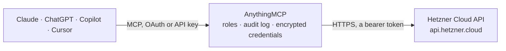

<!-- Generated by scripts/export-github-catalog.mjs in the anythingmcp-website repository. Do not edit by hand. -->

# Hetzner Cloud MCP connector

Hetzner Cloud: servers with metrics and actions, images and snapshots, volumes, networks, firewalls, load balancers, IPs, SSH keys, certificates, DNS zones, server types and pricing. The AnythingMCP connector gives Claude, ChatGPT, Microsoft Copilot, Cursor and Gemini 31 MCP tools for Hetzner Cloud: 26 read and 5 can change data.

**Category:** [Infrastructure](../infrastructure.md) · **Tools:** 31 · **Setup guide:** [anythingmcp.com](https://anythingmcp.com/guides/hetzner-cloud-to-mcp) · [Deutsch](https://anythingmcp.com/de/guides/hetzner-cloud-to-mcp) · [Italiano](https://anythingmcp.com/it/guides/hetzner-cloud-to-mcp) · [Español](https://anythingmcp.com/es/guides/hetzner-cloud-to-mcp) · [日本語](https://anythingmcp.com/ja/guides/hetzner-cloud-to-mcp) · [Русский](https://anythingmcp.com/ru/guides/hetzner-cloud-to-mcp) · [中文](https://anythingmcp.com/zh/guides/hetzner-cloud-to-mcp)

## Start without code

No installation and no terminal: AnythingMCP Cloud runs the Hetzner Cloud connector for you, operated by helpcode.ai in Frankfurt, Germany.

1. **Click the button above** and create an account or sign in. The Hetzner Cloud connector opens, ready to install.
2. **Paste the API key or token from your Hetzner Cloud account.** Every click is in the [step-by-step guide](https://anythingmcp.com/guides/hetzner-cloud-to-mcp).
3. **Click Install.** AnythingMCP shows the address of your MCP server.
4. **Add that address to your assistant:** [Claude](https://anythingmcp.com/guides/connect-hetzner-cloud-to-claude) · [ChatGPT](https://anythingmcp.com/guides/connect-hetzner-cloud-to-chatgpt) · [Microsoft Copilot](https://anythingmcp.com/guides/connect-hetzner-cloud-to-copilot) · [Cursor](https://anythingmcp.com/guides/connect-hetzner-cloud-to-cursor) · [Gemini CLI](https://anythingmcp.com/guides/connect-hetzner-cloud-to-gemini) · [Meta Muse](https://anythingmcp.com/guides/connect-hetzner-cloud-to-muse).
5. **Ask your first question**, for example: *What is the status, public IPv4 and hourly type of server web-prod-03?*

Prefer help with the setup? [Talk to us](https://anythingmcp.com/contact).

## How it works

- **The AI client** speaks MCP (Streamable HTTP) to AnythingMCP and only sees tool names, descriptions and results. It never gets the Hetzner Cloud credentials.
- **AnythingMCP** checks the client's role, builds the call from the tool definition, adds the credentials (a bearer token), calls Hetzner Cloud, logs the call and returns the result.
- **Hetzner Cloud** sees an ordinary API client with the rights of the account the credentials belong to.

## Tools

| Tool | What it does | Access |
|---|---|---|
| [`hetzner_cloud_list_servers`](#hetzner_cloud_list_servers) | List the servers of the project with status, server type, location, public and private IPs, image, labels, protection and traffic. | read |
| [`hetzner_cloud_get_server`](#hetzner_cloud_get_server) | Get one server with status, type (cores, memory, disk), datacenter, public IPv4/IPv6, private networks, attached volumes, image, backup window, labels and… | read |
| [`hetzner_cloud_get_server_metrics`](#hetzner_cloud_get_server_metrics) | Get time series for one server: cpu usage, disk IOPS and bandwidth, or network packets and bandwidth, between two RFC 3339 times. | read |
| [`hetzner_cloud_list_server_actions`](#hetzner_cloud_list_server_actions) | List the actions run on one server (power, rebuild, backup, attach, ...) with command, status, progress, start and finish times and errors. | read |
| [`hetzner_cloud_get_action`](#hetzner_cloud_get_action) | Get one action by id: command, status (running, success, error), progress in percent, affected resources and the error if it failed. | read |
| [`hetzner_cloud_list_images`](#hetzner_cloud_list_images) | List images: system images (OS), app images, snapshots and backups, with type, OS flavor and version, architecture, size and the server it was created from. | read |
| [`hetzner_cloud_get_image`](#hetzner_cloud_get_image) | Get one image: type, status, description, OS flavor and version, architecture, disk size, creation source, protection, labels and deprecation date. | read |
| [`hetzner_cloud_list_volumes`](#hetzner_cloud_list_volumes) | List block storage volumes with size in GB, location, the server they are attached to, Linux device path, format, protection and labels. | read |
| [`hetzner_cloud_get_volume`](#hetzner_cloud_get_volume) | Get one volume: size, location, attached server, Linux device path, filesystem format, protection, labels and creation time. | read |
| [`hetzner_cloud_list_networks`](#hetzner_cloud_list_networks) | List private networks with IP range, subnets, routes, attached servers and load balancers, and protection. | read |
| [`hetzner_cloud_get_network`](#hetzner_cloud_get_network) | Get one private network with its IP range, subnets (zone, type, gateway), routes, attached servers and load balancers. | read |
| [`hetzner_cloud_list_firewalls`](#hetzner_cloud_list_firewalls) | List firewalls with their inbound and outbound rules (protocol, port, source and destination IPs) and the servers or label selectors they apply to. | read |
| [`hetzner_cloud_get_firewall`](#hetzner_cloud_get_firewall) | Get one firewall with every rule and the resources it is applied to. | read |
| [`hetzner_cloud_list_load_balancers`](#hetzner_cloud_list_load_balancers) | List load balancers with type, location, public and private IPs, algorithm, services (ports, protocol, health check) and targets. | read |
| [`hetzner_cloud_get_load_balancer`](#hetzner_cloud_get_load_balancer) | Get one load balancer with services, health checks, targets and their health status, algorithm, network attachments and included traffic. | read |
| [`hetzner_cloud_get_load_balancer_metrics`](#hetzner_cloud_get_load_balancer_metrics) | Get time series for one load balancer: open connections, connections per second, requests per second or bandwidth, between two RFC 3339 times. | read |
| [`hetzner_cloud_list_primary_ips`](#hetzner_cloud_list_primary_ips) | List primary IPs (the main public IPv4/IPv6 of servers) with address, type, datacenter, assignee, auto-delete flag and reverse DNS. | read |
| [`hetzner_cloud_list_floating_ips`](#hetzner_cloud_list_floating_ips) | List floating IPs with address, type, home location, the server they point to, reverse DNS entries and protection. | read |
| [`hetzner_cloud_list_ssh_keys`](#hetzner_cloud_list_ssh_keys) | List the SSH public keys stored in the project with name, fingerprint and labels. | read |
| [`hetzner_cloud_list_certificates`](#hetzner_cloud_list_certificates) | List TLS certificates for load balancers (uploaded or managed by Let's Encrypt) with domains, validity dates and managed status. | read |
| [`hetzner_cloud_list_server_types`](#hetzner_cloud_list_server_types) | List server types (for example cx22, cpx31, cax21) with cores, CPU type, architecture, memory, disk, included traffic and prices per location. | read |
| [`hetzner_cloud_list_locations`](#hetzner_cloud_list_locations) | List the locations (fsn1, nbg1, hel1, ash, hil, sin) with city, country, network zone and coordinates. | read |
| [`hetzner_cloud_list_datacenters`](#hetzner_cloud_list_datacenters) | List datacenters with their location and which server types are supported and currently available there. | read |
| [`hetzner_cloud_get_pricing`](#hetzner_cloud_get_pricing) | Get the full price list of the project: per server type and location (hourly and monthly, net and gross), volumes per GB, primary and floating IPs, load… | read |
| [`hetzner_cloud_list_zones`](#hetzner_cloud_list_zones) | List DNS zones hosted in Hetzner DNS (Cloud API) with name, mode (primary or secondary), TTL, record count, nameservers and protection. | read |
| [`hetzner_cloud_list_zone_rrsets`](#hetzner_cloud_list_zone_rrsets) | List the DNS record sets of one zone (A, AAAA, CNAME, MX, TXT, ...) with name, type, TTL and values. | read |
| [`hetzner_cloud_power_on_server`](#hetzner_cloud_power_on_server) | Start a server that is off. | write |
| [`hetzner_cloud_power_off_server`](#hetzner_cloud_power_off_server) | Cut the power of a server immediately, like pulling the plug. | write |
| [`hetzner_cloud_shutdown_server`](#hetzner_cloud_shutdown_server) | Ask the guest operating system to shut down gracefully (ACPI). | write |
| [`hetzner_cloud_reboot_server`](#hetzner_cloud_reboot_server) | Ask the guest operating system to reboot gracefully (ACPI soft reboot). | write |
| [`hetzner_cloud_reset_server`](#hetzner_cloud_reset_server) | Hard-reset a server, like pressing the reset button. | write |

## Tool reference

Every parameter as the AI client sees it in `tools/list`. Source: [`packages/backend/src/adapters/intl/hetzner-cloud.json`](../../../packages/backend/src/adapters/intl/hetzner-cloud.json).

### `hetzner_cloud_list_servers`

List the servers of the project with status, server type, location, public and private IPs, image, labels, protection and traffic. Filter by name, label or status. Start here.

**Access:** read · **Call:** `GET /servers`

| Parameter | Type | Required | Description |
|---|---|---|---|
| `name` | string | no | Return only the resource with exactly this name. |
| `label_selector` | string | no | Label selector, for example env=prod or env in (prod,staging) or !temporary. |
| `sort` | string | no | Sort order: id, name or created, with :asc or :desc, for example created:desc. |
| `status` | `running` \| `initializing` \| `starting` \| `stopping` \| `off` \| `deleting` \| `migrating` \| `rebuilding` \| `unknown` | no | Only servers in this status. |
| `page` | integer | no | Page number, starting at 1. |
| `per_page` | integer | no | Entries per page, default 25, at most 50. |

### `hetzner_cloud_get_server`

Get one server with status, type (cores, memory, disk), datacenter, public IPv4/IPv6, private networks, attached volumes, image, backup window, labels and traffic usage.

**Access:** read · **Call:** `GET /servers/{id}`

| Parameter | Type | Required | Description |
|---|---|---|---|
| `id` | integer | yes | Server id from hetzner_cloud_list_servers. |

### `hetzner_cloud_get_server_metrics`

Get time series for one server: cpu usage, disk IOPS and bandwidth, or network packets and bandwidth, between two RFC 3339 times. Use it to check load before resizing.

**Access:** read · **Call:** `GET /servers/{id}/metrics`

| Parameter | Type | Required | Description |
|---|---|---|---|
| `id` | integer | yes | Server id. |
| `type` | string | yes | Metric family: cpu, disk or network. Several can be joined with a comma. |
| `start` | string | yes | Start time, RFC 3339, for example 2026-10-05T00:00:00Z. |
| `end` | string | yes | End time, RFC 3339. |
| `step` | string | no | Resolution in seconds, for example 300. Default chosen by the API to return about 200 points. |

### `hetzner_cloud_list_server_actions`

List the actions run on one server (power, rebuild, backup, attach, ...) with command, status, progress, start and finish times and errors. Use it to see what changed on a server.

**Access:** read · **Call:** `GET /servers/{id}/actions`

| Parameter | Type | Required | Description |
|---|---|---|---|
| `id` | integer | yes | Server id. |
| `status` | `running` \| `success` \| `error` | no | Only actions in this status. |
| `sort` | string | no | Sort: id, command, status, started or finished, with :asc or :desc. |
| `page` | integer | no | Page number, starting at 1. |
| `per_page` | integer | no | Entries per page, default 25, at most 50. |

### `hetzner_cloud_get_action`

Get one action by id: command, status (running, success, error), progress in percent, affected resources and the error if it failed. Poll it after a power action.

**Access:** read · **Call:** `GET /actions/{id}`

| Parameter | Type | Required | Description |
|---|---|---|---|
| `id` | integer | yes | Action id from a write tool's answer or an action list. |

### `hetzner_cloud_list_images`

List images: system images (OS), app images, snapshots and backups, with type, OS flavor and version, architecture, size and the server it was created from.

**Access:** read · **Call:** `GET /images`

| Parameter | Type | Required | Description |
|---|---|---|---|
| `name` | string | no | Return only the resource with exactly this name. |
| `label_selector` | string | no | Label selector, for example env=prod or env in (prod,staging) or !temporary. |
| `sort` | string | no | Sort order: id, name or created, with :asc or :desc, for example created:desc. |
| `type` | `system` \| `app` \| `snapshot` \| `backup` | no | Only images of this type. |
| `status` | `available` \| `creating` \| `unavailable` | no | Only images in this status. |
| `architecture` | `x86` \| `arm` | no | Only images for this CPU architecture. |
| `include_deprecated` | boolean | no | Include deprecated system images. |
| `bound_to` | integer | no | Only backups of this server id. |
| `page` | integer | no | Page number, starting at 1. |
| `per_page` | integer | no | Entries per page, default 25, at most 50. |

### `hetzner_cloud_get_image`

Get one image: type, status, description, OS flavor and version, architecture, disk size, creation source, protection, labels and deprecation date.

**Access:** read · **Call:** `GET /images/{id}`

| Parameter | Type | Required | Description |
|---|---|---|---|
| `id` | integer | yes | Image id from hetzner_cloud_list_images. |

### `hetzner_cloud_list_volumes`

List block storage volumes with size in GB, location, the server they are attached to, Linux device path, format, protection and labels.

**Access:** read · **Call:** `GET /volumes`

| Parameter | Type | Required | Description |
|---|---|---|---|
| `name` | string | no | Return only the resource with exactly this name. |
| `label_selector` | string | no | Label selector, for example env=prod or env in (prod,staging) or !temporary. |
| `sort` | string | no | Sort order: id, name or created, with :asc or :desc, for example created:desc. |
| `status` | `available` \| `creating` | no | Only volumes in this status. |
| `page` | integer | no | Page number, starting at 1. |
| `per_page` | integer | no | Entries per page, default 25, at most 50. |

### `hetzner_cloud_get_volume`

Get one volume: size, location, attached server, Linux device path, filesystem format, protection, labels and creation time.

**Access:** read · **Call:** `GET /volumes/{id}`

| Parameter | Type | Required | Description |
|---|---|---|---|
| `id` | integer | yes | Volume id from hetzner_cloud_list_volumes. |

### `hetzner_cloud_list_networks`

List private networks with IP range, subnets, routes, attached servers and load balancers, and protection. Use it to understand how servers talk to each other.

**Access:** read · **Call:** `GET /networks`

| Parameter | Type | Required | Description |
|---|---|---|---|
| `name` | string | no | Return only the resource with exactly this name. |
| `label_selector` | string | no | Label selector, for example env=prod or env in (prod,staging) or !temporary. |
| `sort` | string | no | Sort order: id, name or created, with :asc or :desc, for example created:desc. |
| `page` | integer | no | Page number, starting at 1. |
| `per_page` | integer | no | Entries per page, default 25, at most 50. |

### `hetzner_cloud_get_network`

Get one private network with its IP range, subnets (zone, type, gateway), routes, attached servers and load balancers.

**Access:** read · **Call:** `GET /networks/{id}`

| Parameter | Type | Required | Description |
|---|---|---|---|
| `id` | integer | yes | Network id from hetzner_cloud_list_networks. |

### `hetzner_cloud_list_firewalls`

List firewalls with their inbound and outbound rules (protocol, port, source and destination IPs) and the servers or label selectors they apply to.

**Access:** read · **Call:** `GET /firewalls`

| Parameter | Type | Required | Description |
|---|---|---|---|
| `name` | string | no | Return only the resource with exactly this name. |
| `label_selector` | string | no | Label selector, for example env=prod or env in (prod,staging) or !temporary. |
| `sort` | string | no | Sort order: id, name or created, with :asc or :desc, for example created:desc. |
| `page` | integer | no | Page number, starting at 1. |
| `per_page` | integer | no | Entries per page, default 25, at most 50. |

### `hetzner_cloud_get_firewall`

Get one firewall with every rule and the resources it is applied to. Use it to answer why a port is or is not reachable.

**Access:** read · **Call:** `GET /firewalls/{id}`

| Parameter | Type | Required | Description |
|---|---|---|---|
| `id` | integer | yes | Firewall id from hetzner_cloud_list_firewalls. |

### `hetzner_cloud_list_load_balancers`

List load balancers with type, location, public and private IPs, algorithm, services (ports, protocol, health check) and targets.

**Access:** read · **Call:** `GET /load_balancers`

| Parameter | Type | Required | Description |
|---|---|---|---|
| `name` | string | no | Return only the resource with exactly this name. |
| `label_selector` | string | no | Label selector, for example env=prod or env in (prod,staging) or !temporary. |
| `sort` | string | no | Sort order: id, name or created, with :asc or :desc, for example created:desc. |
| `page` | integer | no | Page number, starting at 1. |
| `per_page` | integer | no | Entries per page, default 25, at most 50. |

### `hetzner_cloud_get_load_balancer`

Get one load balancer with services, health checks, targets and their health status, algorithm, network attachments and included traffic.

**Access:** read · **Call:** `GET /load_balancers/{id}`

| Parameter | Type | Required | Description |
|---|---|---|---|
| `id` | integer | yes | Load balancer id from hetzner_cloud_list_load_balancers. |

### `hetzner_cloud_get_load_balancer_metrics`

Get time series for one load balancer: open connections, connections per second, requests per second or bandwidth, between two RFC 3339 times.

**Access:** read · **Call:** `GET /load_balancers/{id}/metrics`

| Parameter | Type | Required | Description |
|---|---|---|---|
| `id` | integer | yes | Load balancer id. |
| `type` | string | yes | Metric: open_connections, connections_per_second, requests_per_second or bandwidth. Several can be joined with a comma. |
| `start` | string | yes | Start time, RFC 3339. |
| `end` | string | yes | End time, RFC 3339. |
| `step` | string | no | Resolution in seconds. |

### `hetzner_cloud_list_primary_ips`

List primary IPs (the main public IPv4/IPv6 of servers) with address, type, datacenter, assignee, auto-delete flag and reverse DNS.

**Access:** read · **Call:** `GET /primary_ips`

| Parameter | Type | Required | Description |
|---|---|---|---|
| `name` | string | no | Return only the resource with exactly this name. |
| `label_selector` | string | no | Label selector, for example env=prod or env in (prod,staging) or !temporary. |
| `sort` | string | no | Sort order: id, name or created, with :asc or :desc, for example created:desc. |
| `ip` | string | no | Return only the primary IP with this address. |
| `page` | integer | no | Page number, starting at 1. |
| `per_page` | integer | no | Entries per page, default 25, at most 50. |

### `hetzner_cloud_list_floating_ips`

List floating IPs with address, type, home location, the server they point to, reverse DNS entries and protection.

**Access:** read · **Call:** `GET /floating_ips`

| Parameter | Type | Required | Description |
|---|---|---|---|
| `name` | string | no | Return only the resource with exactly this name. |
| `label_selector` | string | no | Label selector, for example env=prod or env in (prod,staging) or !temporary. |
| `sort` | string | no | Sort order: id, name or created, with :asc or :desc, for example created:desc. |
| `page` | integer | no | Page number, starting at 1. |
| `per_page` | integer | no | Entries per page, default 25, at most 50. |

### `hetzner_cloud_list_ssh_keys`

List the SSH public keys stored in the project with name, fingerprint and labels. They are injected into servers at creation.

**Access:** read · **Call:** `GET /ssh_keys`

| Parameter | Type | Required | Description |
|---|---|---|---|
| `name` | string | no | Return only the resource with exactly this name. |
| `label_selector` | string | no | Label selector, for example env=prod or env in (prod,staging) or !temporary. |
| `sort` | string | no | Sort order: id, name or created, with :asc or :desc, for example created:desc. |
| `fingerprint` | string | no | Return only the key with this MD5 fingerprint. |
| `page` | integer | no | Page number, starting at 1. |
| `per_page` | integer | no | Entries per page, default 25, at most 50. |

### `hetzner_cloud_list_certificates`

List TLS certificates for load balancers (uploaded or managed by Let's Encrypt) with domains, validity dates and managed status.

**Access:** read · **Call:** `GET /certificates`

| Parameter | Type | Required | Description |
|---|---|---|---|
| `name` | string | no | Return only the resource with exactly this name. |
| `label_selector` | string | no | Label selector, for example env=prod or env in (prod,staging) or !temporary. |
| `sort` | string | no | Sort order: id, name or created, with :asc or :desc, for example created:desc. |
| `type` | `uploaded` \| `managed` | no | Only certificates of this type. |
| `page` | integer | no | Page number, starting at 1. |
| `per_page` | integer | no | Entries per page, default 25, at most 50. |

### `hetzner_cloud_list_server_types`

List server types (for example cx22, cpx31, cax21) with cores, CPU type, architecture, memory, disk, included traffic and prices per location. Use it before resizing or pricing.

**Access:** read · **Call:** `GET /server_types`

| Parameter | Type | Required | Description |
|---|---|---|---|
| `name` | string | no | Return only the resource with exactly this name. |
| `page` | integer | no | Page number, starting at 1. |
| `per_page` | integer | no | Entries per page, default 25, at most 50. |

### `hetzner_cloud_list_locations`

List the locations (fsn1, nbg1, hel1, ash, hil, sin) with city, country, network zone and coordinates.

**Access:** read · **Call:** `GET /locations`

| Parameter | Type | Required | Description |
|---|---|---|---|
| `name` | string | no | Return only the resource with exactly this name. |
| `sort` | string | no | Sort order: id, name or created, with :asc or :desc, for example created:desc. |
| `page` | integer | no | Page number, starting at 1. |
| `per_page` | integer | no | Entries per page, default 25, at most 50. |

### `hetzner_cloud_list_datacenters`

List datacenters with their location and which server types are supported and currently available there.

**Access:** read · **Call:** `GET /datacenters`

| Parameter | Type | Required | Description |
|---|---|---|---|
| `name` | string | no | Return only the resource with exactly this name. |
| `sort` | string | no | Sort order: id, name or created, with :asc or :desc, for example created:desc. |
| `page` | integer | no | Page number, starting at 1. |
| `per_page` | integer | no | Entries per page, default 25, at most 50. |

### `hetzner_cloud_get_pricing`

Get the full price list of the project: per server type and location (hourly and monthly, net and gross), volumes per GB, primary and floating IPs, load balancers, traffic and backups.

**Access:** read · **Call:** `GET /pricing`

No parameters.

### `hetzner_cloud_list_zones`

List DNS zones hosted in Hetzner DNS (Cloud API) with name, mode (primary or secondary), TTL, record count, nameservers and protection.

**Access:** read · **Call:** `GET /zones`

| Parameter | Type | Required | Description |
|---|---|---|---|
| `name` | string | no | Return only the resource with exactly this name. |
| `label_selector` | string | no | Label selector, for example env=prod or env in (prod,staging) or !temporary. |
| `sort` | string | no | Sort order: id, name or created, with :asc or :desc, for example created:desc. |
| `mode` | `primary` \| `secondary` | no | Only zones in this mode. |
| `page` | integer | no | Page number, starting at 1. |
| `per_page` | integer | no | Entries per page, default 25, at most 50. |

### `hetzner_cloud_list_zone_rrsets`

List the DNS record sets of one zone (A, AAAA, CNAME, MX, TXT, ...) with name, type, TTL and values. Filter by name or type.

**Access:** read · **Call:** `GET /zones/{zone}/rrsets`

| Parameter | Type | Required | Description |
|---|---|---|---|
| `zone` | string | yes | Zone id or name, for example example.com. |
| `name` | string | no | Only record sets with this name, for example www or @. |
| `type` | string | no | Only record sets of this type, for example A, MX or TXT. |
| `page` | integer | no | Page number, starting at 1. |
| `per_page` | integer | no | Entries per page, default 25, at most 50. |

### `hetzner_cloud_power_on_server`

Start a server that is off. Returns an action to follow with hetzner_cloud_get_action. Billing continues whether the server is on or off.

**Access:** write · **Call:** `POST /servers/{id}/actions/poweron`

| Parameter | Type | Required | Description |
|---|---|---|---|
| `id` | integer | yes | Server id from hetzner_cloud_list_servers. |

### `hetzner_cloud_power_off_server`

Cut the power of a server immediately, like pulling the plug. Unsaved data in the guest can be lost; prefer hetzner_cloud_shutdown_server. Returns an action.

**Access:** write · **Call:** `POST /servers/{id}/actions/poweroff`

| Parameter | Type | Required | Description |
|---|---|---|---|
| `id` | integer | yes | Server id from hetzner_cloud_list_servers. |

### `hetzner_cloud_shutdown_server`

Ask the guest operating system to shut down gracefully (ACPI). The server may stay on if the OS ignores the request. Returns an action.

**Access:** write · **Call:** `POST /servers/{id}/actions/shutdown`

| Parameter | Type | Required | Description |
|---|---|---|---|
| `id` | integer | yes | Server id from hetzner_cloud_list_servers. |

### `hetzner_cloud_reboot_server`

Ask the guest operating system to reboot gracefully (ACPI soft reboot). Running services are interrupted while it restarts. Returns an action.

**Access:** write · **Call:** `POST /servers/{id}/actions/reboot`

| Parameter | Type | Required | Description |
|---|---|---|---|
| `id` | integer | yes | Server id from hetzner_cloud_list_servers. |

### `hetzner_cloud_reset_server`

Hard-reset a server, like pressing the reset button. Unsaved data in the guest can be lost and services stop at once. Returns an action.

**Access:** write · **Call:** `POST /servers/{id}/actions/reset`

| Parameter | Type | Required | Description |
|---|---|---|---|
| `id` | integer | yes | Server id from hetzner_cloud_list_servers. |

## Run it yourself

AnythingMCP is open source (AGPL-3.0). [Run it with Docker](../../../README.md#run-it-yourself), open **Connectors → Store**, pick **Hetzner Cloud** and enter `HETZNER_CLOUD_API_TOKEN`, then add your MCP server URL to the AI client.

[← Infrastructure connectors](../infrastructure.md) · [All categories](../README.md)
