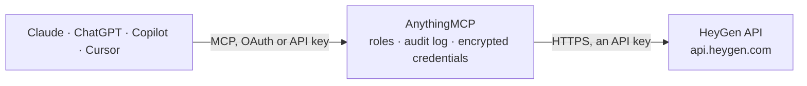

<!-- Generated by scripts/export-github-catalog.mjs in the anythingmcp-website repository. Do not edit by hand. -->

# HeyGen MCP connector

Let your AI make HeyGen avatar videos with your own key: pick avatars and voices, turn a script or a prompt into a talking video, fill your templates, translate videos into other languages with … The AnythingMCP connector gives Claude, ChatGPT, Microsoft Copilot, Cursor and Gemini 19 MCP tools for HeyGen: 13 read and 6 can change data.

**Category:** [Publishing](../publishing.md) · **Tools:** 19 · **Setup guide:** [anythingmcp.com](https://anythingmcp.com/guides/heygen-to-mcp) · [Deutsch](https://anythingmcp.com/de/guides/heygen-to-mcp) · [Italiano](https://anythingmcp.com/it/guides/heygen-to-mcp) · [Español](https://anythingmcp.com/es/guides/heygen-to-mcp) · [日本語](https://anythingmcp.com/ja/guides/heygen-to-mcp) · [Русский](https://anythingmcp.com/ru/guides/heygen-to-mcp) · [中文](https://anythingmcp.com/zh/guides/heygen-to-mcp)

## Start without code

No installation and no terminal: AnythingMCP Cloud runs the HeyGen connector for you, operated by helpcode.ai in Frankfurt, Germany.

1. **Click the button above** and create an account or sign in. The HeyGen connector opens, ready to install.
2. **Paste the API key or token from your HeyGen account.** Every click is in the [step-by-step guide](https://anythingmcp.com/guides/heygen-to-mcp).
3. **Click Install.** AnythingMCP shows the address of your MCP server.
4. **Add that address to your assistant:** [Claude](https://anythingmcp.com/guides/connect-heygen-to-claude) · [ChatGPT](https://anythingmcp.com/guides/connect-heygen-to-chatgpt) · [Microsoft Copilot](https://anythingmcp.com/guides/connect-heygen-to-copilot) · [Cursor](https://anythingmcp.com/guides/connect-heygen-to-cursor) · [Gemini CLI](https://anythingmcp.com/guides/connect-heygen-to-gemini) · [Meta Muse](https://anythingmcp.com/guides/connect-heygen-to-muse).
5. **Ask your first question**, for example: *What's the status and download links for HeyGen video ID vid_2026_0415_77 I shared with the team?*

Prefer help with the setup? [Talk to us](https://anythingmcp.com/contact).

## How it works

- **The AI client** speaks MCP (Streamable HTTP) to AnythingMCP and only sees tool names, descriptions and results. It never gets the HeyGen credentials.
- **AnythingMCP** checks the client's role, builds the call from the tool definition, adds the credentials (an API key), calls HeyGen, logs the call and returns the result.
- **HeyGen** sees an ordinary API client with the rights of the account the credentials belong to.

## Tools

| Tool | What it does | Access |
|---|---|---|
| [`heygen_list_avatar_groups`](#heygen_list_avatar_groups) | List avatar characters (groups): HeyGen's public stock avatars and the user's own (digital twins, photo avatars), with id, name, gender, preview image,… | read |
| [`heygen_list_avatar_looks`](#heygen_list_avatar_looks) | List avatar looks (a character's outfits, poses and styles). | read |
| [`heygen_get_avatar_look`](#heygen_get_avatar_look) | Get one avatar look: type, character, default voice, supported engines, orientation, preview links and, for the user's own avatars, the training status… | read |
| [`heygen_list_voices`](#heygen_list_voices) | List the voices a video can speak with: HeyGen's public voices or the user's own cloned voices, with id, name, language, gender and a preview link. | read |
| [`heygen_create_video`](#heygen_create_video) | Make a talking avatar video: an avatar look speaks a script (or lip-syncs an audio file). | write |
| [`heygen_get_video`](#heygen_get_video) | Check a video (also one made from a template or by the video agent): status pending, processing, completed or failed. | read |
| [`heygen_list_videos`](#heygen_list_videos) | List the videos in the HeyGen account, newest first, with id, title, status, duration and links. | read |
| [`heygen_delete_video`](#heygen_delete_video) | Delete a video and its files from the HeyGen account. | write |
| [`heygen_list_templates`](#heygen_list_templates) | List the workspace's video templates that are ready for the API (templates are designed in the HeyGen editor; only those with variables appear), with id,… | read |
| [`heygen_get_template`](#heygen_get_template) | Get a template's variables with their current values (keyed by variable name, each with its type: text, image, video, audio, character or voice) and its… | read |
| [`heygen_generate_from_template`](#heygen_generate_from_template) | Make a video from a template by filling its variables. | write |
| [`heygen_list_translation_languages`](#heygen_list_translation_languages) | List the target languages video translation supports, as the exact names heygen_translate_video expects (e.g. English, Spanish (Spain), Chinese (Cantonese,… | read |
| [`heygen_translate_video`](#heygen_translate_video) | Translate a video into one or more languages with the speaker's cloned voice and matching lip movements (or the audio only). | write |
| [`heygen_get_video_translation`](#heygen_get_video_translation) | Check a video translation: status pending, running, completed or failed. | read |
| [`heygen_list_video_translations`](#heygen_list_video_translations) | List the video translation jobs in the account with status, languages and links. | read |
| [`heygen_create_agent_video`](#heygen_create_agent_video) | Let HeyGen's Video Agent make a whole video from a prompt: it writes the script, picks an avatar (or uses the one given), builds the scenes and renders. | write |
| [`heygen_get_agent_session`](#heygen_get_agent_session) | Follow a Video Agent session: status (thinking, waiting_for_input, reviewing, generating, completed, failed), progress 0 to 100, title, video_id once… | read |
| [`heygen_create_photo_avatar`](#heygen_create_photo_avatar) | Create an avatar from one photo of a person, to use as a presenter in videos. | write |
| [`heygen_get_account`](#heygen_get_account) | Show the HeyGen account behind the key and what it has left to spend: billing type and, depending on it, the API wallet balance (USD or credits), the plan's… | read |

## Tool reference

Every parameter as the AI client sees it in `tools/list`. Source: [`packages/backend/src/adapters/intl/heygen.json`](../../../packages/backend/src/adapters/intl/heygen.json).

### `heygen_list_avatar_groups`

List avatar characters (groups): HeyGen's public stock avatars and the user's own (digital twins, photo avatars), with id, name, gender, preview image, default voice and how many looks each has. A character's looks (outfits, poses) come from heygen_list_avatar_looks; the look id is what a video needs. Call again with token = next_token while has_more is true. Free.

**Access:** read · **Call:** `GET /v3/avatars`

| Parameter | Type | Required | Description |
|---|---|---|---|
| `ownership` | `public` \| `private` | no | public (HeyGen's stock avatars) or private (the user's own). Leave out for both. |
| `limit` | integer | no | Characters per page, 1 to 50. Default 20. |
| `token` | string | no | next_token from the previous page. |

### `heygen_list_avatar_looks`

List avatar looks (a character's outfits, poses and styles). A look's id is the avatar_id for heygen_create_video; supported_api_engines says which engines can render it (avatar_iii, avatar_iv, avatar_v) and preferred_orientation which format suits it. Filter by character (group_id), type or ownership. Call again with token = next_token while has_more is true. Free.

**Access:** read · **Call:** `GET /v3/avatars/looks`

| Parameter | Type | Required | Description |
|---|---|---|---|
| `group_id` | string | no | Only looks of this character (id from heygen_list_avatar_groups). |
| `avatar_type` | `studio_avatar` \| `digital_twin` \| `photo_avatar` | no | Type of look. |
| `ownership` | `public` \| `private` | no | public (stock) or private (the user's own). Leave out for both. |
| `limit` | integer | no | Looks per page, 1 to 50. Default 20. |
| `token` | string | no | next_token from the previous page. |

### `heygen_get_avatar_look`

Get one avatar look: type, character, default voice, supported engines, orientation, preview links and, for the user's own avatars, the training status (processing, completed or failed with the reason). Use it to wait for a photo avatar made with heygen_create_photo_avatar. Free.

**Access:** read · **Call:** `GET /v3/avatars/looks/{look_id}`

| Parameter | Type | Required | Description |
|---|---|---|---|
| `look_id` | string | yes | Look id (the avatar_id of a video). |

### `heygen_list_voices`

List the voices a video can speak with: HeyGen's public voices or the user's own cloned voices, with id, name, language, gender and a preview link. Filter by language and gender. Call again with token = next_token while has_more is true. Free.

**Access:** read · **Call:** `GET /v3/voices`

| Parameter | Type | Required | Description |
|---|---|---|---|
| `type` | `public` \| `private` | no | public (default, the shared library) or private (the user's cloned voices). |
| `language` | string | no | Language name as HeyGen writes it, e.g. English, German, Spanish. |
| `gender` | `male` \| `female` | no | Voice gender. |
| `engine` | string | no | Only voices of this speech engine, e.g. starfish, heygen_voice or elevenlabs. |
| `limit` | integer | no | Voices per page, 1 to 100. Default 20. |
| `token` | string | no | next_token from the previous page. |

### `heygen_create_video`

Make a talking avatar video: an avatar look speaks a script (or lip-syncs an audio file). Runs in the background and returns video_id; then check heygen_get_video about every 30 seconds until status is completed and video_url is there (usually a few minutes). SPENDS MONEY from the HeyGen API balance, billed by the length of the finished video and the engine used. HeyGen shows the current prices in its API dashboard, and a refused call (402 insufficient_credit) says how much was needed. Confirm the avatar, voice, script length and format with the user before calling.

**Access:** write · **Call:** `POST /v3/videos`

| Parameter | Type | Required | Description |
|---|---|---|---|
| `avatar_id` | string | yes | Look id from heygen_list_avatar_looks. |
| `script` | string | no | What the avatar says, up to 5,000 characters. A pause can be written as <break time="1s"/>. Leave out when audio_url is given. |
| `voice_id` | string | no | Voice id from heygen_list_voices. Leave out to use the avatar's default voice. |
| `audio_url` | string | no | Instead of a script: public link to a WAV or MP3 file (up to 10 minutes) the avatar lip-syncs. |
| `title` | string | no | Title shown in the HeyGen app. |
| `aspect_ratio` | `16:9` \| `9:16` \| `1:1` \| `4:5` \| `5:4` \| `auto` | no | 16:9 (default) landscape, 9:16 portrait for shorts and stories, 1:1, 4:5, 5:4, or auto to follow the avatar. |
| `resolution` | `720p` \| `1080p` \| `4k` | no | Output resolution. Default 1080p; 4k only with engine avatar_iii for digital twins and studio avatars. |
| `engine` | object | no | Rendering engine: {"type": "avatar_iv"} (default), {"type": "avatar_v"} (highest quality, only for looks that list it in supported_api_engines) or {"type": "avatar_iii"} (needed for 4k). |
| `background` | object | no | Optional background: {"type": "color", "value": "#FFFFFF"} or {"type": "image", "url": "https://..."}. |
| `voice_settings` | object | no | Optional voice tuning: speed (0.5 to 1.5), pitch (-50 to 50), volume (0 to 1), locale (e.g. en-US). |
| `motion_prompt` | string | no | Optional description of gestures and body movement, e.g. nods and points to the right. Photo avatars, and video avatars with engine avatar_v. |
| `expressiveness` | `low` \| `medium` \| `high` | no | How animated a photo avatar is (Avatar IV only). Default low. |
| `remove_background` | boolean | no | Remove the avatar's own background (video avatars must have been trained for it). |

### `heygen_get_video`

Check a video (also one made from a template or by the video agent): status pending, processing, completed or failed. When completed it has video_url (MP4 download link), captioned_video_url, subtitle_url (SRT), thumbnail_url, video_page_url (the video in the HeyGen app) and duration; when failed, failure_code and failure_message. Download links are signed and expire; call again for fresh ones. Poll about every 30 seconds, not faster. Free.

**Access:** read · **Call:** `GET /v3/videos/{video_id}`

| Parameter | Type | Required | Description |
|---|---|---|---|
| `video_id` | string | yes | video_id returned when the video was started, or id from heygen_list_videos. |

### `heygen_list_videos`

List the videos in the HeyGen account, newest first, with id, title, status, duration and links. Filter by words in the title or by folder. Call again with token = next_token while has_more is true. Free.

**Access:** read · **Call:** `GET /v3/videos`

| Parameter | Type | Required | Description |
|---|---|---|---|
| `title` | string | no | Only videos whose title contains this text. |
| `folder_id` | string | no | Only videos in this folder. |
| `limit` | integer | no | Videos per page, 1 to 100. Default 10. |
| `token` | string | no | next_token from the previous page. |

### `heygen_delete_video`

Delete a video and its files from the HeyGen account. It cannot be undone. Confirm with the user first. Installed switched off.

**Access:** write · **Call:** `DELETE /v3/videos/{video_id}`

| Parameter | Type | Required | Description |
|---|---|---|---|
| `video_id` | string | yes | Id of the video to delete. |

### `heygen_list_templates`

List the workspace's video templates that are ready for the API (templates are designed in the HeyGen editor; only those with variables appear), with id, name, aspect ratio and thumbnail. Call again with token = next_token while has_more is true. Free.

**Access:** read · **Call:** `GET /v3/templates`

| Parameter | Type | Required | Description |
|---|---|---|---|
| `limit` | integer | no | Templates per page. Default 10. |
| `token` | string | no | next_token from the previous page. |

### `heygen_get_template`

Get a template's variables with their current values (keyed by variable name, each with its type: text, image, video, audio, character or voice) and its scenes with their scripts. The variables object has the shape heygen_generate_from_template expects. Free.

**Access:** read · **Call:** `GET /v3/templates/{template_id}`

| Parameter | Type | Required | Description |
|---|---|---|---|
| `template_id` | string | yes | Template id from heygen_list_templates. |

### `heygen_generate_from_template`

Make a video from a template by filling its variables. Returns the new video (status pending) with its id; then check heygen_get_video about every 30 seconds until it is completed. Fill every text variable: an unfilled one stays as {{name}} in the video. SPENDS MONEY from the HeyGen API balance, billed by the length of the finished video and the engine used. HeyGen shows the current prices in its API dashboard, and a refused call (402 insufficient_credit) says how much was needed. Confirm with the user before calling.

**Access:** write · **Call:** `POST /v3/templates/{template_id}`

| Parameter | Type | Required | Description |
|---|---|---|---|
| `template_id` | string | yes | Template id from heygen_list_templates. |
| `variables` | object | yes | Values keyed by variable name, as returned by heygen_get_template. Text: {"name": {"type": "text", "content": "Anna"}}. Image: {"type": "image", "asset": {"type": "url", "url": "https://..."}}. Avatar: {"type": "character", "avatar_id": "..."}. Voice: {"type": "voice", "voice_id": "..."}. Variables left out (except text) keep the template's value. |
| `title` | string | no | Title of the new video. |
| `caption` | boolean | no | Burn captions into the video. Default false. |
| `scene_ids` | string[] | no | Optional: the template's scene ids to render, in order (repeats allowed). Default all scenes. |
| `folder_id` | string | no | Folder for the new video. |

### `heygen_list_translation_languages`

List the target languages video translation supports, as the exact names heygen_translate_video expects (e.g. English, Spanish (Spain), Chinese (Cantonese, Traditional)). Free.

**Access:** read · **Call:** `GET /v3/video-translations/languages`

No parameters.

### `heygen_translate_video`

Translate a video into one or more languages with the speaker's cloned voice and matching lip movements (or the audio only). Returns one video_translation_id per language; check each with heygen_get_video_translation every 30 to 60 seconds until completed. SPENDS MONEY from the HeyGen API balance for every minute of video and every language; HeyGen shows the current prices in its API dashboard. Tell the user the video length and languages and confirm before calling.

**Access:** write · **Call:** `POST /v3/video-translations`

| Parameter | Type | Required | Description |
|---|---|---|---|
| `video_url` | string | yes | Public HTTPS link to the source video (MP4 or WebM). |
| `output_languages` | string[] | yes | Target language names exactly as heygen_list_translation_languages returns them, e.g. ["German", "Spanish (Spain)"]. |
| `title` | string | no | Title of the translation job. |
| `mode` | `speed` \| `precision` | no | speed (default, faster) or precision (better lip-sync, slower). |
| `input_language` | string | no | Language of the original. Leave out to detect it. |
| `translate_audio_only` | boolean | no | Translate the voice only and keep the original picture (no lip-sync). Default false. |
| `speaker_num` | integer | no | Number of speakers in the video, helps to separate them. |
| `start_time` | number | no | Translate only from this second. |
| `end_time` | number | no | Translate only up to this second. |
| `disable_music_track` | boolean | no | Remove the background music. Default false. |
| `enable_speech_enhancement` | boolean | no | Clean up the speech audio. Default false. |

### `heygen_get_video_translation`

Check a video translation: status pending, running, completed or failed. When completed it has video_url (translated MP4), audio_url, and srt_caption_url and vtt_caption_url (subtitles); when failed, failure_message. Links are signed and expire; call again for fresh ones. Free.

**Access:** read · **Call:** `GET /v3/video-translations/{video_translation_id}`

| Parameter | Type | Required | Description |
|---|---|---|---|
| `video_translation_id` | string | yes | One of the ids returned by heygen_translate_video. |

### `heygen_list_video_translations`

List the video translation jobs in the account with status, languages and links. Call again with token = next_token while has_more is true. Free.

**Access:** read · **Call:** `GET /v3/video-translations`

| Parameter | Type | Required | Description |
|---|---|---|---|
| `limit` | integer | no | Jobs per page, 1 to 100. Default 10. |
| `token` | string | no | next_token from the previous page. |

### `heygen_create_agent_video`

Let HeyGen's Video Agent make a whole video from a prompt: it writes the script, picks an avatar (or uses the one given), builds the scenes and renders. Returns session_id and, once known, video_id; follow it with heygen_get_agent_session, then heygen_get_video for the finished file. SPENDS MONEY from the HeyGen API balance, billed by the length of the finished video and the engine used. HeyGen shows the current prices in its API dashboard, and a refused call (402 insufficient_credit) says how much was needed. A longer video costs more; confirm the idea and rough length with the user before calling.

**Access:** write · **Call:** `POST /v3/video-agents`

| Parameter | Type | Required | Description |
|---|---|---|---|
| `prompt` | string | yes | What the video should be: topic, audience, tone, length, key points, call to action (up to 10,000 characters). |
| `avatar_id` | string | no | Optional look id of the presenter (heygen_list_avatar_looks). |
| `voice_id` | string | no | Optional narration voice id (heygen_list_voices). |
| `orientation` | `landscape` \| `portrait` | no | landscape or portrait. Leave out to let the agent decide. |
| `files` | object[] | no | Optional material to use, up to 20 items, each {"type": "url", "url": "https://..."} (images, videos, MP3/WAV audio or PDF). |

### `heygen_get_agent_session`

Follow a Video Agent session: status (thinking, waiting_for_input, reviewing, generating, completed, failed), progress 0 to 100, title, video_id once rendering starts, the agent's latest messages and an error when it failed. When video_id is set, heygen_get_video returns the file. Poll about every 30 seconds. Free.

**Access:** read · **Call:** `GET /v3/video-agents/{session_id}`

| Parameter | Type | Required | Description |
|---|---|---|---|
| `session_id` | string | yes | session_id from heygen_create_agent_video. |

### `heygen_create_photo_avatar`

Create an avatar from one photo of a person, to use as a presenter in videos. Only with a photo of someone who agreed to it, such as the user themselves: HeyGen keeps no consent record for photo avatars, so ask the user to confirm they have that right before calling. Processing takes a moment: check heygen_get_avatar_look with the returned look id until status is completed. Creating the avatar may use HeyGen credits depending on the plan.

**Access:** write · **Call:** `POST /v3/avatars`

| Parameter | Type | Required | Description |
|---|---|---|---|
| `name` | string | yes | Name of the avatar. |
| `photo_url` | string | yes | Public link to a clear, front-facing JPG or PNG portrait of one person, whole head in frame. |
| `avatar_group_id` | string | no | Optional: add the photo as another look of an existing character of the user. |

### `heygen_get_account`

Show the HeyGen account behind the key and what it has left to spend: billing type and, depending on it, the API wallet balance (USD or credits), the plan's remaining credits with their reset date, or the usage-based spend against its cap. Check it before costly calls. Free.

**Access:** read · **Call:** `GET /v3/users/me`

No parameters.

## Run it yourself

AnythingMCP is open source (AGPL-3.0). [Run it with Docker](../../../README.md#run-it-yourself), open **Connectors → Store**, pick **HeyGen** and enter `HEYGEN_API_KEY`, then add your MCP server URL to the AI client.

[← Publishing connectors](../publishing.md) · [All categories](../README.md)
