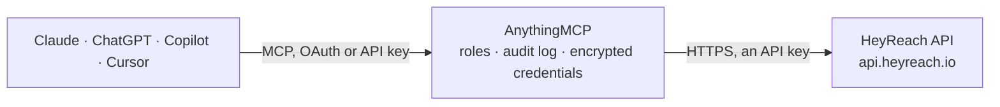

<!-- Generated by scripts/export-github-catalog.mjs in the anythingmcp-website repository. Do not edit by hand. -->

# HeyReach MCP connector

HeyReach LinkedIn outreach from any AI agent: campaigns and their leads, lead lists, the unified LinkedIn inbox, sender accounts, lead tags, network checks, outreach statistics and webhooks. The AnythingMCP connector gives Claude, ChatGPT, Microsoft Copilot, Cursor and Gemini 40 MCP tools for HeyReach: 24 read and 16 can change data.

**Category:** [CRM](../crm.md) · **Tools:** 40 · **Setup guide:** [anythingmcp.com](https://anythingmcp.com/guides/heyreach-to-mcp) · [Deutsch](https://anythingmcp.com/de/guides/heyreach-to-mcp) · [Italiano](https://anythingmcp.com/it/guides/heyreach-to-mcp) · [Español](https://anythingmcp.com/es/guides/heyreach-to-mcp) · [日本語](https://anythingmcp.com/ja/guides/heyreach-to-mcp) · [Русский](https://anythingmcp.com/ru/guides/heyreach-to-mcp) · [中文](https://anythingmcp.com/zh/guides/heyreach-to-mcp)

## Start without code

No installation and no terminal: AnythingMCP Cloud runs the HeyReach connector for you, operated by helpcode.ai in Frankfurt, Germany.

1. **Click the button above** and create an account or sign in. The HeyReach connector opens, ready to install.
2. **Paste the API key or token from your HeyReach account.** Every click is in the [step-by-step guide](https://anythingmcp.com/guides/heyreach-to-mcp).
3. **Click Install.** AnythingMCP shows the address of your MCP server.
4. **Add that address to your assistant:** [Claude](https://anythingmcp.com/guides/connect-heyreach-to-claude) · [ChatGPT](https://anythingmcp.com/guides/connect-heyreach-to-chatgpt) · [Microsoft Copilot](https://anythingmcp.com/guides/connect-heyreach-to-copilot) · [Cursor](https://anythingmcp.com/guides/connect-heyreach-to-cursor) · [Gemini CLI](https://anythingmcp.com/guides/connect-heyreach-to-gemini) · [Meta Muse](https://anythingmcp.com/guides/connect-heyreach-to-muse).
5. **Ask your first question**, for example: *Show me leads in campaign CR-2026-Q4 with activity since 2026-10-01*

Prefer help with the setup? [Talk to us](https://anythingmcp.com/contact).

## How it works

- **The AI client** speaks MCP (Streamable HTTP) to AnythingMCP and only sees tool names, descriptions and results. It never gets the HeyReach credentials.
- **AnythingMCP** checks the client's role, builds the call from the tool definition, adds the credentials (an API key), calls HeyReach, logs the call and returns the result.
- **HeyReach** sees an ordinary API client with the rights of the account the credentials belong to.

## Tools

| Tool | What it does | Access |
|---|---|---|
| [`heyreach_check_api_key`](#heyreach_check_api_key) | Check that the HeyReach API key works. | read |
| [`heyreach_list_campaigns`](#heyreach_list_campaigns) | List LinkedIn outreach campaigns with status, lead list, sender accounts and progress counts (total, in progress, pending, finished, failed). | read |
| [`heyreach_get_campaign`](#heyreach_get_campaign) | Get one campaign: status, lead list, sender accounts, exclusion settings and progress counts. | read |
| [`heyreach_get_campaign_sequence`](#heyreach_get_campaign_sequence) | Get the sequence of a campaign: the tree of steps (connection request, message, InMail, follow, like, view profile) with delays and message texts. | read |
| [`heyreach_list_campaign_leads`](#heyreach_list_campaign_leads) | List the leads of a campaign with their LinkedIn profile, status and last action. | read |
| [`heyreach_get_campaigns_for_lead`](#heyreach_get_campaigns_for_lead) | List the campaigns a lead is in, with campaign status and the lead status in each (Pending, InSequence, Finished, Paused, Failed, Excluded). | read |
| [`heyreach_add_leads_to_campaign`](#heyreach_add_leads_to_campaign) | Add up to 100 leads to a campaign, optionally pinning each lead to a sender account. | write |
| [`heyreach_stop_lead_in_campaign`](#heyreach_stop_lead_in_campaign) | Stop a lead in a campaign: it gets no further steps. | write |
| [`heyreach_pause_campaign`](#heyreach_pause_campaign) | Pause a running campaign. | write |
| [`heyreach_resume_campaign`](#heyreach_resume_campaign) | Resume a paused campaign so it continues its sequence where each lead stopped. | write |
| [`heyreach_start_campaign`](#heyreach_start_campaign) | Start a draft campaign. | write |
| [`heyreach_update_lead_custom_fields`](#heyreach_update_lead_custom_fields) | Set custom field values on a lead in a campaign, for use as variables in its messages. | write |
| [`heyreach_list_conversations`](#heyreach_list_conversations) | List LinkedIn conversations of the sender accounts, newest first, with the last message, read state and the lead profile. | read |
| [`heyreach_get_conversation`](#heyreach_get_conversation) | Get one LinkedIn conversation with all its messages, senders and the lead profile. | read |
| [`heyreach_send_message`](#heyreach_send_message) | Send a LinkedIn message in an existing conversation from the sender account of that conversation. | write |
| [`heyreach_set_conversation_seen`](#heyreach_set_conversation_seen) | Mark a LinkedIn conversation as read or unread in the HeyReach inbox. | write |
| [`heyreach_list_linkedin_accounts`](#heyreach_list_linkedin_accounts) | List the LinkedIn sender accounts: name, email, active campaigns, whether the session is valid, Sales Navigator and Recruiter status, cooldowns and daily… | read |
| [`heyreach_get_linkedin_account`](#heyreach_get_linkedin_account) | Get one LinkedIn sender account with its limits, cooldowns and session state. | read |
| [`heyreach_get_linkedin_account_status`](#heyreach_get_linkedin_account_status) | Get the live connection status of a LinkedIn sender (Connected, Disconnected and why) and its Sales Navigator and Recruiter sessions. | read |
| [`heyreach_list_lists`](#heyreach_list_lists) | List lead and company lists with their ids, sizes, type and the campaigns using them. | read |
| [`heyreach_get_list`](#heyreach_get_list) | Get one lead or company list: name, type, size, creation time and campaigns using it. | read |
| [`heyreach_list_list_leads`](#heyreach_list_list_leads) | List the leads of a lead list with profile, company, position, tags, email and custom fields. | read |
| [`heyreach_list_list_companies`](#heyreach_list_list_companies) | List the companies of a company list with name, LinkedIn URL and details, paged. | read |
| [`heyreach_get_lists_for_lead`](#heyreach_get_lists_for_lead) | List the lead lists a lead belongs to. | read |
| [`heyreach_create_list`](#heyreach_create_list) | Create an empty lead list or company list; fill it with heyreach_add_leads_to_list. | write |
| [`heyreach_add_leads_to_list`](#heyreach_add_leads_to_list) | Add up to 100 leads to a lead list. | write |
| [`heyreach_delete_leads_from_list`](#heyreach_delete_leads_from_list) | Remove leads from a lead list by their LinkedIn profile URLs. | write |
| [`heyreach_get_lead`](#heyreach_get_lead) | Get a lead by LinkedIn profile URL: name, headline, company, position, location, email, tags, experience and education. | read |
| [`heyreach_get_lead_tags`](#heyreach_get_lead_tags) | Get the tags of a lead, identified by its LinkedIn profile URL. | read |
| [`heyreach_add_lead_tags`](#heyreach_add_lead_tags) | Add tags to a lead (existing tags are kept). | write |
| [`heyreach_replace_lead_tags`](#heyreach_replace_lead_tags) | Replace all tags of a lead with the given ones. | write |
| [`heyreach_list_network`](#heyreach_list_network) | List the 1st-degree LinkedIn connections of a sender account, paged. | read |
| [`heyreach_is_connection`](#heyreach_is_connection) | Check whether a lead is a 1st-degree connection of a sender. | read |
| [`heyreach_get_overall_stats`](#heyreach_get_overall_stats) | Get outreach results for a period, per day and in total: profile views, likes, follows, connection requests sent and accepted, messages and InMails sent and… | read |
| [`heyreach_get_stats_by_campaign`](#heyreach_get_stats_by_campaign) | Get the same outreach results as heyreach_get_overall_stats, broken down per campaign. | read |
| [`heyreach_list_webhooks`](#heyreach_list_webhooks) | List the webhooks of the workspace with their URL, event type, campaigns and active state. | read |
| [`heyreach_get_webhook`](#heyreach_get_webhook) | Get one webhook with its URL, event type, campaigns and active state. | read |
| [`heyreach_create_webhook`](#heyreach_create_webhook) | Create a webhook that POSTs one event type to a URL, for all campaigns or selected ones. | write |
| [`heyreach_update_webhook`](#heyreach_update_webhook) | Change a webhook: name, URL, event type, campaigns, or switch it on or off. | write |
| [`heyreach_delete_webhook`](#heyreach_delete_webhook) | Delete a webhook by id. | write |

## Tool reference

Every parameter as the AI client sees it in `tools/list`. Source: [`packages/backend/src/adapters/intl/heyreach.json`](../../../packages/backend/src/adapters/intl/heyreach.json).

### `heyreach_check_api_key`

Check that the HeyReach API key works. Returns HTTP 200 with no body when it does.

**Access:** read · **Call:** `GET /auth/CheckApiKey`

No parameters.

### `heyreach_list_campaigns`

List LinkedIn outreach campaigns with status, lead list, sender accounts and progress counts (total, in progress, pending, finished, failed). Up to 100 per page.

**Access:** read · **Call:** `POST /campaign/GetAll`

| Parameter | Type | Required | Description |
|---|---|---|---|
| `offset` | integer | no | Records to skip (default 0). |
| `limit` | integer | no | Page size, at most 100. |
| `keyword` | string | no | Filter by campaign name. |
| `statuses` | string[] | no | Status filter: DRAFT, IN_PROGRESS, PAUSED, FINISHED, CANCELED, FAILED, STARTING, SCHEDULED. |
| `account_ids` | integer[] | no | Only campaigns using these LinkedIn sender ids (heyreach_list_linkedin_accounts). |

### `heyreach_get_campaign`

Get one campaign: status, lead list, sender accounts, exclusion settings and progress counts.

**Access:** read · **Call:** `GET /campaign/GetById`

| Parameter | Type | Required | Description |
|---|---|---|---|
| `campaign_id` | integer | yes | Campaign id from heyreach_list_campaigns. |

### `heyreach_get_campaign_sequence`

Get the sequence of a campaign: the tree of steps (connection request, message, InMail, follow, like, view profile) with delays and message texts.

**Access:** read · **Call:** `GET /campaign/GetCampaignSequence`

| Parameter | Type | Required | Description |
|---|---|---|---|
| `campaign_id` | integer | yes | Campaign id from heyreach_list_campaigns. |

### `heyreach_list_campaign_leads`

List the leads of a campaign with their LinkedIn profile, status and last action. Shows the leads the campaign has picked up; more pending leads of the list may be inserted later.

**Access:** read · **Call:** `POST /campaign/GetLeadsFromCampaign`

| Parameter | Type | Required | Description |
|---|---|---|---|
| `campaign_id` | integer | yes | Campaign id from heyreach_list_campaigns. |
| `offset` | integer | no | Records to skip (default 0). |
| `limit` | integer | no | Page size, at most 100. |
| `time_from` | string | no | Start of the time window, ISO 8601 with offset. |
| `time_to` | string | no | End of the time window, ISO 8601 with offset. |
| `time_filter` | `CreationTime` \| `Everywhere` \| `LastActionTakenTime` \| `FailedTime` \| `LastActionTakenOrFailedTime` | no | What the window applies to. |

### `heyreach_get_campaigns_for_lead`

List the campaigns a lead is in, with campaign status and the lead status in each (Pending, InSequence, Finished, Paused, Failed, Excluded). Identify the lead by email, LinkedIn id or profile URL.

**Access:** read · **Call:** `POST /campaign/GetCampaignsForLead`

| Parameter | Type | Required | Description |
|---|---|---|---|
| `email` | string | no | Email address of the lead. |
| `linkedin_id` | string | no | LinkedIn id of the lead (the linkedin_id field of lead records). |
| `profile_url` | string | no | LinkedIn profile URL, e.g. https://www.linkedin.com/in/jane-doe/. |
| `offset` | integer | no | Records to skip (default 0). |
| `limit` | integer | no | Page size, at most 100. |

### `heyreach_add_leads_to_campaign`

Add up to 100 leads to a campaign, optionally pinning each lead to a sender account. Returns how many leads were added, updated and failed. A paused campaign can be resumed by the same call.

**Access:** write · **Call:** `POST /campaign/AddLeadsToCampaignV2`

| Parameter | Type | Required | Description |
|---|---|---|---|
| `campaign_id` | integer | yes | Campaign id from heyreach_list_campaigns. |
| `account_lead_pairs` | object[] | yes | Pairs: [{"linkedInAccountId": 123 (optional sender), "lead": {"profileUrl": "https://www.linkedin.com/in/jane-doe", "firstName": "Jane", "lastName": "Doe", "companyName": "Acme", "position": "CTO", "emailAddress": "jane@acme.com", "customUserFields": [{"name": "pain_point", "value": "hiring"}]}}]. Custom field names: letters, digits and underscores only. |
| `resume_paused_campaign` | boolean | no | Resume the campaign if it is paused. |
| `resume_finished_campaign` | boolean | no | Restart the campaign if it has finished. |

### `heyreach_stop_lead_in_campaign`

Stop a lead in a campaign: it gets no further steps. Identify it by its LinkedIn member id or profile URL.

**Access:** write · **Call:** `POST /campaign/StopLeadInCampaign`

| Parameter | Type | Required | Description |
|---|---|---|---|
| `campaign_id` | integer | yes | Campaign id from heyreach_list_campaigns. |
| `lead_member_id` | string | no | LinkedIn member id of the lead (linkedin_id in heyreach_list_campaign_leads). |
| `lead_url` | string | no | LinkedIn profile URL of the lead. |

### `heyreach_pause_campaign`

Pause a running campaign. No further actions are taken until it is resumed.

**Access:** write · **Call:** `POST /campaign/Pause`

| Parameter | Type | Required | Description |
|---|---|---|---|
| `campaign_id` | integer | yes | Campaign id from heyreach_list_campaigns. |

### `heyreach_resume_campaign`

Resume a paused campaign so it continues its sequence where each lead stopped.

**Access:** write · **Call:** `POST /campaign/Resume`

| Parameter | Type | Required | Description |
|---|---|---|---|
| `campaign_id` | integer | yes | Campaign id from heyreach_list_campaigns. |

### `heyreach_start_campaign`

Start a draft campaign. It needs a sequence, a lead list and at least one connected LinkedIn sender.

**Access:** write · **Call:** `POST /campaign/StartCampaign`

| Parameter | Type | Required | Description |
|---|---|---|---|
| `campaign_id` | integer | yes | Campaign id from heyreach_list_campaigns. |

### `heyreach_update_lead_custom_fields`

Set custom field values on a lead in a campaign, for use as variables in its messages.

**Access:** write · **Call:** `PATCH /campaign/UpdateLeadCustomFields/campaigns/{campaign_id}/leads/custom-fields`

| Parameter | Type | Required | Description |
|---|---|---|---|
| `campaign_id` | integer | yes | Campaign id from heyreach_list_campaigns. |
| `lead_member_id_or_url` | string | yes | LinkedIn member id or profile URL of the lead. |
| `custom_fields` | object | yes | Field values, e.g. {"pain_point": "hiring", "event": "SaaStr"}. |

### `heyreach_list_conversations`

List LinkedIn conversations of the sender accounts, newest first, with the last message, read state and the lead profile. Cursor paged; filters by sender, campaign, lead, tags, read state and time.

**Access:** read · **Call:** `POST /inbox/GetConversationsV3`

| Parameter | Type | Required | Description |
|---|---|---|---|
| `limit` | integer | no | Page size, 1-100 (default 10). |
| `cursor` | string | no | nextCursor from the previous page; omit for the first page. |
| `from` | string | no | Only conversations with activity after this ISO 8601 time. |
| `to` | string | no | Only conversations with activity before this ISO 8601 time. |
| `filters` | object | no | Filters: {"linkedInAccountIds": [123], "campaignIds": [45], "searchString": "acme", "leadLinkedInId": "...", "leadProfileUrl": "https://www.linkedin.com/in/jane-doe/", "tags": ["hot"], "seen": false}. |

### `heyreach_get_conversation`

Get one LinkedIn conversation with all its messages, senders and the lead profile.

**Access:** read · **Call:** `GET /inbox/GetChatroom/{account_id}/{conversation_id}`

| Parameter | Type | Required | Description |
|---|---|---|---|
| `account_id` | integer | yes | LinkedIn sender id (linkedInAccountId of the conversation). |
| `conversation_id` | string | yes | Conversation id from heyreach_list_conversations. |

### `heyreach_send_message`

Send a LinkedIn message in an existing conversation from the sender account of that conversation.

**Access:** write · **Call:** `POST /inbox/SendMessage`

| Parameter | Type | Required | Description |
|---|---|---|---|
| `conversation_id` | string | yes | Conversation id from heyreach_list_conversations. |
| `linkedin_account_id` | integer | yes | Sender id that owns the conversation. |
| `message` | string | yes | Message text. |
| `subject` | string | no | Subject, only used for InMail conversations. |

### `heyreach_set_conversation_seen`

Mark a LinkedIn conversation as read or unread in the HeyReach inbox.

**Access:** write · **Call:** `POST /inbox/SetSeenStatus`

| Parameter | Type | Required | Description |
|---|---|---|---|
| `conversation_id` | string | yes | Conversation id. |
| `linkedin_account_id` | integer | yes | Sender id that owns the conversation. |
| `seen` | boolean | yes | true for read, false for unread. |

### `heyreach_list_linkedin_accounts`

List the LinkedIn sender accounts: name, email, active campaigns, whether the session is valid, Sales Navigator and Recruiter status, cooldowns and daily limits.

**Access:** read · **Call:** `POST /li_account/GetAll`

| Parameter | Type | Required | Description |
|---|---|---|---|
| `offset` | integer | no | Records to skip (default 0). |
| `limit` | integer | no | Page size, at most 100. |
| `keyword` | string | no | Filter by account name. |

### `heyreach_get_linkedin_account`

Get one LinkedIn sender account with its limits, cooldowns and session state.

**Access:** read · **Call:** `GET /li_account/GetById`

| Parameter | Type | Required | Description |
|---|---|---|---|
| `account_id` | integer | yes | Sender id from heyreach_list_linkedin_accounts. |

### `heyreach_get_linkedin_account_status`

Get the live connection status of a LinkedIn sender (Connected, Disconnected and why) and its Sales Navigator and Recruiter sessions.

**Access:** read · **Call:** `GET /li_account/GetAccountStatus/{account_id}`

| Parameter | Type | Required | Description |
|---|---|---|---|
| `account_id` | integer | yes | Sender id. |

### `heyreach_list_lists`

List lead and company lists with their ids, sizes, type and the campaigns using them. Up to 100 per page.

**Access:** read · **Call:** `POST /list/GetAll`

| Parameter | Type | Required | Description |
|---|---|---|---|
| `offset` | integer | no | Records to skip (default 0). |
| `limit` | integer | no | Page size, at most 100. |
| `keyword` | string | no | Filter by list name. |
| `list_type` | `USER_LIST` \| `COMPANY_LIST` | no | List type. |
| `campaign_ids` | integer[] | no | Only lists used by these campaigns. |

### `heyreach_get_list`

Get one lead or company list: name, type, size, creation time and campaigns using it.

**Access:** read · **Call:** `GET /list/GetById`

| Parameter | Type | Required | Description |
|---|---|---|---|
| `list_id` | integer | yes | List id from heyreach_list_lists. |

### `heyreach_list_list_leads`

List the leads of a lead list with profile, company, position, tags, email and custom fields. Up to 1000 per page.

**Access:** read · **Call:** `POST /list/GetLeadsFromList`

| Parameter | Type | Required | Description |
|---|---|---|---|
| `list_id` | integer | yes | Lead list id. |
| `offset` | integer | no | Records to skip (default 0). |
| `limit` | integer | no | Page size, at most 1000. |
| `keyword` | string | no | Search by name or other fields. |
| `lead_profile_url` | string | no | Only this LinkedIn profile URL. |
| `lead_linkedin_id` | string | no | Only this LinkedIn id. |
| `created_from` | string | no | Added on or after this ISO 8601 time. |
| `created_to` | string | no | Added on or before this ISO 8601 time. |

### `heyreach_list_list_companies`

List the companies of a company list with name, LinkedIn URL and details, paged.

**Access:** read · **Call:** `POST /list/GetCompaniesFromList`

| Parameter | Type | Required | Description |
|---|---|---|---|
| `list_id` | integer | yes | Company list id. |
| `offset` | integer | no | Records to skip (default 0). |
| `limit` | integer | no | Page size, at most 100. |
| `keyword` | string | no | Filter by company name. |

### `heyreach_get_lists_for_lead`

List the lead lists a lead belongs to. Identify the lead by email, LinkedIn id or profile URL.

**Access:** read · **Call:** `POST /list/GetListsForLead`

| Parameter | Type | Required | Description |
|---|---|---|---|
| `email` | string | no | Email address of the lead. |
| `linkedin_id` | string | no | LinkedIn id of the lead (the linkedin_id field of lead records). |
| `profile_url` | string | no | LinkedIn profile URL, e.g. https://www.linkedin.com/in/jane-doe/. |
| `offset` | integer | no | Records to skip (default 0). |
| `limit` | integer | no | Page size, at most 100. |

### `heyreach_create_list`

Create an empty lead list or company list; fill it with heyreach_add_leads_to_list.

**Access:** write · **Call:** `POST /list/CreateEmptyList`

| Parameter | Type | Required | Description |
|---|---|---|---|
| `name` | string | yes | List name. |
| `type` | `USER_LIST` \| `COMPANY_LIST` | yes | List type. |

### `heyreach_add_leads_to_list`

Add up to 100 leads to a lead list. Returns counts of added, updated and failed leads. A list is not a campaign: a finished campaign does not pick up new list leads; use heyreach_add_leads_to_campaign for that.

**Access:** write · **Call:** `POST /list/AddLeadsToListV2`

| Parameter | Type | Required | Description |
|---|---|---|---|
| `list_id` | integer | yes | Lead list id. |
| `leads` | object[] | yes | Leads: [{"profileUrl": "https://www.linkedin.com/in/jane-doe", "firstName": "Jane", "lastName": "Doe", "companyName": "Acme", "position": "CTO", "emailAddress": "jane@acme.com", "location": "Berlin", "summary": "...", "about": "...", "customUserFields": [{"name": "pain_point", "value": "hiring"}]}]. profileUrl is required; custom field names may only contain letters, digits and underscores. At most 100 per call. |

### `heyreach_delete_leads_from_list`

Remove leads from a lead list by their LinkedIn profile URLs.

**Access:** write · **Call:** `DELETE /list/DeleteLeadsFromListByProfileUrl`

| Parameter | Type | Required | Description |
|---|---|---|---|
| `list_id` | integer | yes | Lead list id. |
| `profile_urls` | string[] | yes | LinkedIn profile URLs to remove. |

### `heyreach_get_lead`

Get a lead by LinkedIn profile URL: name, headline, company, position, location, email, tags, experience and education.

**Access:** read · **Call:** `POST /lead/GetLead`

| Parameter | Type | Required | Description |
|---|---|---|---|
| `profile_url` | string | yes | LinkedIn profile URL. |

### `heyreach_get_lead_tags`

Get the tags of a lead, identified by its LinkedIn profile URL.

**Access:** read · **Call:** `POST /lead/GetTags`

| Parameter | Type | Required | Description |
|---|---|---|---|
| `profile_url` | string | yes | LinkedIn profile URL. |

### `heyreach_add_lead_tags`

Add tags to a lead (existing tags are kept). Identify the lead by profile URL or LinkedIn id.

**Access:** write · **Call:** `POST /lead/AddTags`

| Parameter | Type | Required | Description |
|---|---|---|---|
| `lead_profile_url` | string | no | LinkedIn profile URL. |
| `lead_linkedin_id` | string | no | LinkedIn id, instead of the URL. |
| `tags` | string[] | yes | Tag names. |
| `create_tag_if_not_existing` | boolean | no | Create tags that do not exist yet (otherwise unknown tags fail). |

### `heyreach_replace_lead_tags`

Replace all tags of a lead with the given ones. Identify the lead by profile URL or LinkedIn id.

**Access:** write · **Call:** `POST /lead/ReplaceTags`

| Parameter | Type | Required | Description |
|---|---|---|---|
| `lead_profile_url` | string | no | LinkedIn profile URL. |
| `lead_linkedin_id` | string | no | LinkedIn id, instead of the URL. |
| `tags` | string[] | yes | Tag names; [] removes all tags. |
| `create_tag_if_not_existing` | boolean | no | Create tags that do not exist yet. |

### `heyreach_list_network`

List the 1st-degree LinkedIn connections of a sender account, paged.

**Access:** read · **Call:** `POST /MyNetwork/GetMyNetworkForSender`

| Parameter | Type | Required | Description |
|---|---|---|---|
| `sender_id` | integer | yes | Sender id from heyreach_list_linkedin_accounts. |
| `page_number` | integer | no | Page, starting at 0. |
| `page_size` | integer | no | Page size, at most 100. |

### `heyreach_is_connection`

Check whether a lead is a 1st-degree connection of a sender. Give the profile URL or the LinkedIn id, not both.

**Access:** read · **Call:** `POST /MyNetwork/IsConnection`

| Parameter | Type | Required | Description |
|---|---|---|---|
| `sender_account_id` | integer | yes | Sender id. |
| `lead_profile_url` | string | no | LinkedIn profile URL. |
| `lead_linkedin_id` | string | no | LinkedIn id. |

### `heyreach_get_overall_stats`

Get outreach results for a period, per day and in total: profile views, likes, follows, connection requests sent and accepted, messages and InMails sent and replied, with acceptance and reply rates.

**Access:** read · **Call:** `POST /stats/GetOverallStats`

| Parameter | Type | Required | Description |
|---|---|---|---|
| `start_date` | string | yes | Start, ISO 8601, e.g. 2026-10-01T00:00:00.000Z. |
| `end_date` | string | yes | End, ISO 8601, e.g. 2026-10-31T23:59:59.999Z. |
| `account_ids` | integer[] | no | Sender ids; [] or omitted for all. |
| `campaign_ids` | integer[] | no | Campaign ids; [] or omitted for all. |

### `heyreach_get_stats_by_campaign`

Get the same outreach results as heyreach_get_overall_stats, broken down per campaign.

**Access:** read · **Call:** `POST /stats/GetOverallStatsByCampaign`

| Parameter | Type | Required | Description |
|---|---|---|---|
| `start_date` | string | yes | Start, ISO 8601, e.g. 2026-10-01T00:00:00.000Z. |
| `end_date` | string | yes | End, ISO 8601, e.g. 2026-10-31T23:59:59.999Z. |
| `account_ids` | integer[] | no | Sender ids; [] or omitted for all. |
| `campaign_ids` | integer[] | no | Campaign ids; [] or omitted for all. |

### `heyreach_list_webhooks`

List the webhooks of the workspace with their URL, event type, campaigns and active state.

**Access:** read · **Call:** `POST /webhooks/GetAllWebhooks`

| Parameter | Type | Required | Description |
|---|---|---|---|
| `offset` | integer | no | Records to skip (default 0). |
| `limit` | integer | no | Page size, at most 100. |

### `heyreach_get_webhook`

Get one webhook with its URL, event type, campaigns and active state.

**Access:** read · **Call:** `GET /webhooks/GetWebhookById`

| Parameter | Type | Required | Description |
|---|---|---|---|
| `webhook_id` | integer | yes | Webhook id from heyreach_list_webhooks. |

### `heyreach_create_webhook`

Create a webhook that POSTs one event type to a URL, for all campaigns or selected ones.

**Access:** write · **Call:** `POST /webhooks/CreateWebhook`

| Parameter | Type | Required | Description |
|---|---|---|---|
| `webhook_name` | string | yes | Webhook name. |
| `webhook_url` | string | yes | HTTPS URL that receives the events. |
| `event_type` | string | yes | Event: CONNECTION_REQUEST_SENT, CONNECTION_REQUEST_ACCEPTED, MESSAGE_SENT, MESSAGE_REPLY_RECEIVED, EVERY_MESSAGE_REPLY_RECEIVED, INMAIL_SENT, INMAIL_REPLY_RECEIVED, FOLLOW_SENT, LIKED_POST, VIEWED_PROFILE, CAMPAIGN_COMPLETED, LEAD_TAG_UPDATED. |
| `campaign_ids` | integer[] | no | Campaign ids; [] for all campaigns. |

### `heyreach_update_webhook`

Change a webhook: name, URL, event type, campaigns, or switch it on or off. Only the fields passed are changed.

**Access:** write · **Call:** `PATCH /webhooks/UpdateWebhook`

| Parameter | Type | Required | Description |
|---|---|---|---|
| `webhook_id` | integer | yes | Webhook id. |
| `webhook_name` | string | no | New name. |
| `webhook_url` | string | no | New URL. |
| `event_type` | string | no | New event type. |
| `campaign_ids` | integer[] | no | New campaign ids. |
| `is_active` | boolean | no | false to switch the webhook off. |

### `heyreach_delete_webhook`

Delete a webhook by id. Its URL stops receiving HeyReach events.

**Access:** write · **Call:** `DELETE /webhooks/DeleteWebhook`

| Parameter | Type | Required | Description |
|---|---|---|---|
| `webhook_id` | integer | yes | Webhook id. |

## Run it yourself

AnythingMCP is open source (AGPL-3.0). [Run it with Docker](../../../README.md#run-it-yourself), open **Connectors → Store**, pick **HeyReach** and enter `HEYREACH_API_KEY`, then add your MCP server URL to the AI client.

[← CRM connectors](../crm.md) · [All categories](../README.md)
