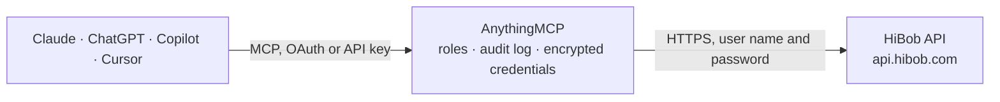

<!-- Generated by scripts/export-github-catalog.mjs in the anythingmcp-website repository. Do not edit by hand. -->

# HiBob MCP connector

HiBob (Bob) HR platform: employee search and records, work, employment, lifecycle and salary history, custom tables, company lists, time off (who is out, requests, balances, policies, holidays), … The AnythingMCP connector gives Claude, ChatGPT, Microsoft Copilot, Cursor and Gemini 44 MCP tools for HiBob: 36 read and 8 can change data.

**Category:** [HR](../hr.md) · **Tools:** 44 · **Setup guide:** [anythingmcp.com](https://anythingmcp.com/guides/hibob-to-mcp) · [Deutsch](https://anythingmcp.com/de/guides/hibob-to-mcp) · [Italiano](https://anythingmcp.com/it/guides/hibob-to-mcp) · [Español](https://anythingmcp.com/es/guides/hibob-to-mcp) · [日本語](https://anythingmcp.com/ja/guides/hibob-to-mcp) · [Русский](https://anythingmcp.com/ru/guides/hibob-to-mcp) · [中文](https://anythingmcp.com/zh/guides/hibob-to-mcp)

## Start without code

No installation and no terminal: AnythingMCP Cloud runs the HiBob connector for you, operated by helpcode.ai in Frankfurt, Germany.

1. **Click the button above** and create an account or sign in. The HiBob connector opens, ready to install.
2. **Paste the API key or token from your HiBob account.** Every click is in the [step-by-step guide](https://anythingmcp.com/guides/hibob-to-mcp).
3. **Click Install.** AnythingMCP shows the address of your MCP server.
4. **Add that address to your assistant:** [Claude](https://anythingmcp.com/guides/connect-hibob-to-claude) · [ChatGPT](https://anythingmcp.com/guides/connect-hibob-to-chatgpt) · [Microsoft Copilot](https://anythingmcp.com/guides/connect-hibob-to-copilot) · [Cursor](https://anythingmcp.com/guides/connect-hibob-to-cursor) · [Gemini CLI](https://anythingmcp.com/guides/connect-hibob-to-gemini) · [Meta Muse](https://anythingmcp.com/guides/connect-hibob-to-muse).
5. **Ask your first question**, for example: *What's the current work title and manager email for Mara Kovács (mara.kovacs@novaevents.hu)?*

Prefer help with the setup? [Talk to us](https://anythingmcp.com/contact).

## How it works

- **The AI client** speaks MCP (Streamable HTTP) to AnythingMCP and only sees tool names, descriptions and results. It never gets the HiBob credentials.
- **AnythingMCP** checks the client's role, builds the call from the tool definition, adds the credentials (user name and password), calls HiBob, logs the call and returns the result.
- **HiBob** sees an ordinary API client with the rights of the account the credentials belong to.

## Tools

| Tool | What it does | Access |
|---|---|---|
| [`hibob_search_people`](#hibob_search_people) | Read employee fields for many employees in one call: everyone the service user can access, or only the employees whose id or email is given in filters. | read |
| [`hibob_get_employee`](#hibob_get_employee) | Read the fields of one employee, identified by employee id or work email. | read |
| [`hibob_update_employee`](#hibob_update_employee) | Update fields of one employee record. | write |
| [`hibob_list_profiles`](#hibob_list_profiles) | Public profile section of every active employee the service user can access: a fixed set of fields such as name, email, work title, department, site,… | read |
| [`hibob_list_employee_fields`](#hibob_list_employee_fields) | All employee fields defined in the company (built-in and custom) with their field id (the dot-notation id to pass in fields), name, category, type, whether… | read |
| [`hibob_list_named_lists`](#hibob_list_named_lists) | All company lists (departments, sites, job titles, calendars, custom lists) with their items: each item has an id, the value Bob stores in employee fields,… | read |
| [`hibob_get_named_list`](#hibob_get_named_list) | One company list by its internal name (e.g. department, site, title, calendar), with its items, their ids and names, and child items for hierarchy lists. | read |
| [`hibob_add_named_list_item`](#hibob_add_named_list_item) | Add a new item to an existing company list, for example a new department or job title, optionally below a parent item in a hierarchy list. | write |
| [`hibob_list_work_history`](#hibob_list_work_history) | Work history of one employee: one entry per change with effective date, title, department, site, manager (reportsTo) and reason. | read |
| [`hibob_list_employment_history`](#hibob_list_employment_history) | Employment history of one employee: contract type, weekly hours, working pattern, FTE and similar entries, each with its effective date. | read |
| [`hibob_list_lifecycle_history`](#hibob_list_lifecycle_history) | Lifecycle status history of one employee: hired, employed, on leave, terminated and so on, each with its effective date and reason. | read |
| [`hibob_list_salary_history`](#hibob_list_salary_history) | Salary (payroll) history of one employee: base pay amount, currency, pay period and frequency, each entry with its effective date. | read |
| [`hibob_bulk_list_work_history`](#hibob_bulk_list_work_history) | Work history for many employees at once (one page of employees per call, each with all its work entries). | read |
| [`hibob_bulk_list_lifecycle_history`](#hibob_bulk_list_lifecycle_history) | Lifecycle history for many employees at once (one page of employees per call, each with all its lifecycle entries). | read |
| [`hibob_bulk_list_salary_history`](#hibob_bulk_list_salary_history) | Salary history for many employees at once (one page of employees per call, each with all its salary entries). | read |
| [`hibob_create_work_entry`](#hibob_create_work_entry) | Add a work history entry for an employee (promotion, transfer, new manager, department change) taking effect on a given date. | write |
| [`hibob_list_custom_tables`](#hibob_list_custom_tables) | Custom employee tables defined in the company, with their ids, names and column definitions. | read |
| [`hibob_get_custom_table_metadata`](#hibob_get_custom_table_metadata) | Definition of one custom employee table: its columns with id, name, type and the list id for list columns. | read |
| [`hibob_list_custom_table_entries`](#hibob_list_custom_table_entries) | All entries of one custom table for one employee; values are keyed by column id. | read |
| [`hibob_create_custom_table_entry`](#hibob_create_custom_table_entry) | Add one or more entries to an employee's custom table. | write |
| [`hibob_list_whos_out`](#hibob_list_whos_out) | Time off requests in a date range, for everyone the service user can access: who is out, which policy, request type, dates and status. | read |
| [`hibob_list_out_today`](#hibob_list_out_today) | Who is out of the office today (UTC) or on one given date, optionally only at one site. | read |
| [`hibob_list_time_off_changes`](#hibob_list_time_off_changes) | Time off requests created, approved, declined, cancelled or deleted since a point in time (at most 6 months back and a 6-month window). | read |
| [`hibob_get_time_off_request`](#hibob_get_time_off_request) | Details of one time off request of an employee: policy type, dates, portions, status, approver, total cost and (by default) the duration and cost of each day. | read |
| [`hibob_get_time_off_balance`](#hibob_get_time_off_balance) | Time off balance of one employee for one policy type on a given date: the amount available, used, pending and accrued, in the policy's unit (days or hours). | read |
| [`hibob_list_policy_types`](#hibob_list_policy_types) | Names of all time off policy types in the company (Holiday, Sick, custom types). | read |
| [`hibob_get_policy_type`](#hibob_get_policy_type) | Settings of one time off policy type: unit (days or hours), allowed request types, whether it is a working type, visibility and similar options. | read |
| [`hibob_list_policy_type_reason_codes`](#hibob_list_policy_type_reason_codes) | Reason codes defined for one time off policy type, with the numeric id to pass as reason_code when submitting a request. | read |
| [`hibob_list_policy_names`](#hibob_list_policy_names) | Names of the policies (for example per country or contract) that belong to one time off policy type. | read |
| [`hibob_get_policy`](#hibob_get_policy) | Details of one time off policy: its type, allowance, accrual, carry-over and other rules. | read |
| [`hibob_search_calendar_events`](#hibob_search_calendar_events) | Company holidays and closures (calendar events) in a date range, optionally for one calendar, site or event type. | read |
| [`hibob_submit_time_off_request`](#hibob_submit_time_off_request) | Submit a time off request for an employee. | write |
| [`hibob_cancel_time_off_request`](#hibob_cancel_time_off_request) | Cancel an existing time off request of an employee. | write |
| [`hibob_list_reports`](#hibob_list_reports) | Company reports saved in Bob that the service user can see, with id, name, description, type, folder and dates (the column configuration is left out). | read |
| [`hibob_download_report`](#hibob_download_report) | Run a saved report and return its data. | read |
| [`hibob_request_report_download`](#hibob_request_report_download) | Start generating a saved report in the background, for reports too large to download at once. | read |
| [`hibob_download_report_by_name`](#hibob_download_report_by_name) | Fetch a report file generated by hibob_request_report_download. | read |
| [`hibob_list_onboarding_wizards`](#hibob_list_onboarding_wizards) | Onboarding wizards configured in Bob (id and name), the flows new hires are invited with. | read |
| [`hibob_list_open_tasks`](#hibob_list_open_tasks) | All open tasks in the company (onboarding, offboarding and other flow tasks) with owner, related employee, due date and status. | read |
| [`hibob_list_employee_tasks`](#hibob_list_employee_tasks) | Tasks assigned to one employee (onboarding and other flow tasks), open, closed or both. | read |
| [`hibob_complete_task`](#hibob_complete_task) | Mark a task as complete, for example an onboarding step that was done outside Bob. | write |
| [`hibob_list_document_folders`](#hibob_list_document_folders) | Document folders defined in Bob (shared, confidential and custom folders) with their ids and metadata. | read |
| [`hibob_list_employee_documents`](#hibob_list_employee_documents) | Documents of one employee in the folders the service user may view, with name and a download link per document. | read |
| [`hibob_upload_shared_document`](#hibob_upload_shared_document) | Add a document to an employee's shared folder by giving a public or pre-signed URL that Bob downloads (max 5 MB). | write |

## Tool reference

Every parameter as the AI client sees it in `tools/list`. Source: [`packages/backend/src/adapters/intl/hibob.json`](../../../packages/backend/src/adapters/intl/hibob.json).

### `hibob_search_people`

Read employee fields for many employees in one call: everyone the service user can access, or only the employees whose id or email is given in filters. Returns all matches at once (no paging) under employees; request only the field ids you need.

**Access:** read · **Call:** `POST /people/search`

| Parameter | Type | Required | Description |
|---|---|---|---|
| `fields` | string[] | no | Field ids in dot notation from hibob_list_employee_fields, e.g. ["root.id","root.displayName","root.email","work.department","work.title","work.reportsTo.id"]. At most 400. Omit for the default set (root, about, employment and work categories). Custom fields are only returned when listed here. |
| `filters` | object[] | no | Optional, e.g. [{"fieldPath":"root.email","operator":"equals","values":["jane@example.com"]}]. Omit the parameter entirely when not filtering; an empty list is refused. |
| `show_inactive` | boolean | no | true also returns inactive employees (terminated, not yet started). Default false: active only. The service user's permission group must also cover them. |
| `human_readable` | `APPEND` \| `REPLACE` | no | APPEND adds a humanReadable node with list values, names and dates as shown in Bob next to the machine values; REPLACE returns only the human-readable values. Omit for machine values (ids). |

### `hibob_get_employee`

Read the fields of one employee, identified by employee id or work email. Same field ids and response shape as hibob_search_people, for a single person.

**Access:** read · **Call:** `POST /people/{identifier}`

| Parameter | Type | Required | Description |
|---|---|---|---|
| `identifier` | string | yes | Employee id (root.id) or the employee's work email. |
| `fields` | string[] | no | Field ids in dot notation from hibob_list_employee_fields, e.g. ["root.displayName","work.manager","payroll.employment.calendarId","work.siteId"]. Omit for the default set. |
| `human_readable` | `APPEND` \| `REPLACE` | no | APPEND adds a humanReadable node with list values, names and dates as shown in Bob next to the machine values; REPLACE returns only the human-readable values. Omit for machine values (ids). |

### `hibob_update_employee`

Update fields of one employee record. Only the fields sent change (it behaves like a patch). Fields only: rows of history tables (work, employment, salaries) and position fields cannot be changed here. A read right after may still show the old value for up to 20 seconds.

**Access:** write · **Call:** `PUT /people/{identifier}`

| Parameter | Type | Required | Description |
|---|---|---|---|
| `identifier` | string | yes | Employee id (root.id) or the employee's work email. |
| `fields` | object | yes | The fields to change, nested by category as hibob_search_people returns them (not slash or dot keys), e.g. {"home":{"mobilePhone":"+44 7700 900123"},"about":{"hobbies":["music"]}} or {"firstName":"Jane"} for root fields. List fields take the item id from hibob_get_named_list. |

### `hibob_list_profiles`

Public profile section of every active employee the service user can access: a fixed set of fields such as name, email, work title, department, site, manager and avatar. A quick directory read without choosing fields.

**Access:** read · **Call:** `GET /profiles`

No parameters.

### `hibob_list_employee_fields`

All employee fields defined in the company (built-in and custom) with their field id (the dot-notation id to pass in fields), name, category, type, whether it keeps history, and the list id for list fields. Read this first to know which field ids exist.

**Access:** read · **Call:** `GET /company/people/fields`

No parameters.

### `hibob_list_named_lists`

All company lists (departments, sites, job titles, calendars, custom lists) with their items: each item has an id, the value Bob stores in employee fields, and a name. Use it to turn list ids into names and to find the id to write.

**Access:** read · **Call:** `GET /company/named-lists`

| Parameter | Type | Required | Description |
|---|---|---|---|
| `include_archived` | boolean | no | true also returns archived items. Default false. |

### `hibob_get_named_list`

One company list by its internal name (e.g. department, site, title, calendar), with its items, their ids and names, and child items for hierarchy lists.

**Access:** read · **Call:** `GET /company/named-lists/{list_name}`

| Parameter | Type | Required | Description |
|---|---|---|---|
| `list_name` | string | yes | Internal list name, as returned by hibob_list_named_lists or in typeData.listId of hibob_list_employee_fields. |
| `include_archived` | boolean | no | true also returns archived items. Default false. |

### `hibob_add_named_list_item`

Add a new item to an existing company list, for example a new department or job title, optionally below a parent item in a hierarchy list.

**Access:** write · **Call:** `POST /company/named-lists/{list_name}`

| Parameter | Type | Required | Description |
|---|---|---|---|
| `list_name` | string | yes | Internal list name from hibob_list_named_lists. |
| `name` | string | yes | Name of the new item. |
| `parent_id` | integer | no | Id of the parent item, for hierarchy lists only. |

### `hibob_list_work_history`

Work history of one employee: one entry per change with effective date, title, department, site, manager (reportsTo) and reason. The entry with the latest effective date that has passed is the current one.

**Access:** read · **Call:** `GET /people/{employee_id}/work`

| Parameter | Type | Required | Description |
|---|---|---|---|
| `employee_id` | string | yes | Employee id (the backend id, a long number such as 3332883884017713238), from hibob_search_people (root.id) or from the employee's profile URL in Bob. |
| `include_archived` | boolean | no | true also returns archived columns. Default false. |

### `hibob_list_employment_history`

Employment history of one employee: contract type, weekly hours, working pattern, FTE and similar entries, each with its effective date.

**Access:** read · **Call:** `GET /people/{employee_id}/employment`

| Parameter | Type | Required | Description |
|---|---|---|---|
| `employee_id` | string | yes | Employee id (the backend id, a long number such as 3332883884017713238), from hibob_search_people (root.id) or from the employee's profile URL in Bob. |
| `include_archived` | boolean | no | true also returns archived columns. Default false. |

### `hibob_list_lifecycle_history`

Lifecycle status history of one employee: hired, employed, on leave, terminated and so on, each with its effective date and reason.

**Access:** read · **Call:** `GET /people/{employee_id}/lifecycle`

| Parameter | Type | Required | Description |
|---|---|---|---|
| `employee_id` | string | yes | Employee id (the backend id, a long number such as 3332883884017713238), from hibob_search_people (root.id) or from the employee's profile URL in Bob. |
| `include_archived` | boolean | no | true also returns archived columns. Default false. |

### `hibob_list_salary_history`

Salary (payroll) history of one employee: base pay amount, currency, pay period and frequency, each entry with its effective date.

**Access:** read · **Call:** `GET /people/{employee_id}/salaries`

| Parameter | Type | Required | Description |
|---|---|---|---|
| `employee_id` | string | yes | Employee id (the backend id, a long number such as 3332883884017713238), from hibob_search_people (root.id) or from the employee's profile URL in Bob. |
| `include_archived` | boolean | no | true also returns archived columns. Default false. |

### `hibob_bulk_list_work_history`

Work history for many employees at once (one page of employees per call, each with all its work entries). Leave employee_ids empty for everyone the service user may see. Pages with a cursor: call again with cursor = response_metadata.next_cursor until it is null.

**Access:** read · **Call:** `GET /bulk/people/work`

| Parameter | Type | Required | Description |
|---|---|---|---|
| `employee_ids` | string | no | Comma-separated employee ids, at most 200. Omit for all employees the service user can access. |
| `limit` | integer | no | Employees per page (default 50). |
| `cursor` | string | no | response_metadata.next_cursor from the previous page. Omit on the first call. |
| `include_archived` | boolean | no | true also returns archived columns. Default false. |

### `hibob_bulk_list_lifecycle_history`

Lifecycle history for many employees at once (one page of employees per call, each with all its lifecycle entries). Leave employee_ids empty for everyone the service user may see. Pages with a cursor: call again with cursor = response_metadata.next_cursor until it is null.

**Access:** read · **Call:** `GET /bulk/people/lifecycle`

| Parameter | Type | Required | Description |
|---|---|---|---|
| `employee_ids` | string | no | Comma-separated employee ids, at most 200. Omit for all employees the service user can access. |
| `limit` | integer | no | Employees per page (default 50). |
| `cursor` | string | no | response_metadata.next_cursor from the previous page. Omit on the first call. |
| `include_archived` | boolean | no | true also returns archived columns. Default false. |

### `hibob_bulk_list_salary_history`

Salary history for many employees at once (one page of employees per call, each with all its salary entries). Leave employee_ids empty for everyone the service user may see. Pages with a cursor: call again with cursor = response_metadata.next_cursor until it is null.

**Access:** read · **Call:** `GET /bulk/people/salaries`

| Parameter | Type | Required | Description |
|---|---|---|---|
| `employee_ids` | string | no | Comma-separated employee ids, at most 200. Omit for all employees the service user can access. |
| `limit` | integer | no | Employees per page (default 50). |
| `cursor` | string | no | response_metadata.next_cursor from the previous page. Omit on the first call. |
| `include_archived` | boolean | no | true also returns archived columns. Default false. |

### `hibob_create_work_entry`

Add a work history entry for an employee (promotion, transfer, new manager, department change) taking effect on a given date. Site (or site id) is required by Bob; title, department and site take ids from the company lists.

**Access:** write · **Call:** `POST /people/{employee_id}/work`

| Parameter | Type | Required | Description |
|---|---|---|---|
| `employee_id` | string | yes | Employee id (the backend id, a long number such as 3332883884017713238), from hibob_search_people (root.id) or from the employee's profile URL in Bob. |
| `effective_date` | string | yes | Date the change takes effect, YYYY-MM-DD. |
| `reason` | string | no | Reason for the change. |
| `title` | string | no | Job title item id from hibob_get_named_list (list title). |
| `department` | string | no | Department item id from hibob_get_named_list (list department). |
| `site` | string | no | Site name. Give site or site_id. |
| `site_id` | integer | no | Site id from hibob_get_named_list (list site). Give site or site_id. |
| `reports_to` | object | no | The new manager, e.g. {"id":"3332883884017713238"}. |
| `custom_columns` | object | no | Values for custom columns of the work table, keyed by column id. |

### `hibob_list_custom_tables`

Custom employee tables defined in the company, with their ids, names and column definitions. Needed to read or add custom table entries.

**Access:** read · **Call:** `GET /people/custom-tables/metadata`

No parameters.

### `hibob_get_custom_table_metadata`

Definition of one custom employee table: its columns with id, name, type and the list id for list columns.

**Access:** read · **Call:** `GET /people/custom-tables/metadata/{custom_table_id}`

| Parameter | Type | Required | Description |
|---|---|---|---|
| `custom_table_id` | string | yes | Custom table id from hibob_list_custom_tables. |

### `hibob_list_custom_table_entries`

All entries of one custom table for one employee; values are keyed by column id.

**Access:** read · **Call:** `GET /people/custom-tables/{employee_id}/{custom_table_id}`

| Parameter | Type | Required | Description |
|---|---|---|---|
| `employee_id` | string | yes | Employee id (the backend id, a long number such as 3332883884017713238), from hibob_search_people (root.id) or from the employee's profile URL in Bob. |
| `custom_table_id` | string | yes | Custom table id from hibob_list_custom_tables. |
| `include_human_readable` | boolean | no | true adds a humanReadable node with list names next to the ids. Default false. |

### `hibob_create_custom_table_entry`

Add one or more entries to an employee's custom table. Each entry is an object of column id to value (dates YYYY-MM-DD, list columns take the item id).

**Access:** write · **Call:** `POST /people/custom-tables/{employee_id}/{custom_table_id}`

| Parameter | Type | Required | Description |
|---|---|---|---|
| `employee_id` | string | yes | Employee id (the backend id, a long number such as 3332883884017713238), from hibob_search_people (root.id) or from the employee's profile URL in Bob. |
| `custom_table_id` | string | yes | Custom table id from hibob_list_custom_tables. |
| `values` | object[] | yes | Entries to add, e.g. [{"column_1663598024920":"2026-09-30","column_1663597992534":"Note text"}]. Column ids come from hibob_get_custom_table_metadata. |

### `hibob_list_whos_out`

Time off requests in a date range, for everyone the service user can access: who is out, which policy, request type, dates and status. Only active employees are included.

**Access:** read · **Call:** `GET /timeoff/whosout`

| Parameter | Type | Required | Description |
|---|---|---|---|
| `from` | string | yes | First day of the range, YYYY-MM-DD. |
| `to` | string | yes | Last day of the range, YYYY-MM-DD. |
| `include_hourly` | boolean | no | Include requests for hours. Default false. |
| `include_private` | boolean | no | Include requests under private policy types (needs the permission). Default false. |
| `include_pending` | boolean | no | Include requests still waiting for approval. Default false. |
| `include_working_requests` | boolean | no | Include requests of working policy types such as work from home or business travel. Default true. |

### `hibob_list_out_today`

Who is out of the office today (UTC) or on one given date, optionally only at one site.

**Access:** read · **Call:** `GET /timeoff/outtoday`

| Parameter | Type | Required | Description |
|---|---|---|---|
| `date` | string | no | Day to check, YYYY-MM-DD. Omit for today (UTC). |
| `include_hourly` | boolean | no | Include requests for hours. Default false. |
| `include_private` | boolean | no | Include requests under private policy types (needs the permission). Default false. |
| `site_id` | integer | no | Only employees of this site id (from hibob_get_named_list, list site). |

### `hibob_list_time_off_changes`

Time off requests created, approved, declined, cancelled or deleted since a point in time (at most 6 months back and a 6-month window). Use it to sync or to see what changed recently; each change carries the employee id and request id.

**Access:** read · **Call:** `GET /timeoff/requests/changes`

| Parameter | Type | Required | Description |
|---|---|---|---|
| `since` | string | yes | Start of the window, ISO 8601 date-time such as 2026-10-01T00:00:00Z. Not older than 6 months. |
| `to` | string | no | End of the window, ISO 8601 date-time, at most 6 months after since. Omit for now. |
| `include_pending` | boolean | no | Include pending requests. Default false. |

### `hibob_get_time_off_request`

Details of one time off request of an employee: policy type, dates, portions, status, approver, total cost and (by default) the duration and cost of each day.

**Access:** read · **Call:** `GET /timeoff/employees/{employee_id}/requests/{request_id}`

| Parameter | Type | Required | Description |
|---|---|---|---|
| `employee_id` | string | yes | Employee id (the backend id, a long number such as 3332883884017713238), from hibob_search_people (root.id) or from the employee's profile URL in Bob. |
| `request_id` | integer | yes | Request id from hibob_list_whos_out or hibob_list_time_off_changes. |
| `include_daily_durations` | boolean | no | Include the per-day durations and cost. Default true. |

### `hibob_get_time_off_balance`

Time off balance of one employee for one policy type on a given date: the amount available, used, pending and accrued, in the policy's unit (days or hours).

**Access:** read · **Call:** `GET /timeoff/employees/{employee_id}/balance`

| Parameter | Type | Required | Description |
|---|---|---|---|
| `employee_id` | string | yes | Employee id (the backend id, a long number such as 3332883884017713238), from hibob_search_people (root.id) or from the employee's profile URL in Bob. |
| `policy_type` | string | yes | Policy type name as returned by hibob_list_policy_types, e.g. Holiday. |
| `date` | string | yes | Date to compute the balance for, YYYY-MM-DD (today for the current balance). |

### `hibob_list_policy_types`

Names of all time off policy types in the company (Holiday, Sick, custom types). These names are what the balance, request and policy tools expect.

**Access:** read · **Call:** `GET /timeoff/policy-types`

No parameters.

### `hibob_get_policy_type`

Settings of one time off policy type: unit (days or hours), allowed request types, whether it is a working type, visibility and similar options.

**Access:** read · **Call:** `GET /timeoff/policy-types/{policy_type}`

| Parameter | Type | Required | Description |
|---|---|---|---|
| `policy_type` | string | yes | Policy type name from hibob_list_policy_types, as returned (spaces allowed). |

### `hibob_list_policy_type_reason_codes`

Reason codes defined for one time off policy type, with the numeric id to pass as reason_code when submitting a request.

**Access:** read · **Call:** `GET /timeoff/policy-types/{policy_type}/reason-codes`

| Parameter | Type | Required | Description |
|---|---|---|---|
| `policy_type` | string | yes | Policy type name from hibob_list_policy_types, as returned (spaces allowed). |

### `hibob_list_policy_names`

Names of the policies (for example per country or contract) that belong to one time off policy type.

**Access:** read · **Call:** `GET /timeoff/policies/names`

| Parameter | Type | Required | Description |
|---|---|---|---|
| `policy_type` | string | yes | Policy type name from hibob_list_policy_types. |

### `hibob_get_policy`

Details of one time off policy: its type, allowance, accrual, carry-over and other rules.

**Access:** read · **Call:** `GET /timeoff/policies`

| Parameter | Type | Required | Description |
|---|---|---|---|
| `policy_name` | string | yes | Policy name from hibob_list_policy_names. |

### `hibob_search_calendar_events`

Company holidays and closures (calendar events) in a date range, optionally for one calendar, site or event type. Paged with cursor = response_metadata.next_cursor.

**Access:** read · **Call:** `POST /timeoff/calendars/events/search`

| Parameter | Type | Required | Description |
|---|---|---|---|
| `filters` | object[] | yes | Must contain exactly one from and one to filter on /calendarEvent/startDate (range of 1 to 366 days), plus optional filters, e.g. [{"fieldId":"/calendarEvent/startDate","operator":"from","values":["2026-01-01"]},{"fieldId":"/calendarEvent/startDate","operator":"to","values":["2026-12-31"]},{"fieldId":"/calendarEvent/siteId","operator":"equals","values":["2338392"]}]. |
| `fields` | string[] | no | Field ids to return, e.g. ["/calendarEvent/id","/calendarEvent/name","/calendarEvent/startDate","/calendarEvent/endDate","/calendarEvent/eventType","/calendarEvent/siteId"]. Omit for all fields. |
| `limit` | integer | no | Results per page, 1-500 (default 50). |
| `cursor` | string | no | response_metadata.next_cursor from the previous page. Omit on the first call. |

### `hibob_submit_time_off_request`

Submit a time off request for an employee. It follows the policy's approval flow unless skip_manager_approval is set by an admin. Give request_range_type and the fields that type needs: days (start/end date and portions), hours (one day, hours and minutes), portionOnRange (day_portion), hoursOnRange (daily_hours and daily_minutes), differentDayDurations (durations), specificHoursDayDurations (local start and end time).

**Access:** write · **Call:** `POST /timeoff/employees/{employee_id}/requests`

| Parameter | Type | Required | Description |
|---|---|---|---|
| `employee_id` | string | yes | Employee id (the backend id, a long number such as 3332883884017713238), from hibob_search_people (root.id) or from the employee's profile URL in Bob. |
| `request_range_type` | `days` \| `hours` \| `portionOnRange` \| `hoursOnRange` \| `differentDayDurations` \| `specificHoursDayDurations` | yes | days, hours, portionOnRange, hoursOnRange, differentDayDurations or specificHoursDayDurations. Hours types only work for policy types measured in hours. |
| `policy_type` | string | yes | Policy type name from hibob_list_policy_types, e.g. Holiday. |
| `start_date` | string | yes | First day, YYYY-MM-DD. |
| `end_date` | string | yes | Last day, YYYY-MM-DD (same as start_date for type hours). |
| `start_date_portion` | `all_day` \| `afternoon` | no | Type days: all_day or afternoon (starting at noon). |
| `end_date_portion` | `all_day` \| `morning` | no | Type days: all_day or morning (ending at noon). |
| `hours` | integer | no | Type hours: number of hours. |
| `minutes` | integer | no | Type hours: number of minutes. |
| `day_portion` | `morning` \| `afternoon` | no | Type portionOnRange: morning or afternoon of every day. |
| `daily_hours` | integer | no | Type hoursOnRange: hours on each day. |
| `daily_minutes` | integer | no | Type hoursOnRange: minutes on each day. |
| `durations` | object[] | no | Type differentDayDurations: one entry per day, e.g. [{"date":"2026-11-02","hours":4,"minutes":0}]. |
| `local_start_time` | string | no | Type specificHoursDayDurations: start time, HH:mm. |
| `local_end_time` | string | no | Type specificHoursDayDurations: end time, HH:mm. |
| `description` | string | no | Reason or note shown on the request. |
| `reason_code` | integer | no | Reason code id from hibob_list_policy_type_reason_codes. |
| `skip_manager_approval` | boolean | no | Admins only: true creates the request already approved. |
| `approver` | string | no | Employee id to record as approver when skip_manager_approval is true. |

### `hibob_cancel_time_off_request`

Cancel an existing time off request of an employee. A cancelled request no longer counts against the balance.

**Access:** write · **Call:** `DELETE /timeoff/employees/{employee_id}/requests/{request_id}`

| Parameter | Type | Required | Description |
|---|---|---|---|
| `employee_id` | string | yes | Employee id (the backend id, a long number such as 3332883884017713238), from hibob_search_people (root.id) or from the employee's profile URL in Bob. |
| `request_id` | integer | yes | Request id from hibob_list_whos_out or hibob_list_time_off_changes. |

### `hibob_list_reports`

Company reports saved in Bob that the service user can see, with id, name, description, type, folder and dates (the column configuration is left out). Use the id with hibob_download_report.

**Access:** read · **Call:** `GET /company/reports`

No parameters.

### `hibob_download_report`

Run a saved report and return its data. format json gives rows the model can read directly; csv returns text; xlsx returns a file. Large reports can time out: use hibob_request_report_download instead.

**Access:** read · **Call:** `GET /company/reports/{report_id}/download`

| Parameter | Type | Required | Description |
|---|---|---|---|
| `report_id` | integer | yes | Report id from hibob_list_reports. |
| `format` | `json` \| `csv` \| `xlsx` | no | json (default here), csv or xlsx. |
| `include_info` | boolean | no | Include the report's info header. |
| `locale` | string | no | Language of the column names, e.g. fr-FR. Omit for the service user's preference. |
| `human_readable` | `APPEND` \| `REPLACE` | no | json only: APPEND adds human-readable values next to the machine values, REPLACE returns only human-readable values. |

### `hibob_request_report_download`

Start generating a saved report in the background, for reports too large to download at once. Bob answers 202 and puts the file URL in the location header (returned under _headers); pass the part after /download/ to hibob_download_report_by_name.

**Access:** read · **Call:** `GET /company/reports/{report_id}/download-async`

| Parameter | Type | Required | Description |
|---|---|---|---|
| `report_id` | integer | yes | Report id from hibob_list_reports. |
| `format` | `csv` \| `xlsx` | yes | csv (default) or xlsx. |
| `include_info` | boolean | no | Include the report's info header. |
| `locale` | string | no | Language of the column names, e.g. fr-FR. |

### `hibob_download_report_by_name`

Fetch a report file generated by hibob_request_report_download. If it is not ready yet, wait a few seconds and call again.

**Access:** read · **Call:** `GET /company/reports/download/{report_name}`

| Parameter | Type | Required | Description |
|---|---|---|---|
| `report_name` | string | yes | The file name after /download/ in the location header returned by hibob_request_report_download. |

### `hibob_list_onboarding_wizards`

Onboarding wizards configured in Bob (id and name), the flows new hires are invited with.

**Access:** read · **Call:** `GET /onboarding/wizards`

No parameters.

### `hibob_list_open_tasks`

All open tasks in the company (onboarding, offboarding and other flow tasks) with owner, related employee, due date and status. At most 5,000 tasks, no paging.

**Access:** read · **Call:** `GET /tasks`

No parameters.

### `hibob_list_employee_tasks`

Tasks assigned to one employee (onboarding and other flow tasks), open, closed or both.

**Access:** read · **Call:** `GET /tasks/people/{employee_id}`

| Parameter | Type | Required | Description |
|---|---|---|---|
| `employee_id` | string | yes | Employee id (the backend id, a long number such as 3332883884017713238), from hibob_search_people (root.id) or from the employee's profile URL in Bob. |
| `task_status` | `open` \| `closed` | no | open or closed. Omit for both. |

### `hibob_complete_task`

Mark a task as complete, for example an onboarding step that was done outside Bob.

**Access:** write · **Call:** `POST /tasks/{task_id}/complete`

| Parameter | Type | Required | Description |
|---|---|---|---|
| `task_id` | string | yes | Task id from hibob_list_open_tasks or hibob_list_employee_tasks. |

### `hibob_list_document_folders`

Document folders defined in Bob (shared, confidential and custom folders) with their ids and metadata.

**Access:** read · **Call:** `GET /docs/folders/metadata`

No parameters.

### `hibob_list_employee_documents`

Documents of one employee in the folders the service user may view, with name and a download link per document.

**Access:** read · **Call:** `GET /docs/people/{employee_id}`

| Parameter | Type | Required | Description |
|---|---|---|---|
| `employee_id` | string | yes | Employee id (the backend id, a long number such as 3332883884017713238), from hibob_search_people (root.id) or from the employee's profile URL in Bob. |

### `hibob_upload_shared_document`

Add a document to an employee's shared folder by giving a public or pre-signed URL that Bob downloads (max 5 MB). The employee can see shared documents.

**Access:** write · **Call:** `POST /docs/people/{employee_id}/shared`

| Parameter | Type | Required | Description |
|---|---|---|---|
| `employee_id` | string | yes | Employee id (the backend id, a long number such as 3332883884017713238), from hibob_search_people (root.id) or from the employee's profile URL in Bob. |
| `document_name` | string | yes | File name shown in Bob, e.g. Contract-2026.pdf. |
| `document_url` | string | yes | URL Bob downloads the file from. |
| `tags` | string[] | no | Tags to attach to the document. |

## Run it yourself

AnythingMCP is open source (AGPL-3.0). [Run it with Docker](../../../README.md#run-it-yourself), open **Connectors → Store**, pick **HiBob** and enter `HIBOB_SERVICE_USER_ID`, `HIBOB_SERVICE_USER_TOKEN`, then add your MCP server URL to the AI client.

[← HR connectors](../hr.md) · [All categories](../README.md)
