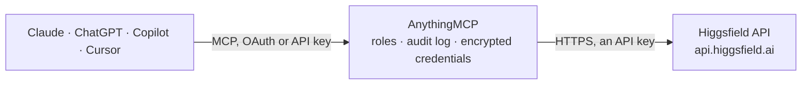

<!-- Generated by scripts/export-github-catalog.mjs in the anythingmcp-website repository. Do not edit by hand. -->

# Higgsfield MCP connector

Let your AI create images and videos on Higgsfield with your own API key: SOUL portraits, Marketing Studio and Ads Studio product images, Seedance, Kling 3.0 and Cinema Studio videos, and 80+ other … The AnythingMCP connector gives Claude, ChatGPT, Microsoft Copilot, Cursor and Gemini 17 MCP tools for Higgsfield: 6 read and 11 can change data.

**Category:** [Public Data](../data.md) · **Tools:** 17 · **Setup guide:** [anythingmcp.com](https://anythingmcp.com/guides/higgsfield-to-mcp) · [Deutsch](https://anythingmcp.com/de/guides/higgsfield-to-mcp) · [Italiano](https://anythingmcp.com/it/guides/higgsfield-to-mcp) · [Español](https://anythingmcp.com/es/guides/higgsfield-to-mcp) · [日本語](https://anythingmcp.com/ja/guides/higgsfield-to-mcp) · [Русский](https://anythingmcp.com/ru/guides/higgsfield-to-mcp) · [中文](https://anythingmcp.com/zh/guides/higgsfield-to-mcp)

## Start without code

No installation and no terminal: AnythingMCP Cloud runs the Higgsfield connector for you, operated by helpcode.ai in Frankfurt, Germany.

1. **Click the button above** and create an account or sign in. The Higgsfield connector opens, ready to install.
2. **Paste the API key or token from your Higgsfield account.** Every click is in the [step-by-step guide](https://anythingmcp.com/guides/higgsfield-to-mcp).
3. **Click Install.** AnythingMCP shows the address of your MCP server.
4. **Add that address to your assistant:** [Claude](https://anythingmcp.com/guides/connect-higgsfield-to-claude) · [ChatGPT](https://anythingmcp.com/guides/connect-higgsfield-to-chatgpt) · [Microsoft Copilot](https://anythingmcp.com/guides/connect-higgsfield-to-copilot) · [Cursor](https://anythingmcp.com/guides/connect-higgsfield-to-cursor) · [Gemini CLI](https://anythingmcp.com/guides/connect-higgsfield-to-gemini) · [Meta Muse](https://anythingmcp.com/guides/connect-higgsfield-to-muse).
5. **Ask your first question**, for example: *What's the status of Higgsfield request r-2026-0117 for the Q3 product hero video?*

Prefer help with the setup? [Talk to us](https://anythingmcp.com/contact).

## How it works

- **The AI client** speaks MCP (Streamable HTTP) to AnythingMCP and only sees tool names, descriptions and results. It never gets the Higgsfield credentials.
- **AnythingMCP** checks the client's role, builds the call from the tool definition, adds the credentials (an API key), calls Higgsfield, logs the call and returns the result.
- **Higgsfield** sees an ordinary API client with the rights of the account the credentials belong to.

## Tools

| Tool | What it does | Access |
|---|---|---|
| [`higgsfield_get_request_status`](#higgsfield_get_request_status) | Get the status and output of a Higgsfield generation request: status (queued, in_progress, completed, failed, nsfw, canceled), error, and when completed the… | read |
| [`higgsfield_cancel_request`](#higgsfield_cancel_request) | Cancel a Higgsfield generation request that is still queued; its reserved credits are refunded. | write |
| [`higgsfield_estimate_cost`](#higgsfield_estimate_cost) | Estimate what a Higgsfield generation would cost before running it: send the model's endpoint ID and the same input you would generate with, and get back… | read |
| [`higgsfield_generate`](#higgsfield_generate) | Run any Higgsfield model by its endpoint ID with the model's own JSON input: use it for the models without a dedicated tool here (SOUL Cinema, Marketing… | write |
| [`higgsfield_list_soul_styles`](#higgsfield_list_soul_styles) | List the SOUL V2 image styles with id, name, description and preview_url. | read |
| [`higgsfield_list_marketing_presets`](#higgsfield_list_marketing_presets) | List Marketing Studio image presets (id, type, name, cover image, aspect ratio and group). | read |
| [`higgsfield_list_soul_ids`](#higgsfield_list_soul_ids) | List the account's Soul ID characters (trained character references) with id, name, model_version (v1, v2 or cinema) and status (not_ready, queued,… | read |
| [`higgsfield_get_soul_id`](#higgsfield_get_soul_id) | Get one Soul ID character by id: name, model_version, status (not_ready, queued, in_progress, completed, failed), thumbnail_url, created_at and fail_reason. | read |
| [`higgsfield_soul_image`](#higgsfield_soul_image) | Generate photorealistic images with Higgsfield SOUL V2 (portraits, fashion, editorial), optionally in a SOUL style (higgsfield_list_soul_styles) or with a… | write |
| [`higgsfield_marketing_studio_image`](#higgsfield_marketing_studio_image) | Generate or edit campaign and product images with Higgsfield Marketing Studio: text to image without image_urls, editing with up to 16 reference images, or… | write |
| [`higgsfield_ads_studio`](#higgsfield_ads_studio) | Turn a marketing brief and optional product images into 1 to 8 ad concepts, each rendered as one image (Higgsfield Ads Studio, fixed 2k, high quality). | write |
| [`higgsfield_seedance_text_to_video`](#higgsfield_seedance_text_to_video) | Generate a video from text with ByteDance Seedance 2.5 on Higgsfield, with optional generated audio. | write |
| [`higgsfield_seedance_image_to_video`](#higgsfield_seedance_image_to_video) | Animate an image into a video with ByteDance Seedance 2.5 on Higgsfield: image_url is the first frame, end_image_url an optional last frame, framing follows… | write |
| [`higgsfield_seedance_reference_to_video`](#higgsfield_seedance_reference_to_video) | Generate a video with ByteDance Seedance 2.5 on Higgsfield guided by reference media: images (up to 30), videos (up to 10) and audio (up to 10), at most 50… | write |
| [`higgsfield_kling_text_to_video`](#higgsfield_kling_text_to_video) | Generate a video from text with Kling 3.0 on Higgsfield, in the Standard, Pro or 4K tier, with native sound and optional multi-shot sequences. | write |
| [`higgsfield_kling_image_to_video`](#higgsfield_kling_image_to_video) | Animate an image into a video with Kling 3.0 on Higgsfield, in the Standard, Pro or 4K tier: image_url is the first frame, last_image_url an optional last… | write |
| [`higgsfield_cinema_studio_video`](#higgsfield_cinema_studio_video) | Create a cinematic video shot with Higgsfield Cinema Studio 4.0: text to video, or reference to video when image, video or audio references are given (refer… | write |

## Tool reference

Every parameter as the AI client sees it in `tools/list`. Source: [`packages/backend/src/adapters/intl/higgsfield.json`](../../../packages/backend/src/adapters/intl/higgsfield.json).

### `higgsfield_get_request_status`

Get the status and output of a Higgsfield generation request: status (queued, in_progress, completed, failed, nsfw, canceled), error, and when completed the output URLs: images[].url for images, video.url for videos, audio.url and audios[].url for audio. Call it every 5 to 10 seconds while status is queued or in_progress; videos usually take minutes. Output URLs stay available for at least seven days. Free. Read-only.

**Access:** read · **Call:** `GET /requests/{request_id}/status`

| Parameter | Type | Required | Description |
|---|---|---|---|
| `request_id` | string | yes | The request_id returned when the generation was submitted. |

### `higgsfield_cancel_request`

Cancel a Higgsfield generation request that is still queued; its reserved credits are refunded. Once status is in_progress it can no longer be canceled (the API answers 400) and it is billed when it completes. Success is an empty 202 answer; check higgsfield_get_request_status for status canceled. Confirm with the user first, and only cancel requests started in this conversation unless the user names another one.

**Access:** write · **Call:** `POST /requests/{request_id}/cancel`

| Parameter | Type | Required | Description |
|---|---|---|---|
| `request_id` | string | yes | The request_id of the queued request to cancel. |

### `higgsfield_estimate_cost`

Estimate what a Higgsfield generation would cost before running it: send the model's endpoint ID and the same input you would generate with, and get back credits and usd. Does not start a generation and costs nothing. Use it before every generation so the user can approve the price.

**Access:** read · **Call:** `POST /estimate/{model_id}`

| Parameter | Type | Required | Description |
|---|---|---|---|
| `model_id` | string | yes | The model's endpoint ID from the Higgsfield docs (docs.higgsfield.ai/docs/models) or the Console, without a leading slash, e.g. bytedance/seedance-2.5/text-to-video, kling-video/v3.0/pro/image-to-video, higgsfield-ai/soul/v2/standard or marketing-studio/image/flare. |
| `input` | object | yes | The model's JSON input with the field names of its documented schema, e.g. {"prompt": "a red bicycle in the rain", "aspect_ratio": "16:9"}. Media go in as public HTTPS URLs (image_url, image_urls, video_url, audio_url). |

### `higgsfield_generate`

Run any Higgsfield model by its endpoint ID with the model's own JSON input: use it for the models without a dedicated tool here (SOUL Cinema, Marketing Studio Flare and Sunburst, Genjutsu, Kling O3 and Omni, Kling 3.0 Turbo, Wan, Happy Horse, MiniMax, Hailuo, LTX-2.5, PixVerse, Grok Imagine, Recraft, Qwen Image, Ideogram, Z-Image, Seedance video edit and extend and more). Read the model's page on docs.higgsfield.ai for its fields; unknown fields are rejected with 422. COSTS CREDITS, billed to the user's Higgsfield balance: confirm the model, the input and the price from higgsfield_estimate_cost with the user before calling. Returns request_id and status queued; poll higgsfield_get_request_status until it is completed, failed, nsfw or canceled.

**Access:** write · **Call:** `POST /{model_id}`

| Parameter | Type | Required | Description |
|---|---|---|---|
| `model_id` | string | yes | The model's endpoint ID from the Higgsfield docs (docs.higgsfield.ai/docs/models) or the Console, without a leading slash, e.g. bytedance/seedance-2.5/text-to-video, kling-video/v3.0/pro/image-to-video, higgsfield-ai/soul/v2/standard or marketing-studio/image/flare. |
| `input` | object | yes | The model's JSON input with the field names of its documented schema, e.g. {"prompt": "a red bicycle in the rain", "aspect_ratio": "16:9"}. Media go in as public HTTPS URLs (image_url, image_urls, video_url, audio_url). |
| `idempotency_key` | string | no | Optional Idempotency-Key header: a unique value (a UUID) for this one generation. If the call times out, repeating it with the same key returns the original request_id instead of starting and billing a second generation. Never reuse a key for a different request. |

### `higgsfield_list_soul_styles`

List the SOUL V2 image styles with id, name, description and preview_url. Pass an id as style_id to higgsfield_soul_image. Free; also a quick check that the API key works. Read-only.

**Access:** read · **Call:** `GET /v1/text2image/soul-styles/v2`

No parameters.

### `higgsfield_list_marketing_presets`

List Marketing Studio image presets (id, type, name, cover image, aspect ratio and group). A preset id is needed as preset_id when higgsfield_marketing_studio_image runs with enhance_prompt true. The answer has total, items and cursor (the offset of the next page, null on the last page). Free. Read-only.

**Access:** read · **Call:** `GET /marketing-studio/image/presets`

| Parameter | Type | Required | Description |
|---|---|---|---|
| `search` | string | no | Optional text to match preset or group names, 1 to 100 characters. |
| `size` | integer | no | Presets per page, 1 to 100. Default 50. |
| `cursor` | integer | no | Zero-based offset: the cursor value of the previous answer. Leave out for the first page. |

### `higgsfield_list_soul_ids`

List the account's Soul ID characters (trained character references) with id, name, model_version (v1, v2 or cinema) and status (not_ready, queued, in_progress, completed, failed). A completed id goes into custom_reference_id of higgsfield_soul_image (model_version v2). Free. Read-only.

**Access:** read · **Call:** `GET /v1/custom-references/list`

| Parameter | Type | Required | Description |
|---|---|---|---|
| `page` | integer | no | Page number, starting at 1. |
| `page_size` | integer | no | Characters per page. Default 20. |

### `higgsfield_get_soul_id`

Get one Soul ID character by id: name, model_version, status (not_ready, queued, in_progress, completed, failed), thumbnail_url, created_at and fail_reason. Only completed characters can be used for generation. Free. Read-only.

**Access:** read · **Call:** `GET /v1/custom-references/{reference_id}`

| Parameter | Type | Required | Description |
|---|---|---|---|
| `reference_id` | string | yes | The Soul ID character id. |

### `higgsfield_soul_image`

Generate photorealistic images with Higgsfield SOUL V2 (portraits, fashion, editorial), optionally in a SOUL style (higgsfield_list_soul_styles) or with a trained Soul ID character. COSTS CREDITS, billed to the user's Higgsfield balance; batch_size 4 costs about four times one image. Confirm the prompt and the price (higgsfield_estimate_cost with model_id higgsfield-ai/soul/v2/standard) with the user before calling. Completed output: images[].url. Returns request_id and status queued; poll higgsfield_get_request_status until it is completed, failed, nsfw or canceled.

**Access:** write · **Call:** `POST /higgsfield-ai/soul/v2/standard`

| Parameter | Type | Required | Description |
|---|---|---|---|
| `prompt` | string | yes | What the image shows. |
| `aspect_ratio` | `9:16` \| `16:9` \| `4:3` \| `3:4` \| `1:1` \| `2:3` \| `3:2` | no | Image aspect ratio. Default 1:1. |
| `resolution` | `720p` \| `1080p` | no | 720p (default) or 1080p. |
| `style_id` | string | no | Optional SOUL style id from higgsfield_list_soul_styles. Leave out for the general style. |
| `enhance_prompt` | boolean | no | Let Higgsfield rewrite the prompt. Default false (short prompts in the general style may be enhanced anyway). |
| `custom_reference_id` | string | no | Optional id of a completed Soul ID character of this account (higgsfield_list_soul_ids, model_version v2). |
| `custom_reference_strength` | number | no | How strongly the character is applied, above 0 and at most 1. Default 1. |
| `seed` | integer | no | Optional seed 1 to 1000000 for repeatable results. Leave out for a random one; null is rejected. |
| `batch_size` | `1` \| `4` | no | Number of images: 1 (default) or 4. |
| `idempotency_key` | string | no | Optional Idempotency-Key header: a unique value (a UUID) for this one generation. If the call times out, repeating it with the same key returns the original request_id instead of starting and billing a second generation. Never reuse a key for a different request. |

### `higgsfield_marketing_studio_image`

Generate or edit campaign and product images with Higgsfield Marketing Studio: text to image without image_urls, editing with up to 16 reference images, or preset-based ads with enhance_prompt true (needs preset_id from higgsfield_list_marketing_presets and 1 to 2 images: product first, optional model second). COSTS CREDITS, billed to the user's Higgsfield balance; 4k and high quality cost more. Confirm the prompt and the price (higgsfield_estimate_cost with model_id marketing-studio/image) with the user before calling. Completed output: images[].url. Returns request_id and status queued; poll higgsfield_get_request_status until it is completed, failed, nsfw or canceled.

**Access:** write · **Call:** `POST /marketing-studio/image`

| Parameter | Type | Required | Description |
|---|---|---|---|
| `prompt` | string | yes | What the image shows or how to edit the references, up to 5,000 characters. |
| `image_urls` | string[] | no | Optional public HTTPS URLs of JPEG, PNG or WebP reference images: up to 16 for editing, exactly 1 to 2 with enhance_prompt true (product first). Leave out for text to image. |
| `resolution` | `1k` \| `2k` \| `4k` | no | Resolution tier 1k, 2k (default) or 4k; exact pixels depend on aspect_ratio. |
| `aspect_ratio` | `auto` \| `1:1` \| `3:2` \| `2:3` \| `4:3` \| `3:4` \| `16:9` \| `9:16` \| `21:9` | no | Aspect ratio. Default auto (the preset's ratio with enhance_prompt, otherwise square). |
| `quality` | `low` \| `medium` \| `high` | no | low, medium or high (default). Must be high with enhance_prompt true. |
| `enhance_prompt` | boolean | no | true to apply a Marketing Studio preset (requires preset_id). Default false. |
| `preset_id` | string | no | Preset id from higgsfield_list_marketing_presets, required when enhance_prompt is true. |
| `moderation` | `auto` \| `low` | no | Content moderation level: auto (default) or low. |
| `idempotency_key` | string | no | Optional Idempotency-Key header: a unique value (a UUID) for this one generation. If the call times out, repeating it with the same key returns the original request_id instead of starting and billing a second generation. Never reuse a key for a different request. |

### `higgsfield_ads_studio`

Turn a marketing brief and optional product images into 1 to 8 ad concepts, each rendered as one image (Higgsfield Ads Studio, fixed 2k, high quality). COSTS CREDITS, billed to the user's Higgsfield balance per concept: batch_size 8 costs about eight images. Confirm the brief, batch_size and the price (higgsfield_estimate_cost with model_id higgsfield/ads-studio/v1.0) with the user before calling. Completed output: images[].url, one per concept. Returns request_id and status queued; poll higgsfield_get_request_status until it is completed, failed, nsfw or canceled.

**Access:** write · **Call:** `POST /higgsfield/ads-studio/v1.0`

| Parameter | Type | Required | Description |
|---|---|---|---|
| `prompt` | string | yes | The brief: product, offer, message and tone, up to 8,000 characters. |
| `image_urls` | string[] | no | Optional public HTTPS URLs of up to 10 product or brand reference images. |
| `batch_size` | integer | no | Number of ad concepts and images, 1 to 8. Default 1. |
| `aspect_ratio` | `1:1` \| `4:5` \| `5:4` \| `16:9` \| `9:16` \| `4:3` \| `3:4` \| `21:9` \| `3:2` \| `2:3` \| `2:1` \| `1:2` \| `3:1` \| `1:3` | no | Aspect ratio of every image. Default 1:1; auto is not supported. |
| `niche` | string | no | Optional industry or niche, up to 1,000 characters. |
| `target_audience` | string | no | Optional target audience, up to 2,000 characters. |
| `language` | string | no | Optional language for text in the ads, e.g. English or Italian. |
| `idempotency_key` | string | no | Optional Idempotency-Key header: a unique value (a UUID) for this one generation. If the call times out, repeating it with the same key returns the original request_id instead of starting and billing a second generation. Never reuse a key for a different request. |

### `higgsfield_seedance_text_to_video`

Generate a video from text with ByteDance Seedance 2.5 on Higgsfield, with optional generated audio. COSTS CREDITS, billed to the user's Higgsfield balance; the price grows with duration and resolution, and video costs far more than images. Confirm the prompt, duration, resolution and the price (higgsfield_estimate_cost with model_id bytedance/seedance-2.5/text-to-video) with the user before calling. Completed output: video.url. Returns request_id and status queued; poll higgsfield_get_request_status until it is completed, failed, nsfw or canceled.

**Access:** write · **Call:** `POST /bytedance/seedance-2.5/text-to-video`

| Parameter | Type | Required | Description |
|---|---|---|---|
| `prompt` | string | yes | What happens in the video. Required and not blank. |
| `duration` | integer | no | Video length in seconds, 4 to 30. Default 5. Longer videos cost more. |
| `resolution` | `480p` \| `720p` \| `1080p` | no | 480p, 720p (default) or 1080p. Higher resolutions cost more. |
| `bitrate_mode` | `standard` \| `high` | no | standard or high (default). |
| `generate_audio` | boolean | no | Generate a soundtrack with the video. Default true. |
| `aspect_ratio` | `16:9` \| `4:3` \| `1:1` \| `3:4` \| `9:16` \| `21:9` | no | Aspect ratio. Default 16:9. |
| `output_format` | `mp4` \| `mov` | no | mp4 (default) or mov. |
| `idempotency_key` | string | no | Optional Idempotency-Key header: a unique value (a UUID) for this one generation. If the call times out, repeating it with the same key returns the original request_id instead of starting and billing a second generation. Never reuse a key for a different request. |

### `higgsfield_seedance_image_to_video`

Animate an image into a video with ByteDance Seedance 2.5 on Higgsfield: image_url is the first frame, end_image_url an optional last frame, framing follows the image. COSTS CREDITS, billed to the user's Higgsfield balance; the price grows with duration and resolution. Confirm the input, duration, resolution and the price (higgsfield_estimate_cost with model_id bytedance/seedance-2.5/image-to-video) with the user before calling. Completed output: video.url. Returns request_id and status queued; poll higgsfield_get_request_status until it is completed, failed, nsfw or canceled.

**Access:** write · **Call:** `POST /bytedance/seedance-2.5/image-to-video`

| Parameter | Type | Required | Description |
|---|---|---|---|
| `image_url` | string | yes | Public HTTPS URL of the first frame image (asset:// references are rejected). |
| `prompt` | string | no | Optional description of the motion and scene. |
| `end_image_url` | string | no | Optional public HTTPS URL of the last frame. |
| `duration` | integer | no | Video length in seconds, 4 to 30. Default 5. Longer videos cost more. |
| `resolution` | `480p` \| `720p` \| `1080p` | no | 480p, 720p (default) or 1080p. Higher resolutions cost more. |
| `bitrate_mode` | `standard` \| `high` | no | standard or high (default). |
| `generate_audio` | boolean | no | Generate a soundtrack with the video. Default true. |
| `idempotency_key` | string | no | Optional Idempotency-Key header: a unique value (a UUID) for this one generation. If the call times out, repeating it with the same key returns the original request_id instead of starting and billing a second generation. Never reuse a key for a different request. |

### `higgsfield_seedance_reference_to_video`

Generate a video with ByteDance Seedance 2.5 on Higgsfield guided by reference media: images (up to 30), videos (up to 10) and audio (up to 10), at most 50 items; at least one list must be non-empty. COSTS CREDITS, billed to the user's Higgsfield balance; the price grows with duration and resolution. Confirm the input and the price (higgsfield_estimate_cost with model_id bytedance/seedance-2.5/reference-to-video) with the user before calling. Completed output: video.url. Returns request_id and status queued; poll higgsfield_get_request_status until it is completed, failed, nsfw or canceled.

**Access:** write · **Call:** `POST /bytedance/seedance-2.5/reference-to-video`

| Parameter | Type | Required | Description |
|---|---|---|---|
| `prompt` | string | no | What happens in the video and how the references are used. |
| `image_urls` | string[] | no | Public HTTPS URLs of up to 30 reference images. |
| `video_urls` | string[] | no | Public HTTPS URLs of up to 10 reference videos (normalized to 30 seconds in total). |
| `audio_urls` | string[] | no | Public HTTPS URLs of up to 10 reference audio files (normalized to 30 seconds in total). |
| `duration` | integer | no | Video length in seconds, 4 to 30. Default 5. Longer videos cost more. |
| `resolution` | `480p` \| `720p` \| `1080p` | no | 480p, 720p (default) or 1080p. Higher resolutions cost more. |
| `bitrate_mode` | `standard` \| `high` | no | standard or high (default). |
| `generate_audio` | boolean | no | Generate a soundtrack with the video. Default true. |
| `aspect_ratio` | `16:9` \| `4:3` \| `1:1` \| `3:4` \| `9:16` \| `21:9` | no | Aspect ratio. Default 16:9. |
| `idempotency_key` | string | no | Optional Idempotency-Key header: a unique value (a UUID) for this one generation. If the call times out, repeating it with the same key returns the original request_id instead of starting and billing a second generation. Never reuse a key for a different request. |

### `higgsfield_kling_text_to_video`

Generate a video from text with Kling 3.0 on Higgsfield, in the Standard, Pro or 4K tier, with native sound and optional multi-shot sequences. COSTS CREDITS, billed to the user's Higgsfield balance; the price depends on tier and duration. Confirm the prompt, tier, duration and the price (higgsfield_estimate_cost with model_id kling-video/v3.0/<tier>/text-to-video) with the user before calling. Completed output: video.url. Returns request_id and status queued; poll higgsfield_get_request_status until it is completed, failed, nsfw or canceled.

**Access:** write · **Call:** `POST /kling-video/v3.0/{tier}/text-to-video`

| Parameter | Type | Required | Description |
|---|---|---|---|
| `tier` | `std` \| `pro` \| `4k` | no | Kling 3.0 quality tier, part of the endpoint: std (Standard), pro (default) or 4k. Higher tiers cost more. |
| `prompt` | string | yes | What happens in the video. Always send a non-empty prompt, also with multi_prompt; at most 2,500 characters (longer is truncated). |
| `duration` | integer | no | Video length in seconds, 3 to 15. Default 5. With multi_prompt the shot durations are summed instead. |
| `sound` | `on` \| `off` | no | Native audio: on (default) or off. |
| `cfg_scale` | number | no | How closely to follow the prompt, 0 to 1 in steps of 0.01. Default 0.5. |
| `multi_shots` | boolean | no | true for a video made of several custom shots described in multi_prompt. |
| `multi_prompt` | object[] | no | With multi_shots true: 1 to 6 shots, each {"prompt": "..." (at most 512 characters), "duration": seconds 1 to 15}. Shot durations are summed for generation and billing. |
| `elements` | string[] | no | Optional Kling element ids (decimal strings) that belong to this account. |
| `aspect_ratio` | `16:9` \| `9:16` \| `1:1` | no | Aspect ratio: 16:9 (default), 9:16 or 1:1. |
| `idempotency_key` | string | no | Optional Idempotency-Key header: a unique value (a UUID) for this one generation. If the call times out, repeating it with the same key returns the original request_id instead of starting and billing a second generation. Never reuse a key for a different request. |

### `higgsfield_kling_image_to_video`

Animate an image into a video with Kling 3.0 on Higgsfield, in the Standard, Pro or 4K tier: image_url is the first frame, last_image_url an optional last frame. COSTS CREDITS, billed to the user's Higgsfield balance; the price depends on tier and duration. Confirm the input, tier, duration and the price (higgsfield_estimate_cost with model_id kling-video/v3.0/<tier>/image-to-video) with the user before calling. Completed output: video.url. Returns request_id and status queued; poll higgsfield_get_request_status until it is completed, failed, nsfw or canceled.

**Access:** write · **Call:** `POST /kling-video/v3.0/{tier}/image-to-video`

| Parameter | Type | Required | Description |
|---|---|---|---|
| `tier` | `std` \| `pro` \| `4k` | no | Kling 3.0 quality tier, part of the endpoint: std (Standard), pro (default) or 4k. Higher tiers cost more. |
| `prompt` | string | yes | What happens in the video. Always send a non-empty prompt, also with multi_prompt; at most 2,500 characters (longer is truncated). |
| `duration` | integer | no | Video length in seconds, 3 to 15. Default 5. With multi_prompt the shot durations are summed instead. |
| `sound` | `on` \| `off` | no | Native audio: on (default) or off. |
| `cfg_scale` | number | no | How closely to follow the prompt, 0 to 1 in steps of 0.01. Default 0.5. |
| `multi_shots` | boolean | no | true for a video made of several custom shots described in multi_prompt. |
| `multi_prompt` | object[] | no | With multi_shots true: 1 to 6 shots, each {"prompt": "..." (at most 512 characters), "duration": seconds 1 to 15}. Shot durations are summed for generation and billing. |
| `elements` | string[] | no | Optional Kling element ids (decimal strings) that belong to this account. |
| `image_url` | string | yes | Public HTTPS URL of the first frame image. |
| `last_image_url` | string | no | Optional public HTTPS URL of the last frame. |
| `idempotency_key` | string | no | Optional Idempotency-Key header: a unique value (a UUID) for this one generation. If the call times out, repeating it with the same key returns the original request_id instead of starting and billing a second generation. Never reuse a key for a different request. |

### `higgsfield_cinema_studio_video`

Create a cinematic video shot with Higgsfield Cinema Studio 4.0: text to video, or reference to video when image, video or audio references are given (refer to them in the prompt as <<<image_1>>>, <<<video_1>>>, <<<audio_1>>>). Camera, lens, light, era, genre, palette and pacing are optional; left out, the director picks them. COSTS CREDITS, billed to the user's Higgsfield balance; the price grows with duration. Confirm the prompt and the price (higgsfield_estimate_cost with model_id higgsfield/cinema-studio/4.0) with the user before calling. Completed output: video.url. Returns request_id and status queued; poll higgsfield_get_request_status until it is completed, failed, nsfw or canceled.

**Access:** write · **Call:** `POST /higgsfield/cinema-studio/4.0`

| Parameter | Type | Required | Description |
|---|---|---|---|
| `prompt` | string | yes | The shot: subject, action and mood. |
| `duration` | integer | no | Video length in seconds, 4 to 30. Default 5. |
| `resolution` | `480p` \| `720p` | no | 480p or 720p (default). |
| `aspect_ratio` | `16:9` \| `4:3` \| `1:1` \| `3:4` \| `9:16` \| `21:9` | no | Aspect ratio. Default 16:9. |
| `generate_audio` | boolean | no | Generate audio with the video. Default true. |
| `image_urls` | string[] | no | Optional public HTTPS URLs of up to 30 reference images. |
| `video_urls` | string[] | no | Optional public HTTPS URLs of up to 10 reference videos. |
| `audio_urls` | string[] | no | Optional public HTTPS URLs of up to 10 reference audio files. |
| `camera_movement` | string | no | Optional camera move, e.g. dolly-in, dolly-out, tracking, handheld, drone-orbit, crane-up, pan-left, whip-pan, static-shot, bullet-time, dolly-zoom (see the Cinema Studio 4.0 docs for all values; auto is not accepted). |
| `camera_model` | `modern` \| `35mm-film` \| `8mm-film` \| `dv-camcorder` | no | Optional camera look. |
| `camera_lens` | `clean-sharp` \| `anamorphic` \| `vintage-anamorphic` \| `warm-vintage` \| `halation-vintage` | no | Optional lens look. |
| `camera_aperture` | `f14-wide-open` \| `f4-moderate` \| `f11-deep-focus` | no | Optional depth of field. |
| `light` | `silhouette` \| `practicals` \| `window` \| `overhead-fall` \| `contre-jour` \| `soft-cross` | no | Optional lighting setup. |
| `genre` | `epic` \| `drama` \| `noir` \| `comedy` \| `horror` \| `action` | no | Optional genre. |
| `era` | `1960s` \| `1980s` \| `1990s` \| `2000s` \| `2020s` | no | Optional era look. |
| `pacing` | `chaotic` \| `dynamic` \| `calm` \| `single-shot` | no | Optional pacing. |
| `color_palette` | string | no | Optional named colour palette slug, e.g. twilight-fable, neon-rain-at-midnight, oil-ochre, industrial-fog (see the Cinema Studio 4.0 docs for all values). |
| `idempotency_key` | string | no | Optional Idempotency-Key header: a unique value (a UUID) for this one generation. If the call times out, repeating it with the same key returns the original request_id instead of starting and billing a second generation. Never reuse a key for a different request. |

## Run it yourself

AnythingMCP is open source (AGPL-3.0). [Run it with Docker](../../../README.md#run-it-yourself), open **Connectors → Store**, pick **Higgsfield** and enter `HIGGSFIELD_API_KEY_ID`, `HIGGSFIELD_API_KEY_SECRET`, then add your MCP server URL to the AI client.

[← Public Data connectors](../data.md) · [All categories](../README.md)
