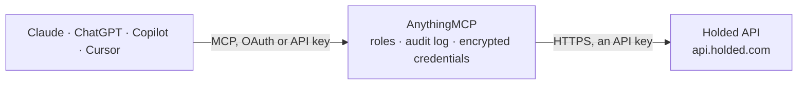

<!-- Generated by scripts/export-github-catalog.mjs in the anythingmcp-website repository. Do not edit by hand. -->

# Holded MCP connector

Holded — the Spanish SMB business suite: contacts, sales and purchase documents, products, warehouses, treasury accounts and CRM funnels. The AnythingMCP connector gives Claude, ChatGPT, Microsoft Copilot, Cursor and Gemini 9 MCP tools for Holded, all read-only.

**Category:** [Accounting](../accounting.md) · **Tools:** 9 · **Setup guide:** [anythingmcp.com](https://anythingmcp.com/guides/holded-to-mcp) · [Deutsch](https://anythingmcp.com/de/guides/holded-to-mcp) · [Italiano](https://anythingmcp.com/it/guides/holded-to-mcp) · [Español](https://anythingmcp.com/es/guides/holded-to-mcp) · [日本語](https://anythingmcp.com/ja/guides/holded-to-mcp) · [Русский](https://anythingmcp.com/ru/guides/holded-to-mcp) · [中文](https://anythingmcp.com/zh/guides/holded-to-mcp)

## Start without code

No installation and no terminal: AnythingMCP Cloud runs the Holded connector for you, operated by helpcode.ai in Frankfurt, Germany.

1. **Click the button above** and create an account or sign in. The Holded connector opens, ready to install.
2. **Paste the API key or token from your Holded account.** Every click is in the [step-by-step guide](https://anythingmcp.com/guides/holded-to-mcp).
3. **Click Install.** AnythingMCP shows the address of your MCP server.
4. **Add that address to your assistant:** [Claude](https://anythingmcp.com/guides/connect-holded-to-claude) · [ChatGPT](https://anythingmcp.com/guides/connect-holded-to-chatgpt) · [Microsoft Copilot](https://anythingmcp.com/guides/connect-holded-to-copilot) · [Cursor](https://anythingmcp.com/guides/connect-holded-to-cursor) · [Gemini CLI](https://anythingmcp.com/guides/connect-holded-to-gemini) · [Meta Muse](https://anythingmcp.com/guides/connect-holded-to-muse).
5. **Ask your first question**, for example: *What's the status and total of invoice INV-2026-0412 for InnovaText SL?*

Prefer help with the setup? [Talk to us](https://anythingmcp.com/contact).

## How it works

- **The AI client** speaks MCP (Streamable HTTP) to AnythingMCP and only sees tool names, descriptions and results. It never gets the Holded credentials.
- **AnythingMCP** checks the client's role, builds the call from the tool definition, adds the credentials (an API key), calls Holded, logs the call and returns the result.
- **Holded** sees an ordinary API client with the rights of the account the credentials belong to.

## Tools

| Tool | What it does | Access |
|---|---|---|
| [`holded_list_contacts`](#holded_list_contacts) | List contacts — customers, suppliers, leads — with their name, NIF/CIF, e-mail, address and the type flags that say which role they hold. | read |
| [`holded_get_contact`](#holded_get_contact) | Read one contact in full: tax data, billing address, payment terms, default VAT rate and the notes recorded against them. | read |
| [`holded_list_documents`](#holded_list_documents) | List documents of one type — invoices, estimates, credit notes, purchase orders — with their number, date, contact, total and payment status. | read |
| [`holded_get_document`](#holded_get_document) | Read one document in full: every line with its quantity, price, discount and VAT, the totals, and the payments applied against it. | read |
| [`holded_list_products`](#holded_list_products) | List products and services with their SKU, name, price, cost, VAT rate and stock level. | read |
| [`holded_list_warehouses`](#holded_list_warehouses) | List warehouses with their name and location, so a stock question can name the right one. | read |
| [`holded_list_treasury_accounts`](#holded_list_treasury_accounts) | List the treasury accounts (bank and cash) with their name, IBAN and current balance — the cash-position answer. | read |
| [`holded_list_funnels`](#holded_list_funnels) | List the CRM funnels with their stages, so a pipeline question knows which stages exist before asking about leads in them. | read |
| [`holded_list_leads`](#holded_list_leads) | List CRM leads with their name, contact, value, funnel stage and expected close date — the sales-pipeline view. | read |

## Tool reference

Every parameter as the AI client sees it in `tools/list`. Source: [`packages/backend/src/adapters/es/holded.json`](../../../packages/backend/src/adapters/es/holded.json).

### `holded_list_contacts`

List contacts — customers, suppliers, leads — with their name, NIF/CIF, e-mail, address and the type flags that say which role they hold.

**Access:** read · **Call:** `GET /invoicing/v1/contacts`

| Parameter | Type | Required | Description |
|---|---|---|---|
| `page` | string | no | Page number, starting at 1. |
| `phone` | string | no | Exact phone number match, including characters like +, # and -. |
| `mobile` | string | no | Exact mobile number match, including characters like +, # and -. |
| `customId` | string | no | Your external reference id; several ids comma-separated. |

### `holded_get_contact`

Read one contact in full: tax data, billing address, payment terms, default VAT rate and the notes recorded against them.

**Access:** read · **Call:** `GET /invoicing/v1/contacts/{contactId}`

| Parameter | Type | Required | Description |
|---|---|---|---|
| `contactId` | string | yes | Holded contact id. |

### `holded_list_documents`

List documents of one type — invoices, estimates, credit notes, purchase orders — with their number, date, contact, total and payment status.

**Access:** read · **Call:** `GET /invoicing/v1/documents/{docType}`

| Parameter | Type | Required | Description |
|---|---|---|---|
| `docType` | string | yes | Document type: invoice, salesreceipt, creditnote, salesorder, proform, waybill, estimate, purchase, purchaseorder or purchaserefund. |
| `starttmp` | number | no | Earliest document date as a Unix timestamp in seconds. |
| `endtmp` | number | no | Latest document date as a Unix timestamp in seconds. |
| `contactid` | string | no | Restrict to one contact's documents. |
| `paid` | string | no | Payment status filter: 0 = not paid, 1 = paid, 2 = partially paid. |
| `billed` | string | no | Billing status filter: 0 = not billed, 1 = billed. |
| `sort` | `created-asc` \| `created-desc` | no | Sort by creation date: created-asc or created-desc. |
| `page` | string | no | Page number, starting at 1. |

### `holded_get_document`

Read one document in full: every line with its quantity, price, discount and VAT, the totals, and the payments applied against it.

**Access:** read · **Call:** `GET /invoicing/v1/documents/{docType}/{documentId}`

| Parameter | Type | Required | Description |
|---|---|---|---|
| `docType` | string | yes | Document type, e.g. invoice. |
| `documentId` | string | yes | Holded document id. |

### `holded_list_products`

List products and services with their SKU, name, price, cost, VAT rate and stock level.

**Access:** read · **Call:** `GET /invoicing/v1/products`

| Parameter | Type | Required | Description |
|---|---|---|---|
| `page` | string | no | Page number, starting at 1. |

### `holded_list_warehouses`

List warehouses with their name and location, so a stock question can name the right one.

**Access:** read · **Call:** `GET /invoicing/v1/warehouses`

No parameters.

### `holded_list_treasury_accounts`

List the treasury accounts (bank and cash) with their name, IBAN and current balance — the cash-position answer.

**Access:** read · **Call:** `GET /invoicing/v1/treasury`

No parameters.

### `holded_list_funnels`

List the CRM funnels with their stages, so a pipeline question knows which stages exist before asking about leads in them.

**Access:** read · **Call:** `GET /crm/v1/funnels`

No parameters.

### `holded_list_leads`

List CRM leads with their name, contact, value, funnel stage and expected close date — the sales-pipeline view.

**Access:** read · **Call:** `GET /crm/v1/leads`

| Parameter | Type | Required | Description |
|---|---|---|---|
| `page` | string | no | Page number, starting at 1. |

## Run it yourself

AnythingMCP is open source (AGPL-3.0). [Run it with Docker](../../../README.md#run-it-yourself), open **Connectors → Store**, pick **Holded** and enter `HOLDED_API_KEY`, then add your MCP server URL to the AI client.

[← Accounting connectors](../accounting.md) · [All categories](../README.md)
