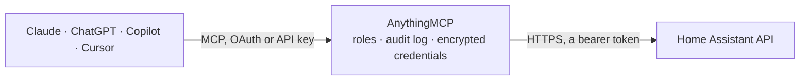

<!-- Generated by scripts/export-github-catalog.mjs in the anythingmcp-website repository. Do not edit by hand. -->

# Home Assistant MCP connector

Let your AI read your Home Assistant: the current state of every sensor, light, door and thermostat, the recorded history, the logbook of what happened when, and your calendars. The AnythingMCP connector gives Claude, ChatGPT, Microsoft Copilot, Cursor and Gemini 7 MCP tools for Home Assistant, all read-only.

**Category:** [Monitoring](../monitoring.md) · **Tools:** 7 · **Setup guide:** [anythingmcp.com](https://anythingmcp.com/guides/home-assistant-to-mcp) · [Deutsch](https://anythingmcp.com/de/guides/home-assistant-to-mcp) · [Italiano](https://anythingmcp.com/it/guides/home-assistant-to-mcp) · [Español](https://anythingmcp.com/es/guides/home-assistant-to-mcp) · [日本語](https://anythingmcp.com/ja/guides/home-assistant-to-mcp) · [Русский](https://anythingmcp.com/ru/guides/home-assistant-to-mcp) · [中文](https://anythingmcp.com/zh/guides/home-assistant-to-mcp)

## Start without code

No installation and no terminal: AnythingMCP Cloud runs the Home Assistant connector for you, operated by helpcode.ai in Frankfurt, Germany.

1. **Click the button above** and create an account or sign in. The Home Assistant connector opens, ready to install.
2. **Paste the API key or token from your Home Assistant account.** Every click is in the [step-by-step guide](https://anythingmcp.com/guides/home-assistant-to-mcp).
3. **Click Install.** AnythingMCP shows the address of your MCP server.
4. **Add that address to your assistant:** [Claude](https://anythingmcp.com/guides/connect-home-assistant-to-claude) · [ChatGPT](https://anythingmcp.com/guides/connect-home-assistant-to-chatgpt) · [Microsoft Copilot](https://anythingmcp.com/guides/connect-home-assistant-to-copilot) · [Cursor](https://anythingmcp.com/guides/connect-home-assistant-to-cursor) · [Gemini CLI](https://anythingmcp.com/guides/connect-home-assistant-to-gemini) · [Meta Muse](https://anythingmcp.com/guides/connect-home-assistant-to-muse).
5. **Ask your first question**, for example: *When did binary_sensor.loading_dock_garage last open? Check entity binary_sensor.loading_dock_garage*

Prefer help with the setup? [Talk to us](https://anythingmcp.com/contact).

## How it works

- **The AI client** speaks MCP (Streamable HTTP) to AnythingMCP and only sees tool names, descriptions and results. It never gets the Home Assistant credentials.
- **AnythingMCP** checks the client's role, builds the call from the tool definition, adds the credentials (a bearer token), calls Home Assistant, logs the call and returns the result.
- **Home Assistant** sees an ordinary API client with the rights of the account the credentials belong to.

## Tools

| Tool | What it does | Access |
|---|---|---|
| [`home_assistant_get_config`](#home_assistant_get_config) | Get the Home Assistant configuration: version, location name, time zone, unit system, coordinates and loaded components. | read |
| [`home_assistant_list_states`](#home_assistant_list_states) | List every entity the token may read, shortened to entity_id, state, friendly name, unit and last_changed. | read |
| [`home_assistant_get_state`](#home_assistant_get_state) | Get the current state of one entity with all its attributes, last_changed and last_updated, e.g. a thermostat's target temperature or whether a window is open. | read |
| [`home_assistant_get_history`](#home_assistant_get_history) | Get the recorded state changes of one or more entities over a period, e.g. the living room temperature overnight. | read |
| [`home_assistant_get_logbook`](#home_assistant_get_logbook) | Get logbook entries from a start time: human-readable events such as a door opening, a light turning on or a person arriving home, with entity_id, name,… | read |
| [`home_assistant_list_calendars`](#home_assistant_list_calendars) | List the calendar entities of this Home Assistant instance (entity_id and name, e.g. calendar.family). | read |
| [`home_assistant_get_calendar_events`](#home_assistant_get_calendar_events) | Get the events of one calendar between start and end: summary, start, end, description and location. | read |

## Tool reference

Every parameter as the AI client sees it in `tools/list`. Source: [`packages/backend/src/adapters/intl/home-assistant.json`](../../../packages/backend/src/adapters/intl/home-assistant.json).

### `home_assistant_get_config`

Get the Home Assistant configuration: version, location name, time zone, unit system, coordinates and loaded components. Use it to check the setup and to present times in the home's time zone. Read-only.

**Access:** read · **Call:** `GET /config`

No parameters.

### `home_assistant_list_states`

List every entity the token may read, shortened to entity_id, state, friendly name, unit and last_changed. Use it to find entity ids (sensor.*, light.*, binary_sensor.*). For all attributes of one entity call home_assistant_get_state. Read-only.

**Access:** read · **Call:** `GET /states`

No parameters.

### `home_assistant_get_state`

Get the current state of one entity with all its attributes, last_changed and last_updated, e.g. a thermostat's target temperature or whether a window is open. Home Assistant answers 404 if the entity does not exist. Read-only.

**Access:** read · **Call:** `GET /states/{entity_id}`

| Parameter | Type | Required | Description |
|---|---|---|---|
| `entity_id` | string | yes | Entity id, e.g. sensor.living_room_temperature or binary_sensor.kitchen_window. |

### `home_assistant_get_history`

Get the recorded state changes of one or more entities over a period, e.g. the living room temperature overnight. Returns one list of {state, last_changed} per entity, without attributes. Without end_time the period is one day from start_time. Read-only.

**Access:** read · **Call:** `GET /history/period/{start_time}`

| Parameter | Type | Required | Description |
|---|---|---|---|
| `start_time` | string | yes | Start of the period. ISO 8601 in UTC with a Z suffix, e.g. 2026-10-01T00:00:00Z (an offset such as +02:00 puts a + into the URL; convert to UTC instead). |
| `filter_entity_id` | string | yes | One or more entity ids, comma-separated, e.g. sensor.living_room_temperature,sensor.outdoor_temperature. |
| `end_time` | string | no | End of the period (default one day after start_time). ISO 8601 in UTC with a Z suffix, e.g. 2026-10-01T00:00:00Z (an offset such as +02:00 puts a + into the URL; convert to UTC instead). |

### `home_assistant_get_logbook`

Get logbook entries from a start time: human-readable events such as a door opening, a light turning on or a person arriving home, with entity_id, name, message, state and when. Use it for 'when did X last happen'. Read-only.

**Access:** read · **Call:** `GET /logbook/{start_time}`

| Parameter | Type | Required | Description |
|---|---|---|---|
| `start_time` | string | yes | Start of the period. ISO 8601 in UTC with a Z suffix, e.g. 2026-10-01T00:00:00Z (an offset such as +02:00 puts a + into the URL; convert to UTC instead). |
| `entity` | string | no | Only these entities, comma-separated, e.g. binary_sensor.garage_door or cover.garage_door,person.alex. |
| `end_time` | string | no | End of the period. ISO 8601 in UTC with a Z suffix, e.g. 2026-10-01T00:00:00Z (an offset such as +02:00 puts a + into the URL; convert to UTC instead). |
| `period` | integer | no | Length of the period in days when end_time is not given (default 1), e.g. 7. |

### `home_assistant_list_calendars`

List the calendar entities of this Home Assistant instance (entity_id and name, e.g. calendar.family). The entity_id is what home_assistant_get_calendar_events takes. Read-only.

**Access:** read · **Call:** `GET /calendars`

No parameters.

### `home_assistant_get_calendar_events`

Get the events of one calendar between start and end: summary, start, end, description and location. Both start and end are required; Home Assistant answers 400 without them. Read-only.

**Access:** read · **Call:** `GET /calendars/{entity_id}`

| Parameter | Type | Required | Description |
|---|---|---|---|
| `entity_id` | string | yes | Calendar entity id from home_assistant_list_calendars, e.g. calendar.family. |
| `start` | string | yes | Start of the range. ISO 8601 in UTC with a Z suffix, e.g. 2026-10-01T00:00:00Z (an offset such as +02:00 puts a + into the URL; convert to UTC instead). |
| `end` | string | yes | End of the range, e.g. 2026-10-08T00:00:00Z. ISO 8601 in UTC with a Z suffix, e.g. 2026-10-01T00:00:00Z (an offset such as +02:00 puts a + into the URL; convert to UTC instead). |

## Run it yourself

AnythingMCP is open source (AGPL-3.0). [Run it with Docker](../../../README.md#run-it-yourself), open **Connectors → Store**, pick **Home Assistant** and enter `HOME_ASSISTANT_URL`, `HOME_ASSISTANT_TOKEN`, then add your MCP server URL to the AI client.

[← Monitoring connectors](../monitoring.md) · [All categories](../README.md)
