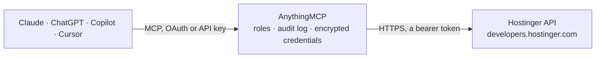

<!-- Generated by scripts/export-github-catalog.mjs in the anythingmcp-website repository. Do not edit by hand. -->

# Hostinger MCP connector

Manage a Hostinger account through its public API: VPS power, metrics, backups, snapshots, Docker projects and firewalls, domains, nameservers and DNS zones with snapshots, subscriptions and the … The AnythingMCP connector gives Claude, ChatGPT, Microsoft Copilot, Cursor and Gemini 53 MCP tools for Hostinger: 33 read and 20 can change data.

**Category:** [Infrastructure](../infrastructure.md) · **Tools:** 53 · **Setup guide:** [anythingmcp.com](https://anythingmcp.com/guides/hostinger-to-mcp) · [Deutsch](https://anythingmcp.com/de/guides/hostinger-to-mcp) · [Italiano](https://anythingmcp.com/it/guides/hostinger-to-mcp) · [Español](https://anythingmcp.com/es/guides/hostinger-to-mcp) · [日本語](https://anythingmcp.com/ja/guides/hostinger-to-mcp) · [Русский](https://anythingmcp.com/ru/guides/hostinger-to-mcp) · [中文](https://anythingmcp.com/zh/guides/hostinger-to-mcp)

## Start without code

No installation and no terminal: AnythingMCP Cloud runs the Hostinger connector for you, operated by helpcode.ai in Frankfurt, Germany.

1. **Click the button above** and create an account or sign in. The Hostinger connector opens, ready to install.
2. **Paste the API key or token from your Hostinger account.** Every click is in the [step-by-step guide](https://anythingmcp.com/guides/hostinger-to-mcp).
3. **Click Install.** AnythingMCP shows the address of your MCP server.
4. **Add that address to your assistant:** [Claude](https://anythingmcp.com/guides/connect-hostinger-to-claude) · [ChatGPT](https://anythingmcp.com/guides/connect-hostinger-to-chatgpt) · [Microsoft Copilot](https://anythingmcp.com/guides/connect-hostinger-to-copilot) · [Cursor](https://anythingmcp.com/guides/connect-hostinger-to-cursor) · [Gemini CLI](https://anythingmcp.com/guides/connect-hostinger-to-gemini) · [Meta Muse](https://anythingmcp.com/guides/connect-hostinger-to-muse).
5. **Ask your first question**, for example: *List my active subscriptions and give me the subscription id for the 'VPS 4 CPU' plan.*

Prefer help with the setup? [Talk to us](https://anythingmcp.com/contact).

## How it works

- **The AI client** speaks MCP (Streamable HTTP) to AnythingMCP and only sees tool names, descriptions and results. It never gets the Hostinger credentials.
- **AnythingMCP** checks the client's role, builds the call from the tool definition, adds the credentials (a bearer token), calls Hostinger, logs the call and returns the result.
- **Hostinger** sees an ordinary API client with the rights of the account the credentials belong to.

## Tools

| Tool | What it does | Access |
|---|---|---|
| [`hostinger_list_virtual_machines`](#hostinger_list_virtual_machines) | List every VPS (virtual machine) of the account: id, hostname, state (running, stopped, ...), plan, CPU count, memory and disk in MB, bandwidth, IPv4 and… | read |
| [`hostinger_get_virtual_machine`](#hostinger_get_virtual_machine) | Read one VPS in detail: state, plan and resources, IP addresses, OS template, hostname, nameservers, data center, active firewall, subscription and whether… | read |
| [`hostinger_get_vm_metrics`](#hostinger_get_vm_metrics) | Usage history of a VPS between two times: CPU, memory and disk usage, incoming and outgoing traffic, and uptime, as time series keyed by Unix timestamp. | read |
| [`hostinger_list_vm_actions`](#hostinger_list_vm_actions) | History of operations run on a VPS (start, stop, restart, backup restore, snapshot, OS change, ...), newest first, with name, state (created, sent, delayed,… | read |
| [`hostinger_get_vm_action`](#hostinger_get_vm_action) | Read one VPS action by id to see whether it is still running, succeeded or failed. | read |
| [`hostinger_start_vm`](#hostinger_start_vm) | Power on a stopped VPS. | write |
| [`hostinger_stop_vm`](#hostinger_stop_vm) | Power off a VPS. | write |
| [`hostinger_restart_vm`](#hostinger_restart_vm) | Reboot a VPS (full stop and start; a stopped VPS is started). | write |
| [`hostinger_set_vm_hostname`](#hostinger_set_vm_hostname) | Change the hostname of a VPS. | write |
| [`hostinger_list_vm_backups`](#hostinger_list_vm_backups) | List the automatic backups of a VPS with their id, size, location and creation time. | read |
| [`hostinger_restore_vm_backup`](#hostinger_restore_vm_backup) | Restore a VPS from one of its backups. | write |
| [`hostinger_get_vm_snapshot`](#hostinger_get_vm_snapshot) | Read the snapshot of a VPS (a VPS has at most one): id, creation time, expiry time and restore time. | read |
| [`hostinger_create_vm_snapshot`](#hostinger_create_vm_snapshot) | Take a snapshot of a VPS's current state. | write |
| [`hostinger_restore_vm_snapshot`](#hostinger_restore_vm_snapshot) | Revert a VPS to its snapshot. | write |
| [`hostinger_list_vm_ssh_keys`](#hostinger_list_vm_ssh_keys) | List the SSH public keys of the root user on a VPS: key type, fingerprint data and comment name. | read |
| [`hostinger_list_vps_templates`](#hostinger_list_vps_templates) | List the OS templates a VPS can be installed with (Ubuntu, Debian, AlmaLinux, panels and app stacks): id, name and description. | read |
| [`hostinger_list_vps_data_centers`](#hostinger_list_vps_data_centers) | List Hostinger's VPS data centers: id, name, location code, city and continent. | read |
| [`hostinger_list_docker_projects`](#hostinger_list_docker_projects) | List the Docker Compose projects on a VPS that uses Hostinger's Docker manager: name, status, compose file path and containers with image, state, health and… | read |
| [`hostinger_get_docker_project_containers`](#hostinger_get_docker_project_containers) | List the containers of one Docker Compose project on a VPS with status, health, port mappings and CPU and memory stats. | read |
| [`hostinger_get_docker_project_logs`](#hostinger_get_docker_project_logs) | Read the latest log lines (up to 300 in total) of every service of a Docker Compose project on a VPS, grouped by service with timestamps. | read |
| [`hostinger_restart_docker_project`](#hostinger_restart_docker_project) | Restart all services of a Docker Compose project on a VPS (stop and start in dependency order; volumes are kept). | write |
| [`hostinger_list_firewalls`](#hostinger_list_firewalls) | List the VPS firewalls of the account: id, name, whether they are in sync with their machines, and their rules. | read |
| [`hostinger_get_firewall`](#hostinger_get_firewall) | Read one firewall with all its rules (protocol, port, source) and its sync state. | read |
| [`hostinger_create_firewall`](#hostinger_create_firewall) | Create an empty firewall. | write |
| [`hostinger_create_firewall_rule`](#hostinger_create_firewall_rule) | Add an accept rule to a firewall. | write |
| [`hostinger_update_firewall_rule`](#hostinger_update_firewall_rule) | Change a firewall rule. | write |
| [`hostinger_delete_firewall_rule`](#hostinger_delete_firewall_rule) | Delete a firewall rule. | write |
| [`hostinger_sync_firewall`](#hostinger_sync_firewall) | Apply a firewall's current rules to every VPS it is activated on. | write |
| [`hostinger_activate_firewall`](#hostinger_activate_firewall) | Activate a firewall on a VPS. | write |
| [`hostinger_deactivate_firewall`](#hostinger_deactivate_firewall) | Deactivate a firewall on a VPS: all its ports are reachable again from everywhere. | write |
| [`hostinger_list_domains`](#hostinger_list_domains) | List the domains in the account's portfolio: id, domain name, type (domain or free subdomain), status and creation and expiry dates. | read |
| [`hostinger_get_domain`](#hostinger_get_domain) | Read one domain: status, nameservers, child nameservers, lock and privacy protection state, WHOIS contact profile ids and dates. | read |
| [`hostinger_get_domain_renewal`](#hostinger_get_domain_renewal) | Read a domain's renewal information: status and current expiry date. | read |
| [`hostinger_check_domain_availability`](#hostinger_check_domain_availability) | Check whether a domain name is free to register in one or more TLDs. | read |
| [`hostinger_update_domain_nameservers`](#hostinger_update_domain_nameservers) | Point a domain to other nameservers (two to four). | write |
| [`hostinger_get_domain_forwarding`](#hostinger_get_domain_forwarding) | Read the forwarding (redirect) of a domain: target URL, redirect type (301 or 302) and dates. | read |
| [`hostinger_list_whois_profiles`](#hostinger_list_whois_profiles) | List the WHOIS contact profiles used to register domains: id, TLD, country, entity type and contact details. | read |
| [`hostinger_get_dns_records`](#hostinger_get_dns_records) | Read the DNS zone of a domain managed by Hostinger nameservers: every record set with name, type, TTL and values. | read |
| [`hostinger_validate_dns_records`](#hostinger_validate_dns_records) | Check DNS record changes without applying them: answers success when hostinger_update_dns_records would accept them, or 422 with the problems. | read |
| [`hostinger_update_dns_records`](#hostinger_update_dns_records) | Add or change DNS records of a domain. | write |
| [`hostinger_delete_dns_records`](#hostinger_delete_dns_records) | Delete whole DNS record sets of a domain, selected by name and type. | write |
| [`hostinger_list_dns_snapshots`](#hostinger_list_dns_snapshots) | List the saved versions (snapshots) of a domain's DNS zone, taken before each change: id, reason and time. | read |
| [`hostinger_get_dns_snapshot`](#hostinger_get_dns_snapshot) | Read one DNS zone snapshot with all the records it contained, e.g. to compare with the current zone before restoring. | read |
| [`hostinger_restore_dns_snapshot`](#hostinger_restore_dns_snapshot) | Restore a domain's DNS zone to a snapshot. | write |
| [`hostinger_list_subscriptions`](#hostinger_list_subscriptions) | List the account's subscriptions: id, name, status, billing period, currency, total and renewal price in cents, auto-renewal flag, creation, expiry and next… | read |
| [`hostinger_list_payment_methods`](#hostinger_list_payment_methods) | List the payment methods saved in the account: id, name, masked identifier, type, default, expired and suspended flags. | read |
| [`hostinger_get_catalog`](#hostinger_get_catalog) | List what can be ordered with prices: catalog items (VPS plans, domain TLDs, hosting, email) with their price items per billing period, price and… | read |
| [`hostinger_list_hosting_orders`](#hostinger_list_hosting_orders) | List the web and cloud hosting orders (plans) the token can see, own and shared: order id, plan name, status, subscription id and creation date. | read |
| [`hostinger_list_websites`](#hostinger_list_websites) | List the websites on web and cloud hosting: domain, hosting account user name, order id, root directory, whether it is enabled, and the detected type… | read |
| [`hostinger_list_wordpress_installations`](#hostinger_list_wordpress_installations) | List the WordPress installations on web and cloud hosting: id, user name, domain, title, URL, directory, admin login and email, and whether the installation… | read |
| [`hostinger_list_databases`](#hostinger_list_databases) | List the MySQL databases of a hosting account: name, user, host and port, assigned domain, disk usage and size limit in MB, and dates. | read |
| [`hostinger_list_cron_jobs`](#hostinger_list_cron_jobs) | List the cron jobs of a hosting account with their schedule and command. | read |
| [`hostinger_clear_website_cache`](#hostinger_clear_website_cache) | Clear the server-side cache of a website (and the Hostinger CDN cache when CDN is on), so updated content shows at once. | write |

## Tool reference

Every parameter as the AI client sees it in `tools/list`. Source: [`packages/backend/src/adapters/intl/hostinger.json`](../../../packages/backend/src/adapters/intl/hostinger.json).

### `hostinger_list_virtual_machines`

List every VPS (virtual machine) of the account: id, hostname, state (running, stopped, ...), plan, CPU count, memory and disk in MB, bandwidth, IPv4 and IPv6 addresses, OS template, data center, firewall group and subscription id.

**Access:** read · **Call:** `GET /api/vps/v1/virtual-machines`

No parameters.

### `hostinger_get_virtual_machine`

Read one VPS in detail: state, plan and resources, IP addresses, OS template, hostname, nameservers, data center, active firewall, subscription and whether an action is still running (actions_lock).

**Access:** read · **Call:** `GET /api/vps/v1/virtual-machines/{virtual_machine_id}`

| Parameter | Type | Required | Description |
|---|---|---|---|
| `virtual_machine_id` | integer | yes | Virtual machine id, a number such as 1268054 (from hostinger_list_virtual_machines). |

### `hostinger_get_vm_metrics`

Usage history of a VPS between two times: CPU, memory and disk usage, incoming and outgoing traffic, and uptime, as time series keyed by Unix timestamp.

**Access:** read · **Call:** `GET /api/vps/v1/virtual-machines/{virtual_machine_id}/metrics`

| Parameter | Type | Required | Description |
|---|---|---|---|
| `virtual_machine_id` | integer | yes | Virtual machine id, a number such as 1268054 (from hostinger_list_virtual_machines). |
| `date_from` | string | yes | Start of the period, ISO 8601, e.g. 2026-10-01T00:00:00Z. |
| `date_to` | string | yes | End of the period, ISO 8601, e.g. 2026-10-30T00:00:00Z. |

### `hostinger_list_vm_actions`

History of operations run on a VPS (start, stop, restart, backup restore, snapshot, OS change, ...), newest first, with name, state (created, sent, delayed, success, error) and times. Use it to follow up a write that answered with an action.

**Access:** read · **Call:** `GET /api/vps/v1/virtual-machines/{virtual_machine_id}/actions`

| Parameter | Type | Required | Description |
|---|---|---|---|
| `virtual_machine_id` | integer | yes | Virtual machine id, a number such as 1268054 (from hostinger_list_virtual_machines). |
| `page` | integer | no | Page number, starting at 1. |

### `hostinger_get_vm_action`

Read one VPS action by id to see whether it is still running, succeeded or failed.

**Access:** read · **Call:** `GET /api/vps/v1/virtual-machines/{virtual_machine_id}/actions/{action_id}`

| Parameter | Type | Required | Description |
|---|---|---|---|
| `virtual_machine_id` | integer | yes | Virtual machine id, a number such as 1268054 (from hostinger_list_virtual_machines). |
| `action_id` | integer | yes | Action id (the id returned by a VPS write or from hostinger_list_vm_actions). |

### `hostinger_start_vm`

Power on a stopped VPS. Answers with an action; the machine is up once that action succeeds.

**Access:** write · **Call:** `POST /api/vps/v1/virtual-machines/{virtual_machine_id}/start`

| Parameter | Type | Required | Description |
|---|---|---|---|
| `virtual_machine_id` | integer | yes | Virtual machine id, a number such as 1268054 (from hostinger_list_virtual_machines). |

### `hostinger_stop_vm`

Power off a VPS. Everything running on it goes offline until it is started again. Billing continues; stopping is not cancelling.

**Access:** write · **Call:** `POST /api/vps/v1/virtual-machines/{virtual_machine_id}/stop`

| Parameter | Type | Required | Description |
|---|---|---|---|
| `virtual_machine_id` | integer | yes | Virtual machine id, a number such as 1268054 (from hostinger_list_virtual_machines). |

### `hostinger_restart_vm`

Reboot a VPS (full stop and start; a stopped VPS is started). Services on it are briefly unavailable.

**Access:** write · **Call:** `POST /api/vps/v1/virtual-machines/{virtual_machine_id}/restart`

| Parameter | Type | Required | Description |
|---|---|---|---|
| `virtual_machine_id` | integer | yes | Virtual machine id, a number such as 1268054 (from hostinger_list_virtual_machines). |

### `hostinger_set_vm_hostname`

Change the hostname of a VPS. The PTR (reverse DNS) record is not updated automatically, and the domain's A/AAAA records must point to the VPS for the name to resolve.

**Access:** write · **Call:** `PUT /api/vps/v1/virtual-machines/{virtual_machine_id}/hostname`

| Parameter | Type | Required | Description |
|---|---|---|---|
| `virtual_machine_id` | integer | yes | Virtual machine id, a number such as 1268054 (from hostinger_list_virtual_machines). |
| `hostname` | string | yes | New hostname, e.g. my.server.tld. |

### `hostinger_list_vm_backups`

List the automatic backups of a VPS with their id, size, location and creation time.

**Access:** read · **Call:** `GET /api/vps/v1/virtual-machines/{virtual_machine_id}/backups`

| Parameter | Type | Required | Description |
|---|---|---|---|
| `virtual_machine_id` | integer | yes | Virtual machine id, a number such as 1268054 (from hostinger_list_virtual_machines). |
| `page` | integer | no | Page number, starting at 1. |

### `hostinger_restore_vm_backup`

Restore a VPS from one of its backups. ALL current data on the VPS is overwritten with the backup; changes made since are lost.

**Access:** write · **Call:** `POST /api/vps/v1/virtual-machines/{virtual_machine_id}/backups/{backup_id}/restore`

| Parameter | Type | Required | Description |
|---|---|---|---|
| `virtual_machine_id` | integer | yes | Virtual machine id, a number such as 1268054 (from hostinger_list_virtual_machines). |
| `backup_id` | integer | yes | Backup id from hostinger_list_vm_backups. |

### `hostinger_get_vm_snapshot`

Read the snapshot of a VPS (a VPS has at most one): id, creation time, expiry time and restore time.

**Access:** read · **Call:** `GET /api/vps/v1/virtual-machines/{virtual_machine_id}/snapshot`

| Parameter | Type | Required | Description |
|---|---|---|---|
| `virtual_machine_id` | integer | yes | Virtual machine id, a number such as 1268054 (from hostinger_list_virtual_machines). |

### `hostinger_create_vm_snapshot`

Take a snapshot of a VPS's current state. A VPS keeps only one snapshot: creating a new one overwrites the existing snapshot.

**Access:** write · **Call:** `POST /api/vps/v1/virtual-machines/{virtual_machine_id}/snapshot`

| Parameter | Type | Required | Description |
|---|---|---|---|
| `virtual_machine_id` | integer | yes | Virtual machine id, a number such as 1268054 (from hostinger_list_virtual_machines). |

### `hostinger_restore_vm_snapshot`

Revert a VPS to its snapshot. Everything changed on the VPS since the snapshot was taken is lost.

**Access:** write · **Call:** `POST /api/vps/v1/virtual-machines/{virtual_machine_id}/snapshot/restore`

| Parameter | Type | Required | Description |
|---|---|---|---|
| `virtual_machine_id` | integer | yes | Virtual machine id, a number such as 1268054 (from hostinger_list_virtual_machines). |

### `hostinger_list_vm_ssh_keys`

List the SSH public keys of the root user on a VPS: key type, fingerprint data and comment name.

**Access:** read · **Call:** `GET /api/vps/v1/virtual-machines/{virtual_machine_id}/ssh-keys`

| Parameter | Type | Required | Description |
|---|---|---|---|
| `virtual_machine_id` | integer | yes | Virtual machine id, a number such as 1268054 (from hostinger_list_virtual_machines). |

### `hostinger_list_vps_templates`

List the OS templates a VPS can be installed with (Ubuntu, Debian, AlmaLinux, panels and app stacks): id, name and description.

**Access:** read · **Call:** `GET /api/vps/v1/templates`

No parameters.

### `hostinger_list_vps_data_centers`

List Hostinger's VPS data centers: id, name, location code, city and continent.

**Access:** read · **Call:** `GET /api/vps/v1/data-centers`

No parameters.

### `hostinger_list_docker_projects`

List the Docker Compose projects on a VPS that uses Hostinger's Docker manager: name, status, compose file path and containers with image, state, health and ports.

**Access:** read · **Call:** `GET /api/vps/v1/virtual-machines/{virtual_machine_id}/docker`

| Parameter | Type | Required | Description |
|---|---|---|---|
| `virtual_machine_id` | integer | yes | Virtual machine id, a number such as 1268054 (from hostinger_list_virtual_machines). |

### `hostinger_get_docker_project_containers`

List the containers of one Docker Compose project on a VPS with status, health, port mappings and CPU and memory stats.

**Access:** read · **Call:** `GET /api/vps/v1/virtual-machines/{virtual_machine_id}/docker/{project_name}/containers`

| Parameter | Type | Required | Description |
|---|---|---|---|
| `virtual_machine_id` | integer | yes | Virtual machine id, a number such as 1268054 (from hostinger_list_virtual_machines). |
| `project_name` | string | yes | Docker Compose project name (from hostinger_list_docker_projects): letters, digits, dashes and underscores. |

### `hostinger_get_docker_project_logs`

Read the latest log lines (up to 300 in total) of every service of a Docker Compose project on a VPS, grouped by service with timestamps.

**Access:** read · **Call:** `GET /api/vps/v1/virtual-machines/{virtual_machine_id}/docker/{project_name}/logs`

| Parameter | Type | Required | Description |
|---|---|---|---|
| `virtual_machine_id` | integer | yes | Virtual machine id, a number such as 1268054 (from hostinger_list_virtual_machines). |
| `project_name` | string | yes | Docker Compose project name (from hostinger_list_docker_projects): letters, digits, dashes and underscores. |

### `hostinger_restart_docker_project`

Restart all services of a Docker Compose project on a VPS (stop and start in dependency order; volumes are kept). The services are briefly unavailable.

**Access:** write · **Call:** `POST /api/vps/v1/virtual-machines/{virtual_machine_id}/docker/{project_name}/restart`

| Parameter | Type | Required | Description |
|---|---|---|---|
| `virtual_machine_id` | integer | yes | Virtual machine id, a number such as 1268054 (from hostinger_list_virtual_machines). |
| `project_name` | string | yes | Docker Compose project name (from hostinger_list_docker_projects): letters, digits, dashes and underscores. |

### `hostinger_list_firewalls`

List the VPS firewalls of the account: id, name, whether they are in sync with their machines, and their rules.

**Access:** read · **Call:** `GET /api/vps/v1/firewall`

| Parameter | Type | Required | Description |
|---|---|---|---|
| `page` | integer | no | Page number, starting at 1. |

### `hostinger_get_firewall`

Read one firewall with all its rules (protocol, port, source) and its sync state.

**Access:** read · **Call:** `GET /api/vps/v1/firewall/{firewall_id}`

| Parameter | Type | Required | Description |
|---|---|---|---|
| `firewall_id` | integer | yes | Firewall id (from hostinger_list_firewalls). |

### `hostinger_create_firewall`

Create an empty firewall. A firewall drops all incoming traffic that no rule accepts, so add rules for SSH and every service before activating it on a VPS.

**Access:** write · **Call:** `POST /api/vps/v1/firewall`

| Parameter | Type | Required | Description |
|---|---|---|---|
| `name` | string | yes | Firewall name. |

### `hostinger_create_firewall_rule`

Add an accept rule to a firewall. Machines using the firewall are out of sync afterwards until hostinger_sync_firewall runs.

**Access:** write · **Call:** `POST /api/vps/v1/firewall/{firewall_id}/rules`

| Parameter | Type | Required | Description |
|---|---|---|---|
| `firewall_id` | integer | yes | Firewall id (from hostinger_list_firewalls). |
| `protocol` | `TCP` \| `UDP` \| `ICMP` \| `GRE` \| `any` \| `ESP` \| `AH` \| `ICMPv6` \| `SSH` \| `HTTP` \| `HTTPS` \| `MySQL` \| `PostgreSQL` | yes | Protocol, or a service shortcut such as SSH, HTTP, HTTPS, MySQL or PostgreSQL. |
| `port` | string | yes | Port or port range, e.g. 443 or 1024:2048. |
| `source` | `any` \| `custom` | yes | any: traffic from everywhere; custom: only from source_detail. |
| `source_detail` | string | yes | IP address, CIDR range (e.g. 203.0.113.0/24) or any. |

### `hostinger_update_firewall_rule`

Change a firewall rule. Machines using the firewall are out of sync afterwards until hostinger_sync_firewall runs.

**Access:** write · **Call:** `PUT /api/vps/v1/firewall/{firewall_id}/rules/{rule_id}`

| Parameter | Type | Required | Description |
|---|---|---|---|
| `firewall_id` | integer | yes | Firewall id (from hostinger_list_firewalls). |
| `rule_id` | integer | yes | Rule id from hostinger_get_firewall. |
| `protocol` | `TCP` \| `UDP` \| `ICMP` \| `GRE` \| `any` \| `ESP` \| `AH` \| `ICMPv6` \| `SSH` \| `HTTP` \| `HTTPS` \| `MySQL` \| `PostgreSQL` | yes | Protocol, or a service shortcut such as SSH, HTTP, HTTPS, MySQL or PostgreSQL. |
| `port` | string | yes | Port or port range, e.g. 443 or 1024:2048. |
| `source` | `any` \| `custom` | yes | any: traffic from everywhere; custom: only from source_detail. |
| `source_detail` | string | yes | IP address, CIDR range (e.g. 203.0.113.0/24) or any. |

### `hostinger_delete_firewall_rule`

Delete a firewall rule. Once synced, traffic that only this rule accepted is dropped (removing the SSH rule locks out SSH).

**Access:** write · **Call:** `DELETE /api/vps/v1/firewall/{firewall_id}/rules/{rule_id}`

| Parameter | Type | Required | Description |
|---|---|---|---|
| `firewall_id` | integer | yes | Firewall id (from hostinger_list_firewalls). |
| `rule_id` | integer | yes | Rule id from hostinger_get_firewall. |

### `hostinger_sync_firewall`

Apply a firewall's current rules to every VPS it is activated on. Needed after rules were added, changed or deleted.

**Access:** write · **Call:** `POST /api/vps/v1/firewall/{firewall_id}/sync`

| Parameter | Type | Required | Description |
|---|---|---|---|
| `firewall_id` | integer | yes | Firewall id (from hostinger_list_firewalls). |

### `hostinger_activate_firewall`

Activate a firewall on a VPS. A VPS has one active firewall at a time; traffic no rule accepts is dropped from then on.

**Access:** write · **Call:** `POST /api/vps/v1/firewall/{firewall_id}/activate/{virtual_machine_id}`

| Parameter | Type | Required | Description |
|---|---|---|---|
| `firewall_id` | integer | yes | Firewall id (from hostinger_list_firewalls). |
| `virtual_machine_id` | integer | yes | Virtual machine id, a number such as 1268054 (from hostinger_list_virtual_machines). |

### `hostinger_deactivate_firewall`

Deactivate a firewall on a VPS: all its ports are reachable again from everywhere.

**Access:** write · **Call:** `POST /api/vps/v1/firewall/{firewall_id}/deactivate/{virtual_machine_id}`

| Parameter | Type | Required | Description |
|---|---|---|---|
| `firewall_id` | integer | yes | Firewall id (from hostinger_list_firewalls). |
| `virtual_machine_id` | integer | yes | Virtual machine id, a number such as 1268054 (from hostinger_list_virtual_machines). |

### `hostinger_list_domains`

List the domains in the account's portfolio: id, domain name, type (domain or free subdomain), status and creation and expiry dates.

**Access:** read · **Call:** `GET /api/domains/v1/portfolio`

No parameters.

### `hostinger_get_domain`

Read one domain: status, nameservers, child nameservers, lock and privacy protection state, WHOIS contact profile ids and dates.

**Access:** read · **Call:** `GET /api/domains/v1/portfolio/{domain}`

| Parameter | Type | Required | Description |
|---|---|---|---|
| `domain` | string | yes | Domain name with its TLD, e.g. mydomain.tld (from hostinger_list_domains). |

### `hostinger_get_domain_renewal`

Read a domain's renewal information: status and current expiry date.

**Access:** read · **Call:** `GET /api/domains/v1/portfolio/{domain}/renewal`

| Parameter | Type | Required | Description |
|---|---|---|---|
| `domain` | string | yes | Domain name with its TLD, e.g. mydomain.tld (from hostinger_list_domains). |

### `hostinger_check_domain_availability`

Check whether a domain name is free to register in one or more TLDs. With a single TLD and with_alternatives true it also suggests similar available names. Rate limited to 90 requests a minute.

**Access:** read · **Call:** `POST /api/domains/v1/availability`

| Parameter | Type | Required | Description |
|---|---|---|---|
| `domain` | string | yes | The name without TLD, e.g. mybrand. |
| `tlds` | string[] | yes | TLDs to check, without the leading dot, e.g. ["com", "net", "de"]. |
| `with_alternatives` | boolean | no | true adds alternative names; only works with exactly one TLD. |

### `hostinger_update_domain_nameservers`

Point a domain to other nameservers (two to four). Wrong nameservers make the domain and its email unreachable until fixed; changes can take hours to spread.

**Access:** write · **Call:** `PUT /api/domains/v1/portfolio/{domain}/nameservers`

| Parameter | Type | Required | Description |
|---|---|---|---|
| `domain` | string | yes | Domain name with its TLD, e.g. mydomain.tld (from hostinger_list_domains). |
| `ns1` | string | yes | First nameserver, e.g. ns1.example-dns.tld. |
| `ns2` | string | yes | Second nameserver. |
| `ns3` | string | no | Third nameserver (optional). |
| `ns4` | string | no | Fourth nameserver (optional). |

### `hostinger_get_domain_forwarding`

Read the forwarding (redirect) of a domain: target URL, redirect type (301 or 302) and dates. Answers 404 when no forwarding is set.

**Access:** read · **Call:** `GET /api/domains/v1/forwarding/{domain}`

| Parameter | Type | Required | Description |
|---|---|---|---|
| `domain` | string | yes | Domain name with its TLD, e.g. mydomain.tld (from hostinger_list_domains). |

### `hostinger_list_whois_profiles`

List the WHOIS contact profiles used to register domains: id, TLD, country, entity type and contact details.

**Access:** read · **Call:** `GET /api/domains/v1/whois`

| Parameter | Type | Required | Description |
|---|---|---|---|
| `tld` | string | no | Only profiles for this TLD, without the dot, e.g. com. |

### `hostinger_get_dns_records`

Read the DNS zone of a domain managed by Hostinger nameservers: every record set with name, type, TTL and values.

**Access:** read · **Call:** `GET /api/dns/v1/zones/{domain}`

| Parameter | Type | Required | Description |
|---|---|---|---|
| `domain` | string | yes | Domain name with its TLD, e.g. mydomain.tld (from hostinger_list_domains). |

### `hostinger_validate_dns_records`

Check DNS record changes without applying them: answers success when hostinger_update_dns_records would accept them, or 422 with the problems. Changes nothing.

**Access:** read · **Call:** `POST /api/dns/v1/zones/{domain}/validate`

| Parameter | Type | Required | Description |
|---|---|---|---|
| `domain` | string | yes | Domain name with its TLD, e.g. mydomain.tld (from hostinger_list_domains). |
| `zone` | object[] | yes | Records grouped by name and type, e.g. [{"name": "www", "type": "CNAME", "ttl": 14400, "records": [{"content": "mydomain.tld."}]}]. Use @ for the domain itself. |
| `overwrite` | boolean | no | true: records with the same name and type are replaced by the given ones; false (default): values are added and TTLs updated. |

### `hostinger_update_dns_records`

Add or change DNS records of a domain. Without overwrite the values are added to existing record sets; with overwrite true, record sets with the same name and type are replaced. Hostinger keeps a snapshot of the zone before each change.

**Access:** write · **Call:** `PUT /api/dns/v1/zones/{domain}`

| Parameter | Type | Required | Description |
|---|---|---|---|
| `domain` | string | yes | Domain name with its TLD, e.g. mydomain.tld (from hostinger_list_domains). |
| `zone` | object[] | yes | Records grouped by name and type, e.g. [{"name": "www", "type": "CNAME", "ttl": 14400, "records": [{"content": "mydomain.tld."}]}]. Use @ for the domain itself. |
| `overwrite` | boolean | no | true: records with the same name and type are replaced by the given ones; false (default): values are added and TTLs updated. |

### `hostinger_delete_dns_records`

Delete whole DNS record sets of a domain, selected by name and type. To remove only some values of a set, use hostinger_update_dns_records with overwrite true instead.

**Access:** write · **Call:** `DELETE /api/dns/v1/zones/{domain}`

| Parameter | Type | Required | Description |
|---|---|---|---|
| `domain` | string | yes | Domain name with its TLD, e.g. mydomain.tld (from hostinger_list_domains). |
| `filters` | object[] | yes | Record sets to delete, e.g. [{"name": "@", "type": "TXT"}]. |

### `hostinger_list_dns_snapshots`

List the saved versions (snapshots) of a domain's DNS zone, taken before each change: id, reason and time.

**Access:** read · **Call:** `GET /api/dns/v1/snapshots/{domain}`

| Parameter | Type | Required | Description |
|---|---|---|---|
| `domain` | string | yes | Domain name with its TLD, e.g. mydomain.tld (from hostinger_list_domains). |

### `hostinger_get_dns_snapshot`

Read one DNS zone snapshot with all the records it contained, e.g. to compare with the current zone before restoring.

**Access:** read · **Call:** `GET /api/dns/v1/snapshots/{domain}/{snapshot_id}`

| Parameter | Type | Required | Description |
|---|---|---|---|
| `domain` | string | yes | Domain name with its TLD, e.g. mydomain.tld (from hostinger_list_domains). |
| `snapshot_id` | integer | yes | Snapshot id from hostinger_list_dns_snapshots. |

### `hostinger_restore_dns_snapshot`

Restore a domain's DNS zone to a snapshot. The current records are replaced by the snapshot's records.

**Access:** write · **Call:** `POST /api/dns/v1/snapshots/{domain}/{snapshot_id}/restore`

| Parameter | Type | Required | Description |
|---|---|---|---|
| `domain` | string | yes | Domain name with its TLD, e.g. mydomain.tld (from hostinger_list_domains). |
| `snapshot_id` | integer | yes | Snapshot id from hostinger_list_dns_snapshots. |

### `hostinger_list_subscriptions`

List the account's subscriptions: id, name, status, billing period, currency, total and renewal price in cents, auto-renewal flag, creation, expiry and next billing dates.

**Access:** read · **Call:** `GET /api/billing/v1/subscriptions`

No parameters.

### `hostinger_list_payment_methods`

List the payment methods saved in the account: id, name, masked identifier, type, default, expired and suspended flags. Read-only; methods are added in hPanel.

**Access:** read · **Call:** `GET /api/billing/v1/payment-methods`

No parameters.

### `hostinger_get_catalog`

List what can be ordered with prices: catalog items (VPS plans, domain TLDs, hosting, email) with their price items per billing period, price and first-period price in cents and currency. Filter by category and name to keep the answer small.

**Access:** read · **Call:** `GET /api/billing/v1/catalog`

| Parameter | Type | Required | Description |
|---|---|---|---|
| `category` | `DOMAIN` \| `VPS` \| `EMAIL` \| `HOSTING` | no | Only this product category. |
| `name` | string | no | Only items whose name matches; * is a wildcard, e.g. .COM* for .com domains or KVM* for VPS plans. |

### `hostinger_list_hosting_orders`

List the web and cloud hosting orders (plans) the token can see, own and shared: order id, plan name, status, subscription id and creation date.

**Access:** read · **Call:** `GET /api/hosting/v1/orders`

| Parameter | Type | Required | Description |
|---|---|---|---|
| `page` | integer | no | Page number, starting at 1. |
| `per_page` | integer | no | Items per page, up to 100 (default 25). |
| `statuses` | `active` \| `deleting` \| `deleted` \| `suspended`[] | no | Only orders with these statuses. |
| `order_ids` | integer[] | no | Only these order ids. |

### `hostinger_list_websites`

List the websites on web and cloud hosting: domain, hosting account user name, order id, root directory, whether it is enabled, and the detected type (wordpress, builder, horizons, nodejs, other).

**Access:** read · **Call:** `GET /api/hosting/v1/websites`

| Parameter | Type | Required | Description |
|---|---|---|---|
| `page` | integer | no | Page number, starting at 1. |
| `per_page` | integer | no | Items per page, up to 100 (default 25). |
| `domain` | string | no | Only websites whose domain contains this text. |
| `username` | string | no | Only websites of this hosting account user name. |
| `order_id` | integer | no | Only websites of this hosting order (from hostinger_list_hosting_orders). |
| `is_enabled` | boolean | no | true: only enabled websites; false: only disabled ones. |
| `website_types` | string | no | Only these types, comma-separated: wordpress, builder, horizons, nodejs, other. |

### `hostinger_list_wordpress_installations`

List the WordPress installations on web and cloud hosting: id, user name, domain, title, URL, directory, admin login and email, and whether the installation is valid.

**Access:** read · **Call:** `GET /api/hosting/v1/wordpress/installations`

| Parameter | Type | Required | Description |
|---|---|---|---|
| `username` | string | no | Only installations of this hosting account user name. |
| `domain` | string | no | Only installations whose domain contains this text. |
| `ownership` | `owned` \| `managed` \| `all` | no | owned (default), managed, or all. |

### `hostinger_list_databases`

List the MySQL databases of a hosting account: name, user, host and port, assigned domain, disk usage and size limit in MB, and dates.

**Access:** read · **Call:** `GET /api/hosting/v1/accounts/{username}/databases`

| Parameter | Type | Required | Description |
|---|---|---|---|
| `username` | string | yes | Hosting account user name, e.g. u123456789 (the username field of hostinger_list_websites). |
| `page` | integer | no | Page number, starting at 1. |
| `per_page` | integer | no | Items per page, up to 100 (default 25). |
| `domain` | string | no | Only databases whose domain contains this text. |
| `is_assigned` | boolean | no | With domain: true returns only databases assigned to that domain. |
| `search` | string | no | Search by database name, user or creation date. |

### `hostinger_list_cron_jobs`

List the cron jobs of a hosting account with their schedule and command.

**Access:** read · **Call:** `GET /api/hosting/v1/accounts/{username}/cron-jobs`

| Parameter | Type | Required | Description |
|---|---|---|---|
| `username` | string | yes | Hosting account user name, e.g. u123456789 (the username field of hostinger_list_websites). |

### `hostinger_clear_website_cache`

Clear the server-side cache of a website (and the Hostinger CDN cache when CDN is on), so updated content shows at once. Pages are slower for a short while until the cache fills again.

**Access:** write · **Call:** `DELETE /api/hosting/v1/accounts/{username}/websites/{domain}/cache/clear`

| Parameter | Type | Required | Description |
|---|---|---|---|
| `username` | string | yes | Hosting account user name, e.g. u123456789 (the username field of hostinger_list_websites). |
| `domain` | string | yes | Domain name with its TLD, e.g. mydomain.tld (from hostinger_list_domains). |
| `directory` | string | no | Sub directory of the installation relative to the website root, e.g. blog. Leave out for the root. |

## Run it yourself

AnythingMCP is open source (AGPL-3.0). [Run it with Docker](../../../README.md#run-it-yourself), open **Connectors → Store**, pick **Hostinger** and enter `HOSTINGER_API_TOKEN`, then add your MCP server URL to the AI client.

[← Infrastructure connectors](../infrastructure.md) · [All categories](../README.md)
