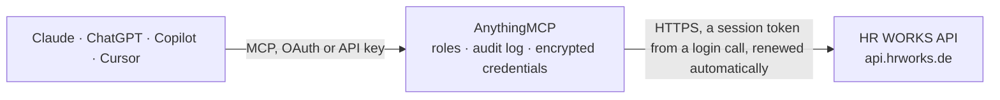

<!-- Generated by scripts/export-github-catalog.mjs in the anythingmcp-website repository. Do not edit by hand. -->

# HR WORKS MCP connector

Access HR WORKS, the German HR/payroll platform: employees, absences, sick leaves, remote work (home office), working times, time accounts, wage payments, personnel files, projects, applicants, … The AnythingMCP connector gives Claude, ChatGPT, Microsoft Copilot, Cursor and Gemini 48 MCP tools for HR WORKS: 45 read and 3 can change data.

**Category:** [HR](../hr.md) · **Tools:** 48 · **Setup guide:** [anythingmcp.com](https://anythingmcp.com/guides/hrworks-to-mcp) · [Deutsch](https://anythingmcp.com/de/guides/hrworks-to-mcp) · [Italiano](https://anythingmcp.com/it/guides/hrworks-to-mcp) · [Español](https://anythingmcp.com/es/guides/hrworks-to-mcp) · [日本語](https://anythingmcp.com/ja/guides/hrworks-to-mcp) · [Русский](https://anythingmcp.com/ru/guides/hrworks-to-mcp) · [中文](https://anythingmcp.com/zh/guides/hrworks-to-mcp)

## Start without code

No installation and no terminal: AnythingMCP Cloud runs the HR WORKS connector for you, operated by helpcode.ai in Frankfurt, Germany.

1. **Click the button above** and create an account or sign in. The HR WORKS connector opens, ready to install.
2. **Paste the API key or token from your HR WORKS account.** Every click is in the [step-by-step guide](https://anythingmcp.com/guides/hrworks-to-mcp).
3. **Click Install.** AnythingMCP shows the address of your MCP server.
4. **Add that address to your assistant:** [Claude](https://anythingmcp.com/guides/connect-hrworks-to-claude) · [ChatGPT](https://anythingmcp.com/guides/connect-hrworks-to-chatgpt) · [Microsoft Copilot](https://anythingmcp.com/guides/connect-hrworks-to-copilot) · [Cursor](https://anythingmcp.com/guides/connect-hrworks-to-cursor) · [Gemini CLI](https://anythingmcp.com/guides/connect-hrworks-to-gemini) · [Meta Muse](https://anythingmcp.com/guides/connect-hrworks-to-muse).
5. **Ask your first question**, for example: *Show current master data for personnel number 2045 (Müller) — I need address, org unit and bank details.*

Prefer help with the setup? [Talk to us](https://anythingmcp.com/contact).

## How it works

- **The AI client** speaks MCP (Streamable HTTP) to AnythingMCP and only sees tool names, descriptions and results. It never gets the HR WORKS credentials.
- **AnythingMCP** checks the client's role, builds the call from the tool definition, adds the credentials (a session token from a login call, renewed automatically), calls HR WORKS, logs the call and returns the result.
- **HR WORKS** sees an ordinary API client with the rights of the account the credentials belong to.

## Tools

| Tool | What it does | Access |
|---|---|---|
| [`hrworks_health_check`](#hrworks_health_check) | Check whether the HR WORKS API is reachable. | read |
| [`hrworks_list_organization_units`](#hrworks_list_organization_units) | List all active organization units (Organisationseinheiten) of the company with their uuid, number and name. | read |
| [`hrworks_get_organization_unit`](#hrworks_get_organization_unit) | Return the data of a specific organization unit. | read |
| [`hrworks_list_present_persons`](#hrworks_list_present_persons) | List all persons currently 'in the office' for a given organization unit. | read |
| [`hrworks_list_permanent_establishments`](#hrworks_list_permanent_establishments) | List all permanent establishments (Betriebsstätten) of the company with id and name. | read |
| [`hrworks_list_holidays`](#hrworks_list_holidays) | List company holidays for a given year and (optionally) country. | read |
| [`hrworks_list_persons`](#hrworks_list_persons) | List all persons (employees) in the company. | read |
| [`hrworks_get_person`](#hrworks_get_person) | Return the base data of a specific person (employee). | read |
| [`hrworks_list_persons_master_data`](#hrworks_list_persons_master_data) | Return the current master data (full personal data, contract details, addresses, bank info, etc.) for one or more persons. | read |
| [`hrworks_get_persons_today`](#hrworks_get_persons_today) | Return day-related objects (working hours, attendance, absences) for the current day for one or more persons. | read |
| [`hrworks_get_leave_account`](#hrworks_get_leave_account) | Return the leave account (vacation balance) of a single person up to a reference date. | read |
| [`hrworks_list_absences`](#hrworks_list_absences) | List absences (vacation, parental leave, etc.) for one or more persons over a date interval. | read |
| [`hrworks_list_absence_types`](#hrworks_list_absence_types) | List all absence types (vacation, parental leave, special leave, etc.) configured for the customer account, with their keys for use as filter values. | read |
| [`hrworks_list_vacation_types`](#hrworks_list_vacation_types) | List vacation types defined for the customer account (subset of absence types focused on vacation/leave). | read |
| [`hrworks_list_sick_leaves`](#hrworks_list_sick_leaves) | List sick leaves (Krankheitstage) for one or more persons over a date interval. | read |
| [`hrworks_list_sick_leave_types`](#hrworks_list_sick_leave_types) | List all sick leave types configured for the customer account with their keys (used as filter values for hrworks_list_sick_leaves). | read |
| [`hrworks_list_remote_work`](#hrworks_list_remote_work) | List remote work / home office records for one or more persons over a date interval. | read |
| [`hrworks_list_working_times`](#hrworks_list_working_times) | List logged working times (time tracking) for one or more persons over a date interval. | read |
| [`hrworks_list_time_recording_regulations`](#hrworks_list_time_recording_regulations) | List all time-recording regulations configured for the customer (defines which working time types are allowed per regulation). | read |
| [`hrworks_list_projects`](#hrworks_list_projects) | List the time-tracking projects of the company, e.g. to find the project id behind a working time. | read |
| [`hrworks_get_project`](#hrworks_get_project) | Return the data of one time-tracking project by its id from hrworks_list_projects. | read |
| [`hrworks_list_project_customers`](#hrworks_list_project_customers) | List the customers that time-tracking projects are booked for (project customers). | read |
| [`hrworks_list_job_applications`](#hrworks_list_job_applications) | List job applications. | read |
| [`hrworks_list_posts`](#hrworks_list_posts) | List the recruiting posts (job postings) of the company; inactive ones on request. | read |
| [`hrworks_get_post`](#hrworks_get_post) | Return the data of one recruiting post (job posting) by its uuid from hrworks_list_posts. | read |
| [`hrworks_list_applicants`](#hrworks_list_applicants) | List applicants (only those with at least one job application). | read |
| [`hrworks_get_applicant`](#hrworks_get_applicant) | Return data of a specific applicant by uuid. | read |
| [`hrworks_list_cost_centers`](#hrworks_list_cost_centers) | List all cost centers (Kostenstellen) of the company with their number/id and name. | read |
| [`hrworks_list_cost_objectives`](#hrworks_list_cost_objectives) | List all cost objectives (Kostenträger) of the company with their number and name. | read |
| [`hrworks_list_wage_salary_types`](#hrworks_list_wage_salary_types) | List all wage/salary types defined for the customer account (used in payroll exports). | read |
| [`hrworks_list_travel_expense_reports`](#hrworks_list_travel_expense_reports) | List travel expense reports (Reisekostenabrechnungen) in a date interval, optionally for some people. | read |
| [`hrworks_list_time_accounts`](#hrworks_list_time_accounts) | Return the time accounts (Arbeitszeitkonto: target hours, worked hours, overtime balance) of people for one or more months. | read |
| [`hrworks_list_leave_accounts`](#hrworks_list_leave_accounts) | Return the leave accounts (vacation entitlement, approved, requested, planned and expiring days) of several people at once, up to a reference date. | read |
| [`hrworks_get_available_working_hours`](#hrworks_get_available_working_hours) | Return the working hours people are available in a date interval (target hours minus absences), summed or split by day, week or month. | read |
| [`hrworks_get_absences_accumulated`](#hrworks_get_absences_accumulated) | Return the number of working days of absence per absence type (vacation, special leave, ...) for each person in a date interval, instead of the single absences. | read |
| [`hrworks_get_sick_leaves_accumulated`](#hrworks_get_sick_leaves_accumulated) | Return the number of working days of sick leave per sick leave type for each person in a date interval. | read |
| [`hrworks_get_remote_work_accumulated`](#hrworks_get_remote_work_accumulated) | Return the number of remote work (home office) days for each person in a date interval. | read |
| [`hrworks_get_person_master_data`](#hrworks_get_person_master_data) | Return the current master data of one person: name, contact data, address, organization unit, employment, contract and similar fields. | read |
| [`hrworks_list_personnel_file_entries`](#hrworks_list_personnel_file_entries) | List the entries of one person's digital personnel file (Personalakte), optionally filtered by category, creation date, attached documents or wage relevance. | read |
| [`hrworks_list_person_wage_payments`](#hrworks_list_person_wage_payments) | List the wage payments (Lohnzahlungen: wage type, amount, period) recorded for one person. | read |
| [`hrworks_list_wage_payments`](#hrworks_list_wage_payments) | List wage payments across all people, optionally only for one wage type (see hrworks_list_wage_salary_types). | read |
| [`hrworks_create_working_times`](#hrworks_create_working_times) | Record working times or breaks for one or more people. | write |
| [`hrworks_update_working_times`](#hrworks_update_working_times) | Change working times that already exist in HR WORKS, with the same item format as hrworks_create_working_times. | write |
| [`hrworks_get_working_times_job`](#hrworks_get_working_times_job) | Return the status and result of a create, update or delete of working times, by the job id those tools returned. | read |
| [`hrworks_get_working_time_status`](#hrworks_get_working_time_status) | Return whether a person is clocked in right now and, if so, the running working time: start, type (working time, business errand, doctor's appointment...),… | read |
| [`hrworks_list_onboarding_documents`](#hrworks_list_onboarding_documents) | List the onboarding documents (Onboarding-Dokumente) of new employees: name, join date, organization unit, superior, status and the personal data the new… | read |
| [`hrworks_get_onboarding_document`](#hrworks_get_onboarding_document) | Return one onboarding document by id, with all the data the new employee entered (address, bank account, tax and social security data, emergency contact)… | read |
| [`hrworks_delete_working_times`](#hrworks_delete_working_times) | Delete recorded working times. | write |

## Tool reference

Every parameter as the AI client sees it in `tools/list`. Source: [`packages/backend/src/adapters/de/hrworks.json`](../../../packages/backend/src/adapters/de/hrworks.json).

### `hrworks_health_check`

Check whether the HR WORKS API is reachable. Returns 200 OK with no body. Useful for connector validation; does not require authentication.

**Access:** read · **Call:** `GET /v2/health-check`

No parameters.

### `hrworks_list_organization_units`

List all active organization units (Organisationseinheiten) of the company with their uuid, number and name.

**Access:** read · **Call:** `GET /v2/organization-units`

No parameters.

### `hrworks_get_organization_unit`

Return the data of a specific organization unit. Pass the unit's uuid (preferred) or its number (deprecated).

**Access:** read · **Call:** `GET /v2/organization-units/{uuid}`

| Parameter | Type | Required | Description |
|---|---|---|---|
| `uuid` | string | yes | The uuid (preferred) or number of the organization unit. |

### `hrworks_list_present_persons`

List all persons currently 'in the office' for a given organization unit. Accounts for vacations, trips, sicknesses and other absences (forenoon/afternoon).

**Access:** read · **Call:** `GET /v2/organization-units/{number}/present-persons`

| Parameter | Type | Required | Description |
|---|---|---|---|
| `number` | string | yes | Number/ID of the organization unit to inspect. |

### `hrworks_list_permanent_establishments`

List all permanent establishments (Betriebsstätten) of the company with id and name.

**Access:** read · **Call:** `GET /v2/permanent-establishments`

No parameters.

### `hrworks_list_holidays`

List company holidays for a given year and (optionally) country. Country codes are ISO 3166-1 alpha-3 (e.g. DEU, AUT, CHE).

**Access:** read · **Call:** `GET /v2/holidays`

| Parameter | Type | Required | Description |
|---|---|---|---|
| `year` | number | yes | Year to fetch holidays for (e.g. 2026). |
| `countryCodes` | string[] | no | Optional ISO 3166-1 alpha-3 country codes to filter by (e.g. ['DEU']). |
| `permanentEstablishments` | string[] | no | Optional list of permanent establishment IDs. |

### `hrworks_list_persons`

List all persons (employees) in the company. By default only active employees are returned. Optionally filter by organization unit.

**Access:** read · **Call:** `GET /v2/persons`

| Parameter | Type | Required | Description |
|---|---|---|---|
| `organizationUnits` | string[] | no | Filter by one or more organization unit identifiers. |
| `onlyActive` | boolean | no | If false, also returns persons that have left the company (default: true). |
| `onlyActiveOrganizationUnits` | boolean | no | If false, also returns persons assigned to deactivated org units (default: true). |
| `identifierType` | string | no | Type of identifier in organizationUnits ('number' or 'uuid'). Default 'number'. |

### `hrworks_get_person`

Return the base data of a specific person (employee). The personIdentifier defaults to the personnel number; pass personIdentifierType='username' or 'personId' to use a different identifier.

**Access:** read · **Call:** `GET /v2/persons/{personIdentifier}`

| Parameter | Type | Required | Description |
|---|---|---|---|
| `personIdentifier` | string | yes | Personnel number (default), HR WORKS username or personId of the person. |
| `personIdentifierType` | string | no | Type of identifier: 'personnelNumber' (default), 'username' or 'personId'. |

### `hrworks_list_persons_master_data`

Return the current master data (full personal data, contract details, addresses, bank info, etc.) for one or more persons. Page size is 50.

**Access:** read · **Call:** `GET /v2/persons/master-data`

| Parameter | Type | Required | Description |
|---|---|---|---|
| `persons` | string[] | no | List of person identifiers to fetch. If omitted, returns master data for all active persons. |
| `personIdentifierType` | string | no | Identifier type: 'personId' (default), 'personnelNumber' or 'username'. |
| `onlyActive` | boolean | no | If false, also returns persons that have left the company (default: true). |
| `page` | number | no | Page number for paginated results (page size 50). |

### `hrworks_get_persons_today`

Return day-related objects (working hours, attendance, absences) for the current day for one or more persons.

**Access:** read · **Call:** `GET /v2/persons/today`

| Parameter | Type | Required | Description |
|---|---|---|---|
| `persons` | string[] | no | List of person identifiers. If omitted, returns data for all active persons. |
| `personIdentifierType` | string | no | Identifier type: 'personId' (default), 'personnelNumber' or 'username'. |
| `onlyActive` | boolean | no | If false, also returns persons that have left the company (default: true). |
| `includeData` | string[] | no | Optional list of data sources to include (e.g. workingTimes, absences). Target working hours and holidays are always included. |
| `page` | number | no | Page number for paginated results (page size 50). |

### `hrworks_get_leave_account`

Return the leave account (vacation balance) of a single person up to a reference date. The interval starts at January 1st of the reference year.

**Access:** read · **Call:** `GET /v2/persons/{personnelNumber}/leave-account`

| Parameter | Type | Required | Description |
|---|---|---|---|
| `personnelNumber` | string | yes | HR WORKS personnel number of the person. |
| `referenceDate` | string | no | Reference date (YYYY-MM-DD). If omitted, defaults to today. |

### `hrworks_list_absences`

List absences (vacation, parental leave, etc.) for one or more persons over a date interval. Required: beginDate and endDate (YYYY-MM-DD, max 1-year span).

**Access:** read · **Call:** `GET /v2/absences`

| Parameter | Type | Required | Description |
|---|---|---|---|
| `beginDate` | string | yes | Start of the date interval (YYYY-MM-DD). |
| `endDate` | string | yes | End of the date interval (YYYY-MM-DD). |
| `persons` | string[] | no | Optional list of HR WORKS usernames (or personnel numbers if usePersonnelNumbers=true). |
| `types` | string[] | no | Optional absence type keys to filter by (see hrworks_list_absence_types). |
| `count` | boolean | no | If true, return cumulated working-day counts per absence type instead of details. |
| `usePersonnelNumbers` | boolean | no | If true, treat 'persons' values as personnel numbers (default: false → usernames). |
| `interval` | string | no | Optional interval split: 'days' (≤31d), 'weeks' or 'months'. |
| `onlyActive` | boolean | no | If false, includes persons who have left the company. |
| `statusFilter` | string[] | no | Optional list of absence statuses to filter by (e.g. APPROVED, PENDING). |
| `page` | number | no | Page number for paginated results (page size 50). |

### `hrworks_list_absence_types`

List all absence types (vacation, parental leave, special leave, etc.) configured for the customer account, with their keys for use as filter values.

**Access:** read · **Call:** `GET /v2/absences/absence-types`

| Parameter | Type | Required | Description |
|---|---|---|---|
| `onlyActive` | boolean | no | If true, only currently active absence types are returned. |

### `hrworks_list_vacation_types`

List vacation types defined for the customer account (subset of absence types focused on vacation/leave).

**Access:** read · **Call:** `GET /v2/absences/vacation-types`

No parameters.

### `hrworks_list_sick_leaves`

List sick leaves (Krankheitstage) for one or more persons over a date interval. Required: beginDate and endDate (YYYY-MM-DD, max 1-year span).

**Access:** read · **Call:** `GET /v2/sick-leaves`

| Parameter | Type | Required | Description |
|---|---|---|---|
| `beginDate` | string | yes | Start of the date interval (YYYY-MM-DD). |
| `endDate` | string | yes | End of the date interval (YYYY-MM-DD). |
| `persons` | string[] | no | Optional list of HR WORKS usernames (or personnel numbers if usePersonnelNumbers=true). |
| `types` | string[] | no | Optional sick leave type keys to filter by. |
| `count` | boolean | no | If true, return cumulated working-day counts per type instead of details. |
| `usePersonnelNumbers` | boolean | no | If true, treat 'persons' values as personnel numbers. |
| `interval` | string | no | Optional interval split: 'days', 'weeks' or 'months'. |
| `onlyActive` | boolean | no | If false, includes persons who have left the company. |
| `statusFilter` | string[] | no | Optional list of sick leave statuses to filter by. |
| `page` | number | no | Page number for paginated results (page size 50). |

### `hrworks_list_sick_leave_types`

List all sick leave types configured for the customer account with their keys (used as filter values for hrworks_list_sick_leaves).

**Access:** read · **Call:** `GET /v2/sick-leaves/sick-leave-types`

No parameters.

### `hrworks_list_remote_work`

List remote work / home office records for one or more persons over a date interval. Required: beginDate and endDate (YYYY-MM-DD, max 1-year span).

**Access:** read · **Call:** `GET /v2/remote-work`

| Parameter | Type | Required | Description |
|---|---|---|---|
| `beginDate` | string | yes | Start of the date interval (YYYY-MM-DD). |
| `endDate` | string | yes | End of the date interval (YYYY-MM-DD). |
| `persons` | string[] | no | Optional list of HR WORKS usernames (or personnel numbers if usePersonnelNumbers=true). |
| `usePersonnelNumbers` | boolean | no | If true, treat 'persons' values as personnel numbers. |
| `interval` | string | no | Optional interval split: 'days', 'weeks' or 'months'. |
| `onlyActive` | boolean | no | If false, includes persons who have left the company. |
| `statusFilter` | string[] | no | Optional list of statuses to filter by. |
| `page` | number | no | Page number for paginated results (page size 50). |

### `hrworks_list_working_times`

List logged working times (time tracking) for one or more persons over a date interval. Required: beginDate and endDate (YYYY-MM-DD); HR WORKS allows at most 31 days touching at most two calendar months per call, so ask month by month. Only persons with a time recording regulation in the interval are returned.

**Access:** read · **Call:** `GET /v2/working-times`

| Parameter | Type | Required | Description |
|---|---|---|---|
| `beginDate` | string | yes | Start of the date interval (YYYY-MM-DD). |
| `endDate` | string | yes | End of the date interval (YYYY-MM-DD). |
| `persons` | string[] | no | Optional list of HR WORKS usernames (or personnel numbers if usePersonnelNumbers=true). |
| `types` | string[] | no | Optional working time types to filter by (see hrworks_list_time_recording_regulations). |
| `usePersonnelNumbers` | boolean | no | If true, treat 'persons' values as personnel numbers. |
| `interval` | string | no | Optional interval split: 'days', 'weeks' or 'months'. |
| `page` | number | no | Page number for paginated results (page size 50). |

### `hrworks_list_time_recording_regulations`

List all time-recording regulations configured for the customer (defines which working time types are allowed per regulation).

**Access:** read · **Call:** `GET /v2/working-times/time-recording-regulations`

No parameters.

### `hrworks_list_projects`

List the time-tracking projects of the company, e.g. to find the project id behind a working time.

**Access:** read · **Call:** `GET /v2/working-times/projects`

No parameters.

### `hrworks_get_project`

Return the data of one time-tracking project by its id from hrworks_list_projects.

**Access:** read · **Call:** `GET /v2/working-times/projects/{id}`

| Parameter | Type | Required | Description |
|---|---|---|---|
| `id` | string | yes | Project id. |

### `hrworks_list_project_customers`

List the customers that time-tracking projects are booked for (project customers).

**Access:** read · **Call:** `GET /v2/working-times/projects/customers`

No parameters.

### `hrworks_list_job_applications`

List job applications. Optionally filter by post id and/or status.

**Access:** read · **Call:** `GET /v2/applicant-management/job-applications`

| Parameter | Type | Required | Description |
|---|---|---|---|
| `page` | number | no | Page number for paginated results (page size 50). |
| `posts` | string[] | no | Optional list of post ids to filter by. |
| `statusFilter` | string[] | no | Optional list of application status identifiers to filter by. |

### `hrworks_list_posts`

List the recruiting posts (job postings) of the company; inactive ones on request.

**Access:** read · **Call:** `GET /v2/applicant-management/posts`

| Parameter | Type | Required | Description |
|---|---|---|---|
| `onlyActive` | boolean | no | If false, also returns inactive posts (default: true). |

### `hrworks_get_post`

Return the data of one recruiting post (job posting) by its uuid from hrworks_list_posts.

**Access:** read · **Call:** `GET /v2/applicant-management/posts/{uuid}`

| Parameter | Type | Required | Description |
|---|---|---|---|
| `uuid` | string | yes | The uuid (preferred) or id of the post. |

### `hrworks_list_applicants`

List applicants (only those with at least one job application). Optionally filter by status.

**Access:** read · **Call:** `GET /v2/applicant-management/applicants`

| Parameter | Type | Required | Description |
|---|---|---|---|
| `applicants` | string[] | no | Optional list of applicant uuids. |
| `statusFilter` | string[] | no | Optional list of application statuses to filter by. |
| `page` | number | no | Page number for paginated results (page size 50). |

### `hrworks_get_applicant`

Return data of a specific applicant by uuid. The uuid does not change when the applicant is converted to an employee.

**Access:** read · **Call:** `GET /v2/applicant-management/applicants/{uuid}`

| Parameter | Type | Required | Description |
|---|---|---|---|
| `uuid` | string | yes | Applicant uuid. |

### `hrworks_list_cost_centers`

List all cost centers (Kostenstellen) of the company with their number/id and name.

**Access:** read · **Call:** `GET /v2/cost-objects/cost-centers`

No parameters.

### `hrworks_list_cost_objectives`

List all cost objectives (Kostenträger) of the company with their number and name.

**Access:** read · **Call:** `GET /v2/cost-objects/cost-objectives`

No parameters.

### `hrworks_list_wage_salary_types`

List all wage/salary types defined for the customer account (used in payroll exports).

**Access:** read · **Call:** `GET /v2/wage-and-salary/types`

No parameters.

### `hrworks_list_travel_expense_reports`

List travel expense reports (Reisekostenabrechnungen) in a date interval, optionally for some people. Required: beginDate and endDate (YYYY-MM-DD). Read-only.

**Access:** read · **Call:** `GET /v2/travel-expenses/expense-reports`

| Parameter | Type | Required | Description |
|---|---|---|---|
| `beginDate` | string | yes | Start of the date interval (YYYY-MM-DD). |
| `endDate` | string | yes | End of the date interval (YYYY-MM-DD). |
| `persons` | string[] | no | Optional list of HR WORKS usernames, or personnel numbers when usePersonnelNumbers is true. |
| `usePersonnelNumbers` | boolean | no | If true, treat 'persons' values as personnel numbers. |
| `page` | number | no | Page number for paginated results (page size 50). |

### `hrworks_list_time_accounts`

Return the time accounts (Arbeitszeitkonto: target hours, worked hours, overtime balance) of people for one or more months. Defaults to the current month for everyone active. Read-only.

**Access:** read · **Call:** `GET /v2/working-times/time-accounts`

| Parameter | Type | Required | Description |
|---|---|---|---|
| `persons` | string[] | no | Optional list of HR WORKS usernames, or personnel numbers when usePersonnelNumbers is true. Omit for everyone. |
| `monthYears` | string[] | no | Months to return as YYYY-MM, e.g. ["2026-09","2026-10"]. Default: the current month. |
| `usePersonnelNumbers` | boolean | no | If true, the values in persons are personnel numbers instead of HR WORKS usernames. |
| `onlyActive` | boolean | no | Default true. Set false to include people who have left the company. Ignored when persons is given. |
| `page` | integer | no | Page of results, starting at 1 (50 per page). The response Link header says whether there are more. |

### `hrworks_list_leave_accounts`

Return the leave accounts (vacation entitlement, approved, requested, planned and expiring days) of several people at once, up to a reference date. For one person, hrworks_get_leave_account is enough. Read-only.

**Access:** read · **Call:** `GET /v2/absences/leave-accounts`

| Parameter | Type | Required | Description |
|---|---|---|---|
| `persons` | string[] | no | Optional list of HR WORKS usernames, or personnel numbers when usePersonnelNumbers is true. Omit for everyone. |
| `referenceDate` | string | no | Reference date, YYYY-MM-DD. Default today; the account runs from January 1st of that year. |
| `usePersonnelNumbers` | boolean | no | If true, the values in persons are personnel numbers instead of HR WORKS usernames. |
| `onlyActive` | boolean | no | Default true. Set false to include people who have left the company. Ignored when persons is given. |
| `page` | integer | no | Page of results, starting at 1 (50 per page). The response Link header says whether there are more. |

### `hrworks_get_available_working_hours`

Return the working hours people are available in a date interval (target hours minus absences), summed or split by day, week or month. Useful for capacity planning. Read-only.

**Access:** read · **Call:** `GET /v2/persons/available-working-hours`

| Parameter | Type | Required | Description |
|---|---|---|---|
| `beginDate` | string | yes | Start of the date interval, YYYY-MM-DD. The interval may span at most one year. |
| `endDate` | string | yes | End of the date interval, YYYY-MM-DD. |
| `persons` | string[] | no | Optional identifiers of the people; personIdentifierType says what they are (default personId). Omit for everyone. |
| `personIdentifierType` | `personId` \| `personnelNumber` \| `personLicenseNumber` \| `uuid` \| `personIdentifierForKiosk` | no | What the values in persons are. Default personId. |
| `interval` | `days` \| `weeks` \| `months` | no | Optional split of the interval: days (then at most 31 days), weeks or months. |
| `onlyActive` | boolean | no | Default true. Set false to include people who have left the company. Ignored when persons is given. |
| `page` | integer | no | Page of results, starting at 1 (150 per page). |

### `hrworks_get_absences_accumulated`

Return the number of working days of absence per absence type (vacation, special leave, ...) for each person in a date interval, instead of the single absences. Read-only.

**Access:** read · **Call:** `GET /v2/absences/accumulated-values`

| Parameter | Type | Required | Description |
|---|---|---|---|
| `beginDate` | string | yes | Start of the date interval, YYYY-MM-DD. The interval may span at most one year. |
| `endDate` | string | yes | End of the date interval, YYYY-MM-DD. |
| `persons` | string[] | no | Optional list of HR WORKS usernames, or personnel numbers when usePersonnelNumbers is true. Omit for everyone. |
| `types` | string[] | no | Optional type keys to filter by. |
| `statusFilter` | string[] | no | Optional statuses to count, e.g. approved, requested. |
| `usePersonnelNumbers` | boolean | no | If true, the values in persons are personnel numbers instead of HR WORKS usernames. |
| `interval` | `days` \| `weeks` \| `months` | no | Optional split of the interval: days (then at most 31 days), weeks or months. |
| `page` | integer | no | Page of results, starting at 1 (50 per page). The response Link header says whether there are more. |

### `hrworks_get_sick_leaves_accumulated`

Return the number of working days of sick leave per sick leave type for each person in a date interval. Health data: only share it with people allowed to see it. Read-only.

**Access:** read · **Call:** `GET /v2/sick-leaves/accumulated-values`

| Parameter | Type | Required | Description |
|---|---|---|---|
| `beginDate` | string | yes | Start of the date interval, YYYY-MM-DD. The interval may span at most one year. |
| `endDate` | string | yes | End of the date interval, YYYY-MM-DD. |
| `persons` | string[] | no | Optional list of HR WORKS usernames, or personnel numbers when usePersonnelNumbers is true. Omit for everyone. |
| `types` | string[] | no | Optional type keys to filter by. |
| `statusFilter` | string[] | no | Optional statuses to count, e.g. approved, requested. |
| `usePersonnelNumbers` | boolean | no | If true, the values in persons are personnel numbers instead of HR WORKS usernames. |
| `interval` | `days` \| `weeks` \| `months` | no | Optional split of the interval: days (then at most 31 days), weeks or months. |
| `onlyActive` | boolean | no | Default true. Set false to include people who have left the company. Ignored when persons is given. |
| `page` | integer | no | Page of results, starting at 1 (50 per page). The response Link header says whether there are more. |

### `hrworks_get_remote_work_accumulated`

Return the number of remote work (home office) days for each person in a date interval. Read-only.

**Access:** read · **Call:** `GET /v2/remote-work/accumulated-values`

| Parameter | Type | Required | Description |
|---|---|---|---|
| `beginDate` | string | yes | Start of the date interval, YYYY-MM-DD. The interval may span at most one year. |
| `endDate` | string | yes | End of the date interval, YYYY-MM-DD. |
| `persons` | string[] | no | Optional list of HR WORKS usernames, or personnel numbers when usePersonnelNumbers is true. Omit for everyone. |
| `statusFilter` | string[] | no | Optional statuses to count, e.g. approved, requested. |
| `usePersonnelNumbers` | boolean | no | If true, the values in persons are personnel numbers instead of HR WORKS usernames. |
| `interval` | `days` \| `weeks` \| `months` | no | Optional split of the interval: days (then at most 31 days), weeks or months. |
| `onlyActive` | boolean | no | Default true. Set false to include people who have left the company. Ignored when persons is given. |
| `page` | integer | no | Page of results, starting at 1 (50 per page). The response Link header says whether there are more. |

### `hrworks_get_person_master_data`

Return the current master data of one person: name, contact data, address, organization unit, employment, contract and similar fields. For many people at once use hrworks_list_persons_master_data. Read-only.

**Access:** read · **Call:** `GET /v2/persons/{personIdentifier}/master-data`

| Parameter | Type | Required | Description |
|---|---|---|---|
| `personIdentifier` | string | yes | The person, by default as personnel number. |
| `personIdentifierType` | `personId` \| `personnelNumber` \| `personLicenseNumber` \| `uuid` \| `personIdentifierForKiosk` | no | What personIdentifier is. Default personnelNumber. |

### `hrworks_list_personnel_file_entries`

List the entries of one person's digital personnel file (Personalakte), optionally filtered by category, creation date, attached documents or wage relevance. Personnel file content is confidential. Read-only.

**Access:** read · **Call:** `GET /v2/persons/{personIdentifier}/personnel-file`

| Parameter | Type | Required | Description |
|---|---|---|---|
| `personIdentifier` | string | yes | The person, by default as personnel number. |
| `personIdentifierType` | `personId` \| `personnelNumber` \| `personLicenseNumber` \| `uuid` \| `personIdentifierForKiosk` | no | What personIdentifier is. Default personnelNumber. |
| `category` | string | no | Optional key of a personnel file category. |
| `createdAfter` | string | no | Only entries created on or after this date, YYYY-MM-DD. |
| `createdBefore` | string | no | Only entries created on or before this date, YYYY-MM-DD. |
| `hasDocuments` | boolean | no | Only entries with (true) or without (false) attached PDF documents. |
| `isWageRelevant` | boolean | no | Only entries that are (true) or are not (false) relevant for payroll. |

### `hrworks_list_person_wage_payments`

List the wage payments (Lohnzahlungen: wage type, amount, period) recorded for one person. The person is given by UUID: hrworks_get_person and hrworks_list_persons_master_data return it. Payroll data is confidential. Read-only.

**Access:** read · **Call:** `GET /v3/persons/{uuid}/wage-payments`

| Parameter | Type | Required | Description |
|---|---|---|---|
| `uuid` | string | yes | UUID of the person. |
| `page` | integer | no | Page of results, starting at 1. |

### `hrworks_list_wage_payments`

List wage payments across all people, optionally only for one wage type (see hrworks_list_wage_salary_types). Payroll data is confidential. Read-only.

**Access:** read · **Call:** `GET /v3/wage-and-salary/wage-payments`

| Parameter | Type | Required | Description |
|---|---|---|---|
| `wageTypeNumber` | integer | no | Optional number of the wage type to filter by. |
| `page` | integer | no | Page of results, starting at 1. |

### `hrworks_create_working_times`

Record working times or breaks for one or more people. HR WORKS processes the request in the background and answers with a job id: check the result with hrworks_get_working_times_job. Changes time tracking data, so confirm the people, dates and times with the user before calling.

**Access:** write · **Call:** `POST /v2/working-times`

| Parameter | Type | Required | Description |
|---|---|---|---|
| `data` | object[] | yes | The working times to record. |
| `deleteOverlappingWorkingTimes` | boolean | no | If true, existing working times that overlap the new ones are deleted. Default false. Ask the user before setting it. |

### `hrworks_update_working_times`

Change working times that already exist in HR WORKS, with the same item format as hrworks_create_working_times. Processed in the background; check the job with hrworks_get_working_times_job. Confirm the changes with the user before calling.

**Access:** write · **Call:** `PUT /v2/working-times`

| Parameter | Type | Required | Description |
|---|---|---|---|
| `data` | object[] | yes | The working times to change, in the format of hrworks_create_working_times. |
| `deleteOverlappingWorkingTimes` | boolean | no | If true, other working times that overlap the changed ones are deleted. Default false. Ask the user before setting it. |

### `hrworks_get_working_times_job`

Return the status and result of a create, update or delete of working times, by the job id those tools returned. Read-only.

**Access:** read · **Call:** `GET /v2/working-times/jobs/{jobId}`

| Parameter | Type | Required | Description |
|---|---|---|---|
| `jobId` | string | yes | Job id returned by hrworks_create_working_times, hrworks_update_working_times or hrworks_delete_working_times. |

### `hrworks_get_working_time_status`

Return whether a person is clocked in right now and, if so, the running working time: start, type (working time, business errand, doctor's appointment...), project, comment and kiosk. Read-only.

**Access:** read · **Call:** `GET /v2/persons/{personIdentifier}/working-times/status`

| Parameter | Type | Required | Description |
|---|---|---|---|
| `personIdentifier` | string | yes | Personnel number of the person (default), or the identifier named in personIdentifierType. |
| `personIdentifierType` | `personId` \| `personnelNumber` \| `personLicenseNumber` \| `uuid` \| `personIdentifierForKiosk` | no | Type of personIdentifier. Leave out for the company's default identifier for working times (usually the personnel number). |

### `hrworks_list_onboarding_documents`

List the onboarding documents (Onboarding-Dokumente) of new employees: name, join date, organization unit, superior, status and the personal data the new employee entered. Contains private data such as address, bank account and social security number. Filter by status or organization unit. Read-only.

**Access:** read · **Call:** `GET /v2/persons/onboarding`

| Parameter | Type | Required | Description |
|---|---|---|---|
| `statusFilter` | `created` \| `editingFinished` \| `activated`[] | no | Only documents in these states: created (sent to the new employee), editingFinished (filled in, waiting for HR) or activated (the person was created from it). |
| `organizationUnits` | string[] | no | Only documents of people assigned to these organization units (numbers from hrworks_list_organization_units). |

### `hrworks_get_onboarding_document`

Return one onboarding document by id, with all the data the new employee entered (address, bank account, tax and social security data, emergency contact) and its status. Read-only.

**Access:** read · **Call:** `GET /v2/persons/onboarding/{id}`

| Parameter | Type | Required | Description |
|---|---|---|---|
| `id` | string | yes | Onboarding document id from hrworks_list_onboarding_documents. |

### `hrworks_delete_working_times`

Delete recorded working times. Each one is named by its number: the personnel number, an underscore and the start as Unix time in seconds (e.g. 1_1683093600), the `id` that hrworks_list_working_times returns. Deleted times are gone from time tracking and the time accounts change. HR WORKS processes the request in the background and answers with a job id: check the result with hrworks_get_working_times_job. List the times to delete to the user and confirm before calling. Installed switched off.

**Access:** write · **Call:** `DELETE /v2/working-times`

| Parameter | Type | Required | Description |
|---|---|---|---|
| `numbers` | string[] | yes | Working time numbers to delete, e.g. ["1_1683093600"]. |

## Run it yourself

AnythingMCP is open source (AGPL-3.0). [Run it with Docker](../../../README.md#run-it-yourself), open **Connectors → Store**, pick **HR WORKS** and enter `HRWORKS_ACCESS_KEY`, `HRWORKS_SECRET_ACCESS_KEY`, then add your MCP server URL to the AI client.

[← HR connectors](../hr.md) · [All categories](../README.md)
