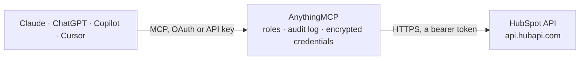

<!-- Generated by scripts/export-github-catalog.mjs in the anythingmcp-website repository. Do not edit by hand. -->

# HubSpot MCP connector

Let your AI work in HubSpot CRM: search and update contacts, companies, deals and tickets, see who is linked to what, check pipelines and owners, and log notes and tasks. The AnythingMCP connector gives Claude, ChatGPT, Microsoft Copilot, Cursor and Gemini 14 MCP tools for HubSpot: 8 read and 6 can change data.

**Category:** [CRM](../crm.md) · **Tools:** 14 · **Setup guide:** [anythingmcp.com](https://anythingmcp.com/guides/hubspot-to-mcp) · [Deutsch](https://anythingmcp.com/de/guides/hubspot-to-mcp) · [Italiano](https://anythingmcp.com/it/guides/hubspot-to-mcp) · [Español](https://anythingmcp.com/es/guides/hubspot-to-mcp) · [日本語](https://anythingmcp.com/ja/guides/hubspot-to-mcp) · [Русский](https://anythingmcp.com/ru/guides/hubspot-to-mcp) · [中文](https://anythingmcp.com/zh/guides/hubspot-to-mcp)

## Start without code

No installation and no terminal: AnythingMCP Cloud runs the HubSpot connector for you, operated by helpcode.ai in Frankfurt, Germany.

1. **Click the button above** and create an account or sign in. The HubSpot connector opens, ready to install.
2. **Paste the API key or token from your HubSpot account.** Every click is in the [step-by-step guide](https://anythingmcp.com/guides/hubspot-to-mcp).
3. **Click Install.** AnythingMCP shows the address of your MCP server.
4. **Add that address to your assistant:** [Claude](https://anythingmcp.com/guides/connect-hubspot-to-claude) · [ChatGPT](https://anythingmcp.com/guides/connect-hubspot-to-chatgpt) · [Microsoft Copilot](https://anythingmcp.com/guides/connect-hubspot-to-copilot) · [Cursor](https://anythingmcp.com/guides/connect-hubspot-to-cursor) · [Gemini CLI](https://anythingmcp.com/guides/connect-hubspot-to-gemini) · [Meta Muse](https://anythingmcp.com/guides/connect-hubspot-to-muse).
5. **Ask your first question**, for example: *Show me the contact with email janet.keller@acrotech.de — I need their contact id, owner, and associated company id and name.*

Prefer help with the setup? [Talk to us](https://anythingmcp.com/contact).

## How it works

- **The AI client** speaks MCP (Streamable HTTP) to AnythingMCP and only sees tool names, descriptions and results. It never gets the HubSpot credentials.
- **AnythingMCP** checks the client's role, builds the call from the tool definition, adds the credentials (a bearer token), calls HubSpot, logs the call and returns the result.
- **HubSpot** sees an ordinary API client with the rights of the account the credentials belong to.

## Tools

| Tool | What it does | Access |
|---|---|---|
| [`hubspot_list_owners`](#hubspot_list_owners) | List the HubSpot users who can own records (owners): owner id, user id, email, first and last name, teams and whether archived. | read |
| [`hubspot_get_account`](#hubspot_get_account) | Get the HubSpot account the token belongs to: portal id (Hub ID), account type, time zone and UTC offset, company currency and additional currencies, and… | read |
| [`hubspot_search_objects`](#hubspot_search_objects) | Search CRM records of one object type (contacts, companies, deals, tickets, notes, tasks, ...) by free text and/or property filters, with sorting. | read |
| [`hubspot_list_objects`](#hubspot_list_objects) | List CRM records of one object type page by page, oldest id first, with the chosen properties and optionally the ids of associated records. | read |
| [`hubspot_get_object`](#hubspot_get_object) | Get one CRM record by id (or by a unique property such as a contact's email with id_property), with the chosen properties, optional property history, and… | read |
| [`hubspot_create_object`](#hubspot_create_object) | Create a CRM record (contact, company, deal, ticket, ...) with property values, optionally associated with existing records. | write |
| [`hubspot_update_object`](#hubspot_update_object) | Change property values of one CRM record; only the given properties change, and an empty string clears a value. | write |
| [`hubspot_archive_object`](#hubspot_archive_object) | Archive (delete) one CRM record: it moves to the recycling bin, where it can be restored for 90 days. | write |
| [`hubspot_get_associations`](#hubspot_get_associations) | List the records of one type associated with a record, with their association types and labels, e.g. all deals of a company or all contacts of a deal. | read |
| [`hubspot_associate_records`](#hubspot_associate_records) | Link two existing records with HubSpot's default (unlabeled) association, e.g. a contact to a company or a deal to a contact. | write |
| [`hubspot_list_pipelines`](#hubspot_list_pipelines) | List the pipelines of deals or tickets with their stages: pipeline id and label, and per stage its id, label, display order and metadata (deal stages carry… | read |
| [`hubspot_list_properties`](#hubspot_list_properties) | List the properties of an object type, default and custom: internal name, label, type, field type, group, description, whether read-only, and the allowed… | read |
| [`hubspot_create_note`](#hubspot_create_note) | Add a note to the CRM timeline, associated with contacts, companies, deals or tickets. | write |
| [`hubspot_create_task`](#hubspot_create_task) | Create a task (to-do, call or email reminder) with a due date, optionally assigned to an owner and associated with records. | write |

## Tool reference

Every parameter as the AI client sees it in `tools/list`. Source: [`packages/backend/src/adapters/intl/hubspot.json`](../../../packages/backend/src/adapters/intl/hubspot.json).

### `hubspot_list_owners`

List the HubSpot users who can own records (owners): owner id, user id, email, first and last name, teams and whether archived. The owner id is what hubspot_owner_id properties hold. Pages with after.

**Access:** read · **Call:** `GET /crm/owners/2026-09`

| Parameter | Type | Required | Description |
|---|---|---|---|
| `email` | string | no | Only the owner with this email address. |
| `limit` | integer | no | Owners per page, 1 to 500 (default 100). |
| `after` | string | no | paging.next.after from the previous response, to fetch the next page. |
| `archived` | boolean | no | true to list only deactivated owners (default false). |

### `hubspot_get_account`

Get the HubSpot account the token belongs to: portal id (Hub ID), account type, time zone and UTC offset, company currency and additional currencies, and the data hosting location (na1, eu1).

**Access:** read · **Call:** `GET /account-info/2026-09/details`

No parameters.

### `hubspot_search_objects`

Search CRM records of one object type (contacts, companies, deals, tickets, notes, tasks, ...) by free text and/or property filters, with sorting. Returns total, the matching records with the requested properties, and paging.next.after. Up to 200 per page and 10,000 results per query; search allows 5 requests per second.

**Access:** read · **Call:** `POST /crm/objects/2026-09/{object_type}/search`

| Parameter | Type | Required | Description |
|---|---|---|---|
| `object_type` | string | yes | CRM object type, plural: contacts, companies, deals, tickets, notes, tasks, calls, meetings, emails, products, line_items, leads, or a custom object's id (e.g. 2-1234567). |
| `query` | string | no | Free text searched across the object's default text properties (for contacts: name, email, phone, company). |
| `filter_groups` | object[] | no | Property filters. Filters inside one group are combined with AND, groups with OR; at most 5 groups and 18 filters. Example: [{"filters": [{"propertyName": "dealstage", "operator": "EQ", "value": "closedwon"}, {"propertyName": "closedate", "operator": "GTE", "value": "2026-01-01"}]}]. Operators: EQ, NEQ, LT, LTE, GT, GTE, BETWEEN (value + highValue), IN / NOT_IN (values array, lowercase for strings), HAS_PROPERTY, NOT_HAS_PROPERTY, CONTAINS_TOKEN (wildcards *), NOT_CONTAINS_TOKEN. Use the pseudo-property associations.contact (or .company, .deal, .ticket) with EQ and a record id to find records associated with it. |
| `properties` | string[] | no | Property names to return, e.g. ["dealname", "amount", "dealstage", "hubspot_owner_id"]. Without it only the object's default properties come back. |
| `sorts` | object[] | no | One sort rule, e.g. [{"propertyName": "createdate", "direction": "DESCENDING"}]. Default: oldest first. |
| `limit` | integer | no | Records per page, 1 to 200 (default 20). |
| `after` | string | no | paging.next.after from the previous response, to fetch the next page with the same filters. |

### `hubspot_list_objects`

List CRM records of one object type page by page, oldest id first, with the chosen properties and optionally the ids of associated records. Returns results and paging.next.after. Use hubspot_search_objects to filter or sort.

**Access:** read · **Call:** `GET /crm/objects/2026-09/{object_type}`

| Parameter | Type | Required | Description |
|---|---|---|---|
| `object_type` | string | yes | CRM object type, plural: contacts, companies, deals, tickets, notes, tasks, calls, meetings, emails, products, line_items, leads, or a custom object's id (e.g. 2-1234567). |
| `properties` | string | no | Comma-separated property names to return, e.g. "firstname,lastname,email,lifecyclestage". Without it HubSpot returns a small default set. hubspot_list_properties lists the names. |
| `associations` | string | no | Comma-separated object types whose associated record ids to include, e.g. "companies,deals". |
| `limit` | integer | no | Records per page, 1 to 100 (default 20). |
| `after` | string | no | paging.next.after from the previous response, to fetch the next page. |
| `archived` | boolean | no | true to list only archived (deleted) records (default false). |

### `hubspot_get_object`

Get one CRM record by id (or by a unique property such as a contact's email with id_property), with the chosen properties, optional property history, and the ids of associated records.

**Access:** read · **Call:** `GET /crm/objects/2026-09/{object_type}/{object_id}`

| Parameter | Type | Required | Description |
|---|---|---|---|
| `object_type` | string | yes | CRM object type, plural: contacts, companies, deals, tickets, notes, tasks, calls, meetings, emails, products, line_items, leads, or a custom object's id (e.g. 2-1234567). |
| `object_id` | string | yes | Record id (hs_object_id), e.g. "51". With id_property, the value of that property instead, e.g. an email address. |
| `id_property` | string | no | Look the record up by this unique property instead of its id, e.g. "email" for contacts. |
| `properties` | string | no | Comma-separated property names to return, e.g. "firstname,lastname,email,lifecyclestage". Without it HubSpot returns a small default set. hubspot_list_properties lists the names. |
| `properties_with_history` | string | no | Comma-separated properties to return with their previous values, e.g. "dealstage". |
| `associations` | string | no | Comma-separated object types whose associated record ids to include, e.g. "companies,deals". |

### `hubspot_create_object`

Create a CRM record (contact, company, deal, ticket, ...) with property values, optionally associated with existing records. Returns the new record with its id. Show the user what will be created and wait for confirmation; never retry a successful create.

**Access:** write · **Call:** `POST /crm/objects/2026-09/{object_type}`

| Parameter | Type | Required | Description |
|---|---|---|---|
| `object_type` | string | yes | CRM object type, plural: contacts, companies, deals, tickets, notes, tasks, calls, meetings, emails, products, line_items, leads, or a custom object's id (e.g. 2-1234567). |
| `properties` | object | yes | Property values as strings, keyed by internal name. Contacts: {"email": "ana@example.com", "firstname": "Ana", "lastname": "Ruiz"}; accounts with data privacy (GDPR) settings on also require hs_legal_basis, e.g. "Legitimate interest – prospect/lead" (allowed values from hubspot_list_properties). Companies: {"name": "Acme", "domain": "acme.com"}. Deals: {"dealname": "Acme renewal", "amount": "5000", "pipeline": "default", "dealstage": "<stage id>", "closedate": "2026-12-31"}. Tickets: {"subject": "...", "hs_pipeline": "0", "hs_pipeline_stage": "1"}. |
| `associations` | object[] | no | Optional records to associate on creation. Each entry: {"to": {"id": "<record id>"}, "types": [{"associationCategory": "HUBSPOT_DEFINED", "associationTypeId": <id>}]}. See the instructions for the common type ids. |

### `hubspot_update_object`

Change property values of one CRM record; only the given properties change, and an empty string clears a value. Moving a deal to another stage is {"dealstage": "<stage id>"}. Returns the updated record. Confirm with the user before writing.

**Access:** write · **Call:** `PATCH /crm/objects/2026-09/{object_type}/{object_id}`

| Parameter | Type | Required | Description |
|---|---|---|---|
| `object_type` | string | yes | CRM object type, plural: contacts, companies, deals, tickets, notes, tasks, calls, meetings, emails, products, line_items, leads, or a custom object's id (e.g. 2-1234567). |
| `object_id` | string | yes | Record id, or the value of id_property. |
| `id_property` | string | no | Address the record by this unique property instead of its id, e.g. "email". |
| `properties` | object | yes | Property values to set, as strings, e.g. {"lifecyclestage": "customer", "phone": "+49 761 123456"}. |

### `hubspot_archive_object`

Archive (delete) one CRM record: it moves to the recycling bin, where it can be restored for 90 days. Installed switched off; turn it on only if the AI should delete records, and confirm every deletion with the user.

**Access:** write · **Call:** `DELETE /crm/objects/2026-09/{object_type}/{object_id}`

| Parameter | Type | Required | Description |
|---|---|---|---|
| `object_type` | string | yes | CRM object type, plural: contacts, companies, deals, tickets, notes, tasks, calls, meetings, emails, products, line_items, leads, or a custom object's id (e.g. 2-1234567). |
| `object_id` | string | yes | Id of the record to archive. |

### `hubspot_get_associations`

List the records of one type associated with a record, with their association types and labels, e.g. all deals of a company or all contacts of a deal. Returns toObjectId per association; long lists page with after.

**Access:** read · **Call:** `POST /crm/associations/2026-09/{from_object_type}/{to_object_type}/batch/read`

| Parameter | Type | Required | Description |
|---|---|---|---|
| `from_object_type` | string | yes | Type of the record you start from, e.g. companies. |
| `object_id` | string | yes | Id of that record. |
| `to_object_type` | string | yes | Type of the associated records to list, e.g. deals. |
| `after` | string | no | paging.next.after of the result, to fetch the next page. |

### `hubspot_associate_records`

Link two existing records with HubSpot's default (unlabeled) association, e.g. a contact to a company or a deal to a contact. Linking an already linked pair changes nothing. Confirm with the user before writing.

**Access:** write · **Call:** `PUT /crm/objects/2026-09/{from_object_type}/{from_object_id}/associations/default/{to_object_type}/{to_object_id}`

| Parameter | Type | Required | Description |
|---|---|---|---|
| `from_object_type` | string | yes | Type of the first record, e.g. contacts. |
| `from_object_id` | string | yes | Id of the first record. |
| `to_object_type` | string | yes | Type of the second record, e.g. companies. |
| `to_object_id` | string | yes | Id of the second record. |

### `hubspot_list_pipelines`

List the pipelines of deals or tickets with their stages: pipeline id and label, and per stage its id, label, display order and metadata (deal stages carry probability, ticket stages ticketState OPEN or CLOSED). Stage ids are what dealstage and hs_pipeline_stage hold.

**Access:** read · **Call:** `GET /crm/pipelines/2026-09/{object_type}`

| Parameter | Type | Required | Description |
|---|---|---|---|
| `object_type` | `deals` \| `tickets` | yes | deals or tickets. |

### `hubspot_list_properties`

List the properties of an object type, default and custom: internal name, label, type, field type, group, description, whether read-only, and the allowed options of dropdown and checkbox properties. Use it to find the internal names for search filters and writes.

**Access:** read · **Call:** `GET /crm/properties/2026-09/{object_type}`

| Parameter | Type | Required | Description |
|---|---|---|---|
| `object_type` | string | yes | CRM object type, plural: contacts, companies, deals, tickets, notes, tasks, calls, meetings, emails, products, line_items, leads, or a custom object's id (e.g. 2-1234567). |
| `archived` | boolean | no | true to list only archived properties (default false). |

### `hubspot_create_note`

Add a note to the CRM timeline, associated with contacts, companies, deals or tickets. Returns the note with its id. Confirm the text with the user before writing.

**Access:** write · **Call:** `POST /crm/objects/2026-09/notes`

| Parameter | Type | Required | Description |
|---|---|---|---|
| `body` | string | yes | Note text; simple HTML such as 
, <b>,   is allowed. Up to 65,536 characters. |
| `timestamp` | string | yes | When the note happened, ISO 8601 (e.g. 2026-10-10T09:30:00Z) or Unix milliseconds. Sets its place on the timeline. |
| `owner_id` | string | no | Owner id from hubspot_list_owners, shown as the note's author. |
| `associations` | object[] | no | Optional records to associate on creation. Each entry: {"to": {"id": "<record id>"}, "types": [{"associationCategory": "HUBSPOT_DEFINED", "associationTypeId": <id>}]}. See the instructions for the common type ids. |

### `hubspot_create_task`

Create a task (to-do, call or email reminder) with a due date, optionally assigned to an owner and associated with records. Returns the task with its id. Confirm with the user before writing.

**Access:** write · **Call:** `POST /crm/objects/2026-09/tasks`

| Parameter | Type | Required | Description |
|---|---|---|---|
| `subject` | string | yes | Task title. |
| `due` | string | yes | Due date and time, ISO 8601 (e.g. 2026-10-15T09:00:00Z) or Unix milliseconds. |
| `body` | string | no | Task notes. |
| `status` | `NOT_STARTED` \| `COMPLETED` | no | Task status (default NOT_STARTED). |
| `priority` | `LOW` \| `MEDIUM` \| `HIGH` | no | Task priority. |
| `task_type` | `TODO` \| `CALL` \| `EMAIL` | no | Task type (default TODO). |
| `owner_id` | string | no | Owner id from hubspot_list_owners the task is assigned to. |
| `associations` | object[] | no | Optional records to associate on creation. Each entry: {"to": {"id": "<record id>"}, "types": [{"associationCategory": "HUBSPOT_DEFINED", "associationTypeId": <id>}]}. See the instructions for the common type ids. |

## Run it yourself

AnythingMCP is open source (AGPL-3.0). [Run it with Docker](../../../README.md#run-it-yourself), open **Connectors → Store**, pick **HubSpot** and enter `HUBSPOT_ACCESS_TOKEN`, then add your MCP server URL to the AI client.

[← CRM connectors](../crm.md) · [All categories](../README.md)
