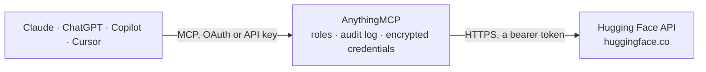

<!-- Generated by scripts/export-github-catalog.mjs in the anythingmcp-website repository. Do not edit by hand. -->

# Hugging Face MCP connector

Let your AI explore the Hugging Face Hub with your own access token: find and compare models, datasets, Spaces, papers and collections, look inside datasets row by row, read files from any … The AnythingMCP connector gives Claude, ChatGPT, Microsoft Copilot, Cursor and Gemini 27 MCP tools for Hugging Face: 25 read and 2 can change data.

**Category:** [Public Data](../data.md) · **Tools:** 27 · **Setup guide:** [anythingmcp.com](https://anythingmcp.com/guides/huggingface-to-mcp) · [Deutsch](https://anythingmcp.com/de/guides/huggingface-to-mcp) · [Italiano](https://anythingmcp.com/it/guides/huggingface-to-mcp) · [Español](https://anythingmcp.com/es/guides/huggingface-to-mcp) · [日本語](https://anythingmcp.com/ja/guides/huggingface-to-mcp) · [Русский](https://anythingmcp.com/ru/guides/huggingface-to-mcp) · [中文](https://anythingmcp.com/zh/guides/huggingface-to-mcp)

## Start without code

No installation and no terminal: AnythingMCP Cloud runs the Hugging Face connector for you, operated by helpcode.ai in Frankfurt, Germany.

1. **Click the button above** and create an account or sign in. The Hugging Face connector opens, ready to install.
2. **Paste the API key or token from your Hugging Face account.** Every click is in the [step-by-step guide](https://anythingmcp.com/guides/huggingface-to-mcp).
3. **Click Install.** AnythingMCP shows the address of your MCP server.
4. **Add that address to your assistant:** [Claude](https://anythingmcp.com/guides/connect-huggingface-to-claude) · [ChatGPT](https://anythingmcp.com/guides/connect-huggingface-to-chatgpt) · [Microsoft Copilot](https://anythingmcp.com/guides/connect-huggingface-to-copilot) · [Cursor](https://anythingmcp.com/guides/connect-huggingface-to-cursor) · [Gemini CLI](https://anythingmcp.com/guides/connect-huggingface-to-gemini) · [Meta Muse](https://anythingmcp.com/guides/connect-huggingface-to-muse).
5. **Ask your first question**, for example: *Which Inference Providers currently serve meta-llama/Llama-2-70b and which are live?*

Prefer help with the setup? [Talk to us](https://anythingmcp.com/contact).

## How it works

- **The AI client** speaks MCP (Streamable HTTP) to AnythingMCP and only sees tool names, descriptions and results. It never gets the Hugging Face credentials.
- **AnythingMCP** checks the client's role, builds the call from the tool definition, adds the credentials (a bearer token), calls Hugging Face, logs the call and returns the result.
- **Hugging Face** sees an ordinary API client with the rights of the account the credentials belong to.

## Tools

| Tool | What it does | Access |
|---|---|---|
| [`huggingface_whoami`](#huggingface_whoami) | Show who the Hugging Face token belongs to: user name, PRO status, whether the account can pay for inference, the organizations it belongs to, and the… | read |
| [`huggingface_search_models`](#huggingface_search_models) | Search models on the Hugging Face Hub. | read |
| [`huggingface_get_model`](#huggingface_get_model) | Read one model's details from the Hugging Face Hub: task, library, license, base model, parameter count, downloads, likes, gated or private, last change,… | read |
| [`huggingface_get_model_providers`](#huggingface_get_model_providers) | List the Inference Providers that serve a model through Hugging Face (e.g. groq, together, novita, fal-ai, hf-inference), with each provider's status (live… | read |
| [`huggingface_list_chat_models`](#huggingface_list_chat_models) | List every model available for chat through the Hugging Face router, with each provider's status, context length, price per million input and output tokens… | read |
| [`huggingface_search_datasets`](#huggingface_search_datasets) | Search datasets on the Hugging Face Hub by text in the id, author or organization and tag (e.g. task_categories:text-classification, language:de,… | read |
| [`huggingface_get_dataset`](#huggingface_get_dataset) | Read one dataset's details from the Hugging Face Hub: license, tasks, languages, size category, downloads, likes, gated or private, last change, the start… | read |
| [`huggingface_dataset_splits`](#huggingface_dataset_splits) | List a dataset's subsets (config) and splits (train, validation, test, ...) from the Hugging Face dataset viewer. | read |
| [`huggingface_dataset_first_rows`](#huggingface_dataset_first_rows) | Show the column names and types and the first 20 rows of one split of a Hugging Face dataset, from the dataset viewer. | read |
| [`huggingface_dataset_rows`](#huggingface_dataset_rows) | Read a slice of rows (up to 100) from one split of a Hugging Face dataset, starting at offset, to page through the data. | read |
| [`huggingface_dataset_search`](#huggingface_dataset_search) | Full-text search inside one split of a Hugging Face dataset (text columns only) and return the matching rows (up to 100) with the total number of matches. | read |
| [`huggingface_dataset_filter`](#huggingface_dataset_filter) | Filter the rows of one split of a Hugging Face dataset with an SQL-like condition and optional sort, e.g. where "label"=1 AND "score">0.5, orderby "score" DESC. | read |
| [`huggingface_dataset_size`](#huggingface_dataset_size) | Show how big a Hugging Face dataset is: number of rows and columns and bytes (original files, Parquet, in memory) for the whole dataset, each subset and… | read |
| [`huggingface_dataset_statistics`](#huggingface_dataset_statistics) | Descriptive statistics for every column of one split of a Hugging Face dataset: for numbers min, max, mean, median, standard deviation and a histogram; for… | read |
| [`huggingface_search_spaces`](#huggingface_search_spaces) | Search Spaces (hosted AI demo apps) on the Hugging Face Hub by text in the id, author and tag, sorted by likes, trending, creation or last change. | read |
| [`huggingface_semantic_search_spaces`](#huggingface_semantic_search_spaces) | Find Spaces (hosted AI demo apps) on Hugging Face by describing what they should do, e.g. 'remove image background' or 'transcribe audio'. | read |
| [`huggingface_get_space`](#huggingface_get_space) | Read one Space (hosted AI demo app) on Hugging Face: title, SDK, license, the app URL, the models and datasets it uses, and its runtime (stage such as… | read |
| [`huggingface_daily_papers`](#huggingface_daily_papers) | List the AI research papers curated on Hugging Face Daily Papers, newest first or by trending, for a day, an ISO week or a month (latest when none is given). | read |
| [`huggingface_search_papers`](#huggingface_search_papers) | Search AI research papers indexed on Hugging Face by words in the title and abstract. | read |
| [`huggingface_get_paper`](#huggingface_get_paper) | Read one paper's page on Hugging Face by arXiv id: title, authors, abstract, AI summary and keywords, upvotes, and the first models, datasets and Spaces on… | read |
| [`huggingface_read_paper`](#huggingface_read_paper) | Read a paper's full Hugging Face page as markdown by arXiv id (title, abstract and the paper text as Hugging Face renders it), capped at about 60 KB. | read |
| [`huggingface_list_repo_files`](#huggingface_list_repo_files) | List the files and folders in a model, dataset or Space repository on Hugging Face, with sizes, at a branch, tag or commit. | read |
| [`huggingface_read_file`](#huggingface_read_file) | Read the start of one text file from a Hugging Face repository (a README, config.json, tokenizer_config.json, a Python script or a small CSV), at most… | read |
| [`huggingface_list_collections`](#huggingface_list_collections) | List curated collections on Hugging Face (groups of models, datasets, Spaces and papers), filtered by owner or by an item they contain, sorted by last… | read |
| [`huggingface_get_collection`](#huggingface_get_collection) | Read one Hugging Face collection with all its items (models, datasets, Spaces, papers) and the curator's notes. | read |
| [`huggingface_chat_completion`](#huggingface_chat_completion) | Chat with an open model through Hugging Face Inference Providers (OpenAI-compatible). | write |
| [`huggingface_run_inference_task`](#huggingface_run_inference_task) | Run a model on the hf-inference provider for a non-chat task: text classification, token classification (named entities), fill-mask, summarization,… | write |

## Tool reference

Every parameter as the AI client sees it in `tools/list`. Source: [`packages/backend/src/adapters/intl/huggingface.json`](../../../packages/backend/src/adapters/intl/huggingface.json).

### `huggingface_whoami`

Show who the Hugging Face token belongs to: user name, PRO status, whether the account can pay for inference, the organizations it belongs to, and the token's name and role (read, write or fine-grained with its scopes). Free. Read-only.

**Access:** read · **Call:** `GET /api/whoami-v2`

No parameters.

### `huggingface_search_models`

Search models on the Hugging Face Hub. Filter by text in the model id, task (pipeline_tag, e.g. text-generation, text-to-image, automatic-speech-recognition), author or organization, a library or tag (e.g. transformers, gguf, diffusers, license:mit, language:de) and by Inference Provider, sorted by downloads, likes, trending, creation or last change (always highest or newest first). Returns id, task, library, downloads and likes. Free. Read-only.

**Access:** read · **Call:** `GET /api/models`

| Parameter | Type | Required | Description |
|---|---|---|---|
| `search` | string | no | Text contained in the model id, e.g. 'llama' or 'whisper'. |
| `pipeline_tag` | string | no | Task, e.g. text-generation, text-classification, text-to-image, image-text-to-text, automatic-speech-recognition, feature-extraction, translation, summarization. |
| `author` | string | no | User or organization that owns the models, e.g. 'meta-llama', 'mistralai', 'google'. |
| `filter` | string | no | A library or tag the models must have, e.g. 'transformers', 'gguf', 'diffusers', 'mlx', 'license:apache-2.0', 'language:it'. |
| `inference_provider` | string | no | Only models served by this Inference Provider (e.g. 'hf-inference', 'groq', 'together', 'novita'), or 'all' for models served by at least one provider. |
| `sort` | `downloads` \| `likes` \| `trendingScore` \| `createdAt` \| `lastModified` | no | Sort order, highest or newest first: downloads, likes, trendingScore, createdAt or lastModified. |
| `limit` | integer | no | Number of models to return, 1 to 100. Default 20. |

### `huggingface_get_model`

Read one model's details from the Hugging Face Hub: task, library, license, base model, parameter count, downloads, likes, gated or private, last change, tags, file names and up to 10 Spaces that use it. Pass the full id such as 'meta-llama/Llama-3.1-8B-Instruct'. Free. Read-only.

**Access:** read · **Call:** `GET /api/models/{repo_id}`

| Parameter | Type | Required | Description |
|---|---|---|---|
| `repo_id` | string | yes | Model id as owner/name, e.g. 'openai-community/gpt2'. |

### `huggingface_get_model_providers`

List the Inference Providers that serve a model through Hugging Face (e.g. groq, together, novita, fal-ai, hf-inference), with each provider's status (live or error), the task it serves (conversational, text-to-image, ...) and the provider's own model id. Use it before huggingface_chat_completion or huggingface_run_inference_task. Free. Read-only.

**Access:** read · **Call:** `GET /api/models/{repo_id}`

| Parameter | Type | Required | Description |
|---|---|---|---|
| `repo_id` | string | yes | Model id as owner/name, e.g. 'meta-llama/Llama-3.1-8B-Instruct'. |

### `huggingface_list_chat_models`

List every model available for chat through the Hugging Face router, with each provider's status, context length, price per million input and output tokens (US dollars) and tool-calling support. Use it to pick a model and estimate the cost before huggingface_chat_completion. A long list (100+ models). Free. Read-only.

**Access:** read · **Call:** `GET https://router.huggingface.co/v1/models`

No parameters.

### `huggingface_search_datasets`

Search datasets on the Hugging Face Hub by text in the id, author or organization and tag (e.g. task_categories:text-classification, language:de, size_categories:10K<n<100K, format:parquet), sorted by downloads, likes, trending, creation or last change. Returns id, downloads, likes and the start of the dataset card. Free. Read-only.

**Access:** read · **Call:** `GET /api/datasets`

| Parameter | Type | Required | Description |
|---|---|---|---|
| `search` | string | no | Text contained in the dataset id, e.g. 'squad' or 'invoices'. |
| `author` | string | no | User or organization that owns the datasets, e.g. 'HuggingFaceFW'. |
| `filter` | string | no | A tag the datasets must have, e.g. 'task_categories:question-answering', 'language:fr', 'license:mit', 'modality:image'. |
| `sort` | `downloads` \| `likes` \| `trendingScore` \| `createdAt` \| `lastModified` | no | Sort order, highest or newest first: downloads, likes, trendingScore, createdAt or lastModified. |
| `limit` | integer | no | Number of datasets to return, 1 to 100. Default 20. |

### `huggingface_get_dataset`

Read one dataset's details from the Hugging Face Hub: license, tasks, languages, size category, downloads, likes, gated or private, last change, the start of its card and its file names. Pass the full id such as 'rajpurkar/squad'. To see the data itself, use huggingface_dataset_splits and huggingface_dataset_first_rows. Free. Read-only.

**Access:** read · **Call:** `GET /api/datasets/{repo_id}`

| Parameter | Type | Required | Description |
|---|---|---|---|
| `repo_id` | string | yes | Dataset id as owner/name, e.g. 'rajpurkar/squad'. |

### `huggingface_dataset_splits`

List a dataset's subsets (config) and splits (train, validation, test, ...) from the Hugging Face dataset viewer. The other dataset viewer tools need these names, so call this first. Free. Read-only.

**Access:** read · **Call:** `GET https://datasets-server.huggingface.co/splits`

| Parameter | Type | Required | Description |
|---|---|---|---|
| `dataset` | string | yes | Dataset id as owner/name, e.g. 'rajpurkar/squad'. |
| `config` | string | no | Optional: only this subset. |

### `huggingface_dataset_first_rows`

Show the column names and types and the first 20 rows of one split of a Hugging Face dataset, from the dataset viewer. Long cell values may be cut short; page further with huggingface_dataset_rows. Get config and split from huggingface_dataset_splits. Free. Read-only.

**Access:** read · **Call:** `GET https://datasets-server.huggingface.co/first-rows`

| Parameter | Type | Required | Description |
|---|---|---|---|
| `dataset` | string | yes | Dataset id as owner/name, e.g. 'rajpurkar/squad'. |
| `config` | string | yes | Subset name from huggingface_dataset_splits, often 'default'. |
| `split` | string | yes | Split name, e.g. 'train', 'validation' or 'test'. |

### `huggingface_dataset_rows`

Read a slice of rows (up to 100) from one split of a Hugging Face dataset, starting at offset, to page through the data. Returns the columns, the rows with their index and the total number of rows. Free. Read-only.

**Access:** read · **Call:** `GET https://datasets-server.huggingface.co/rows`

| Parameter | Type | Required | Description |
|---|---|---|---|
| `dataset` | string | yes | Dataset id as owner/name. |
| `config` | string | yes | Subset name from huggingface_dataset_splits. |
| `split` | string | yes | Split name, e.g. 'train'. |
| `offset` | integer | no | Index of the first row to return. Default 0. |
| `length` | integer | no | Number of rows, 1 to 100. Default 20. |

### `huggingface_dataset_search`

Full-text search inside one split of a Hugging Face dataset (text columns only) and return the matching rows (up to 100) with the total number of matches. Only for datasets the viewer has indexed; a large or new dataset may answer that its index is loading, then retry later. Free. Read-only.

**Access:** read · **Call:** `GET https://datasets-server.huggingface.co/search`

| Parameter | Type | Required | Description |
|---|---|---|---|
| `dataset` | string | yes | Dataset id as owner/name. |
| `config` | string | yes | Subset name from huggingface_dataset_splits. |
| `split` | string | yes | Split name, e.g. 'train'. |
| `query` | string | yes | Words to look for in the text columns. |
| `offset` | integer | no | Index of the first match to return. Default 0. |
| `length` | integer | no | Number of matches, 1 to 100. Default 20. |

### `huggingface_dataset_filter`

Filter the rows of one split of a Hugging Face dataset with an SQL-like condition and optional sort, e.g. where "label"=1 AND "score">0.5, orderby "score" DESC. Column names go in double quotes, text values in single quotes. Returns the matching rows (up to 100) and the total. Only for datasets the viewer has indexed. Free. Read-only.

**Access:** read · **Call:** `GET https://datasets-server.huggingface.co/filter`

| Parameter | Type | Required | Description |
|---|---|---|---|
| `dataset` | string | yes | Dataset id as owner/name. |
| `config` | string | yes | Subset name from huggingface_dataset_splits. |
| `split` | string | yes | Split name, e.g. 'train'. |
| `where` | string | yes | Condition with =, <>, >, >=, <, <= combined with AND, OR, NOT, e.g. "title"='Normans' OR "age">30. Columns in double quotes, text in single quotes. |
| `orderby` | string | no | Optional sort column in double quotes, ascending, or add DESC, e.g. "age" DESC. |
| `offset` | integer | no | Index of the first match to return. Default 0. |
| `length` | integer | no | Number of matches, 1 to 100. Default 20. |

### `huggingface_dataset_size`

Show how big a Hugging Face dataset is: number of rows and columns and bytes (original files, Parquet, in memory) for the whole dataset, each subset and each split. Free. Read-only.

**Access:** read · **Call:** `GET https://datasets-server.huggingface.co/size`

| Parameter | Type | Required | Description |
|---|---|---|---|
| `dataset` | string | yes | Dataset id as owner/name. |
| `config` | string | no | Optional: only this subset. |

### `huggingface_dataset_statistics`

Descriptive statistics for every column of one split of a Hugging Face dataset: for numbers min, max, mean, median, standard deviation and a histogram; for labels and short text the most frequent values; plus the share of missing values. Only for datasets the viewer has processed. Free. Read-only.

**Access:** read · **Call:** `GET https://datasets-server.huggingface.co/statistics`

| Parameter | Type | Required | Description |
|---|---|---|---|
| `dataset` | string | yes | Dataset id as owner/name. |
| `config` | string | yes | Subset name from huggingface_dataset_splits. |
| `split` | string | yes | Split name, e.g. 'train'. |

### `huggingface_search_spaces`

Search Spaces (hosted AI demo apps) on the Hugging Face Hub by text in the id, author and tag, sorted by likes, trending, creation or last change. Returns id, SDK (gradio, streamlit, docker, static) and likes. To find apps by what they do, use huggingface_semantic_search_spaces. Free. Read-only.

**Access:** read · **Call:** `GET /api/spaces`

| Parameter | Type | Required | Description |
|---|---|---|---|
| `search` | string | no | Text contained in the Space id, e.g. 'flux' or 'whisper'. |
| `author` | string | no | User or organization that owns the Spaces. |
| `filter` | string | no | A tag the Spaces must have, e.g. 'gradio' or 'mcp-server'. |
| `sort` | `likes` \| `trendingScore` \| `createdAt` \| `lastModified` | no | Sort order, highest or newest first: likes, trendingScore, createdAt or lastModified. |
| `limit` | integer | no | Number of Spaces to return, 1 to 100. Default 20. |

### `huggingface_semantic_search_spaces`

Find Spaces (hosted AI demo apps) on Hugging Face by describing what they should do, e.g. 'remove image background' or 'transcribe audio'. Returns id, title, a short description, category, runtime stage and likes, by relevance. Only running Spaces unless include_non_running is true. Free. Read-only.

**Access:** read · **Call:** `GET /api/spaces/semantic-search`

| Parameter | Type | Required | Description |
|---|---|---|---|
| `query` | string | yes | What the app should do, in plain words. |
| `sdk` | `gradio` \| `streamlit` \| `docker` \| `static` | no | Optional: only Spaces built with this SDK. |
| `include_non_running` | boolean | no | Also return sleeping or stopped Spaces. Default false. |

### `huggingface_get_space`

Read one Space (hosted AI demo app) on Hugging Face: title, SDK, license, the app URL, the models and datasets it uses, and its runtime (stage such as RUNNING, SLEEPING, BUILDING or RUNTIME_ERROR, and hardware). Pass the full id such as 'black-forest-labs/FLUX.1-dev'. Free. Read-only.

**Access:** read · **Call:** `GET /api/spaces/{repo_id}`

| Parameter | Type | Required | Description |
|---|---|---|---|
| `repo_id` | string | yes | Space id as owner/name. |

### `huggingface_daily_papers`

List the AI research papers curated on Hugging Face Daily Papers, newest first or by trending, for a day, an ISO week or a month (latest when none is given). Returns arXiv id, title, abstract, upvotes, comments and GitHub repository. Free. Read-only.

**Access:** read · **Call:** `GET /api/daily_papers`

| Parameter | Type | Required | Description |
|---|---|---|---|
| `date` | string | no | A day as YYYY-MM-DD. |
| `week` | string | no | An ISO week as YYYY-Www, e.g. 2026-W41. |
| `month` | string | no | A month as YYYY-MM. |
| `sort` | `publishedAt` \| `trending` | no | publishedAt (default) or trending. |
| `limit` | integer | no | Number of papers, 1 to 100. Default 20. |
| `page` | integer | no | Page number starting at 0, for more papers. |

### `huggingface_search_papers`

Search AI research papers indexed on Hugging Face by words in the title and abstract. Returns arXiv id, title, publication date, upvotes, a short AI-written summary and keywords. Read a paper with huggingface_get_paper or huggingface_read_paper. Free. Read-only.

**Access:** read · **Call:** `GET /api/papers/search`

| Parameter | Type | Required | Description |
|---|---|---|---|
| `query` | string | yes | Words to look for, e.g. 'speculative decoding'. |
| `limit` | integer | no | Number of papers, 1 to 100. Default 20. |

### `huggingface_get_paper`

Read one paper's page on Hugging Face by arXiv id: title, authors, abstract, AI summary and keywords, upvotes, and the first models, datasets and Spaces on the Hub that cite it (with totals). Free. Read-only.

**Access:** read · **Call:** `GET /api/papers/{paper_id}`

| Parameter | Type | Required | Description |
|---|---|---|---|
| `paper_id` | string | yes | arXiv id, e.g. '1706.03762'. |

### `huggingface_read_paper`

Read a paper's full Hugging Face page as markdown by arXiv id (title, abstract and the paper text as Hugging Face renders it), capped at about 60 KB. Use huggingface_get_paper for a short overview first. Free. Read-only.

**Access:** read · **Call:** `GET /papers/{paper_id}.md`

| Parameter | Type | Required | Description |
|---|---|---|---|
| `paper_id` | string | yes | arXiv id, e.g. '1706.03762'. |

### `huggingface_list_repo_files`

List the files and folders in a model, dataset or Space repository on Hugging Face, with sizes, at a branch, tag or commit. Pass a folder path to look inside it, or recursive true for everything. Large folders come in pages: call again with cursor = _pagination.nextCursor until it is missing. Free. Read-only.

**Access:** read · **Call:** `GET /api/{repo_type}/{repo_id}/tree/{revision}/{path}`

| Parameter | Type | Required | Description |
|---|---|---|---|
| `repo_type` | `models` \| `datasets` \| `spaces` | no | models (default), datasets or spaces. |
| `repo_id` | string | yes | Repository id as owner/name. |
| `revision` | string | no | Branch, tag or commit. Default main. |
| `path` | string | no | Folder inside the repository, e.g. 'onnx'. Leave out for the top level. |
| `recursive` | boolean | no | List sub-folders too. Default false. |
| `cursor` | string | no | Page cursor from _pagination.nextCursor of the previous call. |

### `huggingface_read_file`

Read the start of one text file from a Hugging Face repository (a README, config.json, tokenizer_config.json, a Python script or a small CSV), at most max_bytes bytes. JSON files that fit come back parsed. Do not use it for model weights or other binaries. Find file names with huggingface_list_repo_files. Free. Read-only.

**Access:** read · **Call:** `GET /{repo_path}/resolve/{revision}/{file_path}`

| Parameter | Type | Required | Description |
|---|---|---|---|
| `repo_path` | string | yes | For a model just owner/name (e.g. 'openai-community/gpt2'); for a dataset 'datasets/owner/name'; for a Space 'spaces/owner/name'. |
| `file_path` | string | yes | Path of the file inside the repository, e.g. 'config.json' or 'src/app.py'. |
| `revision` | string | no | Branch, tag or commit. Default main. |
| `max_bytes` | integer | no | How many bytes to read from the start of the file, 1000 to 100000. Default 50000. |

### `huggingface_list_collections`

List curated collections on Hugging Face (groups of models, datasets, Spaces and papers), filtered by owner or by an item they contain, sorted by last change, trending or upvotes. Each collection shows up to 4 items; read all with huggingface_get_collection. Free. Read-only.

**Access:** read · **Call:** `GET /api/collections`

| Parameter | Type | Required | Description |
|---|---|---|---|
| `owner` | string | no | User or organization that owns the collections, e.g. 'meta-llama'. |
| `item` | string | no | Only collections containing this item, e.g. 'models/openai/gpt-oss-120b', 'datasets/rajpurkar/squad' or 'papers/1706.03762'. |
| `sort` | `lastModified` \| `trending` \| `upvotes` | no | lastModified, trending or upvotes. |
| `limit` | integer | no | Number of collections, 1 to 100. Default 20. |

### `huggingface_get_collection`

Read one Hugging Face collection with all its items (models, datasets, Spaces, papers) and the curator's notes. Pass the slug from huggingface_list_collections, e.g. 'meta-llama/llama-32-66f448ffc8c32f949b04c8cf'. Free. Read-only.

**Access:** read · **Call:** `GET /api/collections/{slug}`

| Parameter | Type | Required | Description |
|---|---|---|---|
| `slug` | string | yes | Collection slug as owner/title-id. |

### `huggingface_chat_completion`

Chat with an open model through Hugging Face Inference Providers (OpenAI-compatible). COSTS MONEY: billed to the user's Hugging Face credits (or to bill_to's organization). Confirm with the user which model will run before calling, and never call it in a loop without asking. model is a Hub id, optionally with :cheapest, :fastest, :preferred or a provider such as :groq. Returns the answer, the model used and token usage.

**Access:** write · **Call:** `POST https://router.huggingface.co/v1/chat/completions`

| Parameter | Type | Required | Description |
|---|---|---|---|
| `model` | string | yes | Hub model id, e.g. 'openai/gpt-oss-120b', 'meta-llama/Llama-3.1-8B-Instruct:cheapest' or 'deepseek-ai/DeepSeek-V3.1:novita'. |
| `messages` | object[] | yes | The conversation as OpenAI chat messages, e.g. [{"role": "system", "content": "..."}, {"role": "user", "content": "..."}]. |
| `max_tokens` | integer | no | Most tokens to generate. Default 1024; higher costs more. |
| `temperature` | number | no | Randomness, 0 to 2. Lower is more focused. |
| `top_p` | number | no | Nucleus sampling, 0 to 1. |
| `stop` | string[] | no | Up to 4 texts that end the answer when generated. |
| `seed` | integer | no | Seed for repeatable sampling, where the provider supports it. |
| `response_format` | object | no | Structured output, e.g. {"type": "json_schema", "json_schema": {"name": "x", "schema": {...}}}. Not every provider supports it. |
| `bill_to` | string | no | Optional organization name to bill instead of the user (the user must be a member and the organization must allow it). |

### `huggingface_run_inference_task`

Run a model on the hf-inference provider for a non-chat task: text classification, token classification (named entities), fill-mask, summarization, translation, zero-shot classification, question answering, sentence similarity or feature extraction (embeddings). COSTS MONEY: billed to the user's Hugging Face credits by compute time (usually fractions of a cent). Confirm with the user before calling. Find models with huggingface_search_models and inference_provider hf-inference.

**Access:** write · **Call:** `POST https://router.huggingface.co/hf-inference/models/{model}`

| Parameter | Type | Required | Description |
|---|---|---|---|
| `model` | string | yes | Hub model id served by hf-inference, e.g. 'distilbert/distilbert-base-uncased-finetuned-sst-2-english'. |
| `inputs` | string,object,array | yes | The task input: a text for most tasks; for question answering {"question": ..., "context": ...}; for sentence similarity {"source_sentence": ..., "sentences": [...]}. |
| `parameters` | object | no | Optional task settings, e.g. {"candidate_labels": ["sport", "politics"]} for zero-shot classification or {"top_k": 3} for classification. |
| `bill_to` | string | no | Optional organization name to bill instead of the user. |

## Run it yourself

AnythingMCP is open source (AGPL-3.0). [Run it with Docker](../../../README.md#run-it-yourself), open **Connectors → Store**, pick **Hugging Face** and enter `HF_TOKEN`, then add your MCP server URL to the AI client.

[← Public Data connectors](../data.md) · [All categories](../README.md)
