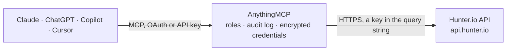

<!-- Generated by scripts/export-github-catalog.mjs in the anythingmcp-website repository. Do not edit by hand. -->

# Hunter.io MCP connector

Find and verify email addresses via Hunter.io. 7 tools for domain search, email finder, email verifier, account stats. The AnythingMCP connector gives Claude, ChatGPT, Microsoft Copilot, Cursor and Gemini 7 MCP tools for Hunter.io, all read-only.

**Category:** [Data Enrichment](../enrichment.md) · **Tools:** 7 · **Setup guide:** [anythingmcp.com](https://anythingmcp.com/guides/hunter-to-mcp) · [Deutsch](https://anythingmcp.com/de/guides/hunter-to-mcp) · [Italiano](https://anythingmcp.com/it/guides/hunter-to-mcp) · [Español](https://anythingmcp.com/es/guides/hunter-to-mcp) · [日本語](https://anythingmcp.com/ja/guides/hunter-to-mcp) · [Русский](https://anythingmcp.com/ru/guides/hunter-to-mcp) · [中文](https://anythingmcp.com/zh/guides/hunter-to-mcp)

## Start without code

No installation and no terminal: AnythingMCP Cloud runs the Hunter.io connector for you, operated by helpcode.ai in Frankfurt, Germany.

1. **Click the button above** and create an account or sign in. The Hunter.io connector opens, ready to install.
2. **Paste the API key or token from your Hunter.io account.** Every click is in the [step-by-step guide](https://anythingmcp.com/guides/hunter-to-mcp).
3. **Click Install.** AnythingMCP shows the address of your MCP server.
4. **Add that address to your assistant:** [Claude](https://anythingmcp.com/guides/connect-hunter-to-claude) · [ChatGPT](https://anythingmcp.com/guides/connect-hunter-to-chatgpt) · [Microsoft Copilot](https://anythingmcp.com/guides/connect-hunter-to-copilot) · [Cursor](https://anythingmcp.com/guides/connect-hunter-to-cursor) · [Gemini CLI](https://anythingmcp.com/guides/connect-hunter-to-gemini) · [Meta Muse](https://anythingmcp.com/guides/connect-hunter-to-muse).
5. **Ask your first question**, for example: *What's the best email for Martin Krause, CTO at Soterra GmbH (soterra.de)? I need to send invoice INV-2026-078.*

Prefer help with the setup? [Talk to us](https://anythingmcp.com/contact).

## How it works

- **The AI client** speaks MCP (Streamable HTTP) to AnythingMCP and only sees tool names, descriptions and results. It never gets the Hunter.io credentials.
- **AnythingMCP** checks the client's role, builds the call from the tool definition, adds the credentials (a key in the query string), calls Hunter.io, logs the call and returns the result.
- **Hunter.io** sees an ordinary API client with the rights of the account the credentials belong to.

## Tools

| Tool | What it does | Access |
|---|---|---|
| [`hunter_account`](#hunter_account) | Return account info: email, plan_name, plan_level, calls.used, calls.available. | read |
| [`hunter_domain_search`](#hunter_domain_search) | Find email addresses associated with a domain. | read |
| [`hunter_email_finder`](#hunter_email_finder) | Find the most-likely email for a specific person at a domain. | read |
| [`hunter_email_verifier`](#hunter_email_verifier) | Verify if an email is deliverable. | read |
| [`hunter_email_count`](#hunter_email_count) | Count emails Hunter has indexed for a domain. | read |
| [`hunter_combined_enrichment`](#hunter_combined_enrichment) | Combined person + company enrichment in one call. | read |
| [`hunter_company_enrichment`](#hunter_company_enrichment) | Enrich a company by domain. | read |

## Tool reference

Every parameter as the AI client sees it in `tools/list`. Source: [`packages/backend/src/adapters/intl/hunter.json`](../../../packages/backend/src/adapters/intl/hunter.json).

### `hunter_account`

Return account info: email, plan_name, plan_level, calls.used, calls.available. FREE — doesn't consume credits. Use at startup to verify credentials and check remaining quota.

**Access:** read · **Call:** `GET /account`

No parameters.

### `hunter_domain_search`

Find email addresses associated with a domain. Returns up to 100 emails (per_page param) with name, position, seniority, department, confidence, sources. The most credit-expensive endpoint.

**Access:** read · **Call:** `GET /domain-search`

| Parameter | Type | Required | Description |
|---|---|---|---|
| `domain` | string | no | Domain to search (e.g. 'acme.com'). Mutually exclusive with company. |
| `company` | string | no | Company name (Hunter resolves to domain). |
| `limit` | integer | no | Max emails to return (default 10, max 100). |
| `offset` | integer | no | Pagination offset. |
| `type` | string | no | Filter by type: personal or generic. |
| `seniority` | string | no | Filter: junior, senior, executive (comma-separated). |
| `department` | string | no | Filter by department: executive, it, finance, management, sales, legal, support, hr, marketing, communication, education, design, health, operations (comma-separated). |

### `hunter_email_finder`

Find the most-likely email for a specific person at a domain. Required: domain + (first_name+last_name OR full_name). Returns email + confidence + sources.

**Access:** read · **Call:** `GET /email-finder`

| Parameter | Type | Required | Description |
|---|---|---|---|
| `domain` | string | no | Domain (e.g. 'acme.com'). Mutually exclusive with company. |
| `company` | string | no | Company name. |
| `first_name` | string | no | First name. |
| `last_name` | string | no | Last name. |
| `full_name` | string | no | Or full name as single string. |
| `max_duration` | integer | no | Max seconds Hunter spends searching (3-20, default 10). |

### `hunter_email_verifier`

Verify if an email is deliverable. Returns status (valid/invalid/accept_all/webmail/disposable/unknown) + score 0-100 + smtp_check + mx_records.

**Access:** read · **Call:** `GET /email-verifier`

| Parameter | Type | Required | Description |
|---|---|---|---|
| `email` | string | yes | Email to verify. |

### `hunter_email_count`

Count emails Hunter has indexed for a domain. FREE (no credits). Useful to estimate before a domain_search.

**Access:** read · **Call:** `GET /email-count`

| Parameter | Type | Required | Description |
|---|---|---|---|
| `domain` | string | no | Domain. |
| `company` | string | no | Or company name. |
| `type` | string | no | personal or generic. |

### `hunter_combined_enrichment`

Combined person + company enrichment in one call. Provide an email — returns the person's name, role, employment + the company's industry, employees, location, technologies.

**Access:** read · **Call:** `GET /combined/find`

| Parameter | Type | Required | Description |
|---|---|---|---|
| `email` | string | yes | Email to enrich. |

### `hunter_company_enrichment`

Enrich a company by domain. Returns industry, employee count, address, country, technologies, social profiles, description.

**Access:** read · **Call:** `GET /companies/find`

| Parameter | Type | Required | Description |
|---|---|---|---|
| `domain` | string | yes | Company domain. |

## Run it yourself

AnythingMCP is open source (AGPL-3.0). [Run it with Docker](../../../README.md#run-it-yourself), open **Connectors → Store**, pick **Hunter.io** and enter `HUNTER_API_KEY`, then add your MCP server URL to the AI client.

[← Data Enrichment connectors](../enrichment.md) · [All categories](../README.md)
