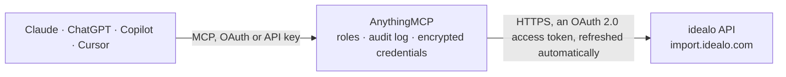

<!-- Generated by scripts/export-github-catalog.mjs in the anythingmcp-website repository. Do not edit by hand. -->

# idealo MCP connector

Maintain your shop's offers in the idealo price comparison from an AI agent through idealo's Partner Web Service: read an offer by SKU, and with your approval create or replace offers, change prices, … The AnythingMCP connector gives Claude, ChatGPT, Microsoft Copilot, Cursor and Gemini 4 MCP tools for idealo: 1 read and 3 can change data.

**Category:** [E-commerce](../e-commerce.md) · **Tools:** 4 · **Setup guide:** [anythingmcp.com](https://anythingmcp.com/guides/idealo-to-mcp) · [Deutsch](https://anythingmcp.com/de/guides/idealo-to-mcp) · [Italiano](https://anythingmcp.com/it/guides/idealo-to-mcp) · [Español](https://anythingmcp.com/es/guides/idealo-to-mcp) · [日本語](https://anythingmcp.com/ja/guides/idealo-to-mcp) · [Русский](https://anythingmcp.com/ru/guides/idealo-to-mcp) · [中文](https://anythingmcp.com/zh/guides/idealo-to-mcp)

## Start without code

No installation and no terminal: AnythingMCP Cloud runs the idealo connector for you, operated by helpcode.ai in Frankfurt, Germany.

1. **Click the button above** and create an account or sign in. The idealo connector opens, ready to install.
2. **Sign in with your idealo account** when AnythingMCP asks. The first time, an admin creates a small app in the idealo developer console. Every click is in the [step-by-step guide](https://anythingmcp.com/guides/idealo-to-mcp).
3. **Click Install.** AnythingMCP shows the address of your MCP server.
4. **Add that address to your assistant:** [Claude](https://anythingmcp.com/guides/connect-idealo-to-claude) · [ChatGPT](https://anythingmcp.com/guides/connect-idealo-to-chatgpt) · [Microsoft Copilot](https://anythingmcp.com/guides/connect-idealo-to-copilot) · [Cursor](https://anythingmcp.com/guides/connect-idealo-to-cursor) · [Gemini CLI](https://anythingmcp.com/guides/connect-idealo-to-gemini) · [Meta Muse](https://anythingmcp.com/guides/connect-idealo-to-muse).
5. **Ask your first question**, for example: *Show me the idealo offer for SKU TV-55Q900_01 — I need price, former price, delivery time and URL.*

Prefer help with the setup? [Talk to us](https://anythingmcp.com/contact).

## How it works

- **The AI client** speaks MCP (Streamable HTTP) to AnythingMCP and only sees tool names, descriptions and results. It never gets the idealo credentials.
- **AnythingMCP** checks the client's role, builds the call from the tool definition, adds the credentials (an OAuth 2.0 access token, refreshed automatically), calls idealo, logs the call and returns the result.
- **idealo** sees an ordinary API client with the rights of the account the credentials belong to.

## Tools

| Tool | What it does | Access |
|---|---|---|
| [`idealo_get_offer`](#idealo_get_offer) | Read one of your offers on idealo by its SKU, as idealo stores it: title, price and former price, URL, EANs and manufacturer numbers, brand, delivery and… | read |
| [`idealo_upsert_offer`](#idealo_upsert_offer) | Create an offer on idealo or replace it completely (PUT): every field not sent is removed from the offer. | write |
| [`idealo_update_offer`](#idealo_update_offer) | Change some fields of an existing idealo offer (PATCH), e.g. the price, former price, delivery time or title, and keep the rest. | write |
| [`idealo_delete_offer`](#idealo_delete_offer) | Remove one offer from idealo by its SKU; it disappears from the price comparison. | write |

## Tool reference

Every parameter as the AI client sees it in `tools/list`. Source: [`packages/backend/src/adapters/de/idealo.json`](../../../packages/backend/src/adapters/de/idealo.json).

### `idealo_get_offer`

Read one of your offers on idealo by its SKU, as idealo stores it: title, price and former price, URL, EANs and manufacturer numbers, brand, delivery and payment costs, delivery time, energy labels, condition and the other offer fields. The Partner Web Service has no list call, so ask the user for the SKU. Answers 404 when the offer does not exist in this shop.

**Access:** read · **Call:** `GET /shop/{{IDEALO_SHOP_ID}}/offer/{sku}`

| Parameter | Type | Required | Description |
|---|---|---|---|
| `sku` | string | yes | Your offer SKU, the shop's own unique id of the offer. Letters, digits, underscores, dots and dashes; no spaces. |

### `idealo_upsert_offer`

Create an offer on idealo or replace it completely (PUT): every field not sent is removed from the offer. Required for the price comparison: sku (equal to the sku argument), title, price and url, plus at least one entry in deliveryCosts and in paymentCosts; prices as strings with two decimals, e.g. "177.99". The offer goes live on idealo, so show the user the offer and get a yes first. Installed switched off.

**Access:** write · **Call:** `PUT /shop/{{IDEALO_SHOP_ID}}/offer/{sku}`

| Parameter | Type | Required | Description |
|---|---|---|---|
| `sku` | string | yes | Your offer SKU, the shop's own unique id of the offer. Letters, digits, underscores, dots and dashes; no spaces. |
| `offer` | object | yes | The complete offer in idealo's offer format, e.g. {"sku": "ABC-1", "title": "Sony WH-1000XM5 black", "price": "299.00", "url": "https://shop.example/abc-1", "eans": ["4548736132610"], "brand": "Sony", "deliveryCosts": {"DHL": "0.00"}, "paymentCosts": {"PAYPAL": "0.00", "INVOICE": "0.00"}, "delivery": "1-3 Werktage"}. Field list: https://idealo.github.io/partner-web-service/docs/v2/ |

### `idealo_update_offer`

Change some fields of an existing idealo offer (PATCH), e.g. the price, former price, delivery time or title, and keep the rest. Prices as strings with two decimals. List fields (eans, imageUrls, categoryPath...) must be sent complete; deliveryCosts, paymentCosts, size, colour, gender, material and dynamicProductAttributes cannot be patched, use idealo_upsert_offer for them. The change goes live on idealo: confirm it with the user first. Installed switched off.

**Access:** write · **Call:** `PATCH /shop/{{IDEALO_SHOP_ID}}/offer/{sku}`

| Parameter | Type | Required | Description |
|---|---|---|---|
| `sku` | string | yes | Your offer SKU, the shop's own unique id of the offer. Letters, digits, underscores, dots and dashes; no spaces. |
| `fields` | object | yes | Only the fields to change, e.g. {"price": "279.00", "formerPrice": "299.00", "delivery": "1-2 Werktage"}. |

### `idealo_delete_offer`

Remove one offer from idealo by its SKU; it disappears from the price comparison. Name the SKU to the user and get a yes first. Installed switched off.

**Access:** write · **Call:** `DELETE /shop/{{IDEALO_SHOP_ID}}/offer/{sku}`

| Parameter | Type | Required | Description |
|---|---|---|---|
| `sku` | string | yes | Your offer SKU, the shop's own unique id of the offer. Letters, digits, underscores, dots and dashes; no spaces. |

## Run it yourself

AnythingMCP is open source (AGPL-3.0). [Run it with Docker](../../../README.md#run-it-yourself), open **Connectors → Store**, pick **idealo** and enter `IDEALO_CLIENT_ID`, `IDEALO_CLIENT_SECRET`, `IDEALO_SHOP_ID`, then add your MCP server URL to the AI client.

[← E-commerce connectors](../e-commerce.md) · [All categories](../README.md)
