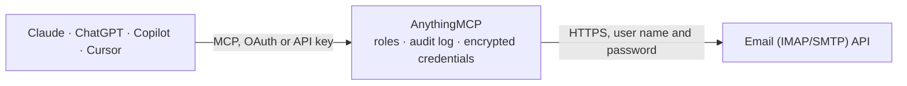

<!-- Generated by scripts/export-github-catalog.mjs in the anythingmcp-website repository. Do not edit by hand. -->

# Email (IMAP/SMTP) MCP connector

Connect any mailbox over IMAP and SMTP: list folders, search and read mail with attachments, mark, flag, move and delete to Trash, save drafts and send or reply. The AnythingMCP connector gives Claude, ChatGPT, Microsoft Copilot, Cursor and Gemini 1 MCP tool for Email (IMAP/SMTP), all read-only.

**Category:** [Email](../email.md) · **Tools:** 1 · **Setup guide:** [anythingmcp.com](https://anythingmcp.com/guides/imap-smtp-to-mcp) · [Deutsch](https://anythingmcp.com/de/guides/imap-smtp-to-mcp) · [Italiano](https://anythingmcp.com/it/guides/imap-smtp-to-mcp) · [Español](https://anythingmcp.com/es/guides/imap-smtp-to-mcp) · [日本語](https://anythingmcp.com/ja/guides/imap-smtp-to-mcp) · [Русский](https://anythingmcp.com/ru/guides/imap-smtp-to-mcp) · [中文](https://anythingmcp.com/zh/guides/imap-smtp-to-mcp)

## Start without code

No installation and no terminal: AnythingMCP Cloud runs the Email (IMAP/SMTP) connector for you, operated by helpcode.ai in Frankfurt, Germany.

1. **Click the button above** and create an account or sign in. The Email (IMAP/SMTP) connector opens, ready to install.
2. **Paste the API key or token from your Email (IMAP/SMTP) account.** Every click is in the [step-by-step guide](https://anythingmcp.com/guides/imap-smtp-to-mcp).
3. **Click Install.** AnythingMCP shows the address of your MCP server.
4. **Add that address to your assistant:** [Claude](https://anythingmcp.com/guides/connect-imap-smtp-to-claude) · [ChatGPT](https://anythingmcp.com/guides/connect-imap-smtp-to-chatgpt) · [Microsoft Copilot](https://anythingmcp.com/guides/connect-imap-smtp-to-copilot) · [Cursor](https://anythingmcp.com/guides/connect-imap-smtp-to-cursor) · [Gemini CLI](https://anythingmcp.com/guides/connect-imap-smtp-to-gemini) · [Meta Muse](https://anythingmcp.com/guides/connect-imap-smtp-to-muse).
5. **Ask your first question**, for example: *Find the invoice email from BauTec Handels KG with subject 'Invoice 2026-07-INV-142' in Inbox and show attachment details.*

Prefer help with the setup? [Talk to us](https://anythingmcp.com/contact).

## How it works

- **The AI client** speaks MCP (Streamable HTTP) to AnythingMCP and only sees tool names, descriptions and results. It never gets the Email (IMAP/SMTP) credentials.
- **AnythingMCP** checks the client's role, builds the call from the tool definition, adds the credentials (user name and password), calls Email (IMAP/SMTP), logs the call and returns the result.
- **Email (IMAP/SMTP)** sees an ordinary API client with the rights of the account the credentials belong to.

## Tools

| Tool | What it does | Access |
|---|---|---|
| [`imap_smtp_guide`](#imap_smtp_guide) | How to work with this mailbox: the order to call the tools in, folder names, search criteria, replies and what to confirm before sending. | read |

## Tool reference

Every parameter as the AI client sees it in `tools/list`. Source: [`packages/backend/src/adapters/intl/imap-smtp.json`](../../../packages/backend/src/adapters/intl/imap-smtp.json).

### `imap_smtp_guide`

How to work with this mailbox: the order to call the tools in, folder names, search criteria, replies and what to confirm before sending. Costs no mail-server call.

**Access:** read

No parameters.

## Run it yourself

AnythingMCP is open source (AGPL-3.0). [Run it with Docker](../../../README.md#run-it-yourself), open **Connectors → Store**, pick **Email (IMAP/SMTP)** and enter `EMAIL_IMAP_HOST`, `EMAIL_IMAP_PORT`, `EMAIL_SMTP_HOST`, `EMAIL_SMTP_PORT`, `EMAIL_USERNAME`, `EMAIL_PASSWORD`, then add your MCP server URL to the AI client.

[← Email connectors](../email.md) · [All categories](../README.md)
