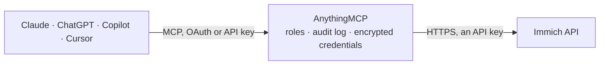

<!-- Generated by scripts/export-github-catalog.mjs in the anythingmcp-website repository. Do not edit by hand. -->

# Immich MCP connector

Let your AI read your Immich photo library: how many photos and videos you have, your albums and who they are shared with, the date, place, camera and people of a photo, the people Immich recognised … The AnythingMCP connector gives Claude, ChatGPT, Microsoft Copilot, Cursor and Gemini 8 MCP tools for Immich, all read-only.

**Category:** [File Storage](../storage.md) · **Tools:** 8 · **Setup guide:** [anythingmcp.com](https://anythingmcp.com/guides/immich-to-mcp) · [Deutsch](https://anythingmcp.com/de/guides/immich-to-mcp) · [Italiano](https://anythingmcp.com/it/guides/immich-to-mcp) · [Español](https://anythingmcp.com/es/guides/immich-to-mcp) · [日本語](https://anythingmcp.com/ja/guides/immich-to-mcp) · [Русский](https://anythingmcp.com/ru/guides/immich-to-mcp) · [中文](https://anythingmcp.com/zh/guides/immich-to-mcp)

## Start without code

No installation and no terminal: AnythingMCP Cloud runs the Immich connector for you, operated by helpcode.ai in Frankfurt, Germany.

1. **Click the button above** and create an account or sign in. The Immich connector opens, ready to install.
2. **Paste the API key or token from your Immich account.** Every click is in the [step-by-step guide](https://anythingmcp.com/guides/immich-to-mcp).
3. **Click Install.** AnythingMCP shows the address of your MCP server.
4. **Add that address to your assistant:** [Claude](https://anythingmcp.com/guides/connect-immich-to-claude) · [ChatGPT](https://anythingmcp.com/guides/connect-immich-to-chatgpt) · [Microsoft Copilot](https://anythingmcp.com/guides/connect-immich-to-copilot) · [Cursor](https://anythingmcp.com/guides/connect-immich-to-cursor) · [Gemini CLI](https://anythingmcp.com/guides/connect-immich-to-gemini) · [Meta Muse](https://anythingmcp.com/guides/connect-immich-to-muse).
5. **Ask your first question**, for example: *What's the capture date and camera for the album cover of the album named 'Apollo Launch'?*

Prefer help with the setup? [Talk to us](https://anythingmcp.com/contact).

## How it works

- **The AI client** speaks MCP (Streamable HTTP) to AnythingMCP and only sees tool names, descriptions and results. It never gets the Immich credentials.
- **AnythingMCP** checks the client's role, builds the call from the tool definition, adds the credentials (an API key), calls Immich, logs the call and returns the result.
- **Immich** sees an ordinary API client with the rights of the account the credentials belong to.

## Tools

| Tool | What it does | Access |
|---|---|---|
| [`immich_get_my_user`](#immich_get_my_user) | Get the Immich user behind the API key: id, name, email, whether it is an admin, and the storage quota and usage in bytes. | read |
| [`immich_get_asset_statistics`](#immich_get_asset_statistics) | Count the photos and videos in the library: {images, videos, total}. | read |
| [`immich_list_albums`](#immich_list_albums) | List the albums this user owns or that are shared with them, shortened to id, name, description, asset count, shared flag, date range, thumbnail asset id,… | read |
| [`immich_get_album`](#immich_get_album) | Get one album by id: name, description, asset count, first and last photo date, thumbnail asset id, sharing and every member with their role. | read |
| [`immich_get_asset`](#immich_get_asset) | Get one photo or video by id: file name, type, capture and upload dates, favourite, archive and trash state, EXIF data (camera, lens, exposure, GPS, city,… | read |
| [`immich_search_people`](#immich_search_people) | Find people Immich recognised by face, by name: id, name, birth date, favourite and hidden flags. | read |
| [`immich_get_timeline_buckets`](#immich_get_timeline_buckets) | Count assets per month: one {timeBucket, count} per month that has assets, newest first, timeBucket being the first day of the month (2026-10-01). | read |
| [`immich_search_places`](#immich_search_places) | Find places by name in Immich's built-in geocoding data: name, region (admin1name, admin2name), latitude and longitude, e.g. to place a photo's city on a map. | read |

## Tool reference

Every parameter as the AI client sees it in `tools/list`. Source: [`packages/backend/src/adapters/intl/immich.json`](../../../packages/backend/src/adapters/intl/immich.json).

### `immich_get_my_user`

Get the Immich user behind the API key: id, name, email, whether it is an admin, and the storage quota and usage in bytes. Use it to check the setup. Read-only.

**Access:** read · **Call:** `GET /users/me`

No parameters.

### `immich_get_asset_statistics`

Count the photos and videos in the library: {images, videos, total}. Without filters it counts every asset not in the trash, archived ones included. Use visibility=timeline for the main timeline only. Read-only.

**Access:** read · **Call:** `GET /assets/statistics`

| Parameter | Type | Required | Description |
|---|---|---|---|
| `isFavorite` | boolean | no | Optional: true for favourites only, false for non-favourites only. |
| `isTrashed` | boolean | no | Optional: true counts only assets in the trash. Without it, trashed assets are left out. |
| `visibility` | `timeline` \| `archive` \| `hidden` | no | Optional: timeline for assets on the main timeline, archive for archived assets, hidden for assets hidden by Immich (e.g. the video part of a live photo). Without it, archived assets are counted too. |

### `immich_list_albums`

List the albums this user owns or that are shared with them, shortened to id, name, description, asset count, shared flag, date range, thumbnail asset id, owner and members. The id is what immich_get_album and immich_get_timeline_buckets take. Read-only.

**Access:** read · **Call:** `GET /albums`

| Parameter | Type | Required | Description |
|---|---|---|---|
| `isShared` | boolean | no | Optional: true for shared albums only (shared with you or by you), false for albums nobody else can see. |
| `isOwned` | boolean | no | Optional: true for albums you own, false for albums other users shared with you. |
| `name` | string | no | Optional: only albums with exactly this name, e.g. Holidays 2026. |
| `assetId` | string | no | Optional asset id (UUID) from immich_get_asset: only albums that contain this asset. |

### `immich_get_album`

Get one album by id: name, description, asset count, first and last photo date, thumbnail asset id, sharing and every member with their role. It does not list the album's assets. Immich answers 400 if the album does not exist. Read-only.

**Access:** read · **Call:** `GET /albums/{id}`

| Parameter | Type | Required | Description |
|---|---|---|---|
| `id` | string | yes | Album id (UUID) from immich_list_albums, e.g. 1e80e25e-4f5f-48cf-8807-e25209774beb. |

### `immich_get_asset`

Get one photo or video by id: file name, type, capture and upload dates, favourite, archive and trash state, EXIF data (camera, lens, exposure, GPS, city, country), the recognised people and the tags. Read-only.

**Access:** read · **Call:** `GET /assets/{id}`

| Parameter | Type | Required | Description |
|---|---|---|---|
| `id` | string | yes | Asset id (UUID), e.g. albumThumbnailAssetId from immich_list_albums or immich_get_album. |

### `immich_search_people`

Find people Immich recognised by face, by name: id, name, birth date, favourite and hidden flags. The id is what immich_get_timeline_buckets takes as personId. Unnamed people cannot be found by name. Read-only.

**Access:** read · **Call:** `GET /search/person`

| Parameter | Type | Required | Description |
|---|---|---|---|
| `name` | string | yes | Name or start of a name as set in Immich, e.g. Anna. |
| `withHidden` | boolean | no | Optional: true to include people hidden in Immich. |

### `immich_get_timeline_buckets`

Count assets per month: one {timeBucket, count} per month that has assets, newest first, timeBucket being the first day of the month (2026-10-01). Use it for 'how many photos of Anna each month', filtered by person, album, tag or favourites. Read-only.

**Access:** read · **Call:** `GET /timeline/buckets`

| Parameter | Type | Required | Description |
|---|---|---|---|
| `personId` | string | no | Optional person id (UUID) from immich_search_people. |
| `albumId` | string | no | Optional album id (UUID) from immich_list_albums. |
| `tagId` | string | no | Optional tag id (UUID) from the tags of an asset returned by immich_get_asset. |
| `isFavorite` | boolean | no | Optional: true for favourites only, false for non-favourites only. |
| `isTrashed` | boolean | no | Optional: true counts only assets in the trash. Without it, trashed assets are left out. |
| `visibility` | `timeline` \| `archive` \| `hidden` | no | Optional: timeline for assets on the main timeline, archive for archived assets, hidden for assets hidden by Immich (e.g. the video part of a live photo). Without it, archived assets are counted too. |

### `immich_search_places`

Find places by name in Immich's built-in geocoding data: name, region (admin1name, admin2name), latitude and longitude, e.g. to place a photo's city on a map. Read-only.

**Access:** read · **Call:** `GET /search/places`

| Parameter | Type | Required | Description |
|---|---|---|---|
| `name` | string | yes | Place name or start of it, e.g. Berlin or Arezzo. |

## Run it yourself

AnythingMCP is open source (AGPL-3.0). [Run it with Docker](../../../README.md#run-it-yourself), open **Connectors → Store**, pick **Immich** and enter `IMMICH_URL`, `IMMICH_API_KEY`, then add your MCP server URL to the AI client.

[← File Storage connectors](../storage.md) · [All categories](../README.md)
