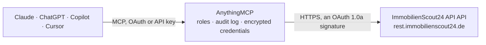

<!-- Generated by scripts/export-github-catalog.mjs in the anythingmcp-website repository. Do not edit by hand. -->

# ImmobilienScout24 API MCP connector

Search real estate listings on ImmobilienScout24, Germany's largest property portal, from any AI assistant. The AnythingMCP connector gives Claude, ChatGPT, Microsoft Copilot, Cursor and Gemini 3 MCP tools for ImmobilienScout24 API, all read-only.

**Category:** [Real Estate](../real-estate.md) · **Tools:** 3 · **Setup guide:** [anythingmcp.com](https://anythingmcp.com/guides/immobilienscout24-to-mcp) · [Deutsch](https://anythingmcp.com/de/guides/immobilienscout24-to-mcp) · [Italiano](https://anythingmcp.com/it/guides/immobilienscout24-to-mcp) · [Español](https://anythingmcp.com/es/guides/immobilienscout24-to-mcp) · [日本語](https://anythingmcp.com/ja/guides/immobilienscout24-to-mcp) · [Русский](https://anythingmcp.com/ru/guides/immobilienscout24-to-mcp) · [中文](https://anythingmcp.com/zh/guides/immobilienscout24-to-mcp)

## Start without code

No installation and no terminal: AnythingMCP Cloud runs the ImmobilienScout24 API connector for you, operated by helpcode.ai in Frankfurt, Germany.

1. **Click the button above** and create an account or sign in. The ImmobilienScout24 API connector opens, ready to install.
2. **Sign in with your ImmobilienScout24 API account** when AnythingMCP asks. The first time, an admin creates a small app in the ImmobilienScout24 API developer console. Every click is in the [step-by-step guide](https://anythingmcp.com/guides/immobilienscout24-to-mcp).
3. **Click Install.** AnythingMCP shows the address of your MCP server.
4. **Add that address to your assistant:** [Claude](https://anythingmcp.com/guides/connect-immobilienscout24-to-claude) · [ChatGPT](https://anythingmcp.com/guides/connect-immobilienscout24-to-chatgpt) · [Microsoft Copilot](https://anythingmcp.com/guides/connect-immobilienscout24-to-copilot) · [Cursor](https://anythingmcp.com/guides/connect-immobilienscout24-to-cursor) · [Gemini CLI](https://anythingmcp.com/guides/connect-immobilienscout24-to-gemini) · [Meta Muse](https://anythingmcp.com/guides/connect-immobilienscout24-to-muse).
5. **Ask your first question**, for example: *Show me expose 987654321 details for the Stuttgart rental at Königstraße 12.*

Prefer help with the setup? [Talk to us](https://anythingmcp.com/contact).

## How it works

- **The AI client** speaks MCP (Streamable HTTP) to AnythingMCP and only sees tool names, descriptions and results. It never gets the ImmobilienScout24 API credentials.
- **AnythingMCP** checks the client's role, builds the call from the tool definition, adds the credentials (an OAuth 1.0a signature), calls ImmobilienScout24 API, logs the call and returns the result.
- **ImmobilienScout24 API** sees an ordinary API client with the rights of the account the credentials belong to.

## Tools

| Tool | What it does | Access |
|---|---|---|
| [`is24_search_properties`](#is24_search_properties) | Search for real estate listings on ImmobilienScout24 by location and filters. | read |
| [`is24_search_locations`](#is24_search_locations) | Resolve a place name, district or town in Germany to ImmobilienScout24 GeoCodes (Geo Auto Completion). | read |
| [`is24_get_property`](#is24_get_property) | Get detailed information about a specific real estate listing by its expose ID. | read |

## Tool reference

Every parameter as the AI client sees it in `tools/list`. Source: [`packages/backend/src/adapters/de/immobilienscout24.json`](../../../packages/backend/src/adapters/de/immobilienscout24.json).

### `is24_search_properties`

Search for real estate listings on ImmobilienScout24 by location and filters. Returns property titles, prices, sizes, and listing IDs.

**Access:** read · **Call:** `GET /search/v1.0/search/region`

| Parameter | Type | Required | Description |
|---|---|---|---|
| `geocode` | string | yes | GeoCode of the search area (e.g. '1276003001046' for Berlin Mitte), from is24_search_locations. Several can be given comma-separated. |
| `realestatetype` | string | yes | Property type: 'apartmentrent', 'apartmentbuy', 'houserent', 'housebuy', 'office', 'store', 'gastronomy'. |
| `price` | string | no | Price range as min-max, either side may be empty: '-1500' (up to 1500), '300000-450000'. Rent per month for rentals, purchase price for sales. |
| `livingspace` | string | no | Living space range in m² as min-max, e.g. '60-' (at least 60) or '60-90'. |
| `numberofrooms` | string | no | Number of rooms as min-max, e.g. '2-' (at least 2) or '2-3'. |
| `pagenumber` | number | no | Page number for pagination (default: 1, 20 results per page). |

### `is24_search_locations`

Resolve a place name, district or town in Germany to ImmobilienScout24 GeoCodes (Geo Auto Completion). Use the returned entity.id as the geocode for is24_search_properties.

**Access:** read · **Call:** `GET /gis/v2.0/geoautocomplete/DEU`

| Parameter | Type | Required | Description |
|---|---|---|---|
| `query` | string | yes | Location name to search (e.g. 'Berlin', 'München Schwabing', 'Hamburg Altona') |

### `is24_get_property`

Get detailed information about a specific real estate listing by its expose ID. Returns full property details including description, equipment, energy certificate, and contact info.

**Access:** read · **Call:** `GET /search/v1.0/expose/{exposeId}`

| Parameter | Type | Required | Description |
|---|---|---|---|
| `exposeId` | string | yes | The ImmobilienScout24 expose ID (listing ID) |

## Run it yourself

AnythingMCP is open source (AGPL-3.0). [Run it with Docker](../../../README.md#run-it-yourself), open **Connectors → Store**, pick **ImmobilienScout24 API** and enter `IS24_CONSUMER_KEY`, `IS24_CONSUMER_SECRET`, then add your MCP server URL to the AI client.

[← Real Estate connectors](../real-estate.md) · [All categories](../README.md)
