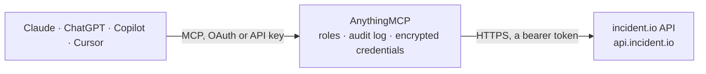

<!-- Generated by scripts/export-github-catalog.mjs in the anythingmcp-website repository. Do not edit by hand. -->

# incident.io MCP connector

incident.io incident response: incidents with updates and timeline, severities, statuses, roles, types and custom fields, actions and follow-ups, alerts and alert sources, on-call schedules and … The AnythingMCP connector gives Claude, ChatGPT, Microsoft Copilot, Cursor and Gemini 43 MCP tools for incident.io: 34 read and 9 can change data.

**Category:** [Monitoring](../monitoring.md) · **Tools:** 43 · **Setup guide:** [anythingmcp.com](https://anythingmcp.com/guides/incident-io-to-mcp) · [Deutsch](https://anythingmcp.com/de/guides/incident-io-to-mcp) · [Italiano](https://anythingmcp.com/it/guides/incident-io-to-mcp) · [Español](https://anythingmcp.com/es/guides/incident-io-to-mcp) · [日本語](https://anythingmcp.com/ja/guides/incident-io-to-mcp) · [Русский](https://anythingmcp.com/ru/guides/incident-io-to-mcp) · [中文](https://anythingmcp.com/zh/guides/incident-io-to-mcp)

## Start without code

No installation and no terminal: AnythingMCP Cloud runs the incident.io connector for you, operated by helpcode.ai in Frankfurt, Germany.

1. **Click the button above** and create an account or sign in. The incident.io connector opens, ready to install.
2. **Paste the API key or token from your incident.io account.** Every click is in the [step-by-step guide](https://anythingmcp.com/guides/incident-io-to-mcp).
3. **Click Install.** AnythingMCP shows the address of your MCP server.
4. **Add that address to your assistant:** [Claude](https://anythingmcp.com/guides/connect-incident-io-to-claude) · [ChatGPT](https://anythingmcp.com/guides/connect-incident-io-to-chatgpt) · [Microsoft Copilot](https://anythingmcp.com/guides/connect-incident-io-to-copilot) · [Cursor](https://anythingmcp.com/guides/connect-incident-io-to-cursor) · [Gemini CLI](https://anythingmcp.com/guides/connect-incident-io-to-gemini) · [Meta Muse](https://anythingmcp.com/guides/connect-incident-io-to-muse).
5. **Ask your first question**, for example: *Show me the incident INC-2026-48 with the PostgreSQL outage, I need its current status and severity.*

Prefer help with the setup? [Talk to us](https://anythingmcp.com/contact).

## How it works

- **The AI client** speaks MCP (Streamable HTTP) to AnythingMCP and only sees tool names, descriptions and results. It never gets the incident.io credentials.
- **AnythingMCP** checks the client's role, builds the call from the tool definition, adds the credentials (a bearer token), calls incident.io, logs the call and returns the result.
- **incident.io** sees an ordinary API client with the rights of the account the credentials belong to.

## Tools

| Tool | What it does | Access |
|---|---|---|
| [`incident_io_get_identity`](#incident_io_get_identity) | Show which API key the connector uses: its name, the organisation's dashboard URL and the roles (permissions) granted to it, e.g. viewer, incident_creator,… | read |
| [`incident_io_list_incidents`](#incident_io_list_incidents) | List incidents, newest first: id, reference (INC-123), name, summary, status and status category, severity, type, mode, visibility, role assignments, custom… | read |
| [`incident_io_get_incident`](#incident_io_get_incident) | Get one incident with everything on it: reference, name, summary, status, severity, type, mode, visibility, role assignments, custom field values,… | read |
| [`incident_io_create_incident`](#incident_io_create_incident) | Declare an incident: name, summary, severity, status, type, visibility and mode, with role assignments and custom field values. | write |
| [`incident_io_edit_incident`](#incident_io_edit_incident) | Edit an incident: rename it, change its summary, severity or status (resolve it by moving to a closed status), assign roles, set custom fields, timestamps… | write |
| [`incident_io_list_incident_updates`](#incident_io_list_incident_updates) | List the updates of an incident (or of all incidents), newest first: message, new status and severity, who posted it and when. | read |
| [`incident_io_create_incident_update`](#incident_io_create_incident_update) | Post an update to an incident: a message for responders and stakeholders, optionally moving it to another status or severity at the same time. | write |
| [`incident_io_list_incident_timeline_items`](#incident_io_list_incident_timeline_items) | List the timeline of one incident: the items added to it (notes, pinned messages, updates) with their time and author, in order. | read |
| [`incident_io_list_severities`](#incident_io_list_severities) | List the severities configured in incident.io (e.g. Minor, Major, Critical) with id, name, description and rank (higher is more severe). | read |
| [`incident_io_list_incident_statuses`](#incident_io_list_incident_statuses) | List the incident statuses (e.g. Investigating, Fixing, Monitoring, Closed) with id, name, description, rank and category (triage, live, learning, paused,… | read |
| [`incident_io_list_incident_roles`](#incident_io_list_incident_roles) | List the incident roles (e.g. Incident Lead, Communications) with id, name, description, the instructions shown to the assignee and whether the role is… | read |
| [`incident_io_list_incident_types`](#incident_io_list_incident_types) | List the incident types (e.g. Security, Platform) with id, name, description, whether it is the default, whether incidents start in triage and whether they… | read |
| [`incident_io_list_custom_fields`](#incident_io_list_custom_fields) | List the custom fields of incidents with id, name, description and type (single_select, multi_select, text, link, numeric), and for catalog-backed fields… | read |
| [`incident_io_get_custom_field`](#incident_io_get_custom_field) | Get one custom field: name, description, type and, for catalog fields, the catalog type it draws its values from. | read |
| [`incident_io_list_custom_field_options`](#incident_io_list_custom_field_options) | List the options of a single or multi select custom field: id (value_option_id), value and sort key. | read |
| [`incident_io_list_incident_timestamps`](#incident_io_list_incident_timestamps) | List the incident timestamps tracked for every incident (reported at, accepted at, impact started, resolved at, ...) with their ids, for… | read |
| [`incident_io_list_actions`](#incident_io_list_actions) | List actions (tasks done during an incident), optionally of one incident: id, description, status (outstanding, completed, not_doing), assignee and times. | read |
| [`incident_io_get_action`](#incident_io_get_action) | Get one action: description, status, assignee, incident and completion time. | read |
| [`incident_io_create_action`](#incident_io_create_action) | Add an action to an incident: a task to do now, optionally assigned to a user. | write |
| [`incident_io_update_action`](#incident_io_update_action) | Update an action: mark it completed or not_doing (or outstanding again), reassign it or change its text. | write |
| [`incident_io_list_follow_ups`](#incident_io_list_follow_ups) | List follow-ups (work to do after an incident), optionally of one incident or team: id, title, description, status, priority, assignee, labels and the… | read |
| [`incident_io_get_follow_up`](#incident_io_get_follow_up) | Get one follow-up: title, description, status, priority, category, assignee, labels, incident and the linked external issue. | read |
| [`incident_io_create_follow_up`](#incident_io_create_follow_up) | Add a follow-up to an incident: a title, optional description, assignee or team, priority, category and labels. | write |
| [`incident_io_update_follow_up`](#incident_io_update_follow_up) | Update a follow-up: complete it or mark it not_doing, reassign it, change priority, labels or text. | write |
| [`incident_io_list_alerts`](#incident_io_list_alerts) | List alerts received from monitoring tools, newest first: id, title, description, status (firing, resolved), alert source, deduplication key, attributes and… | read |
| [`incident_io_get_alert`](#incident_io_get_alert) | Get one alert with its title, description, status, source, deduplication key, attributes, source URL and times. | read |
| [`incident_io_resolve_alert`](#incident_io_resolve_alert) | Resolve a firing alert by hand, e.g. when the source will not send a resolve event. | write |
| [`incident_io_list_incident_alerts`](#incident_io_list_incident_alerts) | List the links between alerts and incidents: which alerts are attached to an incident, or which incidents an alert belongs to. | read |
| [`incident_io_list_alert_sources`](#incident_io_list_alert_sources) | List the alert sources (Datadog, Grafana, Prometheus, CloudWatch, HTTP, email, heartbeat, ...) with id, name, type, the template that builds alerts and the… | read |
| [`incident_io_get_alert_source`](#incident_io_get_alert_source) | Get one alert source: name, type, template (title, description, attributes), filters, owning teams and source-specific options. | read |
| [`incident_io_list_schedules`](#incident_io_list_schedules) | List on-call schedules with id, name, time zone, rotations and layers, and (with page_size 25 or less) the current and next shifts. | read |
| [`incident_io_get_schedule`](#incident_io_get_schedule) | Get one on-call schedule: time zone, rotations with their layers, handover times and members, and the current shifts. | read |
| [`incident_io_list_schedule_entries`](#incident_io_list_schedule_entries) | Show who is on call on a schedule in a time window: the final entries after overrides, each with user, start and end. | read |
| [`incident_io_list_escalation_paths`](#incident_io_list_escalation_paths) | List the escalation paths (who gets paged in which order, through which schedules and users) with id and name. | read |
| [`incident_io_list_escalations`](#incident_io_list_escalations) | List escalations (pages sent to people) with id, title, status (pending, triggered, acked, resolved, expired, cancelled, snoozed, ...), escalation path,… | read |
| [`incident_io_create_escalation`](#incident_io_create_escalation) | Page people: start an escalation that follows an escalation path, or notifies the given users directly, with a title included in every notification. | write |
| [`incident_io_list_users`](#incident_io_list_users) | List the users of the organisation with id, name, email, Slack user id and role. | read |
| [`incident_io_get_user`](#incident_io_get_user) | Get one user: name, email, Slack user id, base role and custom roles. | read |
| [`incident_io_list_teams`](#incident_io_list_teams) | List the teams of the organisation with id and name; team ids are used for follow-ups and alert source ownership. | read |
| [`incident_io_list_catalog_types`](#incident_io_list_catalog_types) | List the catalog types (services, teams, features, environments, ...) with id, name, description, type name, attribute schema and whether they are synced… | read |
| [`incident_io_get_catalog_type`](#incident_io_get_catalog_type) | Get one catalog type with its attribute schema (names, types, which attributes link to other types). | read |
| [`incident_io_list_catalog_entries`](#incident_io_list_catalog_entries) | List the entries of one catalog type (e.g. every service) with id, name, external id, aliases, rank and attribute values. | read |
| [`incident_io_get_catalog_entry`](#incident_io_get_catalog_entry) | Get one catalog entry with its attribute values; with expand true also the entries that link to it. | read |

## Tool reference

Every parameter as the AI client sees it in `tools/list`. Source: [`packages/backend/src/adapters/intl/incident-io.json`](../../../packages/backend/src/adapters/intl/incident-io.json).

### `incident_io_get_identity`

Show which API key the connector uses: its name, the organisation's dashboard URL and the roles (permissions) granted to it, e.g. viewer, incident_creator, incident_editor, on_call_viewer, escalation_creator. Use it to check the key and to see why a call is refused.

**Access:** read · **Call:** `GET /v1/identity`

No parameters.

### `incident_io_list_incidents`

List incidents, newest first: id, reference (INC-123), name, summary, status and status category, severity, type, mode, visibility, role assignments, custom field values, timestamps, Slack channel and permalink. Filter by status category, status, severity, type, mode and created or updated date; combine filters with filter_mode.

**Access:** read · **Call:** `GET /v2/incidents`

| Parameter | Type | Required | Description |
|---|---|---|---|
| `page_size` | integer | no | Results per page, 1 to 250 (default 25). |
| `after` | string | no | Cursor for the next page: `pagination_meta.after` of the previous answer. Leave empty for the first page. |
| `sort_by` | `created_at_newest_first` \| `created_at_oldest_first` | no | Order (default newest first). |
| `filter_mode` | `all` \| `any` | no | all (default): every filter must match; any: one is enough. |
| `status_category` | `triage` \| `live` \| `learning` \| `paused` \| `closed` \| `declined` \| `canceled` \| `merged`[] | no | Only incidents in these status categories. API names: triage, live (shown as Active), learning (Post-incident), paused, closed, declined, canceled, merged. |
| `status_category_not_in` | `triage` \| `live` \| `learning` \| `paused` \| `closed` \| `declined` \| `canceled` \| `merged`[] | no | Leave out incidents in these status categories, e.g. ["closed", "declined", "canceled", "merged"]. |
| `status_id` | string[] | no | Only incidents with these status ids, from `incident_io_list_incident_statuses`. |
| `severity_id` | string[] | no | Only incidents with these severity ids, from `incident_io_list_severities`. |
| `severity_gte` | string | no | Only incidents at least as severe as this severity id (by rank). |
| `incident_type_id` | string[] | no | Only incidents of these type ids, from `incident_io_list_incident_types`. |
| `mode` | `standard` \| `retrospective` \| `test` \| `tutorial`[] | no | Only these modes (default standard and retrospective; test and tutorial are hidden). |
| `created_at_gte` | string | no | Created on or after this date, YYYY-MM-DD. |
| `created_at_lte` | string | no | Created on or before this date, YYYY-MM-DD. |
| `updated_at_gte` | string | no | Updated on or after this date, YYYY-MM-DD. |
| `extra_filters` | string | no | Further filters as a query string, for custom fields and roles, e.g. `custom_field[01FCN...][one_of]=01FCO...` or `incident_role[01FH5...][is_blank]=true` (URL-encode values). |

### `incident_io_get_incident`

Get one incident with everything on it: reference, name, summary, status, severity, type, mode, visibility, role assignments, custom field values, timestamps (reported, accepted, resolved), duration metrics, Slack channel, postmortem link and permalink.

**Access:** read · **Call:** `GET /v2/incidents/{incident_id}`

| Parameter | Type | Required | Description |
|---|---|---|---|
| `incident_id` | string | yes | Incident id (a ULID such as 01FDAG4SAP5TYPT98WGR2N7W91), from `incident_io_list_incidents` (`incidents[].id`). |

### `incident_io_create_incident`

Declare an incident: name, summary, severity, status, type, visibility and mode, with role assignments and custom field values. A standard incident opens a Slack or Teams channel and alerts the team; use mode test to try it out.

**Access:** write · **Call:** `POST /v2/incidents`

| Parameter | Type | Required | Description |
|---|---|---|---|
| `idempotency_key` | string | yes | Any unique string for this request (e.g. a UUID). Sending the same key again returns the first result instead of creating a duplicate. |
| `visibility` | `public` \| `private` | yes | public (anyone in the workspace can join) or private (invite-only). |
| `name` | string | no | Short title of the incident. |
| `summary` | string | no | Longer description of what is happening (Markdown). |
| `severity_id` | string | no | Severity id, from `incident_io_list_severities`. |
| `incident_status_id` | string | no | Starting status id, from `incident_io_list_incident_statuses` (default the first active status, or triage when the type starts in triage). |
| `incident_type_id` | string | no | Incident type id, from `incident_io_list_incident_types`. |
| `mode` | `standard` \| `retrospective` \| `test` \| `tutorial` | no | standard (default), retrospective (to record a past incident), test or tutorial. |
| `incident_role_assignments` | object[] | no | Roles to assign, each {"incident_role_id": "<id from incident_io_list_incident_roles>", "assignee": {"email": "jane@example.com"}} (assignee by `id`, `email` or `slack_user_id`). |
| `custom_field_entries` | object[] | no | Custom field values, each {"custom_field_id": "<id>", "values": [{"value_option_id": "<id>"}]}; use value_text, value_numeric, value_link or value_catalog_entry_id by field type, and [] to clear. Ids from `incident_io_list_custom_fields` and `incident_io_list_custom_field_options`. |
| `incident_timestamp_values` | object[] | no | Timestamp values, each {"incident_timestamp_id": "<id from incident_io_list_incident_timestamps>", "value": "2026-10-30T09:00:00Z"}. |
| `slack_channel_name_override` | string | no | Name for the incident's Slack channel instead of the generated one. |
| `slack_team_id` | string | no | Slack workspace (team) id to create the channel in, for Slack Enterprise Grid. |

### `incident_io_edit_incident`

Edit an incident: rename it, change its summary, severity or status (resolve it by moving to a closed status), assign roles, set custom fields, timestamps or the call link. Only the fields you pass change. Posts to the incident channel when notify_incident_channel is true.

**Access:** write · **Call:** `POST /v2/incidents/{incident_id}/actions/edit`

| Parameter | Type | Required | Description |
|---|---|---|---|
| `incident_id` | string | yes | Incident id (a ULID such as 01FDAG4SAP5TYPT98WGR2N7W91), from `incident_io_list_incidents` (`incidents[].id`). |
| `notify_incident_channel` | boolean | yes | Tell the responders in the incident's Slack or Teams channel about this change. |
| `name` | string | no | New title. |
| `summary` | string | no | New summary (Markdown). |
| `severity_id` | string | no | New severity id, from `incident_io_list_severities`. |
| `incident_status_id` | string | no | New status id, from `incident_io_list_incident_statuses`. Allowed: another status in the same category, or a later category (e.g. live to learning or closed). |
| `call_url` | string | no | Link of the incident call (Zoom, Meet, Teams). |
| `slack_channel_name_override` | string | no | New name for the incident's Slack channel. |
| `incident_role_assignments` | object[] | no | Roles to assign, each {"incident_role_id": "<id from incident_io_list_incident_roles>", "assignee": {"email": "jane@example.com"}} (assignee by `id`, `email` or `slack_user_id`). |
| `custom_field_entries` | object[] | no | Custom field values, each {"custom_field_id": "<id>", "values": [{"value_option_id": "<id>"}]}; use value_text, value_numeric, value_link or value_catalog_entry_id by field type, and [] to clear. Ids from `incident_io_list_custom_fields` and `incident_io_list_custom_field_options`. |
| `incident_timestamp_values` | object[] | no | Timestamp values, each {"incident_timestamp_id": "<id from incident_io_list_incident_timestamps>", "value": "2026-10-30T09:00:00Z"}. |

### `incident_io_list_incident_updates`

List the updates of an incident (or of all incidents), newest first: message, new status and severity, who posted it and when.

**Access:** read · **Call:** `GET /v2/incident_updates`

| Parameter | Type | Required | Description |
|---|---|---|---|
| `incident_id` | string | no | Only updates of this incident id. Leave empty for updates of every incident. |
| `page_size` | integer | no | Results per page, 1 to 250 (default 25). |
| `after` | string | no | Cursor for the next page: `pagination_meta.after` of the previous answer. Leave empty for the first page. |

### `incident_io_create_incident_update`

Post an update to an incident: a message for responders and stakeholders, optionally moving it to another status or severity at the same time. Shared in the incident channel like an update from the app.

**Access:** write · **Call:** `POST /v2/incident_updates`

| Parameter | Type | Required | Description |
|---|---|---|---|
| `idempotency_key` | string | yes | Any unique string for this request (e.g. a UUID). Sending the same key again returns the first result instead of creating a duplicate. |
| `incident_id` | string | yes | Incident id, from `incident_io_list_incidents`. |
| `message` | string | no | What changed and what happens next (Markdown). |
| `to_incident_status_id` | string | no | Move the incident to this status id, from `incident_io_list_incident_statuses`. |
| `to_severity_id` | string | no | Move the incident to this severity id, from `incident_io_list_severities`. |

### `incident_io_list_incident_timeline_items`

List the timeline of one incident: the items added to it (notes, pinned messages, updates) with their time and author, in order.

**Access:** read · **Call:** `GET /v2/incident_timeline_items`

| Parameter | Type | Required | Description |
|---|---|---|---|
| `incident_id` | string | yes | Incident id, from `incident_io_list_incidents`. |
| `page_size` | integer | no | Results per page, 1 to 250 (default 25). |
| `after` | string | no | Cursor for the next page: `pagination_meta.after` of the previous answer. Leave empty for the first page. |

### `incident_io_list_severities`

List the severities configured in incident.io (e.g. Minor, Major, Critical) with id, name, description and rank (higher is more severe). Ids feed create, edit and filter calls.

**Access:** read · **Call:** `GET /v1/severities`

No parameters.

### `incident_io_list_incident_statuses`

List the incident statuses (e.g. Investigating, Fixing, Monitoring, Closed) with id, name, description, rank and category (triage, live, learning, paused, closed, declined, canceled, merged).

**Access:** read · **Call:** `GET /v1/incident_statuses`

No parameters.

### `incident_io_list_incident_roles`

List the incident roles (e.g. Incident Lead, Communications) with id, name, description, the instructions shown to the assignee and whether the role is required.

**Access:** read · **Call:** `GET /v2/incident_roles`

No parameters.

### `incident_io_list_incident_types`

List the incident types (e.g. Security, Platform) with id, name, description, whether it is the default, whether incidents start in triage and whether they must be private.

**Access:** read · **Call:** `GET /v1/incident_types`

No parameters.

### `incident_io_list_custom_fields`

List the custom fields of incidents with id, name, description and type (single_select, multi_select, text, link, numeric), and for catalog-backed fields the catalog type.

**Access:** read · **Call:** `GET /v2/custom_fields`

No parameters.

### `incident_io_get_custom_field`

Get one custom field: name, description, type and, for catalog fields, the catalog type it draws its values from.

**Access:** read · **Call:** `GET /v2/custom_fields/{custom_field_id}`

| Parameter | Type | Required | Description |
|---|---|---|---|
| `custom_field_id` | string | yes | Custom field id, from `incident_io_list_custom_fields`. |

### `incident_io_list_custom_field_options`

List the options of a single or multi select custom field: id (value_option_id), value and sort key.

**Access:** read · **Call:** `GET /v1/custom_field_options`

| Parameter | Type | Required | Description |
|---|---|---|---|
| `custom_field_id` | string | yes | Custom field id, from `incident_io_list_custom_fields`. |
| `page_size` | integer | no | Results per page, 1 to 250 (default 25). |
| `after` | string | no | Cursor for the next page: `pagination_meta.after` of the previous answer. Leave empty for the first page. |

### `incident_io_list_incident_timestamps`

List the incident timestamps tracked for every incident (reported at, accepted at, impact started, resolved at, ...) with their ids, for `incident_timestamp_values`.

**Access:** read · **Call:** `GET /v2/incident_timestamps`

No parameters.

### `incident_io_list_actions`

List actions (tasks done during an incident), optionally of one incident: id, description, status (outstanding, completed, not_doing), assignee and times.

**Access:** read · **Call:** `GET /v3/actions`

| Parameter | Type | Required | Description |
|---|---|---|---|
| `incident_id` | string | no | Only actions of this incident id. |
| `incident_mode` | `standard` \| `retrospective` \| `test` \| `tutorial` \| `stream` | no | Only from incidents of this mode (default standard and retrospective). |
| `page_size` | integer | no | Results per page, 1 to 250 (default 25). |
| `after` | string | no | Cursor for the next page: `pagination_meta.after` of the previous answer. Leave empty for the first page. |

### `incident_io_get_action`

Get one action: description, status, assignee, incident and completion time.

**Access:** read · **Call:** `GET /v3/actions/{action_id}`

| Parameter | Type | Required | Description |
|---|---|---|---|
| `action_id` | string | yes | Action id, from `incident_io_list_actions`. |

### `incident_io_create_action`

Add an action to an incident: a task to do now, optionally assigned to a user.

**Access:** write · **Call:** `POST /v3/actions`

| Parameter | Type | Required | Description |
|---|---|---|---|
| `incident_id` | string | yes | Incident id, from `incident_io_list_incidents`. |
| `description` | string | yes | What needs doing (Markdown). |
| `assignee_id` | string | no | User id to assign it to, from `incident_io_list_users`. |

### `incident_io_update_action`

Update an action: mark it completed or not_doing (or outstanding again), reassign it or change its text. The API replaces the action, so pass the description and status every time.

**Access:** write · **Call:** `PUT /v3/actions/{action_id}`

| Parameter | Type | Required | Description |
|---|---|---|---|
| `action_id` | string | yes | Action id, from `incident_io_list_actions`. |
| `description` | string | yes | Text of the action (send the current one to keep it). |
| `status` | `outstanding` \| `completed` \| `not_doing` | yes | New status. |
| `assignee_id` | string | no | User id to assign it to, from `incident_io_list_users`. |

### `incident_io_list_follow_ups`

List follow-ups (work to do after an incident), optionally of one incident or team: id, title, description, status, priority, assignee, labels and the linked external issue (Jira, Linear, ...).

**Access:** read · **Call:** `GET /v3/follow_ups`

| Parameter | Type | Required | Description |
|---|---|---|---|
| `incident_id` | string | no | Only follow-ups of this incident id. |
| `assignee_team_id` | string | no | Only follow-ups assigned to this team id, from `incident_io_list_teams`. |
| `incident_mode` | `standard` \| `retrospective` \| `test` \| `tutorial` \| `stream` | no | Only from incidents of this mode (default standard and retrospective). |
| `page_size` | integer | no | Results per page, 1 to 250 (default 25). |
| `after` | string | no | Cursor for the next page: `pagination_meta.after` of the previous answer. Leave empty for the first page. |

### `incident_io_get_follow_up`

Get one follow-up: title, description, status, priority, category, assignee, labels, incident and the linked external issue.

**Access:** read · **Call:** `GET /v3/follow_ups/{follow_up_id}`

| Parameter | Type | Required | Description |
|---|---|---|---|
| `follow_up_id` | string | yes | Follow-up id, from `incident_io_list_follow_ups`. |

### `incident_io_create_follow_up`

Add a follow-up to an incident: a title, optional description, assignee or team, priority, category and labels.

**Access:** write · **Call:** `POST /v3/follow_ups`

| Parameter | Type | Required | Description |
|---|---|---|---|
| `incident_id` | string | yes | Incident id, from `incident_io_list_incidents`. |
| `title` | string | yes | Title of the follow-up. |
| `description` | string | no | Details (Markdown). |
| `assignee_id` | string | no | User id to assign it to, from `incident_io_list_users`. |
| `assignee_team_id` | string | no | Team id to assign it to, from `incident_io_list_teams`. |
| `follow_up_priority_option_id` | string | no | Priority option id, as shown on existing follow-ups (`priority.id`). |
| `follow_up_category_id` | string | no | Category id, as shown on existing follow-ups. |
| `labels` | string[] | no | Labels for the follow-up. |
| `external_issue_reference_id` | string | no | Id of an existing external issue (Jira, Linear, ...) to link it to. |

### `incident_io_update_follow_up`

Update a follow-up: complete it or mark it not_doing, reassign it, change priority, labels or text. The API replaces the follow-up, so pass the title and status every time.

**Access:** write · **Call:** `PUT /v3/follow_ups/{follow_up_id}`

| Parameter | Type | Required | Description |
|---|---|---|---|
| `follow_up_id` | string | yes | Follow-up id, from `incident_io_list_follow_ups`. |
| `status` | `outstanding` \| `completed` \| `not_doing` | yes | New status. |
| `title` | string | yes | Title of the follow-up. |
| `description` | string | no | Details (Markdown). |
| `assignee_id` | string | no | User id to assign it to, from `incident_io_list_users`. |
| `assignee_team_id` | string | no | Team id to assign it to, from `incident_io_list_teams`. |
| `follow_up_priority_option_id` | string | no | Priority option id, as shown on existing follow-ups (`priority.id`). |
| `follow_up_category_id` | string | no | Category id, as shown on existing follow-ups. |
| `labels` | string[] | no | Labels for the follow-up. |

### `incident_io_list_alerts`

List alerts received from monitoring tools, newest first: id, title, description, status (firing, resolved), alert source, deduplication key, attributes and times. Filter by status, source, deduplication key or creation date.

**Access:** read · **Call:** `GET /v2/alerts`

| Parameter | Type | Required | Description |
|---|---|---|---|
| `page_size` | integer | no | Results per page, 1 to 250 (default 25). |
| `after` | string | no | Cursor for the next page: `pagination_meta.after` of the previous answer. Leave empty for the first page. |
| `status` | `firing` \| `resolved`[] | no | Only alerts with these statuses. |
| `alert_source_id` | string[] | no | Only alerts from these alert source ids, from `incident_io_list_alert_sources`. |
| `deduplication_key` | string | no | Only the alert with this deduplication key. |
| `created_at_gte` | string | no | Created on or after this date, YYYY-MM-DD. |
| `created_at_lte` | string | no | Created on or before this date, YYYY-MM-DD. |

### `incident_io_get_alert`

Get one alert with its title, description, status, source, deduplication key, attributes, source URL and times.

**Access:** read · **Call:** `GET /v2/alerts/{alert_id}`

| Parameter | Type | Required | Description |
|---|---|---|---|
| `alert_id` | string | yes | Alert id, from `incident_io_list_alerts`. |

### `incident_io_resolve_alert`

Resolve a firing alert by hand, e.g. when the source will not send a resolve event. Incidents and escalations it started may resolve too, depending on the alert route.

**Access:** write · **Call:** `POST /v2/alerts/{alert_id}/actions/resolve`

| Parameter | Type | Required | Description |
|---|---|---|---|
| `alert_id` | string | yes | Alert id, from `incident_io_list_alerts`. |

### `incident_io_list_incident_alerts`

List the links between alerts and incidents: which alerts are attached to an incident, or which incidents an alert belongs to.

**Access:** read · **Call:** `GET /v2/incident_alerts`

| Parameter | Type | Required | Description |
|---|---|---|---|
| `page_size` | integer | no | Results per page, 1 to 250 (default 25). |
| `after` | string | no | Cursor for the next page: `pagination_meta.after` of the previous answer. Leave empty for the first page. |
| `incident_id` | string | no | Only alerts attached to this incident id. |
| `alert_id` | string | no | Only incidents this alert id is attached to. |

### `incident_io_list_alert_sources`

List the alert sources (Datadog, Grafana, Prometheus, CloudWatch, HTTP, email, heartbeat, ...) with id, name, type, the template that builds alerts and the owning teams. Secret tokens are left out.

**Access:** read · **Call:** `GET /v2/alert_sources`

No parameters.

### `incident_io_get_alert_source`

Get one alert source: name, type, template (title, description, attributes), filters, owning teams and source-specific options. The secret token is left out.

**Access:** read · **Call:** `GET /v2/alert_sources/{alert_source_id}`

| Parameter | Type | Required | Description |
|---|---|---|---|
| `alert_source_id` | string | yes | Alert source id, from `incident_io_list_alert_sources`. |

### `incident_io_list_schedules`

List on-call schedules with id, name, time zone, rotations and layers, and (with page_size 25 or less) the current and next shifts.

**Access:** read · **Call:** `GET /v2/schedules`

| Parameter | Type | Required | Description |
|---|---|---|---|
| `page_size` | integer | no | Results per page, 1 to 250 (default 25). |
| `after` | string | no | Cursor for the next page: `pagination_meta.after` of the previous answer. Leave empty for the first page. |

### `incident_io_get_schedule`

Get one on-call schedule: time zone, rotations with their layers, handover times and members, and the current shifts.

**Access:** read · **Call:** `GET /v2/schedules/{schedule_id}`

| Parameter | Type | Required | Description |
|---|---|---|---|
| `schedule_id` | string | yes | Schedule id, from `incident_io_list_schedules`. |

### `incident_io_list_schedule_entries`

Show who is on call on a schedule in a time window: the final entries after overrides, each with user, start and end. Answers who is on call now when the window is around the current time.

**Access:** read · **Call:** `GET /v2/schedule_entries`

| Parameter | Type | Required | Description |
|---|---|---|---|
| `schedule_id` | string | yes | Schedule id, from `incident_io_list_schedules`. |
| `entry_window_start` | string | no | Start of the window, ISO 8601 (e.g. 2026-10-30T00:00:00Z). For the next page pass `pagination_meta.after` here and keep entry_window_end. |
| `entry_window_end` | string | no | End of the window, ISO 8601. |

### `incident_io_list_escalation_paths`

List the escalation paths (who gets paged in which order, through which schedules and users) with id and name.

**Access:** read · **Call:** `GET /v2/escalation_paths`

| Parameter | Type | Required | Description |
|---|---|---|---|
| `page_size` | integer | no | Results per page, 1 to 250 (default 25). |
| `after` | string | no | Cursor for the next page: `pagination_meta.after` of the previous answer. Leave empty for the first page. |

### `incident_io_list_escalations`

List escalations (pages sent to people) with id, title, status (pending, triggered, acked, resolved, expired, cancelled, snoozed, ...), escalation path, related alert and incident and times. Filter by status, escalation path or incident.

**Access:** read · **Call:** `GET /v2/escalations`

| Parameter | Type | Required | Description |
|---|---|---|---|
| `page_size` | integer | no | Results per page, 1 to 250 (default 25). |
| `after` | string | no | Cursor for the next page: `pagination_meta.after` of the previous answer. Leave empty for the first page. |
| `status` | `pending` \| `triggered` \| `acked` \| `resolved` \| `expired` \| `cancelled` \| `snoozed` \| `delayed` \| `pending_repeat`[] | no | Only escalations with these statuses. |
| `escalation_path_id` | string[] | no | Only escalations of these escalation path ids, from `incident_io_list_escalation_paths`. |
| `incident_id` | string[] | no | Only escalations connected to these incident ids. |

### `incident_io_create_escalation`

Page people: start an escalation that follows an escalation path, or notifies the given users directly, with a title included in every notification. This wakes people up; confirm first.

**Access:** write · **Call:** `POST /v2/escalations`

| Parameter | Type | Required | Description |
|---|---|---|---|
| `idempotency_key` | string | yes | Any unique string for this request (e.g. a UUID). Sending the same key again returns the first result instead of creating a duplicate. |
| `title` | string | yes | What the page is about, shown in every notification. |
| `description` | string | no | More details for the people paged. |
| `escalation_path_id` | string | no | Escalation path to follow, from `incident_io_list_escalation_paths`. |
| `user_ids` | string[] | no | User ids to page directly instead of (or as well as) a path, from `incident_io_list_users`. |
| `incident_id` | string | no | Incident id to link the escalation to. |

### `incident_io_list_users`

List the users of the organisation with id, name, email, Slack user id and role. Find someone's id by email or Slack id.

**Access:** read · **Call:** `GET /v2/users`

| Parameter | Type | Required | Description |
|---|---|---|---|
| `email` | string | no | Only the user with this email address. |
| `slack_user_id` | string | no | Only the user with this Slack user id. |
| `include_inactive` | boolean | no | Also include deactivated users and users not active yet. |
| `page_size` | integer | no | Results per page, 1 to 250 (default 25). |
| `after` | string | no | Cursor for the next page: `pagination_meta.after` of the previous answer. Leave empty for the first page. |

### `incident_io_get_user`

Get one user: name, email, Slack user id, base role and custom roles.

**Access:** read · **Call:** `GET /v2/users/{user_id}`

| Parameter | Type | Required | Description |
|---|---|---|---|
| `user_id` | string | yes | User id, from `incident_io_list_users`. |

### `incident_io_list_teams`

List the teams of the organisation with id and name; team ids are used for follow-ups and alert source ownership.

**Access:** read · **Call:** `GET /v3/teams`

| Parameter | Type | Required | Description |
|---|---|---|---|
| `page_size` | integer | no | Results per page, 1 to 250 (default 25). |
| `after` | string | no | Cursor for the next page: `pagination_meta.after` of the previous answer. Leave empty for the first page. |

### `incident_io_list_catalog_types`

List the catalog types (services, teams, features, environments, ...) with id, name, description, type name, attribute schema and whether they are synced from an external source.

**Access:** read · **Call:** `GET /v3/catalog_types`

No parameters.

### `incident_io_get_catalog_type`

Get one catalog type with its attribute schema (names, types, which attributes link to other types).

**Access:** read · **Call:** `GET /v3/catalog_types/{catalog_type_id}`

| Parameter | Type | Required | Description |
|---|---|---|---|
| `catalog_type_id` | string | yes | Catalog type id, from `incident_io_list_catalog_types`. |

### `incident_io_list_catalog_entries`

List the entries of one catalog type (e.g. every service) with id, name, external id, aliases, rank and attribute values. Look up one entry by its id, external id, alias or name with identifier.

**Access:** read · **Call:** `GET /v3/catalog_entries`

| Parameter | Type | Required | Description |
|---|---|---|---|
| `catalog_type_id` | string | yes | Catalog type id, from `incident_io_list_catalog_types`. |
| `identifier` | string | no | Only entries matching this id, external id or alias (and name, when the type uses names as identifiers). |
| `page_size` | integer | no | Results per page, 1 to 250 (default 25). |
| `after` | string | no | Cursor for the next page: `pagination_meta.after` of the previous answer. Leave empty for the first page. |

### `incident_io_get_catalog_entry`

Get one catalog entry with its attribute values; with expand true also the entries that link to it.

**Access:** read · **Call:** `GET /v3/catalog_entries/{catalog_entry_id}`

| Parameter | Type | Required | Description |
|---|---|---|---|
| `catalog_entry_id` | string | yes | Catalog entry id, from `incident_io_list_catalog_entries`. |
| `expand` | boolean | no | Include the links from other entries to this one (default: only its own forward links). |

## Run it yourself

AnythingMCP is open source (AGPL-3.0). [Run it with Docker](../../../README.md#run-it-yourself), open **Connectors → Store**, pick **incident.io** and enter `INCIDENT_IO_API_KEY`, then add your MCP server URL to the AI client.

[← Monitoring connectors](../monitoring.md) · [All categories](../README.md)
