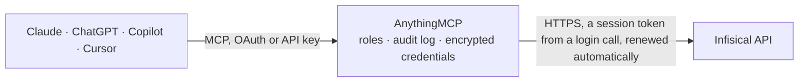

<!-- Generated by scripts/export-github-catalog.mjs in the anythingmcp-website repository. Do not edit by hand. -->

# Infisical MCP connector

Infisical secrets management (Cloud US, Cloud EU or self-hosted) as a machine identity: projects, environments, folders and imports, secret names and metadata, single secret values on request, tags, … The AnythingMCP connector gives Claude, ChatGPT, Microsoft Copilot, Cursor and Gemini 23 MCP tools for Infisical: 17 read and 6 can change data.

**Category:** [Infrastructure](../infrastructure.md) · **Tools:** 23 · **Setup guide:** [anythingmcp.com](https://anythingmcp.com/guides/infisical-to-mcp) · [Deutsch](https://anythingmcp.com/de/guides/infisical-to-mcp) · [Italiano](https://anythingmcp.com/it/guides/infisical-to-mcp) · [Español](https://anythingmcp.com/es/guides/infisical-to-mcp) · [日本語](https://anythingmcp.com/ja/guides/infisical-to-mcp) · [Русский](https://anythingmcp.com/ru/guides/infisical-to-mcp) · [中文](https://anythingmcp.com/zh/guides/infisical-to-mcp)

## Start without code

No installation and no terminal: AnythingMCP Cloud runs the Infisical connector for you, operated by helpcode.ai in Frankfurt, Germany.

1. **Click the button above** and create an account or sign in. The Infisical connector opens, ready to install.
2. **Paste the API key or token from your Infisical account.** Every click is in the [step-by-step guide](https://anythingmcp.com/guides/infisical-to-mcp).
3. **Click Install.** AnythingMCP shows the address of your MCP server.
4. **Add that address to your assistant:** [Claude](https://anythingmcp.com/guides/connect-infisical-to-claude) · [ChatGPT](https://anythingmcp.com/guides/connect-infisical-to-chatgpt) · [Microsoft Copilot](https://anythingmcp.com/guides/connect-infisical-to-copilot) · [Cursor](https://anythingmcp.com/guides/connect-infisical-to-cursor) · [Gemini CLI](https://anythingmcp.com/guides/connect-infisical-to-gemini) · [Meta Muse](https://anythingmcp.com/guides/connect-infisical-to-muse).
5. **Ask your first question**, for example: *Fetch the DB_PASSWORD value for project orion-platform, environment production, path /services/api*

Prefer help with the setup? [Talk to us](https://anythingmcp.com/contact).

## How it works

- **The AI client** speaks MCP (Streamable HTTP) to AnythingMCP and only sees tool names, descriptions and results. It never gets the Infisical credentials.
- **AnythingMCP** checks the client's role, builds the call from the tool definition, adds the credentials (a session token from a login call, renewed automatically), calls Infisical, logs the call and returns the result.
- **Infisical** sees an ordinary API client with the rights of the account the credentials belong to.

## Tools

| Tool | What it does | Access |
|---|---|---|
| [`infisical_get_identity_details`](#infisical_get_identity_details) | Who the connector is signed in as: the organization (id, name, slug) of the machine identity. | read |
| [`infisical_list_projects`](#infisical_list_projects) | Projects the machine identity is a member of: id, name, slug, type (secret-manager, cert-manager, kms, ...), organization id and the environments (name,… | read |
| [`infisical_get_project`](#infisical_get_project) | One project by id: name, slug, type, environments (name, slug, id), audit log retention and delete protection. | read |
| [`infisical_get_project_by_slug`](#infisical_get_project_by_slug) | One project by its slug (the short name in the project URL and settings), to find its id. | read |
| [`infisical_get_environment`](#infisical_get_environment) | One environment of a project by its slug: id, name, slug and position. | read |
| [`infisical_list_folders`](#infisical_list_folders) | Folders below a path in one environment of a project: id, name, description, relative path and when a secret in it last changed. | read |
| [`infisical_get_folder`](#infisical_get_folder) | One folder by id: name, description, full path, environment and project. | read |
| [`infisical_list_secret_imports`](#infisical_list_secret_imports) | Secret imports of a folder: other environments or paths whose secrets this folder inherits (importPath, importEnv, position, replication status). | read |
| [`infisical_list_secrets`](#infisical_list_secrets) | Names and metadata of the secrets in one folder of an environment, WITHOUT their values: the connector asks Infisical not to send values… | read |
| [`infisical_get_secret`](#infisical_get_secret) | Metadata of one secret WITHOUT its value: version, comment, tags, metadata, reminder, who changed it last and when. | read |
| [`infisical_read_secret_value`](#infisical_read_secret_value) | READS THE SECRET VALUE in plain text: returns `secret.secretValue` of one secret (current or a given version), with its metadata. | read |
| [`infisical_list_tags`](#infisical_list_tags) | Secret tags of a project: id, slug and color. | read |
| [`infisical_list_project_members`](#infisical_list_project_members) | Users who are members of a project, with their roles: membership id, user id, email, first and last name. | read |
| [`infisical_list_project_identities`](#infisical_list_project_identities) | Machine identities with access to a project, with their roles and auth methods. | read |
| [`infisical_list_org_identities`](#infisical_list_org_identities) | Machine identities of the organization with their organization role, auth methods and last login. | read |
| [`infisical_get_identity`](#infisical_get_identity) | One machine identity by id: name, organization role, auth methods, locked-out auth methods, metadata and last login. | read |
| [`infisical_list_audit_logs`](#infisical_list_audit_logs) | Audit log of the organization, newest first: event type and class, actor (user, identity, service), IP address, user agent, project and time. | read |
| [`infisical_create_secret`](#infisical_create_secret) | Create a secret in one folder of an environment. | write |
| [`infisical_update_secret`](#infisical_update_secret) | Change an existing secret: a new value, a new name, comment or tags. | write |
| [`infisical_delete_secret`](#infisical_delete_secret) | Delete a secret from one folder of an environment. | write |
| [`infisical_create_folder`](#infisical_create_folder) | Create a folder in one environment of a project, below an existing path. | write |
| [`infisical_create_environment`](#infisical_create_environment) | Add an environment (e.g. qa or preview) to a project, with its name, slug and position. | write |
| [`infisical_create_tag`](#infisical_create_tag) | Create a secret tag (slug and color) in a project, to group and filter secrets. | write |

## Tool reference

Every parameter as the AI client sees it in `tools/list`. Source: [`packages/backend/src/adapters/intl/infisical.json`](../../../packages/backend/src/adapters/intl/infisical.json).

### `infisical_get_identity_details`

Who the connector is signed in as: the organization (id, name, slug) of the machine identity. Use the organization id with infisical_list_org_identities. No parameters.

**Access:** read · **Call:** `GET /v1/identities/details`

No parameters.

### `infisical_list_projects`

Projects the machine identity is a member of: id, name, slug, type (secret-manager, cert-manager, kms, ...), organization id and the environments (name, slug, id) of each. Start here; every other tool needs a project id.

**Access:** read · **Call:** `GET /v1/projects`

| Parameter | Type | Required | Description |
|---|---|---|---|
| `type` | `secret-manager` \| `cert-manager` \| `kms` \| `secret-scanning` \| `pam` \| `agent-vault` | no | Only projects of this product type. |

### `infisical_get_project`

One project by id: name, slug, type, environments (name, slug, id), audit log retention and delete protection.

**Access:** read · **Call:** `GET /v1/projects/{project_id}`

| Parameter | Type | Required | Description |
|---|---|---|---|
| `project_id` | string | yes | Project id (the `id` from infisical_list_projects), not the slug. |

### `infisical_get_project_by_slug`

One project by its slug (the short name in the project URL and settings), to find its id.

**Access:** read · **Call:** `GET /v1/projects/slug/{project_slug}`

| Parameter | Type | Required | Description |
|---|---|---|---|
| `project_slug` | string | yes | Project slug, e.g. backend-api-x1y2. |

### `infisical_get_environment`

One environment of a project by its slug: id, name, slug and position.

**Access:** read · **Call:** `GET /v1/projects/{project_id}/environments/slug/{environment}`

| Parameter | Type | Required | Description |
|---|---|---|---|
| `project_id` | string | yes | Project id (the `id` from infisical_list_projects), not the slug. |
| `environment` | string | yes | Environment slug as shown in the project, e.g. dev, staging, prod (see `environments` in infisical_get_project). |

### `infisical_list_folders`

Folders below a path in one environment of a project: id, name, description, relative path and when a secret in it last changed. Set recursive to walk all subfolders.

**Access:** read · **Call:** `GET /v2/folders`

| Parameter | Type | Required | Description |
|---|---|---|---|
| `project_id` | string | yes | Project id (the `id` from infisical_list_projects), not the slug. |
| `environment` | string | yes | Environment slug as shown in the project, e.g. dev, staging, prod (see `environments` in infisical_get_project). |
| `path` | string | yes | Folder path to list, starting with /, e.g. / for the root. |
| `recursive` | boolean | no | Also list every subfolder below the path (default false). |
| `last_secret_modified` | string | no | Only folders with a secret changed after this time, ISO 8601, e.g. 2026-10-01T00:00:00Z. |

### `infisical_get_folder`

One folder by id: name, description, full path, environment and project.

**Access:** read · **Call:** `GET /v1/folders/{folder_id}`

| Parameter | Type | Required | Description |
|---|---|---|---|
| `folder_id` | string | yes | Folder id from infisical_list_folders. |

### `infisical_list_secret_imports`

Secret imports of a folder: other environments or paths whose secrets this folder inherits (importPath, importEnv, position, replication status). Imported secrets show up in infisical_list_secrets under `imports`.

**Access:** read · **Call:** `GET /v2/secret-imports`

| Parameter | Type | Required | Description |
|---|---|---|---|
| `project_id` | string | yes | Project id (the `id` from infisical_list_projects), not the slug. |
| `environment` | string | yes | Environment slug as shown in the project, e.g. dev, staging, prod (see `environments` in infisical_get_project). |
| `path` | string | no | Folder path, starting with /, e.g. / (root, the default) or /backend/api. |

### `infisical_list_secrets`

Names and metadata of the secrets in one folder of an environment, WITHOUT their values: the connector asks Infisical not to send values (viewSecretValue=false). Returns secretKey, path, version, comment, tags, metadata, timestamps, plus the names of imported secrets under `imports`. Use infisical_read_secret_value to read one value.

**Access:** read · **Call:** `GET /v4/secrets`

| Parameter | Type | Required | Description |
|---|---|---|---|
| `project_id` | string | yes | Project id (the `id` from infisical_list_projects), not the slug. |
| `environment` | string | yes | Environment slug as shown in the project, e.g. dev, staging, prod (see `environments` in infisical_get_project). |
| `secret_path` | string | no | Folder path, starting with /, e.g. / (root, the default) or /backend/api. |
| `recursive` | `true` \| `false` | no | true: also list secrets in all subfolders (Infisical caps the depth at 20). Default false. |
| `include_imports` | `true` \| `false` | no | true (default): also list the names of secrets imported into this folder. |
| `tag_slugs` | string | no | Only secrets with these tags, comma-separated tag slugs from infisical_list_tags. |
| `metadata_filter` | string | no | Only secrets with this unencrypted metadata, e.g. key=owner,value=payments. |

### `infisical_get_secret`

Metadata of one secret WITHOUT its value: version, comment, tags, metadata, reminder, who changed it last and when. Use it to check that a secret exists or which version is current.

**Access:** read · **Call:** `GET /v4/secrets/{secret_name}`

| Parameter | Type | Required | Description |
|---|---|---|---|
| `secret_name` | string | yes | Secret name (key), exactly as stored, e.g. DATABASE_URL. Names are case-sensitive. |
| `project_id` | string | yes | Project id (the `id` from infisical_list_projects), not the slug. |
| `environment` | string | yes | Environment slug as shown in the project, e.g. dev, staging, prod (see `environments` in infisical_get_project). |
| `secret_path` | string | no | Folder path, starting with /, e.g. / (root, the default) or /backend/api. |
| `version` | integer | no | A specific older version instead of the current one. |

### `infisical_read_secret_value`

READS THE SECRET VALUE in plain text: returns `secret.secretValue` of one secret (current or a given version), with its metadata. The value enters the conversation and the AI provider sees it. Call it only when the user asked for this secret's value; never for browsing (use infisical_list_secrets or infisical_get_secret). Infisical records the read in its audit log.

**Access:** read · **Call:** `GET /v4/secrets/{secret_name}`

| Parameter | Type | Required | Description |
|---|---|---|---|
| `secret_name` | string | yes | Secret name (key), exactly as stored, e.g. DATABASE_URL. Names are case-sensitive. |
| `project_id` | string | yes | Project id (the `id` from infisical_list_projects), not the slug. |
| `environment` | string | yes | Environment slug as shown in the project, e.g. dev, staging, prod (see `environments` in infisical_get_project). |
| `secret_path` | string | no | Folder path, starting with /, e.g. / (root, the default) or /backend/api. |
| `version` | integer | no | A specific older version instead of the current one. |
| `expand_secret_references` | `true` \| `false` | no | true (default): resolve references such as ${DB_HOST} or ${prod.DB_HOST} inside the value; false: return the raw value with the references. |

### `infisical_list_tags`

Secret tags of a project: id, slug and color. Tag ids go into tag_ids of infisical_create_secret and infisical_update_secret; slugs into tag_slugs of infisical_list_secrets.

**Access:** read · **Call:** `GET /v1/projects/{project_id}/tags`

| Parameter | Type | Required | Description |
|---|---|---|---|
| `project_id` | string | yes | Project id (the `id` from infisical_list_projects), not the slug. |

### `infisical_list_project_members`

Users who are members of a project, with their roles: membership id, user id, email, first and last name.

**Access:** read · **Call:** `GET /v1/projects/{project_id}/memberships`

| Parameter | Type | Required | Description |
|---|---|---|---|
| `project_id` | string | yes | Project id (the `id` from infisical_list_projects), not the slug. |

### `infisical_list_project_identities`

Machine identities with access to a project, with their roles and auth methods. Paged with offset and limit; totalCount is the full number.

**Access:** read · **Call:** `GET /v1/projects/{project_id}/memberships/identities`

| Parameter | Type | Required | Description |
|---|---|---|---|
| `project_id` | string | yes | Project id (the `id` from infisical_list_projects), not the slug. |
| `identity_name` | string | no | Only identities whose name contains this text. |
| `roles` | string | no | Only identities with these project role slugs, comma-separated, e.g. admin,viewer. |
| `offset` | integer | no | Rows to skip (default 0). |
| `limit` | integer | no | Rows per page (default 20). |

### `infisical_list_org_identities`

Machine identities of the organization with their organization role, auth methods and last login. Paged with offset and limit (default 100); totalCount is the full number.

**Access:** read · **Call:** `GET /v2/organizations/{org_id}/identity-memberships`

| Parameter | Type | Required | Description |
|---|---|---|---|
| `org_id` | string | yes | Organization id, from infisical_get_identity_details or a project's orgId. |
| `search` | string | no | Only identities whose name contains this text. |
| `order_by` | `name` \| `role` | no | Sort column (default name). |
| `order_direction` | `asc` \| `desc` | no | Sort direction (default asc). |
| `offset` | integer | no | Rows to skip (default 0). |
| `limit` | integer | no | Rows per page (default 100). |

### `infisical_get_identity`

One machine identity by id: name, organization role, auth methods, locked-out auth methods, metadata and last login.

**Access:** read · **Call:** `GET /v1/identities/{identity_id}`

| Parameter | Type | Required | Description |
|---|---|---|---|
| `identity_id` | string | yes | Machine identity id (identity.id or identityId from the identity lists). |

### `infisical_list_audit_logs`

Audit log of the organization, newest first: event type and class, actor (user, identity, service), IP address, user agent, project and time. Filter by project, environment, secret, actor, event type and dates. Paged with offset and limit (default 20). Needs an organization role that may read audit logs.

**Access:** read · **Call:** `GET /v1/organization/audit-logs`

| Parameter | Type | Required | Description |
|---|---|---|---|
| `project_id` | string | no | Only events of this project id. |
| `environment` | string | no | Only events in this environment slug (needs project_id). |
| `secret_path` | string | no | Only events on secrets in this folder path (needs project_id). |
| `secret_key` | string | no | Only events on this secret name (needs project_id). |
| `event_type` | string | no | Only this event type, e.g. get-secret, get-secrets, create-secret, update-secret, delete-secret, login-identity-universal-auth; comma-separated for several. |
| `event_class` | string | no | Only these event classes, comma-separated, e.g. data-access, management, authentication. |
| `actor_type` | `platform` \| `user` \| `service` \| `identity` \| `scimClient` \| `unknownUser` \| `gateway` \| `kmipClient` | no | Only this actor type (required when actor is not a user). |
| `actor` | string | no | Only this actor id: the userId of a user or the identityId of a machine identity. |
| `user_agent_type` | `web` \| `cli` \| `k8-operator` \| `terraform` \| `other` \| `InfisicalPythonSDK` \| `InfisicalNodeSDK` | no | Only calls from this client. |
| `start_date` | string | no | Start of the period, ISO 8601, e.g. 2026-10-01T00:00:00Z. |
| `end_date` | string | no | End of the period, ISO 8601. |
| `offset` | integer | no | Rows to skip (default 0). |
| `limit` | integer | no | Rows per page (default 20). |

### `infisical_create_secret`

Create a secret in one folder of an environment. The value you pass is stored encrypted; it still travels through this conversation. If the environment has a change approval policy, Infisical opens an approval request instead of creating it at once.

**Access:** write · **Call:** `POST /v4/secrets/{secret_name}`

| Parameter | Type | Required | Description |
|---|---|---|---|
| `secret_name` | string | yes | Name (key) of the new secret, e.g. STRIPE_WEBHOOK_SECRET. Projects with auto-capitalization store it in upper case. |
| `project_id` | string | yes | Project id (the `id` from infisical_list_projects), not the slug. |
| `environment` | string | yes | Environment slug as shown in the project, e.g. dev, staging, prod (see `environments` in infisical_get_project). |
| `secret_path` | string | no | Folder path, starting with /, e.g. / (root, the default) or /backend/api. |
| `secret_value` | string | yes | The value to store. References such as ${OTHER_KEY} are allowed. |
| `secret_comment` | string | no | Optional comment shown next to the secret. |
| `tag_ids` | string[] | no | Tag ids from infisical_list_tags to attach. |
| `skip_multiline_encoding` | boolean | no | Store line breaks as they are instead of encoding them (default false). |

### `infisical_update_secret`

Change an existing secret: a new value, a new name, comment or tags. Infisical keeps the previous version, so a value change can be rolled back in the dashboard. tag_ids replaces the whole tag list. Apps that read the secret get the new value on their next fetch. Subject to change approval policies like infisical_create_secret.

**Access:** write · **Call:** `PATCH /v4/secrets/{secret_name}`

| Parameter | Type | Required | Description |
|---|---|---|---|
| `secret_name` | string | yes | Secret name (key), exactly as stored, e.g. DATABASE_URL. Names are case-sensitive. |
| `project_id` | string | yes | Project id (the `id` from infisical_list_projects), not the slug. |
| `environment` | string | yes | Environment slug as shown in the project, e.g. dev, staging, prod (see `environments` in infisical_get_project). |
| `secret_path` | string | no | Folder path, starting with /, e.g. / (root, the default) or /backend/api. |
| `secret_value` | string | no | The new value. Leave out to keep the value. |
| `new_secret_name` | string | no | Rename the secret to this name. |
| `secret_comment` | string | no | New comment. |
| `tag_ids` | string[] | no | Tag ids from infisical_list_tags; replaces the current tags. |
| `skip_multiline_encoding` | boolean | no | Store line breaks as they are instead of encoding them. |

### `infisical_delete_secret`

Delete a secret from one folder of an environment. Apps and pipelines that read it fail from the next fetch on. Switched off at install.

**Access:** write · **Call:** `DELETE /v4/secrets/{secret_name}`

| Parameter | Type | Required | Description |
|---|---|---|---|
| `secret_name` | string | yes | Secret name (key), exactly as stored, e.g. DATABASE_URL. Names are case-sensitive. |
| `project_id` | string | yes | Project id (the `id` from infisical_list_projects), not the slug. |
| `environment` | string | yes | Environment slug as shown in the project, e.g. dev, staging, prod (see `environments` in infisical_get_project). |
| `secret_path` | string | no | Folder path, starting with /, e.g. / (root, the default) or /backend/api. |

### `infisical_create_folder`

Create a folder in one environment of a project, below an existing path.

**Access:** write · **Call:** `POST /v2/folders`

| Parameter | Type | Required | Description |
|---|---|---|---|
| `project_id` | string | yes | Project id (the `id` from infisical_list_projects), not the slug. |
| `environment` | string | yes | Environment slug as shown in the project, e.g. dev, staging, prod (see `environments` in infisical_get_project). |
| `name` | string | yes | Folder name, letters, digits, dashes and underscores, e.g. payments. |
| `path` | string | no | Parent path, starting with /, e.g. / (default) or /backend. |
| `description` | string | no | Optional description. |

### `infisical_create_environment`

Add an environment (e.g. qa or preview) to a project, with its name, slug and position.

**Access:** write · **Call:** `POST /v1/projects/{project_id}/environments`

| Parameter | Type | Required | Description |
|---|---|---|---|
| `project_id` | string | yes | Project id (the `id` from infisical_list_projects), not the slug. |
| `name` | string | yes | Display name, e.g. QA. |
| `slug` | string | yes | Slug used in API calls, e.g. qa. |
| `position` | integer | no | Display position; the lowest number is shown first. |

### `infisical_create_tag`

Create a secret tag (slug and color) in a project, to group and filter secrets.

**Access:** write · **Call:** `POST /v1/projects/{project_id}/tags`

| Parameter | Type | Required | Description |
|---|---|---|---|
| `project_id` | string | yes | Project id (the `id` from infisical_list_projects), not the slug. |
| `slug` | string | yes | Tag slug, e.g. payments. |
| `color` | string | yes | Tag color as a hex code, e.g. #3b82f6. |

## Run it yourself

AnythingMCP is open source (AGPL-3.0). [Run it with Docker](../../../README.md#run-it-yourself), open **Connectors → Store**, pick **Infisical** and enter `INFISICAL_URL`, `INFISICAL_CLIENT_ID`, `INFISICAL_CLIENT_SECRET`, then add your MCP server URL to the AI client.

[← Infrastructure connectors](../infrastructure.md) · [All categories](../README.md)
