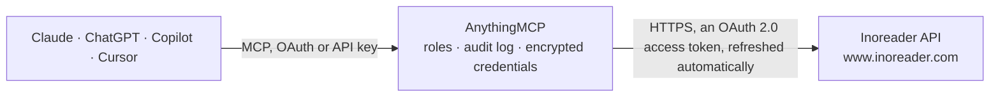

<!-- Generated by scripts/export-github-catalog.mjs in the anythingmcp-website repository. Do not edit by hand. -->

# Inoreader MCP connector

Inoreader RSS reader: subscriptions, folders and tags, unread counts, articles of any feed, folder or tag with paging, and marking articles read, unread or starred. The AnythingMCP connector gives Claude, ChatGPT, Microsoft Copilot, Cursor and Gemini 8 MCP tools for Inoreader: 7 read and 1 can change data.

**Category:** [Knowledge Base](../knowledge.md) · **Tools:** 8 · **Setup guide:** [anythingmcp.com](https://anythingmcp.com/guides/inoreader-to-mcp) · [Deutsch](https://anythingmcp.com/de/guides/inoreader-to-mcp) · [Italiano](https://anythingmcp.com/it/guides/inoreader-to-mcp) · [Español](https://anythingmcp.com/es/guides/inoreader-to-mcp) · [日本語](https://anythingmcp.com/ja/guides/inoreader-to-mcp) · [Русский](https://anythingmcp.com/ru/guides/inoreader-to-mcp) · [中文](https://anythingmcp.com/zh/guides/inoreader-to-mcp)

## Start without code

No installation and no terminal: AnythingMCP Cloud runs the Inoreader connector for you, operated by helpcode.ai in Frankfurt, Germany.

1. **Click the button above** and create an account or sign in. The Inoreader connector opens, ready to install.
2. **Sign in with your Inoreader account** when AnythingMCP asks. The first time, an admin creates a small app in the Inoreader developer console. Every click is in the [step-by-step guide](https://anythingmcp.com/guides/inoreader-to-mcp).
3. **Click Install.** AnythingMCP shows the address of your MCP server.
4. **Add that address to your assistant:** [Claude](https://anythingmcp.com/guides/connect-inoreader-to-claude) · [ChatGPT](https://anythingmcp.com/guides/connect-inoreader-to-chatgpt) · [Microsoft Copilot](https://anythingmcp.com/guides/connect-inoreader-to-copilot) · [Cursor](https://anythingmcp.com/guides/connect-inoreader-to-cursor) · [Gemini CLI](https://anythingmcp.com/guides/connect-inoreader-to-gemini) · [Meta Muse](https://anythingmcp.com/guides/connect-inoreader-to-muse).
5. **Ask your first question**, for example: *Unread counts for folder 'Client Alerts' and tag 'Invoice-Issue' as of 2026-11-01?*

Prefer help with the setup? [Talk to us](https://anythingmcp.com/contact).

## How it works

- **The AI client** speaks MCP (Streamable HTTP) to AnythingMCP and only sees tool names, descriptions and results. It never gets the Inoreader credentials.
- **AnythingMCP** checks the client's role, builds the call from the tool definition, adds the credentials (an OAuth 2.0 access token, refreshed automatically), calls Inoreader, logs the call and returns the result.
- **Inoreader** sees an ordinary API client with the rights of the account the credentials belong to.

## Tools

| Tool | What it does | Access |
|---|---|---|
| [`inoreader_get_user_info`](#inoreader_get_user_info) | Get the signed-in Inoreader user: user id, user name, email and sign-up time. | read |
| [`inoreader_list_subscriptions`](#inoreader_list_subscriptions) | List the feeds the user follows: feed id (feed/<url>), title, folders (categories), feed URL, website URL and icon. | read |
| [`inoreader_list_tags`](#inoreader_list_tags) | List the user's folders, tags and saved searches with their type and, by default, unread and unseen counts. | read |
| [`inoreader_get_unread_counts`](#inoreader_get_unread_counts) | Get unread article counts for every feed, folder and tag, with the timestamp of the newest article. | read |
| [`inoreader_get_stream_contents`](#inoreader_get_stream_contents) | Read articles of a feed, folder, tag or the whole reading list: title, author, published time, summary content, link, origin feed and categories (read,… | read |
| [`inoreader_list_item_ids`](#inoreader_list_item_ids) | List only article ids (with their folders and timestamps) for a stream, up to 1000 per call. | read |
| [`inoreader_edit_item_tags`](#inoreader_edit_item_tags) | Add or remove a state or tag on articles: mark read or unread, star or unstar, apply or remove a tag. | write |
| [`inoreader_mark_all_as_read`](#inoreader_mark_all_as_read) | Mark every article in a feed, folder or tag as read, up to a timestamp so newer articles the user has not seen stay unread. | read |

## Tool reference

Every parameter as the AI client sees it in `tools/list`. Source: [`packages/backend/src/adapters/intl/inoreader.json`](../../../packages/backend/src/adapters/intl/inoreader.json).

### `inoreader_get_user_info`

Get the signed-in Inoreader user: user id, user name, email and sign-up time. Use it to check the connection and to read the numeric user id that appears in label ids.

**Access:** read · **Call:** `GET /user-info`

No parameters.

### `inoreader_list_subscriptions`

List the feeds the user follows: feed id (feed/<url>), title, folders (categories), feed URL, website URL and icon. Use a feed id as stream_id in the stream tools.

**Access:** read · **Call:** `GET /subscription/list`

| Parameter | Type | Required | Description |
|---|---|---|---|
| `team_assets` | `1` | no | Pass 1 to include team channels (Inoreader Teams). |

### `inoreader_list_tags`

List the user's folders, tags and saved searches with their type and, by default, unread and unseen counts. Folder and tag ids look like user/1005921515/label/News.

**Access:** read · **Call:** `GET /tag/list`

| Parameter | Type | Required | Description |
|---|---|---|---|
| `counts` | `0` \| `1` | no | 1 (default) to include unread_count and unseen_count, 0 to leave them out. |

### `inoreader_get_unread_counts`

Get unread article counts for every feed, folder and tag, with the timestamp of the newest article. A count equal to max means max or more.

**Access:** read · **Call:** `GET /unread-count`

No parameters.

### `inoreader_get_stream_contents`

Read articles of a feed, folder, tag or the whole reading list: title, author, published time, summary content, link, origin feed and categories (read, starred, labels). Paged with a continuation string.

**Access:** read · **Call:** `GET /stream/contents/{stream_id}`

| Parameter | Type | Required | Description |
|---|---|---|---|
| `stream_id` | string | no | Stream id: user/-/state/com.google/reading-list (all articles), user/-/state/com.google/starred, user/-/label/<folder or tag name>, or feed/<feed URL> from inoreader_list_subscriptions. |
| `n` | integer | no | Number of articles to return, default 20, at most 100. |
| `r` | `o` | no | Pass o for oldest first; newest first by default. |
| `ot` | integer | no | Only articles newer than this Unix timestamp (seconds). |
| `xt` | string | no | Exclude target. user/-/state/com.google/read returns only unread articles. |
| `it` | string | no | Include target: user/-/state/com.google/starred or user/-/state/com.google/like. |
| `c` | string | no | Continuation string from the previous answer, to get the next page. |
| `annotations` | `1` | no | Pass 1 to include the user's highlights and notes on each article. |

### `inoreader_list_item_ids`

List only article ids (with their folders and timestamps) for a stream, up to 1000 per call. Lighter than stream contents; use it to collect ids before marking articles read or starred.

**Access:** read · **Call:** `GET /stream/items/ids`

| Parameter | Type | Required | Description |
|---|---|---|---|
| `stream_id` | string | no | Stream id: user/-/state/com.google/reading-list (all articles), user/-/state/com.google/starred, user/-/label/<folder or tag name>, or feed/<feed URL> from inoreader_list_subscriptions. |
| `n` | integer | no | Number of ids to return, default 20, at most 1000. |
| `r` | `o` | no | Pass o for oldest first; newest first by default. |
| `ot` | integer | no | Only articles newer than this Unix timestamp (seconds). |
| `xt` | string | no | Exclude target. user/-/state/com.google/read returns only unread articles. |
| `it` | string | no | Include target: user/-/state/com.google/starred or user/-/state/com.google/like. |
| `c` | string | no | Continuation string from the previous answer, to get the next page. |

### `inoreader_edit_item_tags`

Add or remove a state or tag on articles: mark read or unread, star or unstar, apply or remove a tag. Up to many article ids per call. Answers OK.

**Access:** write · **Call:** `POST /edit-tag`

| Parameter | Type | Required | Description |
|---|---|---|---|
| `item_ids` | string[] | yes | Article ids from inoreader_get_stream_contents (the id field) or inoreader_list_item_ids. |
| `add` | string | no | Tag to add: user/-/state/com.google/read (mark read), user/-/state/com.google/starred (star), or user/-/label/<tag name>. |
| `remove` | string | no | Tag to remove, same forms as add. Removing user/-/state/com.google/read marks the articles unread. |

### `inoreader_mark_all_as_read`

Mark every article in a feed, folder or tag as read, up to a timestamp so newer articles the user has not seen stay unread. Cannot be undone in bulk.

**Access:** read · **Call:** `POST /mark-all-as-read`

| Parameter | Type | Required | Description |
|---|---|---|---|
| `stream_id` | string | yes | Stream id of the feed, folder or tag to mark read: feed/<url>, user/-/label/<name>, or user/-/state/com.google/reading-list for everything. |
| `ts` | integer | yes | Unix timestamp in seconds: only articles up to this time are marked read. Use the time the user last looked at the stream. |

## Run it yourself

AnythingMCP is open source (AGPL-3.0). [Run it with Docker](../../../README.md#run-it-yourself), open **Connectors → Store**, pick **Inoreader** and enter `INOREADER_APP_ID`, `INOREADER_APP_KEY`, then add your MCP server URL to the AI client.

[← Knowledge Base connectors](../knowledge.md) · [All categories](../README.md)
