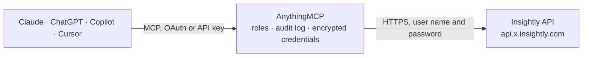

<!-- Generated by scripts/export-github-catalog.mjs in the anythingmcp-website repository. Do not edit by hand. -->

# Insightly MCP connector

Drive Insightly (CRM + project management) from any AI agent: contacts, organisations, leads, opportunities, projects, tasks. 12 tools, Basic auth. The AnythingMCP connector gives Claude, ChatGPT, Microsoft Copilot, Cursor and Gemini 12 MCP tools for Insightly: 9 read and 3 can change data.

**Category:** [CRM](../crm.md) · **Tools:** 12 · **Setup guide:** [anythingmcp.com](https://anythingmcp.com/guides/insightly-to-mcp) · [Deutsch](https://anythingmcp.com/de/guides/insightly-to-mcp) · [Italiano](https://anythingmcp.com/it/guides/insightly-to-mcp) · [Español](https://anythingmcp.com/es/guides/insightly-to-mcp) · [日本語](https://anythingmcp.com/ja/guides/insightly-to-mcp) · [Русский](https://anythingmcp.com/ru/guides/insightly-to-mcp) · [中文](https://anythingmcp.com/zh/guides/insightly-to-mcp)

## Start without code

No installation and no terminal: AnythingMCP Cloud runs the Insightly connector for you, operated by helpcode.ai in Frankfurt, Germany.

1. **Click the button above** and create an account or sign in. The Insightly connector opens, ready to install.
2. **Paste the API key or token from your Insightly account.** Every click is in the [step-by-step guide](https://anythingmcp.com/guides/insightly-to-mcp).
3. **Click Install.** AnythingMCP shows the address of your MCP server.
4. **Add that address to your assistant:** [Claude](https://anythingmcp.com/guides/connect-insightly-to-claude) · [ChatGPT](https://anythingmcp.com/guides/connect-insightly-to-chatgpt) · [Microsoft Copilot](https://anythingmcp.com/guides/connect-insightly-to-copilot) · [Cursor](https://anythingmcp.com/guides/connect-insightly-to-cursor) · [Gemini CLI](https://anythingmcp.com/guides/connect-insightly-to-gemini) · [Meta Muse](https://anythingmcp.com/guides/connect-insightly-to-muse).
5. **Ask your first question**, for example: *Show the contact record for Maria Lopez at VerdeSol GmbH and her direct phone number*

Prefer help with the setup? [Talk to us](https://anythingmcp.com/contact).

## How it works

- **The AI client** speaks MCP (Streamable HTTP) to AnythingMCP and only sees tool names, descriptions and results. It never gets the Insightly credentials.
- **AnythingMCP** checks the client's role, builds the call from the tool definition, adds the credentials (user name and password), calls Insightly, logs the call and returns the result.
- **Insightly** sees an ordinary API client with the rights of the account the credentials belong to.

## Tools

| Tool | What it does | Access |
|---|---|---|
| [`insightly_get_current_user`](#insightly_get_current_user) | Return the user the API key belongs to (whoami). | read |
| [`insightly_list_contacts`](#insightly_list_contacts) | List contacts with filter/sort. | read |
| [`insightly_get_contact`](#insightly_get_contact) | Fetch one contact by ID. | read |
| [`insightly_create_contact`](#insightly_create_contact) | Create a contact. | write |
| [`insightly_list_organisations`](#insightly_list_organisations) | List organisations (companies). | read |
| [`insightly_list_leads`](#insightly_list_leads) | List leads (unqualified prospects). | read |
| [`insightly_create_lead`](#insightly_create_lead) | Create a lead. | write |
| [`insightly_list_opportunities`](#insightly_list_opportunities) | List opportunities. | read |
| [`insightly_create_opportunity`](#insightly_create_opportunity) | Create an opportunity. | write |
| [`insightly_list_pipelines`](#insightly_list_pipelines) | List pipelines + their stages (FOR_OPPORTUNITIES or FOR_PROJECTS). | read |
| [`insightly_list_projects`](#insightly_list_projects) | List projects. | read |
| [`insightly_list_tasks`](#insightly_list_tasks) | List tasks (CRM activities). | read |

## Tool reference

Every parameter as the AI client sees it in `tools/list`. Source: [`packages/backend/src/adapters/intl/insightly.json`](../../../packages/backend/src/adapters/intl/insightly.json).

### `insightly_get_current_user`

Return the user the API key belongs to (whoami).

**Access:** read · **Call:** `GET /Users/me`

No parameters.

### `insightly_list_contacts`

List contacts with filter/sort.

**Access:** read · **Call:** `GET /Contacts`

| Parameter | Type | Required | Description |
|---|---|---|---|
| `skip` | integer | no | Pagination offset. |
| `top` | integer | no | Per page (max 500). |
| `brief` | boolean | no | true = compact response without long-text fields. |
| `updated_after_utc` | string | no | ISO 8601 — contacts modified after. |
| `field_name` | string | no | Filter field name. |
| `field_value` | string | no | Filter value. |

### `insightly_get_contact`

Fetch one contact by ID.

**Access:** read · **Call:** `GET /Contacts/{contactId}`

| Parameter | Type | Required | Description |
|---|---|---|---|
| `contactId` | integer | yes | Contact ID. |

### `insightly_create_contact`

Create a contact. Required: FIRST_NAME or LAST_NAME.

**Access:** write · **Call:** `POST /Contacts`

| Parameter | Type | Required | Description |
|---|---|---|---|
| `FIRST_NAME` | string | no | First name. |
| `LAST_NAME` | string | no | Last name. |
| `EMAIL_ADDRESS` | string | no | Email. |
| `TITLE` | string | no | Job title. |
| `PHONE` | string | no | Phone. |
| `PHONE_MOBILE` | string | no | Mobile phone. |
| `ORGANISATION_ID` | integer | no | Linked organisation. |
| `OWNER_USER_ID` | integer | no | Owner user. |
| `BACKGROUND` | string | no | Notes. |
| `CUSTOMFIELDS` | any[] | no | [{FIELD_NAME, FIELD_VALUE, CUSTOM_FIELD_ID}]. |
| `TAGS` | any[] | no | [{TAG_NAME}]. |

### `insightly_list_organisations`

List organisations (companies).

**Access:** read · **Call:** `GET /Organisations`

| Parameter | Type | Required | Description |
|---|---|---|---|
| `skip` | integer | no | Offset. |
| `top` | integer | no | Per page. |
| `brief` | boolean | no | Compact response. |
| `field_name` | string | no | Filter field. |
| `field_value` | string | no | Filter value. |

### `insightly_list_leads`

List leads (unqualified prospects).

**Access:** read · **Call:** `GET /Leads`

| Parameter | Type | Required | Description |
|---|---|---|---|
| `skip` | integer | no | Offset. |
| `top` | integer | no | Per page. |

### `insightly_create_lead`

Create a lead.

**Access:** write · **Call:** `POST /Leads`

| Parameter | Type | Required | Description |
|---|---|---|---|
| `FIRST_NAME` | string | no | First name. |
| `LAST_NAME` | string | no | Last name. |
| `ORGANISATION_NAME` | string | no | Company name (free text — not linked to organisations record). |
| `EMAIL` | string | no | Email. |
| `PHONE_NUMBER` | string | no | Phone. |
| `TITLE` | string | no | Job title. |
| `LEAD_SOURCE_ID` | integer | no | Lead source ID. |
| `LEAD_STATUS_ID` | integer | no | Lead status ID. |
| `OWNER_USER_ID` | integer | no | Owner. |

### `insightly_list_opportunities`

List opportunities.

**Access:** read · **Call:** `GET /Opportunities`

| Parameter | Type | Required | Description |
|---|---|---|---|
| `skip` | integer | no | Offset. |
| `top` | integer | no | Per page. |
| `field_name` | string | no | Filter field. |
| `field_value` | string | no | Filter value. |

### `insightly_create_opportunity`

Create an opportunity. Required: OPPORTUNITY_NAME.

**Access:** write · **Call:** `POST /Opportunities`

| Parameter | Type | Required | Description |
|---|---|---|---|
| `OPPORTUNITY_NAME` | string | yes | Name. |
| `OPPORTUNITY_DETAILS` | string | no | Description. |
| `OPPORTUNITY_STATE` | string | no | OPEN, WON, LOST, SUSPENDED, ABANDONED. |
| `PIPELINE_ID` | integer | no | Pipeline ID. |
| `STAGE_ID` | integer | no | Stage ID within pipeline. |
| `BID_AMOUNT` | number | no | Deal value. |
| `BID_CURRENCY` | string | no | ISO 4217 code. |
| `FORECAST_CLOSE_DATE` | string | no | ISO 8601. |
| `PROBABILITY` | integer | no | 0-100. |
| `OWNER_USER_ID` | integer | no | Owner. |
| `RESPONSIBLE_USER_ID` | integer | no | Responsible user. |

### `insightly_list_pipelines`

List pipelines + their stages (FOR_OPPORTUNITIES or FOR_PROJECTS).

**Access:** read · **Call:** `GET /Pipelines`

| Parameter | Type | Required | Description |
|---|---|---|---|
| `skip` | integer | no | Offset. |
| `top` | integer | no | Per page. |

### `insightly_list_projects`

List projects.

**Access:** read · **Call:** `GET /Projects`

| Parameter | Type | Required | Description |
|---|---|---|---|
| `skip` | integer | no | Offset. |
| `top` | integer | no | Per page. |

### `insightly_list_tasks`

List tasks (CRM activities).

**Access:** read · **Call:** `GET /Tasks`

| Parameter | Type | Required | Description |
|---|---|---|---|
| `skip` | integer | no | Offset. |
| `top` | integer | no | Per page. |
| `status` | string | no | NOT STARTED, IN PROGRESS, COMPLETED, DEFERRED, WAITING. |

## Run it yourself

AnythingMCP is open source (AGPL-3.0). [Run it with Docker](../../../README.md#run-it-yourself), open **Connectors → Store**, pick **Insightly** and enter `INSIGHTLY_API_KEY`, `INSIGHTLY_POD`, then add your MCP server URL to the AI client.

[← CRM connectors](../crm.md) · [All categories](../README.md)
