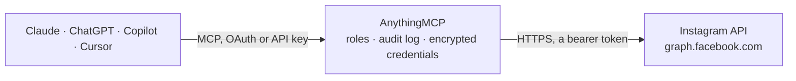

<!-- Generated by scripts/export-github-catalog.mjs in the anythingmcp-website repository. Do not edit by hand. -->

# Instagram MCP connector

Read an Instagram professional (business or creator) account through Meta's Instagram API with Facebook Login: profile, posts, reels and stories, account and post insights, comments and replies, … The AnythingMCP connector gives Claude, ChatGPT, Microsoft Copilot, Cursor and Gemini 20 MCP tools for Instagram: 16 read and 4 can change data.

**Category:** [Social Media](../social.md) · **Tools:** 20 · **Setup guide:** [anythingmcp.com](https://anythingmcp.com/guides/instagram-to-mcp) · [Deutsch](https://anythingmcp.com/de/guides/instagram-to-mcp) · [Italiano](https://anythingmcp.com/it/guides/instagram-to-mcp) · [Español](https://anythingmcp.com/es/guides/instagram-to-mcp) · [日本語](https://anythingmcp.com/ja/guides/instagram-to-mcp) · [Русский](https://anythingmcp.com/ru/guides/instagram-to-mcp) · [中文](https://anythingmcp.com/zh/guides/instagram-to-mcp)

## Start without code

No installation and no terminal: AnythingMCP Cloud runs the Instagram connector for you, operated by helpcode.ai in Frankfurt, Germany.

1. **Click the button above** and create an account or sign in. The Instagram connector opens, ready to install.
2. **Paste the API key or token from your Instagram account.** Every click is in the [step-by-step guide](https://anythingmcp.com/guides/instagram-to-mcp).
3. **Click Install.** AnythingMCP shows the address of your MCP server.
4. **Add that address to your assistant:** [Claude](https://anythingmcp.com/guides/connect-instagram-to-claude) · [ChatGPT](https://anythingmcp.com/guides/connect-instagram-to-chatgpt) · [Microsoft Copilot](https://anythingmcp.com/guides/connect-instagram-to-copilot) · [Cursor](https://anythingmcp.com/guides/connect-instagram-to-cursor) · [Gemini CLI](https://anythingmcp.com/guides/connect-instagram-to-gemini) · [Meta Muse](https://anythingmcp.com/guides/connect-instagram-to-muse).
5. **Ask your first question**, for example: *Which Instagram account is linked and what's its followers_count and media_count right now?*

Prefer help with the setup? [Talk to us](https://anythingmcp.com/contact).

## How it works

- **The AI client** speaks MCP (Streamable HTTP) to AnythingMCP and only sees tool names, descriptions and results. It never gets the Instagram credentials.
- **AnythingMCP** checks the client's role, builds the call from the tool definition, adds the credentials (a bearer token), calls Instagram, logs the call and returns the result.
- **Instagram** sees an ordinary API client with the rights of the account the credentials belong to.

## Tools

| Tool | What it does | Access |
|---|---|---|
| [`instagram_list_linked_accounts`](#instagram_list_linked_accounts) | List the Facebook Pages the token can access, each with the Instagram professional account linked to it (instagram_business_account with id and username). | read |
| [`instagram_get_account`](#instagram_get_account) | Get the configured Instagram account's profile: username, name, biography, website, followers_count, follows_count, media_count and profile picture URL. | read |
| [`instagram_list_media`](#instagram_list_media) | List the account's posts and reels, newest first, with caption, media_type (IMAGE, VIDEO, CAROUSEL_ALBUM), media_product_type (FEED, REELS), permalink,… | read |
| [`instagram_get_media`](#instagram_get_media) | Get one post, reel or story by media id: caption, type, permalink, timestamp, like and comment counts, media URL and, for carousels, the child items. | read |
| [`instagram_list_stories`](#instagram_list_stories) | List the account's stories that are live now (stories disappear from the API 24 hours after posting). | read |
| [`instagram_list_tagged_media`](#instagram_list_tagged_media) | List public posts by other accounts in which the configured account has been tagged, with caption, permalink, username of the author and timestamp. | read |
| [`instagram_get_account_insights`](#instagram_get_account_insights) | Get account-level insights for the configured account: reach, views, accounts_engaged, total_interactions, likes, comments, shares, saves,… | read |
| [`instagram_get_media_insights`](#instagram_get_media_insights) | Get lifetime insights for one post, reel or story: reach, views, likes, comments, saved, shares, total_interactions, or for stories replies and navigation. | read |
| [`instagram_list_comments`](#instagram_list_comments) | List the top-level comments on one post or reel, newest first, with text, username, timestamp, like_count, hidden flag and the replies under each comment. | read |
| [`instagram_list_comment_replies`](#instagram_list_comment_replies) | List the replies to one comment, with text, username, timestamp and like_count. | read |
| [`instagram_reply_to_comment`](#instagram_reply_to_comment) | Post a public reply, as the configured account, under a comment on one of its own posts. | write |
| [`instagram_hide_comment`](#instagram_hide_comment) | Hide or unhide a comment on one of the account's own posts. | write |
| [`instagram_search_hashtag`](#instagram_search_hashtag) | Look up a hashtag by name and return its id, which instagram_get_hashtag_top_media and instagram_get_hashtag_recent_media need. | read |
| [`instagram_get_hashtag_top_media`](#instagram_get_hashtag_top_media) | Get the most popular public posts for a hashtag, with caption, media type, permalink, like and comment counts and timestamp (no usernames). | read |
| [`instagram_get_hashtag_recent_media`](#instagram_get_hashtag_recent_media) | Get public posts tagged with a hashtag in the last 24 hours, newest first, with caption, media type, permalink, counts and timestamp. | read |
| [`instagram_get_business_profile`](#instagram_get_business_profile) | Look up another Instagram business or creator account by username (business discovery): followers_count, media_count, biography, website and its recent… | read |
| [`instagram_get_publishing_limit`](#instagram_get_publishing_limit) | Show how many posts the account has published through the API in the current rolling 24 hours (quota_usage) and the limit (config.quota_total, normally 50). | read |
| [`instagram_create_media_container`](#instagram_create_media_container) | Step 1 of publishing: create a media container for an image, a video, a reel, a story or a carousel item from a public HTTPS URL. | write |
| [`instagram_get_container_status`](#instagram_get_container_status) | Check whether a media container is ready to publish. | read |
| [`instagram_publish_media`](#instagram_publish_media) | Step 2 of publishing: publish a container (status FINISHED) to the account, making the post, reel, story or carousel public at once. | write |

## Tool reference

Every parameter as the AI client sees it in `tools/list`. Source: [`packages/backend/src/adapters/intl/instagram.json`](../../../packages/backend/src/adapters/intl/instagram.json).

### `instagram_list_linked_accounts`

List the Facebook Pages the token can access, each with the Instagram professional account linked to it (instagram_business_account with id and username). Use it once during setup to find the Instagram account id, or to check which accounts the token reaches.

**Access:** read · **Call:** `GET /me/accounts`

| Parameter | Type | Required | Description |
|---|---|---|---|
| `fields` | string | no | Fields per Page. Default: id,name,instagram_business_account{id,username,name}. |
| `limit` | integer | no | Pages per page of results (default 25, max 100). |
| `after` | string | no | Cursor from paging.cursors.after of the previous answer, to read the next page. |

### `instagram_get_account`

Get the configured Instagram account's profile: username, name, biography, website, followers_count, follows_count, media_count and profile picture URL. Start here to confirm the setup works and to get the headline numbers of the account.

**Access:** read · **Call:** `GET /{{INSTAGRAM_ACCOUNT_ID}}`

| Parameter | Type | Required | Description |
|---|---|---|---|
| `fields` | string | no | Comma-separated fields. Default: id,username,name,biography,website,followers_count,follows_count,media_count,profile_picture_url. |

### `instagram_list_media`

List the account's posts and reels, newest first, with caption, media_type (IMAGE, VIDEO, CAROUSEL_ALBUM), media_product_type (FEED, REELS), permalink, timestamp, like_count and comments_count. Stories are not included; use instagram_list_stories. Page with `after`; filter by date with since/until.

**Access:** read · **Call:** `GET /{{INSTAGRAM_ACCOUNT_ID}}/media`

| Parameter | Type | Required | Description |
|---|---|---|---|
| `fields` | string | no | Comma-separated media fields. Default: id,caption,media_type,media_product_type,permalink,timestamp,like_count,comments_count,media_url,thumbnail_url. |
| `limit` | integer | no | Items per page (default 25, max 100). |
| `after` | string | no | Cursor from paging.cursors.after of the previous answer. |
| `before` | string | no | Cursor from paging.cursors.before, to go back one page. |
| `since` | integer | no | Only media published at or after this Unix timestamp (seconds). |
| `until` | integer | no | Only media published before this Unix timestamp (seconds). |

### `instagram_get_media`

Get one post, reel or story by media id: caption, type, permalink, timestamp, like and comment counts, media URL and, for carousels, the child items. Use it after a list tool when you need the details or the current counts of a single item.

**Access:** read · **Call:** `GET /{media_id}`

| Parameter | Type | Required | Description |
|---|---|---|---|
| `media_id` | string | yes | Media id from instagram_list_media, instagram_list_stories or instagram_list_tagged_media. |
| `fields` | string | no | Comma-separated fields. Default: id,caption,media_type,media_product_type,permalink,timestamp,like_count,comments_count,media_url,thumbnail_url,children{id,media_type,media_url}. |

### `instagram_list_stories`

List the account's stories that are live now (stories disappear from the API 24 hours after posting). Returns id, media_type, media_url, permalink and timestamp. Read story insights with instagram_get_media_insights before they expire.

**Access:** read · **Call:** `GET /{{INSTAGRAM_ACCOUNT_ID}}/stories`

| Parameter | Type | Required | Description |
|---|---|---|---|
| `fields` | string | no | Comma-separated fields. Default: id,media_type,media_url,thumbnail_url,permalink,timestamp. |

### `instagram_list_tagged_media`

List public posts by other accounts in which the configured account has been tagged, with caption, permalink, username of the author and timestamp. Use it to monitor user-generated content and mentions by photo tag.

**Access:** read · **Call:** `GET /{{INSTAGRAM_ACCOUNT_ID}}/tags`

| Parameter | Type | Required | Description |
|---|---|---|---|
| `fields` | string | no | Comma-separated fields. Default: id,caption,media_type,permalink,timestamp,username,like_count,comments_count. |
| `limit` | integer | no | Items per page (default 25). |
| `after` | string | no | Cursor from paging.cursors.after of the previous answer. |

### `instagram_get_account_insights`

Get account-level insights for the configured account: reach, views, accounts_engaged, total_interactions, likes, comments, shares, saves, follows_and_unfollows, profile_links_taps, or follower and engaged-audience demographics. Returns one entry per metric with values per day (time_series) or a total for the range (total_value).

**Access:** read · **Call:** `GET /{{INSTAGRAM_ACCOUNT_ID}}/insights`

| Parameter | Type | Required | Description |
|---|---|---|---|
| `metric` | string | yes | Comma-separated metrics, e.g. reach,views,accounts_engaged,total_interactions. Demographics: follower_demographics or engaged_audience_demographics (one per call). |
| `period` | `day` \| `lifetime` | no | day for interaction metrics, lifetime for demographic metrics. |
| `metric_type` | `total_value` \| `time_series` | no | total_value returns one total for the range (needed for most metrics and all breakdowns); time_series returns daily values (reach only). |
| `breakdown` | string | no | Optional split: media_product_type, follow_type or contact_button_type for interactions; age, city, country or gender for demographics. |
| `since` | integer | no | Start of the range as a Unix timestamp. The range may cover at most 30 days. |
| `until` | integer | no | End of the range as a Unix timestamp. |
| `timeframe` | `this_week` \| `this_month` \| `prev_month` \| `last_14_days` \| `last_30_days` \| `last_90_days` | no | Required for demographic metrics instead of since/until. |

### `instagram_get_media_insights`

Get lifetime insights for one post, reel or story: reach, views, likes, comments, saved, shares, total_interactions, or for stories replies and navigation. Returns one entry per metric. Use it to compare how individual posts performed.

**Access:** read · **Call:** `GET /{media_id}/insights`

| Parameter | Type | Required | Description |
|---|---|---|---|
| `media_id` | string | yes | Media id from instagram_list_media or instagram_list_stories. |
| `metric` | string | no | Comma-separated metrics. Posts and reels: reach,views,likes,comments,saved,shares,total_interactions. Stories: reach,views,replies,navigation,shares. |
| `breakdown` | string | no | Optional split, e.g. action_type for the navigation metric of a story. |

### `instagram_list_comments`

List the top-level comments on one post or reel, newest first, with text, username, timestamp, like_count, hidden flag and the replies under each comment. Use it to read the conversation on a post or to find a comment id before replying.

**Access:** read · **Call:** `GET /{media_id}/comments`

| Parameter | Type | Required | Description |
|---|---|---|---|
| `media_id` | string | yes | Media id from instagram_list_media. |
| `fields` | string | no | Comma-separated comment fields. Default: id,text,username,timestamp,like_count,hidden,replies{id,text,username,timestamp}. |
| `limit` | integer | no | Comments per page (default 25, max 50). |
| `after` | string | no | Cursor from paging.cursors.after of the previous answer. |

### `instagram_list_comment_replies`

List the replies to one comment, with text, username, timestamp and like_count. Use it when a comment has more replies than instagram_list_comments returned inline, or to follow a single thread.

**Access:** read · **Call:** `GET /{comment_id}/replies`

| Parameter | Type | Required | Description |
|---|---|---|---|
| `comment_id` | string | yes | Comment id from instagram_list_comments. |
| `fields` | string | no | Comma-separated fields. Default: id,text,username,timestamp,like_count. |
| `after` | string | no | Cursor from paging.cursors.after of the previous answer. |

### `instagram_reply_to_comment`

Post a public reply, as the configured account, under a comment on one of its own posts. Returns the id of the new reply. Needs the instagram_manage_comments permission. The reply is visible to everyone at once.

**Access:** write · **Call:** `POST /{comment_id}/replies`

| Parameter | Type | Required | Description |
|---|---|---|---|
| `comment_id` | string | yes | Id of the comment to answer, from instagram_list_comments. |
| `message` | string | yes | Text of the reply. Up to 2200 characters; @mentions and hashtags are allowed. |

### `instagram_hide_comment`

Hide or unhide a comment on one of the account's own posts. A hidden comment stays visible to its author but not to anyone else. Returns success true. Needs the instagram_manage_comments permission.

**Access:** write · **Call:** `POST /{comment_id}`

| Parameter | Type | Required | Description |
|---|---|---|---|
| `comment_id` | string | yes | Id of the comment, from instagram_list_comments. |
| `hide` | boolean | yes | true to hide the comment, false to show it again. |

### `instagram_search_hashtag`

Look up a hashtag by name and return its id, which instagram_get_hashtag_top_media and instagram_get_hashtag_recent_media need. An account may query at most 30 different hashtags in a rolling 7 days, so reuse ids within a session.

**Access:** read · **Call:** `GET /ig_hashtag_search`

| Parameter | Type | Required | Description |
|---|---|---|---|
| `q` | string | yes | Hashtag name without the #, e.g. coffee. |

### `instagram_get_hashtag_top_media`

Get the most popular public posts for a hashtag, with caption, media type, permalink, like and comment counts and timestamp (no usernames). Use it to see what performs well under a hashtag; get the id from instagram_search_hashtag first.

**Access:** read · **Call:** `GET /{hashtag_id}/top_media`

| Parameter | Type | Required | Description |
|---|---|---|---|
| `hashtag_id` | string | yes | Hashtag id from instagram_search_hashtag. |
| `fields` | string | no | Comma-separated fields. Default: id,caption,media_type,permalink,like_count,comments_count,timestamp. |
| `limit` | integer | no | Items per page (default 25, max 50). |
| `after` | string | no | Cursor from paging.cursors.after of the previous answer. |

### `instagram_get_hashtag_recent_media`

Get public posts tagged with a hashtag in the last 24 hours, newest first, with caption, media type, permalink, counts and timestamp. Use it to monitor a campaign or branded hashtag; get the id from instagram_search_hashtag first.

**Access:** read · **Call:** `GET /{hashtag_id}/recent_media`

| Parameter | Type | Required | Description |
|---|---|---|---|
| `hashtag_id` | string | yes | Hashtag id from instagram_search_hashtag. |
| `fields` | string | no | Comma-separated fields. Default: id,caption,media_type,permalink,like_count,comments_count,timestamp. |
| `limit` | integer | no | Items per page (default 25, max 50). |
| `after` | string | no | Cursor from paging.cursors.after of the previous answer. |

### `instagram_get_business_profile`

Look up another Instagram business or creator account by username (business discovery): followers_count, media_count, biography, website and its recent posts with like and comment counts. Use it for competitor or partner research. Personal accounts are not returned.

**Access:** read · **Call:** `GET /{{INSTAGRAM_ACCOUNT_ID}}`

| Parameter | Type | Required | Description |
|---|---|---|---|
| `username` | string | yes | Instagram username of the other professional account, without the @. |

### `instagram_get_publishing_limit`

Show how many posts the account has published through the API in the current rolling 24 hours (quota_usage) and the limit (config.quota_total, normally 50). Check it before publishing several items in a row.

**Access:** read · **Call:** `GET /{{INSTAGRAM_ACCOUNT_ID}}/content_publishing_limit`

| Parameter | Type | Required | Description |
|---|---|---|---|
| `fields` | string | no | Fields to return. Default: quota_usage,config. |

### `instagram_create_media_container`

Step 1 of publishing: create a media container for an image, a video, a reel, a story or a carousel item from a public HTTPS URL. Returns the container id. Nothing is visible until instagram_publish_media is called with that id. Containers expire after 24 hours. Needs instagram_content_publish.

**Access:** write · **Call:** `POST /{{INSTAGRAM_ACCOUNT_ID}}/media`

| Parameter | Type | Required | Description |
|---|---|---|---|
| `image_url` | string | no | Public HTTPS URL of a JPEG image. Use for single images, image stories and image carousel items. |
| `video_url` | string | no | Public HTTPS URL of an MP4 or MOV video. Use with media_type REELS or STORIES, or for a video carousel item. |
| `media_type` | `REELS` \| `STORIES` \| `CAROUSEL` \| `VIDEO` | no | Leave empty for a single image post. REELS for videos, STORIES for stories, CAROUSEL for the parent of a carousel (with children), VIDEO for a video carousel item. |
| `caption` | string | no | Caption, up to 2200 characters, 30 hashtags and 20 @mentions. Not used for stories or carousel items. |
| `is_carousel_item` | boolean | no | true when this container is one item of a carousel that will be created afterwards. |
| `children` | string | no | For media_type CAROUSEL: comma-separated container ids of 2 to 10 carousel items. |
| `cover_url` | string | no | Reels only: public URL of a cover image. |
| `share_to_feed` | boolean | no | Reels only: also show the reel in the main feed (default true). |
| `alt_text` | string | no | Image posts only: alternative text for screen readers, up to 1000 characters. |
| `location_id` | string | no | Optional Facebook Page id of a place to tag as location. |

### `instagram_get_container_status`

Check whether a media container is ready to publish. status_code is IN_PROGRESS while Instagram processes a video, FINISHED when ready, PUBLISHED after publishing, or ERROR / EXPIRED with a reason in status. Poll it about once a minute for videos.

**Access:** read · **Call:** `GET /{container_id}`

| Parameter | Type | Required | Description |
|---|---|---|---|
| `container_id` | string | yes | Container id returned by instagram_create_media_container. |
| `fields` | string | no | Fields to return. Default: id,status_code,status. |

### `instagram_publish_media`

Step 2 of publishing: publish a container (status FINISHED) to the account, making the post, reel, story or carousel public at once. Returns the new media id. Counts against the limit of 50 API posts per 24 hours. Cannot be undone through the API.

**Access:** write · **Call:** `POST /{{INSTAGRAM_ACCOUNT_ID}}/media_publish`

| Parameter | Type | Required | Description |
|---|---|---|---|
| `creation_id` | string | yes | Container id from instagram_create_media_container (for a carousel, the id of the CAROUSEL parent container). |

## Run it yourself

AnythingMCP is open source (AGPL-3.0). [Run it with Docker](../../../README.md#run-it-yourself), open **Connectors → Store**, pick **Instagram** and enter `INSTAGRAM_ACCESS_TOKEN`, `INSTAGRAM_ACCOUNT_ID`, then add your MCP server URL to the AI client.

[← Social Media connectors](../social.md) · [All categories](../README.md)
