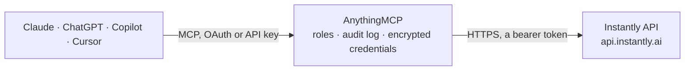

<!-- Generated by scripts/export-github-catalog.mjs in the anythingmcp-website repository. Do not edit by hand. -->

# Instantly MCP connector

Drive Instantly (cold-email outreach platform) from any AI agent: leads, campaigns, lead lists, accounts (sending mailboxes). 8 tools, Bearer auth. The AnythingMCP connector gives Claude, ChatGPT, Microsoft Copilot, Cursor and Gemini 8 MCP tools for Instantly: 6 read and 2 can change data.

**Category:** [CRM](../crm.md) · **Tools:** 8 · **Setup guide:** [anythingmcp.com](https://anythingmcp.com/guides/instantly-to-mcp) · [Deutsch](https://anythingmcp.com/de/guides/instantly-to-mcp) · [Italiano](https://anythingmcp.com/it/guides/instantly-to-mcp) · [Español](https://anythingmcp.com/es/guides/instantly-to-mcp) · [日本語](https://anythingmcp.com/ja/guides/instantly-to-mcp) · [Русский](https://anythingmcp.com/ru/guides/instantly-to-mcp) · [中文](https://anythingmcp.com/zh/guides/instantly-to-mcp)

## Start without code

No installation and no terminal: AnythingMCP Cloud runs the Instantly connector for you, operated by helpcode.ai in Frankfurt, Germany.

1. **Click the button above** and create an account or sign in. The Instantly connector opens, ready to install.
2. **Paste the API key or token from your Instantly account.** Every click is in the [step-by-step guide](https://anythingmcp.com/guides/instantly-to-mcp).
3. **Click Install.** AnythingMCP shows the address of your MCP server.
4. **Add that address to your assistant:** [Claude](https://anythingmcp.com/guides/connect-instantly-to-claude) · [ChatGPT](https://anythingmcp.com/guides/connect-instantly-to-chatgpt) · [Microsoft Copilot](https://anythingmcp.com/guides/connect-instantly-to-copilot) · [Cursor](https://anythingmcp.com/guides/connect-instantly-to-cursor) · [Gemini CLI](https://anythingmcp.com/guides/connect-instantly-to-gemini) · [Meta Muse](https://anythingmcp.com/guides/connect-instantly-to-muse).
5. **Ask your first question**, for example: *Do we have a lead for carla@novagrid.io and which campaign is she in?*

Prefer help with the setup? [Talk to us](https://anythingmcp.com/contact).

## How it works

- **The AI client** speaks MCP (Streamable HTTP) to AnythingMCP and only sees tool names, descriptions and results. It never gets the Instantly credentials.
- **AnythingMCP** checks the client's role, builds the call from the tool definition, adds the credentials (a bearer token), calls Instantly, logs the call and returns the result.
- **Instantly** sees an ordinary API client with the rights of the account the credentials belong to.

## Tools

| Tool | What it does | Access |
|---|---|---|
| [`instantly_list_campaigns`](#instantly_list_campaigns) | List campaigns. | read |
| [`instantly_get_campaign`](#instantly_get_campaign) | Get a campaign by ID with full settings. | read |
| [`instantly_get_campaign_analytics`](#instantly_get_campaign_analytics) | Get campaign aggregated stats (sent, opened, replied, bounced, unsubscribed). | read |
| [`instantly_list_leads`](#instantly_list_leads) | List leads. | read |
| [`instantly_add_lead`](#instantly_add_lead) | Add a lead to a campaign (or to a lead list if no campaign). | write |
| [`instantly_update_lead_interest_status`](#instantly_update_lead_interest_status) | Update a lead's interest_status (a hot/warm/cold flag set during replies). | write |
| [`instantly_list_lead_lists`](#instantly_list_lead_lists) | List lead lists (standalone, not yet in a campaign). | read |
| [`instantly_list_accounts`](#instantly_list_accounts) | List sending accounts (mailboxes). | read |

## Tool reference

Every parameter as the AI client sees it in `tools/list`. Source: [`packages/backend/src/adapters/intl/instantly.json`](../../../packages/backend/src/adapters/intl/instantly.json).

### `instantly_list_campaigns`

List campaigns. Each has id, name, status, daily_limit.

**Access:** read · **Call:** `GET /campaigns`

| Parameter | Type | Required | Description |
|---|---|---|---|
| `limit` | integer | no | Per page (default 100, max 100). |
| `starting_after` | string | no | Cursor — campaign ID to start after. |
| `search` | string | no | Name substring. |

### `instantly_get_campaign`

Get a campaign by ID with full settings.

**Access:** read · **Call:** `GET /campaigns/{campaignId}`

| Parameter | Type | Required | Description |
|---|---|---|---|
| `campaignId` | string | yes | Campaign ID. |

### `instantly_get_campaign_analytics`

Get campaign aggregated stats (sent, opened, replied, bounced, unsubscribed).

**Access:** read · **Call:** `GET /campaigns/analytics`

| Parameter | Type | Required | Description |
|---|---|---|---|
| `campaign_id` | string | no | Campaign ID. |
| `start_date` | string | no | ISO 8601. |
| `end_date` | string | no | ISO 8601. |

### `instantly_list_leads`

List leads. Filter by campaign / status.

**Access:** read · **Call:** `GET /leads/list`

| Parameter | Type | Required | Description |
|---|---|---|---|
| `campaign_id` | string | no | Filter by campaign. |
| `limit` | integer | no | Per page (max 100). |
| `starting_after` | string | no | Cursor. |
| `status` | integer | no | 1=Active, 2=Paused, 3=Completed, -1=Unsubscribed, -2=Bounced, -3=Skipped, 9=Replied. |
| `email` | string | no | Exact email filter. |

### `instantly_add_lead`

Add a lead to a campaign (or to a lead list if no campaign).

**Access:** write · **Call:** `POST /leads`

| Parameter | Type | Required | Description |
|---|---|---|---|
| `campaign` | string | no | Campaign ID to add to. |
| `list_id` | string | no | Lead list ID (alternative). |
| `email` | string | yes | Lead email. |
| `first_name` | string | no | First name. |
| `last_name` | string | no | Last name. |
| `company_name` | string | no | Company. |
| `phone` | string | no | Phone. |
| `website` | string | no | Website URL. |
| `personalization` | string | no | AI/manual personalization snippet for {{personalization}} template variable. |
| `custom_variables` | object | no | Map of custom variable names to values (used in {{var_name}} template tags). |
| `skip_if_in_workspace` | boolean | no | Skip if email exists anywhere in workspace (dedupe). |
| `skip_if_in_campaign` | boolean | no | Skip if already in THIS campaign. |

### `instantly_update_lead_interest_status`

Update a lead's interest_status (a hot/warm/cold flag set during replies).

**Access:** write · **Call:** `POST /leads/{leadId}`

| Parameter | Type | Required | Description |
|---|---|---|---|
| `leadId` | string | yes | Lead ID. |
| `interest_status` | integer | yes | 1=Interested, 2=Meeting Booked, 3=Meeting Completed, 4=Closed, 5=Not Interested, 6=Wrong Person, 7=Lost. |

### `instantly_list_lead_lists`

List lead lists (standalone, not yet in a campaign).

**Access:** read · **Call:** `GET /lead-lists`

| Parameter | Type | Required | Description |
|---|---|---|---|
| `limit` | integer | no | Per page. |
| `starting_after` | string | no | Cursor. |

### `instantly_list_accounts`

List sending accounts (mailboxes). Each has email, status, daily_limit, warmup status.

**Access:** read · **Call:** `GET /accounts`

| Parameter | Type | Required | Description |
|---|---|---|---|
| `limit` | integer | no | Per page. |
| `starting_after` | string | no | Cursor. |

## Run it yourself

AnythingMCP is open source (AGPL-3.0). [Run it with Docker](../../../README.md#run-it-yourself), open **Connectors → Store**, pick **Instantly** and enter `INSTANTLY_API_KEY`, then add your MCP server URL to the AI client.

[← CRM connectors](../crm.md) · [All categories](../README.md)
