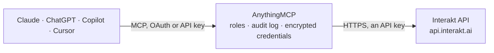

<!-- Generated by scripts/export-github-catalog.mjs in the anythingmcp-website repository. Do not edit by hand. -->

# Interakt MCP connector

Let your AI work with your Interakt WhatsApp Business account: list approved templates, look up and list customers with their traits and tags, add or update customers, record events and assign chats. The AnythingMCP connector gives Claude, ChatGPT, Microsoft Copilot, Cursor and Gemini 9 MCP tools for Interakt: 4 read and 5 can change data.

**Category:** [Messaging](../messaging.md) · **Tools:** 9 · **Setup guide:** [anythingmcp.com](https://anythingmcp.com/guides/interakt-to-mcp) · [Deutsch](https://anythingmcp.com/de/guides/interakt-to-mcp) · [Italiano](https://anythingmcp.com/it/guides/interakt-to-mcp) · [Español](https://anythingmcp.com/es/guides/interakt-to-mcp) · [日本語](https://anythingmcp.com/ja/guides/interakt-to-mcp) · [Русский](https://anythingmcp.com/ru/guides/interakt-to-mcp) · [中文](https://anythingmcp.com/zh/guides/interakt-to-mcp)

## Start without code

No installation and no terminal: AnythingMCP Cloud runs the Interakt connector for you, operated by helpcode.ai in Frankfurt, Germany.

1. **Click the button above** and create an account or sign in. The Interakt connector opens, ready to install.
2. **Paste the API key or token from your Interakt account.** Every click is in the [step-by-step guide](https://anythingmcp.com/guides/interakt-to-mcp).
3. **Click Install.** AnythingMCP shows the address of your MCP server.
4. **Add that address to your assistant:** [Claude](https://anythingmcp.com/guides/connect-interakt-to-claude) · [ChatGPT](https://anythingmcp.com/guides/connect-interakt-to-chatgpt) · [Microsoft Copilot](https://anythingmcp.com/guides/connect-interakt-to-copilot) · [Cursor](https://anythingmcp.com/guides/connect-interakt-to-cursor) · [Gemini CLI](https://anythingmcp.com/guides/connect-interakt-to-gemini) · [Meta Muse](https://anythingmcp.com/guides/connect-interakt-to-muse).
5. **Ask your first question**, for example: *Show customer record for phone 9812345678 — I need name and opt-in to reconcile invoice INV-2026-0412.*

Prefer help with the setup? [Talk to us](https://anythingmcp.com/contact).

## How it works

- **The AI client** speaks MCP (Streamable HTTP) to AnythingMCP and only sees tool names, descriptions and results. It never gets the Interakt credentials.
- **AnythingMCP** checks the client's role, builds the call from the tool definition, adds the credentials (an API key), calls Interakt, logs the call and returns the result.
- **Interakt** sees an ordinary API client with the rights of the account the credentials belong to.

## Tools

| Tool | What it does | Access |
|---|---|---|
| [`interakt_list_templates`](#interakt_list_templates) | List the account's WhatsApp message templates: id, name (the code name used to send), display_name, language, category, approval_status, header, body (with… | read |
| [`interakt_list_customers`](#interakt_list_customers) | List customers (contacts) created or updated in a time window, 100 at a time: id, phone_number, country_code, traits (name, email, whatsapp_opted_in and… | read |
| [`interakt_get_customer_by_phone`](#interakt_get_customer_by_phone) | Find a customer by phone number: id, name and other traits, tags, WhatsApp opt-in, created and modified time. | read |
| [`interakt_get_customer`](#interakt_get_customer) | Read a customer by Interakt customer id: phone, traits, tags, created and modified time. | read |
| [`interakt_upsert_customer`](#interakt_upsert_customer) | Create a customer or update one with the same number: traits are merged into the profile, tags are added (never removed). | write |
| [`interakt_track_event`](#interakt_track_event) | Record an event on a customer's timeline (e.g. Order Placed with its details); events can trigger Interakt automations that message the customer. | write |
| [`interakt_assign_chat`](#interakt_assign_chat) | Assign a customer's chat in the Interakt inbox to a team member by e-mail. | write |
| [`interakt_send_template`](#interakt_send_template) | Send an approved WhatsApp template to a number. | write |
| [`interakt_send_text`](#interakt_send_text) | Send a free-text WhatsApp message to a customer. | write |

## Tool reference

Every parameter as the AI client sees it in `tools/list`. Source: [`packages/backend/src/adapters/in/interakt.json`](../../../packages/backend/src/adapters/in/interakt.json).

### `interakt_list_templates`

List the account's WhatsApp message templates: id, name (the code name used to send), display_name, language, category, approval_status, header, body (with {{1}}, {{2}} placeholders), footer and buttons. Count the placeholders before sending a template: every one needs a value. Read-only.

**Access:** read · **Call:** `GET /v1/public/track/organization/templates`

| Parameter | Type | Required | Description |
|---|---|---|---|
| `template_name` | string | no | Optional: only templates whose name matches. |
| `approval_status` | `APPROVED` \| `PENDING` \| `REJECTED` \| `PAUSED` \| `DISABLED` | no | Optional: only templates in this state. APPROVED ones can be sent. |
| `offset` | integer | no | Skip this many templates (pagination; has_next says whether more exist). |

### `interakt_list_customers`

List customers (contacts) created or updated in a time window, 100 at a time: id, phone_number, country_code, traits (name, email, whatsapp_opted_in and custom traits), tag_names, created_at_utc, modified_at_utc. Without dates it lists every customer. Read-only (a search, sent as POST).

**Access:** read · **Call:** `POST /v1/public/apis/users/`

| Parameter | Type | Required | Description |
|---|---|---|---|
| `trait` | `created_at_utc` \| `modified_at_utc` | no | Which timestamp the window applies to. Default created_at_utc. |
| `from` | string | no | Window start, UTC ISO 8601 (2026-10-01T00:00:00.000Z). Default: the beginning. |
| `to` | string | no | Window end, UTC ISO 8601. Default: no end. |
| `offset` | integer | no | Skip this many customers. has_next_page says whether more exist. |
| `limit` | integer | no | Customers per page, at most 100. Default 50. |

### `interakt_get_customer_by_phone`

Find a customer by phone number: id, name and other traits, tags, WhatsApp opt-in, created and modified time. Read-only.

**Access:** read · **Call:** `GET /v1/public/apis/users/phone_number/{phone_number}`

| Parameter | Type | Required | Description |
|---|---|---|---|
| `phone_number` | string | yes | Phone number without the country code, digits only, e.g. 9876543210. |

### `interakt_get_customer`

Read a customer by Interakt customer id: phone, traits, tags, created and modified time. Read-only.

**Access:** read · **Call:** `GET /v1/public/apis/users/id/{customer_id}`

| Parameter | Type | Required | Description |
|---|---|---|---|
| `customer_id` | string | yes | Customer id (UUID) from interakt_list_customers or interakt_get_customer_by_phone. |

### `interakt_upsert_customer`

Create a customer or update one with the same number: traits are merged into the profile, tags are added (never removed). traits must be a JSON object of flat values, e.g. {"name":"Asha","email":"asha@example.com","whatsapp_opted_in":true}. Changes the CRM: confirm with the user first.

**Access:** write · **Call:** `POST /v1/public/track/users/`

| Parameter | Type | Required | Description |
|---|---|---|---|
| `phone_number` | string | yes | Phone number without the country code, digits only, e.g. 9876543210. |
| `country_code` | string | no | Country code with +, default +91. |
| `traits` | object | no | Profile fields as an object, not a string: name, email, whatsapp_opted_in and any custom trait. |
| `tags` | string[] | no | Tag names to add. |
| `user_id` | string | no | Optional id of this customer in your own system. |

### `interakt_track_event`

Record an event on a customer's timeline (e.g. Order Placed with its details); events can trigger Interakt automations that message the customer. Confirm with the user first.

**Access:** write · **Call:** `POST /v1/public/track/events/`

| Parameter | Type | Required | Description |
|---|---|---|---|
| `phone_number` | string | yes | Phone number without the country code, digits only, e.g. 9876543210. |
| `country_code` | string | no | Country code with +, default +91. |
| `event` | string | yes | Event name, e.g. Order Placed. |
| `traits` | object | no | Event details as an object of flat values. |

### `interakt_assign_chat`

Assign a customer's chat in the Interakt inbox to a team member by e-mail. Only changes the shared inbox. Confirm with the user first.

**Access:** write · **Call:** `POST /v1/public/assignment/`

| Parameter | Type | Required | Description |
|---|---|---|---|
| `full_phone_number` | string | yes | Customer number with country code, digits only, e.g. 919876543210. |
| `agent_email` | string | yes | E-mail of the Interakt team member. |

### `interakt_send_template`

Send an approved WhatsApp template to a number. It reaches the customer at once and Meta charges the conversation. body_values needs exactly one value per {{n}} placeholder in the template body, in order (read it with interakt_list_templates first); otherwise Interakt answers Missing variable values. Installed switched off. Show the template, number and values and confirm with the user first.

**Access:** write · **Call:** `POST /v1/public/message/`

| Parameter | Type | Required | Description |
|---|---|---|---|
| `phone_number` | string | yes | Phone number without the country code, digits only, e.g. 9876543210. |
| `country_code` | string | no | Country code with +, default +91. |
| `template_name` | string | yes | Template code name (name, not display_name) from interakt_list_templates. |
| `language_code` | string | no | Template language code, e.g. en, hi. Default en. |
| `body_values` | string[] | yes | Values for {{1}}, {{2}} ... of the body, in order. |
| `header_values` | string[] | no | Header variable value, or the public media URL for an image, video or document header. |
| `file_name` | string | no | File name shown for a document header. |
| `button_values` | object | no | Dynamic button values keyed by button index, e.g. {"0":["order123"]}. |
| `callback_data` | string | no | Optional text returned in Interakt webhooks for this message. |

### `interakt_send_text`

Send a free-text WhatsApp message to a customer. WhatsApp only allows it within 24 hours of the customer's last message; outside that window Interakt refuses it and only templates work. Installed switched off. Show the text and number and confirm with the user first.

**Access:** write · **Call:** `POST /v1/public/message/`

| Parameter | Type | Required | Description |
|---|---|---|---|
| `full_phone_number` | string | yes | Number with country code, digits only, e.g. 919876543210. |
| `message` | string | yes | Message text. |
| `callback_data` | string | no | Optional text returned in webhooks. |

## Run it yourself

AnythingMCP is open source (AGPL-3.0). [Run it with Docker](../../../README.md#run-it-yourself), open **Connectors → Store**, pick **Interakt** and enter `INTERAKT_API_KEY`, then add your MCP server URL to the AI client.

[← Messaging connectors](../messaging.md) · [All categories](../README.md)
