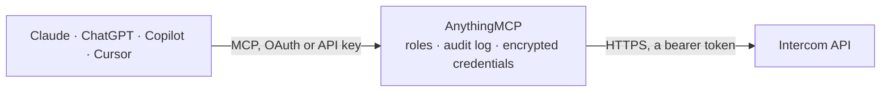

<!-- Generated by scripts/export-github-catalog.mjs in the anythingmcp-website repository. Do not edit by hand. -->

# Intercom MCP connector

Let your AI work in Intercom: find and update contacts and companies, read, search and triage conversations and tickets (reply, add notes, assign, snooze, close, tag), and manage Help Center articles and collections. The AnythingMCP connector gives Claude, ChatGPT, Microsoft Copilot, Cursor and Gemini 59 MCP tools for Intercom: 31 read and 28 can change data.

**Category:** [Customer Support](../support.md) · **Tools:** 59 · **Setup guide:** [anythingmcp.com](https://anythingmcp.com/guides/intercom-to-mcp) · [Deutsch](https://anythingmcp.com/de/guides/intercom-to-mcp) · [Italiano](https://anythingmcp.com/it/guides/intercom-to-mcp) · [Español](https://anythingmcp.com/es/guides/intercom-to-mcp) · [日本語](https://anythingmcp.com/ja/guides/intercom-to-mcp) · [Русский](https://anythingmcp.com/ru/guides/intercom-to-mcp) · [中文](https://anythingmcp.com/zh/guides/intercom-to-mcp)

## Start without code

No installation and no terminal: AnythingMCP Cloud runs the Intercom connector for you, operated by helpcode.ai in Frankfurt, Germany.

1. **Click the button above** and create an account or sign in. The Intercom connector opens, ready to install.
2. **Paste the API key or token from your Intercom account.** Every click is in the [step-by-step guide](https://anythingmcp.com/guides/intercom-to-mcp).
3. **Click Install.** AnythingMCP shows the address of your MCP server.
4. **Add that address to your assistant:** [Claude](https://anythingmcp.com/guides/connect-intercom-to-claude) · [ChatGPT](https://anythingmcp.com/guides/connect-intercom-to-chatgpt) · [Microsoft Copilot](https://anythingmcp.com/guides/connect-intercom-to-copilot) · [Cursor](https://anythingmcp.com/guides/connect-intercom-to-cursor) · [Gemini CLI](https://anythingmcp.com/guides/connect-intercom-to-gemini) · [Meta Muse](https://anythingmcp.com/guides/connect-intercom-to-muse).
5. **Ask your first question**, for example: *Find contact for support@novaflow.io and show their Intercom id, tags and last_seen_at.*

Prefer help with the setup? [Talk to us](https://anythingmcp.com/contact).

## How it works

- **The AI client** speaks MCP (Streamable HTTP) to AnythingMCP and only sees tool names, descriptions and results. It never gets the Intercom credentials.
- **AnythingMCP** checks the client's role, builds the call from the tool definition, adds the credentials (a bearer token), calls Intercom, logs the call and returns the result.
- **Intercom** sees an ordinary API client with the rights of the account the credentials belong to.

## Tools

| Tool | What it does | Access |
|---|---|---|
| [`intercom_get_me`](#intercom_get_me) | Read who the access token belongs to: the admin id, name and email, plus the workspace (app) with its id_code, name, timezone and region. | read |
| [`intercom_list_admins`](#intercom_list_admins) | List the workspace admins (teammates) with id, name, email, away_mode_enabled, has_inbox_seat and team_ids. | read |
| [`intercom_get_admin`](#intercom_get_admin) | Read one admin (teammate): name, email, away mode and reason, inbox seat and the ids of their teams. | read |
| [`intercom_list_teams`](#intercom_list_teams) | List the workspace teams with id, name and admin_ids. | read |
| [`intercom_get_team`](#intercom_get_team) | Read one team: name, the ids of its admins, the assignment limit and the distribution method. | read |
| [`intercom_list_tags`](#intercom_list_tags) | List every tag in the workspace with id and name. | read |
| [`intercom_create_tag`](#intercom_create_tag) | Create a tag, or return the existing tag with that name (names are case-insensitive). | write |
| [`intercom_list_segments`](#intercom_list_segments) | List the saved contact and company segments with id, name, person_type and dates, optionally with how many contacts each holds. | read |
| [`intercom_list_data_attributes`](#intercom_list_data_attributes) | List the data attributes of contacts and companies, standard and custom: name, full_name (the field name to use in searches and updates), label, data_type,… | read |
| [`intercom_list_contacts`](#intercom_list_contacts) | List contacts (users and leads), newest first, with id, role, email, name, phone, external_id, owner_id, location, timestamps and custom_attributes. | read |
| [`intercom_search_contacts`](#intercom_search_contacts) | Search contacts by their attributes, e.g. email, name, phone, external_id, role (user or lead), created_at, last_seen_at, tag_id, segment_id,… | read |
| [`intercom_get_contact`](#intercom_get_contact) | Read one contact: role, email, phone, name, external_id, owner_id, location, browser and device, unsubscribe and bounce flags, timestamps,… | read |
| [`intercom_find_contact_by_external_id`](#intercom_find_contact_by_external_id) | Find a user by the external_id your own system gave them (users only, not leads). | read |
| [`intercom_create_contact`](#intercom_create_contact) | Create a contact, a user or a lead. | write |
| [`intercom_update_contact`](#intercom_update_contact) | Change a contact: only the fields given are overwritten. | write |
| [`intercom_archive_contact`](#intercom_archive_contact) | Archive a contact: it disappears from lists, searches and the Inbox until unarchived with intercom_unarchive_contact. | write |
| [`intercom_unarchive_contact`](#intercom_unarchive_contact) | Bring an archived contact back, so it shows again in lists, searches and the Inbox. | write |
| [`intercom_delete_contact`](#intercom_delete_contact) | Delete a contact for good, with their data. | write |
| [`intercom_list_contact_tags`](#intercom_list_contact_tags) | List the tags on one contact with id, name, applied_at and who applied them. | read |
| [`intercom_tag_contact`](#intercom_tag_contact) | Put an existing tag on a contact (intercom_create_tag makes a new one). | write |
| [`intercom_untag_contact`](#intercom_untag_contact) | Take a tag off a contact; the tag itself stays in the workspace. | write |
| [`intercom_list_contact_notes`](#intercom_list_contact_notes) | List the internal notes teammates left on a contact, newest first, with id, body (HTML), created_at and author. | read |
| [`intercom_add_contact_note`](#intercom_add_contact_note) | Leave an internal note on a contact. | write |
| [`intercom_list_contact_companies`](#intercom_list_contact_companies) | List the companies a contact belongs to, with id, company_id, name, plan, user_count, monthly_spend and custom_attributes. | read |
| [`intercom_attach_contact_to_company`](#intercom_attach_contact_to_company) | Add a contact to a company. | write |
| [`intercom_detach_contact_from_company`](#intercom_detach_contact_from_company) | Remove a contact from a company; both stay in the workspace. | write |
| [`intercom_list_companies`](#intercom_list_companies) | List companies, or find one by name or by your own company_id, or filter by tag or segment. | read |
| [`intercom_get_company`](#intercom_get_company) | Read one company by the id Intercom gave it: company_id, name, plan, size, website, industry, user_count, session_count, monthly_spend, tags, segments and… | read |
| [`intercom_create_or_update_company`](#intercom_create_or_update_company) | Create a company, or update the one that already has this company_id (your own id for it, which cannot be changed later). | write |
| [`intercom_list_company_contacts`](#intercom_list_company_contacts) | List the contacts that belong to a company, with id, role, email and name. | read |
| [`intercom_list_conversations`](#intercom_list_conversations) | List conversations, most recently updated first, with id, title, state (open, closed, snoozed), open, read, priority, admin_assignee_id and team_assignee_id… | read |
| [`intercom_search_conversations`](#intercom_search_conversations) | Search conversations, e.g. by open, state (open, closed, snoozed), admin_assignee_id, team_assignee_id, contact_ids, tag_ids, priority, source.body (matches… | read |
| [`intercom_get_conversation`](#intercom_get_conversation) | Read one conversation with its messages: state, assignees, contacts, tags, priority, statistics and conversation_parts (replies, notes, assignments and… | read |
| [`intercom_reply_to_conversation`](#intercom_reply_to_conversation) | Reply to a conversation as an admin. | write |
| [`intercom_add_conversation_note`](#intercom_add_conversation_note) | Add an internal note to a conversation. | write |
| [`intercom_assign_conversation`](#intercom_assign_conversation) | Assign a conversation to an admin or to a team (a conversation can have both), or unassign it with assignee_id "0". | write |
| [`intercom_close_conversation`](#intercom_close_conversation) | Close a conversation (intercom_open_conversation reopens it). | write |
| [`intercom_snooze_conversation`](#intercom_snooze_conversation) | Snooze a conversation until a time; it reopens by itself then. | write |
| [`intercom_open_conversation`](#intercom_open_conversation) | Open a closed or snoozed conversation again, so it is back in the Inbox. | write |
| [`intercom_tag_conversation`](#intercom_tag_conversation) | Put an existing tag on a conversation (intercom_create_tag makes a new one). | write |
| [`intercom_untag_conversation`](#intercom_untag_conversation) | Take a tag off a conversation; the tag itself stays in the workspace. | write |
| [`intercom_search_tickets`](#intercom_search_tickets) | Search tickets, e.g. by ticket_type_id, open, state, title, description, category (request for customer tickets, task for back-office, tracker),… | read |
| [`intercom_get_ticket`](#intercom_get_ticket) | Read one ticket: id, ticket_id (the Inbox number), ticket_attributes (title, description and custom ones), ticket_state, ticket_type, contacts, assignees,… | read |
| [`intercom_reply_to_ticket`](#intercom_reply_to_ticket) | Reply to a ticket as an admin. | write |
| [`intercom_update_ticket`](#intercom_update_ticket) | Change a ticket: its attributes (title, description, custom ones), state, assignee, open or closed, snooze, sharing with the customer. | write |
| [`intercom_list_ticket_types`](#intercom_list_ticket_types) | List the ticket types with id, name, category (Customer, Back-office, Tracker), archived and their ticket_type_attributes (name, data_type, required). | read |
| [`intercom_list_ticket_states`](#intercom_list_ticket_states) | List the ticket states with id, category (submitted, in_progress, waiting_on_customer, resolved), internal_label, external_label and the ticket types that… | read |
| [`intercom_list_help_centers`](#intercom_list_help_centers) | List the Help Centers of the workspace with id, identifier, display_name, url, custom_domain and whether the website is on. | read |
| [`intercom_list_collections`](#intercom_list_collections) | List Help Center collections and sections, most recently updated first, with id, name, description, url, parent_id (set on sections and sub-collections) and… | read |
| [`intercom_get_collection`](#intercom_get_collection) | Read one Help Center collection: name, description, url, icon, order, parent_id, help_center_id and translated_content. | read |
| [`intercom_create_collection`](#intercom_create_collection) | Create a Help Center collection, or a sub-collection with parent_id. | write |
| [`intercom_update_collection`](#intercom_update_collection) | Rename a Help Center collection, change its description or move it under another parent. | write |
| [`intercom_delete_collection`](#intercom_delete_collection) | Delete a Help Center collection for good. | write |
| [`intercom_list_articles`](#intercom_list_articles) | List Help Center articles, most recently updated first, with id, title, description, body (HTML), author_id, state (published or draft), parent_ids (their… | read |
| [`intercom_search_articles`](#intercom_search_articles) | Search Help Center articles for a phrase. | read |
| [`intercom_get_article`](#intercom_get_article) | Read one Help Center article: title, description, body (HTML), author_id, state, parent_ids, url, statistics and translated_content per language. | read |
| [`intercom_create_article`](#intercom_create_article) | Write a new Help Center article. | write |
| [`intercom_update_article`](#intercom_update_article) | Change a Help Center article. | write |
| [`intercom_delete_article`](#intercom_delete_article) | Delete a Help Center article for good; setting state draft with intercom_update_article only unpublishes it. | write |

## Tool reference

Every parameter as the AI client sees it in `tools/list`. Source: [`packages/backend/src/adapters/intl/intercom.json`](../../../packages/backend/src/adapters/intl/intercom.json).

### `intercom_get_me`

Read who the access token belongs to: the admin id, name and email, plus the workspace (app) with its id_code, name, timezone and region. The admin id is what replies, notes and state changes need as admin_id.

**Access:** read · **Call:** `GET /me`

No parameters.

### `intercom_list_admins`

List the workspace admins (teammates) with id, name, email, away_mode_enabled, has_inbox_seat and team_ids. Use an id as admin_id or as assignee_id when assigning. Returns admins (no paging).

**Access:** read · **Call:** `GET /admins`

No parameters.

### `intercom_get_admin`

Read one admin (teammate): name, email, away mode and reason, inbox seat and the ids of their teams.

**Access:** read · **Call:** `GET /admins/{admin_id}`

| Parameter | Type | Required | Description |
|---|---|---|---|
| `admin_id` | string | yes | The admin id, from intercom_list_admins. |

### `intercom_list_teams`

List the workspace teams with id, name and admin_ids. A team id can be the assignee_id of intercom_assign_conversation. Returns teams, an empty list when the workspace has none.

**Access:** read · **Call:** `GET /teams`

No parameters.

### `intercom_get_team`

Read one team: name, the ids of its admins, the assignment limit and the distribution method.

**Access:** read · **Call:** `GET /teams/{team_id}`

| Parameter | Type | Required | Description |
|---|---|---|---|
| `team_id` | string | yes | The team id, from intercom_list_teams. |

### `intercom_list_tags`

List every tag in the workspace with id and name. Returns data (no paging); an empty workspace returns an empty list.

**Access:** read · **Call:** `GET /tags`

No parameters.

### `intercom_create_tag`

Create a tag, or return the existing tag with that name (names are case-insensitive). With id it renames that tag instead, everywhere it is applied. Returns the tag with id and name.

**Access:** write · **Call:** `POST /tags`

| Parameter | Type | Required | Description |
|---|---|---|---|
| `name` | string | yes | The tag name, or the new name when id is given. |
| `id` | string | no | Only to rename: the id of the tag to rename. |

### `intercom_list_segments`

List the saved contact and company segments with id, name, person_type and dates, optionally with how many contacts each holds. Returns segments.

**Access:** read · **Call:** `GET /segments`

| Parameter | Type | Required | Description |
|---|---|---|---|
| `include_count` | boolean | no | true to add the number of contacts in each segment. |

### `intercom_list_data_attributes`

List the data attributes of contacts and companies, standard and custom: name, full_name (the field name to use in searches and updates), label, data_type, whether the API may write it, and archived. Returns data.

**Access:** read · **Call:** `GET /data_attributes`

| Parameter | Type | Required | Description |
|---|---|---|---|
| `model` | `contact` \| `company` | no | contact or company; both when omitted. |
| `include_archived` | boolean | no | true to include archived attributes. |

### `intercom_list_contacts`

List contacts (users and leads), newest first, with id, role, email, name, phone, external_id, owner_id, location, timestamps and custom_attributes. Returns data, total_count and pages; pages.next.starting_after is the cursor for the next page (no pages.next on the last page). For a filtered list use intercom_search_contacts.

**Access:** read · **Call:** `GET /contacts`

| Parameter | Type | Required | Description |
|---|---|---|---|
| `per_page` | integer | no | Results per page (default 20 here, max 150). |
| `starting_after` | string | no | Cursor for the next page: pages.next.starting_after of the previous answer. Omit for the first page. |

### `intercom_search_contacts`

Search contacts by their attributes, e.g. email, name, phone, external_id, role (user or lead), created_at, last_seen_at, tag_id, segment_id, location.country or custom_attributes.<name>. Read-only although it is a POST. Returns data, total_count and pages with the next cursor. Contacts created in the last few minutes may not be found yet.

**Access:** read · **Call:** `POST /contacts/search`

| Parameter | Type | Required | Description |
|---|---|---|---|
| `query` | object | yes | The filter. One condition: {"field": "email", "operator": "=", "value": "ana@example.com"}. Several: {"operator": "AND", "value": [condition, condition]} (or "OR"; groups nest at most 2 levels, 15 conditions per group). Operators: =, !=, IN, NIN (value is an array), <, <=, >, >= (numbers), ~ (contains), !~, ^ (starts with), $ (ends with). Dates are Unix timestamps in seconds. |
| `sort` | object | no | Optional order, e.g. {"field": "last_seen_at", "order": "descending"} (order is ascending or descending). |
| `per_page` | integer | no | Results per page (default 20 here, max 150). |
| `starting_after` | string | no | Cursor for the next page: pages.next.starting_after of the previous answer. Omit for the first page. |

### `intercom_get_contact`

Read one contact: role, email, phone, name, external_id, owner_id, location, browser and device, unsubscribe and bounce flags, timestamps, custom_attributes, and the first tags, notes and companies. A merged contact answers 410 with code contact_merged.

**Access:** read · **Call:** `GET /contacts/{contact_id}`

| Parameter | Type | Required | Description |
|---|---|---|---|
| `contact_id` | string | yes | The contact id Intercom gave the contact (24 hex characters), from intercom_search_contacts or intercom_list_contacts. |

### `intercom_find_contact_by_external_id`

Find a user by the external_id your own system gave them (users only, not leads). Returns the contact with the same fields as intercom_get_contact.

**Access:** read · **Call:** `GET /contacts/find_by_external_id/{external_id}`

| Parameter | Type | Required | Description |
|---|---|---|---|
| `external_id` | string | yes | The external_id (your own user id) of the user. |

### `intercom_create_contact`

Create a contact, a user or a lead. Needs at least an email, an external_id or a role. Nothing is sent to the person. Returns the new contact with its id.

**Access:** write · **Call:** `POST /contacts`

| Parameter | Type | Required | Description |
|---|---|---|---|
| `role` | `user` \| `lead` | no | user (a signed-up customer) or lead (a prospect). Defaults to user on create. |
| `email` | string | no | Email address. |
| `external_id` | string | no | Your own unique id for this user. |
| `phone` | string | no | Phone number, e.g. +4930123456. |
| `name` | string | no | Full name. |
| `owner_id` | string | no | Id of the admin who owns this contact. |
| `signed_up_at` | integer | no | When they signed up, Unix timestamp in seconds. |
| `unsubscribed_from_emails` | boolean | no | true if they unsubscribed from your emails. |
| `custom_attributes` | object | no | Custom attributes by name, e.g. {"plan": "pro"}. Each must already exist (intercom_list_data_attributes, model contact). |

### `intercom_update_contact`

Change a contact: only the fields given are overwritten. Setting role to user turns a lead into a user. Changing the email resets its verified state. Returns the updated contact.

**Access:** write · **Call:** `PUT /contacts/{contact_id}`

| Parameter | Type | Required | Description |
|---|---|---|---|
| `contact_id` | string | yes | The contact id Intercom gave the contact (24 hex characters), from intercom_search_contacts or intercom_list_contacts. |
| `role` | `user` \| `lead` | no | user (a signed-up customer) or lead (a prospect). Defaults to user on create. |
| `email` | string | no | Email address. |
| `external_id` | string | no | Your own unique id for this user. |
| `phone` | string | no | Phone number, e.g. +4930123456. |
| `name` | string | no | Full name. |
| `owner_id` | string | no | Id of the admin who owns this contact. |
| `signed_up_at` | integer | no | When they signed up, Unix timestamp in seconds. |
| `unsubscribed_from_emails` | boolean | no | true if they unsubscribed from your emails. |
| `custom_attributes` | object | no | Custom attributes by name, e.g. {"plan": "pro"}. Each must already exist (intercom_list_data_attributes, model contact). |

### `intercom_archive_contact`

Archive a contact: it disappears from lists, searches and the Inbox until unarchived with intercom_unarchive_contact. Confirm with the user first. Returns id, external_id and archived: true.

**Access:** write · **Call:** `POST /contacts/{contact_id}/archive`

| Parameter | Type | Required | Description |
|---|---|---|---|
| `contact_id` | string | yes | The contact id Intercom gave the contact (24 hex characters), from intercom_search_contacts or intercom_list_contacts. |

### `intercom_unarchive_contact`

Bring an archived contact back, so it shows again in lists, searches and the Inbox. Returns id, external_id and archived: false.

**Access:** write · **Call:** `POST /contacts/{contact_id}/unarchive`

| Parameter | Type | Required | Description |
|---|---|---|---|
| `contact_id` | string | yes | The contact id Intercom gave the contact (24 hex characters), from intercom_search_contacts or intercom_list_contacts. |

### `intercom_delete_contact`

Delete a contact for good, with their data. This cannot be undone; intercom_archive_contact is the reversible choice. Confirm with the user first. Installed switched off. Returns id and deleted: true.

**Access:** write · **Call:** `DELETE /contacts/{contact_id}`

| Parameter | Type | Required | Description |
|---|---|---|---|
| `contact_id` | string | yes | The contact id Intercom gave the contact (24 hex characters), from intercom_search_contacts or intercom_list_contacts. |

### `intercom_list_contact_tags`

List the tags on one contact with id, name, applied_at and who applied them. Returns data, empty when the contact has no tag.

**Access:** read · **Call:** `GET /contacts/{contact_id}/tags`

| Parameter | Type | Required | Description |
|---|---|---|---|
| `contact_id` | string | yes | The contact id Intercom gave the contact (24 hex characters), from intercom_search_contacts or intercom_list_contacts. |

### `intercom_tag_contact`

Put an existing tag on a contact (intercom_create_tag makes a new one). The contact does not see tags. Returns the tag with id and name.

**Access:** write · **Call:** `POST /contacts/{contact_id}/tags`

| Parameter | Type | Required | Description |
|---|---|---|---|
| `contact_id` | string | yes | The contact id Intercom gave the contact (24 hex characters), from intercom_search_contacts or intercom_list_contacts. |
| `tag_id` | string | yes | The tag id, from intercom_list_tags or intercom_create_tag. |

### `intercom_untag_contact`

Take a tag off a contact; the tag itself stays in the workspace. Returns the removed tag with id and name.

**Access:** write · **Call:** `DELETE /contacts/{contact_id}/tags/{tag_id}`

| Parameter | Type | Required | Description |
|---|---|---|---|
| `contact_id` | string | yes | The contact id Intercom gave the contact (24 hex characters), from intercom_search_contacts or intercom_list_contacts. |
| `tag_id` | string | yes | The tag id to remove, from intercom_list_contact_tags. |

### `intercom_list_contact_notes`

List the internal notes teammates left on a contact, newest first, with id, body (HTML), created_at and author. Returns data, empty when there are none.

**Access:** read · **Call:** `GET /contacts/{contact_id}/notes`

| Parameter | Type | Required | Description |
|---|---|---|---|
| `contact_id` | string | yes | The contact id Intercom gave the contact (24 hex characters), from intercom_search_contacts or intercom_list_contacts. |

### `intercom_add_contact_note`

Leave an internal note on a contact. Notes are only visible to teammates, never to the contact. Returns the note with id, body and author.

**Access:** write · **Call:** `POST /contacts/{contact_id}/notes`

| Parameter | Type | Required | Description |
|---|---|---|---|
| `contact_id` | string | yes | The contact id Intercom gave the contact (24 hex characters), from intercom_search_contacts or intercom_list_contacts. |
| `body` | string | yes | The note text; simple HTML such as 
 and <b> is allowed. |
| `admin_id` | string | no | Id of the admin (teammate) doing this; the action appears under their name. intercom_get_me returns your own id, intercom_list_admins all of them. |

### `intercom_list_contact_companies`

List the companies a contact belongs to, with id, company_id, name, plan, user_count, monthly_spend and custom_attributes. Returns data, empty when there are none.

**Access:** read · **Call:** `GET /contacts/{contact_id}/companies`

| Parameter | Type | Required | Description |
|---|---|---|---|
| `contact_id` | string | yes | The contact id Intercom gave the contact (24 hex characters), from intercom_search_contacts or intercom_list_contacts. |

### `intercom_attach_contact_to_company`

Add a contact to a company. A company only shows in Intercom once it has at least one contact. Returns the company.

**Access:** write · **Call:** `POST /contacts/{contact_id}/companies`

| Parameter | Type | Required | Description |
|---|---|---|---|
| `contact_id` | string | yes | The contact id Intercom gave the contact (24 hex characters), from intercom_search_contacts or intercom_list_contacts. |
| `company_id` | string | yes | The company id Intercom gave the company (the `id` field, not your own company_id), from intercom_list_companies. |

### `intercom_detach_contact_from_company`

Remove a contact from a company; both stay in the workspace. Returns the company.

**Access:** write · **Call:** `DELETE /contacts/{contact_id}/companies/{company_id}`

| Parameter | Type | Required | Description |
|---|---|---|---|
| `contact_id` | string | yes | The contact id Intercom gave the contact (24 hex characters), from intercom_search_contacts or intercom_list_contacts. |
| `company_id` | string | yes | The company `id` Intercom gave it, from intercom_list_contact_companies. |

### `intercom_list_companies`

List companies, or find one by name or by your own company_id, or filter by tag or segment. Each has id, company_id, name, plan, size, website, industry, user_count, monthly_spend, tags, segments and custom_attributes. Returns data, total_count and pages (page numbers). Companies without any contact are not listed.

**Access:** read · **Call:** `GET /companies`

| Parameter | Type | Required | Description |
|---|---|---|---|
| `name` | string | no | Exact company name to look up. |
| `company_id` | string | no | Your own company_id to look up. |
| `tag_id` | string | no | Only companies with this tag. |
| `segment_id` | string | no | Only companies in this segment. |
| `page` | integer | no | Page number, starting at 1. |
| `per_page` | integer | no | Results per page (default 20 here, max 150). |

### `intercom_get_company`

Read one company by the id Intercom gave it: company_id, name, plan, size, website, industry, user_count, session_count, monthly_spend, tags, segments and custom_attributes.

**Access:** read · **Call:** `GET /companies/{company_id}`

| Parameter | Type | Required | Description |
|---|---|---|---|
| `company_id` | string | yes | The company `id` Intercom gave it (not your own company_id), from intercom_list_companies. |

### `intercom_create_or_update_company`

Create a company, or update the one that already has this company_id (your own id for it, which cannot be changed later). Only the fields given are written. It shows in Intercom once a contact is attached (intercom_attach_contact_to_company). Returns the company with its Intercom id.

**Access:** write · **Call:** `POST /companies`

| Parameter | Type | Required | Description |
|---|---|---|---|
| `company_id` | string | yes | Your own unique id for the company; it identifies the company on later calls. |
| `name` | string | no | Company name. |
| `plan` | string | no | Name of the plan the company is on. |
| `size` | integer | no | Number of employees. |
| `website` | string | no | Website URL. |
| `industry` | string | no | Industry. |
| `monthly_spend` | integer | no | Revenue from this company per month, a whole number. |
| `remote_created_at` | integer | no | When the company was created in your system, Unix timestamp in seconds. |
| `custom_attributes` | object | no | Custom company attributes by name, e.g. {"region": "DACH"}. Each must already exist (intercom_list_data_attributes, model company). |

### `intercom_list_company_contacts`

List the contacts that belong to a company, with id, role, email and name. Returns data, total_count and pages; for big companies search contacts instead.

**Access:** read · **Call:** `GET /companies/{company_id}/contacts`

| Parameter | Type | Required | Description |
|---|---|---|---|
| `company_id` | string | yes | The company `id` Intercom gave it, from intercom_list_companies. |

### `intercom_list_conversations`

List conversations, most recently updated first, with id, title, state (open, closed, snoozed), open, read, priority, admin_assignee_id and team_assignee_id (0 when unassigned), contacts, tags, source (the first message) and timestamps. Returns conversations, total_count and pages with the next cursor. For filters use intercom_search_conversations.

**Access:** read · **Call:** `GET /conversations`

| Parameter | Type | Required | Description |
|---|---|---|---|
| `per_page` | integer | no | Results per page (default 20 here, max 150). |
| `starting_after` | string | no | Cursor for the next page: pages.next.starting_after of the previous answer. Omit for the first page. |

### `intercom_search_conversations`

Search conversations, e.g. by open, state (open, closed, snoozed), admin_assignee_id, team_assignee_id, contact_ids, tag_ids, priority, source.body (matches single words), source.author.email, created_at or updated_at. Read-only although it is a POST. Returns conversations, total_count and pages with the next cursor.

**Access:** read · **Call:** `POST /conversations/search`

| Parameter | Type | Required | Description |
|---|---|---|---|
| `query` | object | yes | The filter. One condition: {"field": "email", "operator": "=", "value": "ana@example.com"}. Several: {"operator": "AND", "value": [condition, condition]} (or "OR"; groups nest at most 2 levels, 15 conditions per group). Operators: =, !=, IN, NIN (value is an array), <, <=, >, >= (numbers), ~ (contains), !~, ^ (starts with), $ (ends with). Dates are Unix timestamps in seconds. |
| `per_page` | integer | no | Results per page (default 20 here, max 150). |
| `starting_after` | string | no | Cursor for the next page: pages.next.starting_after of the previous answer. Omit for the first page. |

### `intercom_get_conversation`

Read one conversation with its messages: state, assignees, contacts, tags, priority, statistics and conversation_parts (replies, notes, assignments and state changes, up to the 500 most recent), each with part_type, body, author and created_at.

**Access:** read · **Call:** `GET /conversations/{conversation_id}`

| Parameter | Type | Required | Description |
|---|---|---|---|
| `conversation_id` | string | yes | The conversation id (a number, e.g. "1295"), from intercom_list_conversations or intercom_search_conversations. |
| `display_as` | `plaintext` | no | plaintext to get message bodies as plain text instead of HTML. |

### `intercom_reply_to_conversation`

Reply to a conversation as an admin. The customer sees this message (in the Messenger, or by email for email conversations): show the text and confirm with the user before sending. Returns the conversation with the new part.

**Access:** write · **Call:** `POST /conversations/{conversation_id}/reply`

| Parameter | Type | Required | Description |
|---|---|---|---|
| `conversation_id` | string | yes | The conversation id (a number, e.g. "1295"), from intercom_list_conversations or intercom_search_conversations. |
| `admin_id` | string | yes | Id of the admin (teammate) doing this; the action appears under their name. intercom_get_me returns your own id, intercom_list_admins all of them. |
| `body` | string | yes | The reply; simple HTML is allowed. |
| `attachment_urls` | string[] | no | Up to 10 public image URLs to attach. |

### `intercom_add_conversation_note`

Add an internal note to a conversation. Notes are only visible to teammates, never to the customer. Returns the conversation with the new part.

**Access:** write · **Call:** `POST /conversations/{conversation_id}/reply`

| Parameter | Type | Required | Description |
|---|---|---|---|
| `conversation_id` | string | yes | The conversation id (a number, e.g. "1295"), from intercom_list_conversations or intercom_search_conversations. |
| `admin_id` | string | yes | Id of the admin (teammate) doing this; the action appears under their name. intercom_get_me returns your own id, intercom_list_admins all of them. |
| `body` | string | yes | The note; simple HTML is allowed. |

### `intercom_assign_conversation`

Assign a conversation to an admin or to a team (a conversation can have both), or unassign it with assignee_id "0". Teammates are notified; the customer is not. Returns the conversation.

**Access:** write · **Call:** `POST /conversations/{conversation_id}/parts`

| Parameter | Type | Required | Description |
|---|---|---|---|
| `conversation_id` | string | yes | The conversation id (a number, e.g. "1295"), from intercom_list_conversations or intercom_search_conversations. |
| `admin_id` | string | yes | Id of the admin (teammate) doing this; the action appears under their name. intercom_get_me returns your own id, intercom_list_admins all of them. |
| `assignee_type` | `admin` \| `team` | yes | admin to assign to a teammate, team to assign to a team. |
| `assignee_id` | string | yes | Id of the admin or team to assign to, or "0" for unassigned. |

### `intercom_close_conversation`

Close a conversation (intercom_open_conversation reopens it). An optional body is posted in the conversation and the customer sees it: confirm the text with the user first. Returns the conversation.

**Access:** write · **Call:** `POST /conversations/{conversation_id}/parts`

| Parameter | Type | Required | Description |
|---|---|---|---|
| `conversation_id` | string | yes | The conversation id (a number, e.g. "1295"), from intercom_list_conversations or intercom_search_conversations. |
| `admin_id` | string | yes | Id of the admin (teammate) doing this; the action appears under their name. intercom_get_me returns your own id, intercom_list_admins all of them. |
| `body` | string | no | Optional closing message, visible to the customer. |

### `intercom_snooze_conversation`

Snooze a conversation until a time; it reopens by itself then. Returns the conversation with state snoozed and snoozed_until.

**Access:** write · **Call:** `POST /conversations/{conversation_id}/parts`

| Parameter | Type | Required | Description |
|---|---|---|---|
| `conversation_id` | string | yes | The conversation id (a number, e.g. "1295"), from intercom_list_conversations or intercom_search_conversations. |
| `admin_id` | string | yes | Id of the admin (teammate) doing this; the action appears under their name. intercom_get_me returns your own id, intercom_list_admins all of them. |
| `snoozed_until` | integer | yes | When it should reopen, Unix timestamp in seconds, in the future. |

### `intercom_open_conversation`

Open a closed or snoozed conversation again, so it is back in the Inbox. Returns the conversation with state open.

**Access:** write · **Call:** `POST /conversations/{conversation_id}/parts`

| Parameter | Type | Required | Description |
|---|---|---|---|
| `conversation_id` | string | yes | The conversation id (a number, e.g. "1295"), from intercom_list_conversations or intercom_search_conversations. |
| `admin_id` | string | yes | Id of the admin (teammate) doing this; the action appears under their name. intercom_get_me returns your own id, intercom_list_admins all of them. |

### `intercom_tag_conversation`

Put an existing tag on a conversation (intercom_create_tag makes a new one). The customer does not see tags. Returns the tag with id and name.

**Access:** write · **Call:** `POST /conversations/{conversation_id}/tags`

| Parameter | Type | Required | Description |
|---|---|---|---|
| `conversation_id` | string | yes | The conversation id (a number, e.g. "1295"), from intercom_list_conversations or intercom_search_conversations. |
| `tag_id` | string | yes | The tag id, from intercom_list_tags or intercom_create_tag. |
| `admin_id` | string | yes | Id of the admin (teammate) doing this; the action appears under their name. intercom_get_me returns your own id, intercom_list_admins all of them. |

### `intercom_untag_conversation`

Take a tag off a conversation; the tag itself stays in the workspace. Returns the removed tag with id and name.

**Access:** write · **Call:** `DELETE /conversations/{conversation_id}/tags/{tag_id}`

| Parameter | Type | Required | Description |
|---|---|---|---|
| `conversation_id` | string | yes | The conversation id (a number, e.g. "1295"), from intercom_list_conversations or intercom_search_conversations. |
| `tag_id` | string | yes | The tag id to remove, from the conversation's tags. |
| `admin_id` | string | yes | Id of the admin (teammate) doing this; the action appears under their name. intercom_get_me returns your own id, intercom_list_admins all of them. |

### `intercom_search_tickets`

Search tickets, e.g. by ticket_type_id, open, state, title, description, category (request for customer tickets, task for back-office, tracker), contact_ids, admin_assignee_id, team_assignee_id, created_at or ticket_attribute.<id>. Read-only although it is a POST. Returns tickets, total_count and pages with the next cursor.

**Access:** read · **Call:** `POST /tickets/search`

| Parameter | Type | Required | Description |
|---|---|---|---|
| `query` | object | yes | The filter. One condition: {"field": "email", "operator": "=", "value": "ana@example.com"}. Several: {"operator": "AND", "value": [condition, condition]} (or "OR"; groups nest at most 2 levels, 15 conditions per group). Operators: =, !=, IN, NIN (value is an array), <, <=, >, >= (numbers), ~ (contains), !~, ^ (starts with), $ (ends with). Dates are Unix timestamps in seconds. |
| `per_page` | integer | no | Results per page (default 20 here, max 150). |
| `starting_after` | string | no | Cursor for the next page: pages.next.starting_after of the previous answer. Omit for the first page. |

### `intercom_get_ticket`

Read one ticket: id, ticket_id (the Inbox number), ticket_attributes (title, description and custom ones), ticket_state, ticket_type, contacts, assignees, open, is_shared, linked objects and ticket_parts.

**Access:** read · **Call:** `GET /tickets/{ticket_id}`

| Parameter | Type | Required | Description |
|---|---|---|---|
| `ticket_id` | string | yes | The ticket `id` from the API (intercom_search_tickets), not the #number shown in the Inbox (`ticket_id`). |

### `intercom_reply_to_ticket`

Reply to a ticket as an admin. message_type note stays internal; comment is shown to the customer: show the text and confirm with the user before sending a comment. Back-office and tracker tickets not shared with the customer only take notes. Returns the new ticket part.

**Access:** write · **Call:** `POST /tickets/{ticket_id}/reply`

| Parameter | Type | Required | Description |
|---|---|---|---|
| `ticket_id` | string | yes | The ticket `id` from the API (intercom_search_tickets), not the #number shown in the Inbox (`ticket_id`). |
| `message_type` | `note` \| `comment` | no | note (internal, the default) or comment (visible to the customer). |
| `admin_id` | string | yes | Id of the admin (teammate) doing this; the action appears under their name. intercom_get_me returns your own id, intercom_list_admins all of them. |
| `body` | string | yes | The reply or note; simple HTML is allowed. |

### `intercom_update_ticket`

Change a ticket: its attributes (title, description, custom ones), state, assignee, open or closed, snooze, sharing with the customer. Only the fields given change. Closing or a new state can notify the customer: confirm with the user first. Returns the updated ticket.

**Access:** write · **Call:** `PUT /tickets/{ticket_id}`

| Parameter | Type | Required | Description |
|---|---|---|---|
| `ticket_id` | string | yes | The ticket `id` from the API (intercom_search_tickets), not the #number shown in the Inbox (`ticket_id`). |
| `ticket_attributes` | object | no | Attributes to set, e.g. {"_default_title_": "Login fails", "_default_description_": "..."}; custom ones by name as in intercom_list_ticket_types. |
| `ticket_state_id` | string | no | A ticket state id of this ticket type, from intercom_list_ticket_states. |
| `open` | boolean | no | false closes the ticket (and ends a snooze), true reopens it. |
| `snoozed_until` | integer | no | Snooze until this time, Unix timestamp in seconds. |
| `assignee_id` | string | no | Id of the admin or team to assign to, or "0" to unassign. |
| `is_shared` | boolean | no | true to make the ticket visible to the customer. |
| `admin_id` | integer | no | Id of the admin making the change (credited in the ticket history and needed by some workflows). |

### `intercom_list_ticket_types`

List the ticket types with id, name, category (Customer, Back-office, Tracker), archived and their ticket_type_attributes (name, data_type, required). Returns data, empty when the workspace has no ticket types.

**Access:** read · **Call:** `GET /ticket_types`

No parameters.

### `intercom_list_ticket_states`

List the ticket states with id, category (submitted, in_progress, waiting_on_customer, resolved), internal_label, external_label and the ticket types that use each. Returns data.

**Access:** read · **Call:** `GET /ticket_states`

No parameters.

### `intercom_list_help_centers`

List the Help Centers of the workspace with id, identifier, display_name, url, custom_domain and whether the website is on. Returns data, which can be empty.

**Access:** read · **Call:** `GET /help_center/help_centers`

No parameters.

### `intercom_list_collections`

List Help Center collections and sections, most recently updated first, with id, name, description, url, parent_id (set on sections and sub-collections) and help_center_id. Returns data, total_count and pages (page numbers).

**Access:** read · **Call:** `GET /help_center/collections`

| Parameter | Type | Required | Description |
|---|---|---|---|
| `page` | integer | no | Page number, starting at 1. |
| `per_page` | integer | no | Results per page (default 20 here, max 150). |

### `intercom_get_collection`

Read one Help Center collection: name, description, url, icon, order, parent_id, help_center_id and translated_content.

**Access:** read · **Call:** `GET /help_center/collections/{collection_id}`

| Parameter | Type | Required | Description |
|---|---|---|---|
| `collection_id` | string | yes | The collection id, from intercom_list_collections. |

### `intercom_create_collection`

Create a Help Center collection, or a sub-collection with parent_id. It is visible in the public Help Center as soon as it holds a published article: confirm with the user first. Returns the collection with its id and url.

**Access:** write · **Call:** `POST /help_center/collections`

| Parameter | Type | Required | Description |
|---|---|---|---|
| `name` | string | yes | Collection name in the default language. |
| `description` | string | no | Short description in the default language. |
| `parent_id` | string | no | Id of the parent collection, for a sub-collection. |
| `help_center_id` | integer | no | Help Center to create it in (intercom_list_help_centers); the default Help Center when omitted. |

### `intercom_update_collection`

Rename a Help Center collection, change its description or move it under another parent. Changes show in the public Help Center at once: confirm with the user first. Returns the collection.

**Access:** write · **Call:** `PUT /help_center/collections/{collection_id}`

| Parameter | Type | Required | Description |
|---|---|---|---|
| `collection_id` | string | yes | The collection id, from intercom_list_collections. |
| `name` | string | no | New name in the default language. |
| `description` | string | no | New description in the default language. |
| `parent_id` | string | no | Id of the new parent collection. |

### `intercom_delete_collection`

Delete a Help Center collection for good. Confirm with the user first. Installed switched off. Returns id and deleted: true.

**Access:** write · **Call:** `DELETE /help_center/collections/{collection_id}`

| Parameter | Type | Required | Description |
|---|---|---|---|
| `collection_id` | string | yes | The collection id, from intercom_list_collections. |

### `intercom_list_articles`

List Help Center articles, most recently updated first, with id, title, description, body (HTML), author_id, state (published or draft), parent_ids (their collections), url and dates. Returns data, total_count and pages (page numbers).

**Access:** read · **Call:** `GET /articles`

| Parameter | Type | Required | Description |
|---|---|---|---|
| `page` | integer | no | Page number, starting at 1. |
| `per_page` | integer | no | Results per page (default 20 here, max 150). |

### `intercom_search_articles`

Search Help Center articles for a phrase. Returns data.articles (id, title, description, body, state, url, parent_ids), data.highlights when asked for, and total_count.

**Access:** read · **Call:** `GET /articles/search`

| Parameter | Type | Required | Description |
|---|---|---|---|
| `phrase` | string | no | Words to look for in the articles. |
| `state` | `published` \| `draft` \| `all` | no | published, draft or all. |
| `help_center_id` | integer | no | Only articles of this Help Center (intercom_list_help_centers). |
| `highlight` | boolean | no | true to also return the matching passages, highlighted. |

### `intercom_get_article`

Read one Help Center article: title, description, body (HTML), author_id, state, parent_ids, url, statistics and translated_content per language.

**Access:** read · **Call:** `GET /articles/{article_id}`

| Parameter | Type | Required | Description |
|---|---|---|---|
| `article_id` | string | yes | The article id, from intercom_list_articles or intercom_search_articles. |

### `intercom_create_article`

Write a new Help Center article. It is created as a draft unless state is published, which puts it in the public Help Center at once: confirm with the user before publishing. Returns the article with id, state and url.

**Access:** write · **Call:** `POST /articles`

| Parameter | Type | Required | Description |
|---|---|---|---|
| `title` | string | yes | Article title in the default language. |
| `description` | string | no | Short description shown under the title. |
| `body` | string | no | The article in HTML. Use either body or body_markdown. |
| `body_markdown` | string | no | The article in Markdown, instead of body. |
| `author_id` | integer | yes | Id of the admin shown as author (intercom_get_me or intercom_list_admins). |
| `parent_id` | integer | no | Id of the collection or section to put it in (intercom_list_collections). |
| `parent_type` | `collection` \| `section` | no | collection or section, the kind of parent_id. |
| `state` | `draft` \| `published` | no | draft (the default) or published. |

### `intercom_update_article`

Change a Help Center article. Edits to a published article go live at once; state published publishes a draft and state draft takes the article offline. Confirm with the user before changing a published article or publishing. Returns the article.

**Access:** write · **Call:** `PUT /articles/{article_id}`

| Parameter | Type | Required | Description |
|---|---|---|---|
| `article_id` | string | yes | The article id, from intercom_list_articles or intercom_search_articles. |
| `title` | string | no | Article title in the default language. |
| `description` | string | no | Short description shown under the title. |
| `body` | string | no | The article in HTML. Use either body or body_markdown. |
| `body_markdown` | string | no | The article in Markdown, instead of body. |
| `author_id` | integer | no | Id of the admin shown as author (intercom_get_me or intercom_list_admins). |
| `parent_id` | string | no | Id of the collection or section to move it to (intercom_list_collections), e.g. "159". |
| `parent_type` | `collection` \| `section` | no | collection or section, the kind of parent_id. |
| `state` | `draft` \| `published` | no | published or draft; leave out to keep the current state. |

### `intercom_delete_article`

Delete a Help Center article for good; setting state draft with intercom_update_article only unpublishes it. Confirm with the user first. Installed switched off. Returns id and deleted: true.

**Access:** write · **Call:** `DELETE /articles/{article_id}`

| Parameter | Type | Required | Description |
|---|---|---|---|
| `article_id` | string | yes | The article id, from intercom_list_articles. |

## Run it yourself

AnythingMCP is open source (AGPL-3.0). [Run it with Docker](../../../README.md#run-it-yourself), open **Connectors → Store**, pick **Intercom** and enter `INTERCOM_API_URL`, `INTERCOM_ACCESS_TOKEN`, then add your MCP server URL to the AI client.

[← Customer Support connectors](../support.md) · [All categories](../README.md)
