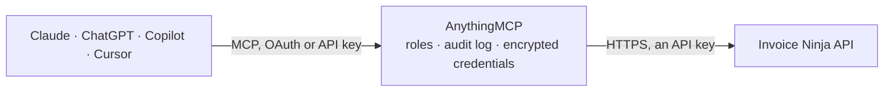

<!-- Generated by scripts/export-github-catalog.mjs in the anythingmcp-website repository. Do not edit by hand. -->

# Invoice Ninja MCP connector

Invoice Ninja: clients, invoices, quotes, recurring invoices, payments, products, expenses and projects. The AnythingMCP connector gives Claude, ChatGPT, Microsoft Copilot, Cursor and Gemini 10 MCP tools for Invoice Ninja, all read-only.

**Category:** [Accounting](../accounting.md) · **Tools:** 10 · **Setup guide:** [anythingmcp.com](https://anythingmcp.com/guides/invoice-ninja-to-mcp) · [Deutsch](https://anythingmcp.com/de/guides/invoice-ninja-to-mcp) · [Italiano](https://anythingmcp.com/it/guides/invoice-ninja-to-mcp) · [Español](https://anythingmcp.com/es/guides/invoice-ninja-to-mcp) · [日本語](https://anythingmcp.com/ja/guides/invoice-ninja-to-mcp) · [Русский](https://anythingmcp.com/ru/guides/invoice-ninja-to-mcp) · [中文](https://anythingmcp.com/zh/guides/invoice-ninja-to-mcp)

## Start without code

No installation and no terminal: AnythingMCP Cloud runs the Invoice Ninja connector for you, operated by helpcode.ai in Frankfurt, Germany.

1. **Click the button above** and create an account or sign in. The Invoice Ninja connector opens, ready to install.
2. **Paste the API key or token from your Invoice Ninja account.** Every click is in the [step-by-step guide](https://anythingmcp.com/guides/invoice-ninja-to-mcp).
3. **Click Install.** AnythingMCP shows the address of your MCP server.
4. **Add that address to your assistant:** [Claude](https://anythingmcp.com/guides/connect-invoice-ninja-to-claude) · [ChatGPT](https://anythingmcp.com/guides/connect-invoice-ninja-to-chatgpt) · [Microsoft Copilot](https://anythingmcp.com/guides/connect-invoice-ninja-to-copilot) · [Cursor](https://anythingmcp.com/guides/connect-invoice-ninja-to-cursor) · [Gemini CLI](https://anythingmcp.com/guides/connect-invoice-ninja-to-gemini) · [Meta Muse](https://anythingmcp.com/guides/connect-invoice-ninja-to-muse).
5. **Ask your first question**, for example: *What's the status and outstanding balance on invoice INV-2026-034 for Solara Tech GmbH?*

Prefer help with the setup? [Talk to us](https://anythingmcp.com/contact).

## How it works

- **The AI client** speaks MCP (Streamable HTTP) to AnythingMCP and only sees tool names, descriptions and results. It never gets the Invoice Ninja credentials.
- **AnythingMCP** checks the client's role, builds the call from the tool definition, adds the credentials (an API key), calls Invoice Ninja, logs the call and returns the result.
- **Invoice Ninja** sees an ordinary API client with the rights of the account the credentials belong to.

## Tools

| Tool | What it does | Access |
|---|---|---|
| [`invoice_ninja_list_clients`](#invoice_ninja_list_clients) | List clients with their name, contacts, balance, paid-to-date total and currency. | read |
| [`invoice_ninja_get_client`](#invoice_ninja_get_client) | Read one client in full: their contacts, addresses, payment terms, balance and the settings that override the company defaults for them. | read |
| [`invoice_ninja_list_invoices`](#invoice_ninja_list_invoices) | List invoices with their number, date, due date, client, amount and balance. | read |
| [`invoice_ninja_get_invoice`](#invoice_ninja_get_invoice) | Read one invoice in full: every line item with quantity, cost and tax, the totals, the balance outstanding and the payments applied. | read |
| [`invoice_ninja_list_quotes`](#invoice_ninja_list_quotes) | List quotes with their number, date, client, amount and status — what is out with prospects and not yet converted into an invoice. | read |
| [`invoice_ninja_list_payments`](#invoice_ninja_list_payments) | List payments with their date, amount, method, client and the invoices they were applied to — the money that actually arrived. | read |
| [`invoice_ninja_list_recurring_invoices`](#invoice_ninja_list_recurring_invoices) | List recurring invoices with their frequency, next send date, client and amount — the predictable part of the revenue. | read |
| [`invoice_ninja_list_products`](#invoice_ninja_list_products) | List products with their key, notes, cost, price, quantity and tax settings. | read |
| [`invoice_ninja_list_expenses`](#invoice_ninja_list_expenses) | List expenses with their date, vendor, category, amount and whether they have been billed to a client — the cost side of the ledger. | read |
| [`invoice_ninja_list_projects`](#invoice_ninja_list_projects) | List projects with their name, client, budgeted hours, task rate and due date — the anchor for time and profitability questions. | read |

## Tool reference

Every parameter as the AI client sees it in `tools/list`. Source: [`packages/backend/src/adapters/intl/invoice-ninja.json`](../../../packages/backend/src/adapters/intl/invoice-ninja.json).

### `invoice_ninja_list_clients`

List clients with their name, contacts, balance, paid-to-date total and currency. The quickest call for checking that the API token works.

**Access:** read · **Call:** `GET /clients`

| Parameter | Type | Required | Description |
|---|---|---|---|
| `per_page` | number | no | Rows per page (default 20). |
| `page` | number | no | Page number, starting at 1. |
| `filter` | string | no | Search fragment matched against name, e-mail and number. |
| `include` | string | no | Relationships to resolve inline, e.g. contacts. |
| `sort` | string | no | Sort expression, e.g. `name\|asc` or `balance\|desc`. |

### `invoice_ninja_get_client`

Read one client in full: their contacts, addresses, payment terms, balance and the settings that override the company defaults for them.

**Access:** read · **Call:** `GET /clients/{clientId}`

| Parameter | Type | Required | Description |
|---|---|---|---|
| `clientId` | string | yes | Invoice Ninja client hashed id. |
| `include` | string | no | Relationships to resolve inline, e.g. contacts,documents. |

### `invoice_ninja_list_invoices`

List invoices with their number, date, due date, client, amount and balance. Status 1 draft, 2 sent, 3 partial, 4 paid, 5 cancelled.

**Access:** read · **Call:** `GET /invoices`

| Parameter | Type | Required | Description |
|---|---|---|---|
| `per_page` | number | no | Rows per page (default 20). |
| `page` | number | no | Page number, starting at 1. |
| `client_id` | string | no | Restrict to one client's invoices. |
| `filter` | string | no | Search fragment matched against number and PO number. |
| `include` | string | no | Relationships to resolve inline, e.g. client. |
| `sort` | string | no | Sort expression, e.g. `date\|desc`. |

### `invoice_ninja_get_invoice`

Read one invoice in full: every line item with quantity, cost and tax, the totals, the balance outstanding and the payments applied.

**Access:** read · **Call:** `GET /invoices/{invoiceId}`

| Parameter | Type | Required | Description |
|---|---|---|---|
| `invoiceId` | string | yes | Invoice Ninja invoice hashed id. |
| `include` | string | no | Relationships to resolve inline, e.g. client,payments. |

### `invoice_ninja_list_quotes`

List quotes with their number, date, client, amount and status — what is out with prospects and not yet converted into an invoice.

**Access:** read · **Call:** `GET /quotes`

| Parameter | Type | Required | Description |
|---|---|---|---|
| `per_page` | number | no | Rows per page. |
| `page` | number | no | Page number, starting at 1. |
| `client_id` | string | no | Restrict to one client's quotes. |
| `include` | string | no | Relationships to resolve inline, e.g. client. |

### `invoice_ninja_list_payments`

List payments with their date, amount, method, client and the invoices they were applied to — the money that actually arrived.

**Access:** read · **Call:** `GET /payments`

| Parameter | Type | Required | Description |
|---|---|---|---|
| `per_page` | number | no | Rows per page. |
| `page` | number | no | Page number, starting at 1. |
| `client_id` | string | no | Restrict to one client's payments. |
| `include` | string | no | Relationships to resolve inline, e.g. client,invoices. |

### `invoice_ninja_list_recurring_invoices`

List recurring invoices with their frequency, next send date, client and amount — the predictable part of the revenue.

**Access:** read · **Call:** `GET /recurring_invoices`

| Parameter | Type | Required | Description |
|---|---|---|---|
| `per_page` | number | no | Rows per page. |
| `page` | number | no | Page number, starting at 1. |
| `client_id` | string | no | Restrict to one client. |
| `include` | string | no | Relationships to resolve inline, e.g. client. |

### `invoice_ninja_list_products`

List products with their key, notes, cost, price, quantity and tax settings.

**Access:** read · **Call:** `GET /products`

| Parameter | Type | Required | Description |
|---|---|---|---|
| `per_page` | number | no | Rows per page. |
| `page` | number | no | Page number, starting at 1. |
| `filter` | string | no | Search fragment matched against the product key and notes. |

### `invoice_ninja_list_expenses`

List expenses with their date, vendor, category, amount and whether they have been billed to a client — the cost side of the ledger.

**Access:** read · **Call:** `GET /expenses`

| Parameter | Type | Required | Description |
|---|---|---|---|
| `per_page` | number | no | Rows per page. |
| `page` | number | no | Page number, starting at 1. |
| `client_id` | string | no | Restrict to expenses billed to one client. |
| `include` | string | no | Relationships to resolve inline, e.g. client,vendor. |

### `invoice_ninja_list_projects`

List projects with their name, client, budgeted hours, task rate and due date — the anchor for time and profitability questions.

**Access:** read · **Call:** `GET /projects`

| Parameter | Type | Required | Description |
|---|---|---|---|
| `per_page` | number | no | Rows per page. |
| `page` | number | no | Page number, starting at 1. |
| `client_id` | string | no | Restrict to one client's projects. |

## Run it yourself

AnythingMCP is open source (AGPL-3.0). [Run it with Docker](../../../README.md#run-it-yourself), open **Connectors → Store**, pick **Invoice Ninja** and enter `INVOICENINJA_URL`, `INVOICENINJA_API_TOKEN`, then add your MCP server URL to the AI client.

[← Accounting connectors](../accounting.md) · [All categories](../README.md)
