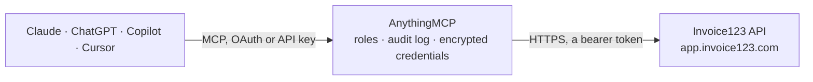

<!-- Generated by scripts/export-github-catalog.mjs in the anythingmcp-website repository. Do not edit by hand. -->

# Invoice123 MCP connector

Invoice123 (Saskaita123), invoicing for Lithuania and Latvia, read-only: sales invoices with payments, payment links and PDFs, purchases, clients, products, projects, waybills, VAT rates, series and bank accounts. The AnythingMCP connector gives Claude, ChatGPT, Microsoft Copilot, Cursor and Gemini 21 MCP tools for Invoice123, all read-only.

**Category:** [Accounting](../accounting.md) · **Tools:** 21 · **Setup guide:** [anythingmcp.com](https://anythingmcp.com/guides/invoice123-to-mcp) · [Deutsch](https://anythingmcp.com/de/guides/invoice123-to-mcp) · [Italiano](https://anythingmcp.com/it/guides/invoice123-to-mcp) · [Español](https://anythingmcp.com/es/guides/invoice123-to-mcp) · [日本語](https://anythingmcp.com/ja/guides/invoice123-to-mcp) · [Русский](https://anythingmcp.com/ru/guides/invoice123-to-mcp) · [中文](https://anythingmcp.com/zh/guides/invoice123-to-mcp)

## Start without code

No installation and no terminal: AnythingMCP Cloud runs the Invoice123 connector for you, operated by helpcode.ai in Frankfurt, Germany.

1. **Click the button above** and create an account or sign in. The Invoice123 connector opens, ready to install.
2. **Paste the API key or token from your Invoice123 account.** Every click is in the [step-by-step guide](https://anythingmcp.com/guides/invoice123-to-mcp).
3. **Click Install.** AnythingMCP shows the address of your MCP server.
4. **Add that address to your assistant:** [Claude](https://anythingmcp.com/guides/connect-invoice123-to-claude) · [ChatGPT](https://anythingmcp.com/guides/connect-invoice123-to-chatgpt) · [Microsoft Copilot](https://anythingmcp.com/guides/connect-invoice123-to-copilot) · [Cursor](https://anythingmcp.com/guides/connect-invoice123-to-cursor) · [Gemini CLI](https://anythingmcp.com/guides/connect-invoice123-to-gemini) · [Meta Muse](https://anythingmcp.com/guides/connect-invoice123-to-muse).
5. **Ask your first question**, for example: *What is the payment status of invoice INV-2026-134 for Baltic Workshop UAB?*

Prefer help with the setup? [Talk to us](https://anythingmcp.com/contact).

## How it works

- **The AI client** speaks MCP (Streamable HTTP) to AnythingMCP and only sees tool names, descriptions and results. It never gets the Invoice123 credentials.
- **AnythingMCP** checks the client's role, builds the call from the tool definition, adds the credentials (a bearer token), calls Invoice123, logs the call and returns the result.
- **Invoice123** sees an ordinary API client with the rights of the account the credentials belong to.

## Tools

| Tool | What it does | Access |
|---|---|---|
| [`invoice123_get_company`](#invoice123_get_company) | Get the company profile behind the API token (currently whether the company is VAT registered). | read |
| [`invoice123_list_invoices`](#invoice123_list_invoices) | List sales invoices with client, line items, VAT, totals, currency, payments and paid flag, 20 per page by default. | read |
| [`invoice123_list_invoice_payments`](#invoice123_list_invoice_payments) | List the payments registered for one invoice: type (transfer, cash, refund, other), cash document type and receipt number, amount, date and whether the… | read |
| [`invoice123_download_invoice_pdf`](#invoice123_download_invoice_pdf) | Download the PDF of an invoice in Lithuanian, English or Latvian; the file is handed over as an attachment. | read |
| [`invoice123_get_invoice_payment_link`](#invoice123_get_invoice_payment_link) | Get the online payment link of an invoice, when the company has a payment provider (Montonio or Paysera) enabled. | read |
| [`invoice123_list_invoice_vat_rates`](#invoice123_list_invoice_vat_rates) | List the VAT rates available on sales invoices: id, VAT code (e.g. PVM1), tariff in percent and the reverse-charge article where it applies. | read |
| [`invoice123_get_invoice_data`](#invoice123_get_invoice_data) | Get in one call the reference data used on invoices: activities, document series, bank accounts, units, VAT rates and warehouses, with their ids. | read |
| [`invoice123_list_purchases`](#invoice123_list_purchases) | List purchase invoices (expenses) with supplier, line items with expense type, VAT, totals, payments and paid flag. | read |
| [`invoice123_list_purchase_vat_rates`](#invoice123_list_purchase_vat_rates) | List the VAT rates available on purchase invoices: id, VAT code, tariff in percent and reverse-charge article. | read |
| [`invoice123_list_purchase_types`](#invoice123_list_purchase_types) | List the expense types (purchase categories) that purchase line items can carry, with their ids. | read |
| [`invoice123_download_commercial_offer_pdf`](#invoice123_download_commercial_offer_pdf) | Download the PDF of a commercial offer (quote) in Lithuanian, English or Latvian; the file is handed over as an attachment. | read |
| [`invoice123_list_clients`](#invoice123_list_clients) | List clients (customers and suppliers): id, name, company or personal code, client code, VAT code, address and country. | read |
| [`invoice123_list_products`](#invoice123_list_products) | List the product catalog: id, name, code, price, description, prime cost, type, weight and stock per warehouse. | read |
| [`invoice123_list_projects`](#invoice123_list_projects) | List projects with number, description, start and end dates and budget. | read |
| [`invoice123_list_waybills`](#invoice123_list_waybills) | List waybills (delivery notes) with type, series, receiver, carrier, load and delivery dates and the linked invoice series, at most 50 per page. | read |
| [`invoice123_list_bank_accounts`](#invoice123_list_bank_accounts) | List the company bank accounts (IBAN, bank name, code, SWIFT, default flag) that invoices show for payment. | read |
| [`invoice123_list_series`](#invoice123_list_series) | List document series (numbering ranges) with id, title and type: simple, advance, credit invoices, and the cash documents kpo, ppk, kio. | read |
| [`invoice123_list_cash_registers`](#invoice123_list_cash_registers) | List the company cash registers with register number, last receipt number and receipt pattern. | read |
| [`invoice123_list_units`](#invoice123_list_units) | List the measurement units (pcs, hours, kg...) with their ids, as used on invoice lines. | read |
| [`invoice123_list_activities`](#invoice123_list_activities) | List the business activities (for individual activity accounts) with their ids, used to filter invoices and purchases. | read |
| [`invoice123_list_email_templates`](#invoice123_list_email_templates) | List the e-mail templates the company uses to send invoices, with their ids and names. | read |

## Tool reference

Every parameter as the AI client sees it in `tools/list`. Source: [`packages/backend/src/adapters/intl/invoice123.json`](../../../packages/backend/src/adapters/intl/invoice123.json).

### `invoice123_get_company`

Get the company profile behind the API token (currently whether the company is VAT registered). Costs one call and needs no permission, so it is the connection check.

**Access:** read · **Call:** `GET /company`

No parameters.

### `invoice123_list_invoices`

List sales invoices with client, line items, VAT, totals, currency, payments and paid flag, 20 per page by default. Filter by text (number, client, product), date range, payment date range, status (paid, unpaid, partially_paid, late, draft, credit, advance, nullified...) or by client, series, project, product, activity or warehouse id. Needs the invoice:index permission.

**Access:** read · **Call:** `GET /invoices`

| Parameter | Type | Required | Description |
|---|---|---|---|
| `page` | integer | no | Page number, starting at 1. |
| `limit` | integer | no | Results per page. |
| `text` | string | no | Free text: invoice number, client name, address or code, product title or description. |
| `range` | string | no | Invoice dates: Date range as two YYYY-MM-DD dates joined by a comma, e.g. 2026-01-01,2026-03-31. |
| `payment_date` | string | no | Payment dates: Date range as two YYYY-MM-DD dates joined by a comma, e.g. 2026-01-01,2026-03-31. |
| `status` | `draft` \| `paid` \| `unpaid` \| `fully_unpaid` \| `partially_paid` \| `overpaid` \| `cash` \| `transfer` \| `simple` \| `advance` \| `credit` \| `late` \| `nullified` | no | Invoice status or kind. |
| `invoice_id` | string | no | Only this invoice id. |
| `series_id` | string | no | Series id, from invoice123_list_series. |
| `activity_id` | string | no | Activity id, from invoice123_list_activities. |
| `client_id` | string | no | Client id, from invoice123_list_clients. |
| `project_id` | string | no | Project id, from invoice123_list_projects. |
| `warehouse_id` | string | no | Warehouse id, from invoice123_get_invoice_data. |
| `product_id` | string | no | Product id, from invoice123_list_products. |
| `issued_by` | string | no | Name of the person who issued the invoice. |
| `order_number` | string | no | Order number on the invoice. |

### `invoice123_list_invoice_payments`

List the payments registered for one invoice: type (transfer, cash, refund, other), cash document type and receipt number, amount, date and whether the invoice is fully paid. Needs invoice:index.

**Access:** read · **Call:** `GET /invoices/{invoice_id}/payments`

| Parameter | Type | Required | Description |
|---|---|---|---|
| `invoice_id` | string | yes | Invoice id, from invoice123_list_invoices. |

### `invoice123_download_invoice_pdf`

Download the PDF of an invoice in Lithuanian, English or Latvian; the file is handed over as an attachment. The token needs the invoice:store permission for this route.

**Access:** read · **Call:** `GET /invoice/{invoice_id}/pdf/{language}`

| Parameter | Type | Required | Description |
|---|---|---|---|
| `invoice_id` | string | yes | Invoice id, from invoice123_list_invoices. |
| `language` | `lt` \| `en` \| `lv` | yes | Language of the PDF: lt (Lithuanian), en (English) or lv (Latvian). |

### `invoice123_get_invoice_payment_link`

Get the online payment link of an invoice, when the company has a payment provider (Montonio or Paysera) enabled. Needs invoice:index.

**Access:** read · **Call:** `GET /invoice/{invoice_id}/payment-link`

| Parameter | Type | Required | Description |
|---|---|---|---|
| `invoice_id` | string | yes | Invoice id, from invoice123_list_invoices. |

### `invoice123_list_invoice_vat_rates`

List the VAT rates available on sales invoices: id, VAT code (e.g. PVM1), tariff in percent and the reverse-charge article where it applies.

**Access:** read · **Call:** `GET /invoice/vats`

No parameters.

### `invoice123_get_invoice_data`

Get in one call the reference data used on invoices: activities, document series, bank accounts, units, VAT rates and warehouses, with their ids.

**Access:** read · **Call:** `GET /invoice-data`

| Parameter | Type | Required | Description |
|---|---|---|---|
| `types` | string | no | Only series of these types, comma-separated: simple, advance, credit, kpo, ppk, kio. |

### `invoice123_list_purchases`

List purchase invoices (expenses) with supplier, line items with expense type, VAT, totals, payments and paid flag. Filter by text, date range, type (simple, vat-simple, credit, vat-credit, foreign, other), status (paid, unpaid, partially_paid, late, nullified), expense type, activity, client (supplier) or project. Needs expense:index and the purchases module.

**Access:** read · **Call:** `GET /expenses`

| Parameter | Type | Required | Description |
|---|---|---|---|
| `page` | integer | no | Page number, starting at 1. |
| `limit` | integer | no | Results per page. |
| `text` | string | no | Free text search. |
| `range` | string | no | Purchase dates: Date range as two YYYY-MM-DD dates joined by a comma, e.g. 2026-01-01,2026-03-31. |
| `type` | `simple` \| `vat-simple` \| `credit` \| `vat-credit` \| `foreign` \| `other` | no | Purchase document type. |
| `status` | `paid` \| `unpaid` \| `partially_paid` \| `late` \| `nullified` | no | Payment status. |
| `expense_type_id` | string | no | Expense type id, from invoice123_list_purchase_types. |
| `activity_id` | string | no | Activity id, from invoice123_list_activities. |
| `client_id` | string | no | Supplier id (suppliers are clients), from invoice123_list_clients. |
| `project_id` | string | no | Project id, from invoice123_list_projects. |

### `invoice123_list_purchase_vat_rates`

List the VAT rates available on purchase invoices: id, VAT code, tariff in percent and reverse-charge article.

**Access:** read · **Call:** `GET /expense/vats`

No parameters.

### `invoice123_list_purchase_types`

List the expense types (purchase categories) that purchase line items can carry, with their ids.

**Access:** read · **Call:** `GET /expense/types`

No parameters.

### `invoice123_download_commercial_offer_pdf`

Download the PDF of a commercial offer (quote) in Lithuanian, English or Latvian; the file is handed over as an attachment. Needs the commercial:store permission and the commercial offers module.

**Access:** read · **Call:** `GET /commercial-suggestion/{offer_id}/pdf/{language}`

| Parameter | Type | Required | Description |
|---|---|---|---|
| `offer_id` | string | yes | Commercial offer id. |
| `language` | `lt` \| `en` \| `lv` | yes | Language of the PDF: lt (Lithuanian), en (English) or lv (Latvian). |

### `invoice123_list_clients`

List clients (customers and suppliers): id, name, company or personal code, client code, VAT code, address and country. Filter by name or code. Needs client:index.

**Access:** read · **Call:** `GET /clients`

| Parameter | Type | Required | Description |
|---|---|---|---|
| `page` | integer | no | Page number, starting at 1. |
| `limit` | integer | no | Results per page. |
| `name` | string | no | Client name. |
| `code` | string | no | Company code or personal identification number. |

### `invoice123_list_products`

List the product catalog: id, name, code, price, description, prime cost, type, weight and stock per warehouse. Filter by exact code. Needs product:index.

**Access:** read · **Call:** `GET /products`

| Parameter | Type | Required | Description |
|---|---|---|---|
| `page` | integer | no | Page number, starting at 1. |
| `limit` | integer | no | Results per page. |
| `code` | string | no | Product code. |

### `invoice123_list_projects`

List projects with number, description, start and end dates and budget. Projects can be linked to invoices and purchases. Needs project:index.

**Access:** read · **Call:** `GET /projects`

| Parameter | Type | Required | Description |
|---|---|---|---|
| `page` | integer | no | Page number, starting at 1. |
| `limit` | integer | no | Results per page. |

### `invoice123_list_waybills`

List waybills (delivery notes) with type, series, receiver, carrier, load and delivery dates and the linked invoice series, at most 50 per page. Needs waybills:index and the waybill module.

**Access:** read · **Call:** `GET /waybills`

| Parameter | Type | Required | Description |
|---|---|---|---|
| `page` | integer | no | Page number, starting at 1. |
| `limit` | integer | no | Results per page (at most 50). |

### `invoice123_list_bank_accounts`

List the company bank accounts (IBAN, bank name, code, SWIFT, default flag) that invoices show for payment.

**Access:** read · **Call:** `GET /banks`

No parameters.

### `invoice123_list_series`

List document series (numbering ranges) with id, title and type: simple, advance, credit invoices, and the cash documents kpo, ppk, kio.

**Access:** read · **Call:** `GET /series`

| Parameter | Type | Required | Description |
|---|---|---|---|
| `types` | string | no | Only these types, comma-separated: simple, advance, credit, kpo, ppk, kio. |

### `invoice123_list_cash_registers`

List the company cash registers with register number, last receipt number and receipt pattern.

**Access:** read · **Call:** `GET /cash-registers`

No parameters.

### `invoice123_list_units`

List the measurement units (pcs, hours, kg...) with their ids, as used on invoice lines.

**Access:** read · **Call:** `GET /units`

No parameters.

### `invoice123_list_activities`

List the business activities (for individual activity accounts) with their ids, used to filter invoices and purchases.

**Access:** read · **Call:** `GET /activities`

No parameters.

### `invoice123_list_email_templates`

List the e-mail templates the company uses to send invoices, with their ids and names.

**Access:** read · **Call:** `GET /templates`

No parameters.

## Run it yourself

AnythingMCP is open source (AGPL-3.0). [Run it with Docker](../../../README.md#run-it-yourself), open **Connectors → Store**, pick **Invoice123** and enter `INVOICE123_API_TOKEN`, then add your MCP server URL to the AI client.

[← Accounting connectors](../accounting.md) · [All categories](../README.md)
