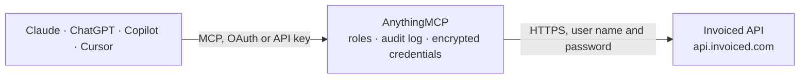

<!-- Generated by scripts/export-github-catalog.mjs in the anythingmcp-website repository. Do not edit by hand. -->

# Invoiced MCP connector

Manage Invoiced (A/R automation: customers, invoices, payments, subscriptions, credit notes) from any AI agent. 9 tools, basic-auth. The AnythingMCP connector gives Claude, ChatGPT, Microsoft Copilot, Cursor and Gemini 9 MCP tools for Invoiced: 5 read and 4 can change data.

**Category:** [Accounting](../accounting.md) · **Tools:** 9 · **Setup guide:** [anythingmcp.com](https://anythingmcp.com/guides/invoiced-to-mcp) · [Deutsch](https://anythingmcp.com/de/guides/invoiced-to-mcp) · [Italiano](https://anythingmcp.com/it/guides/invoiced-to-mcp) · [Español](https://anythingmcp.com/es/guides/invoiced-to-mcp) · [日本語](https://anythingmcp.com/ja/guides/invoiced-to-mcp) · [Русский](https://anythingmcp.com/ru/guides/invoiced-to-mcp) · [中文](https://anythingmcp.com/zh/guides/invoiced-to-mcp)

## Start without code

No installation and no terminal: AnythingMCP Cloud runs the Invoiced connector for you, operated by helpcode.ai in Frankfurt, Germany.

1. **Click the button above** and create an account or sign in. The Invoiced connector opens, ready to install.
2. **Paste the API key or token from your Invoiced account.** Every click is in the [step-by-step guide](https://anythingmcp.com/guides/invoiced-to-mcp).
3. **Click Install.** AnythingMCP shows the address of your MCP server.
4. **Add that address to your assistant:** [Claude](https://anythingmcp.com/guides/connect-invoiced-to-claude) · [ChatGPT](https://anythingmcp.com/guides/connect-invoiced-to-chatgpt) · [Microsoft Copilot](https://anythingmcp.com/guides/connect-invoiced-to-copilot) · [Cursor](https://anythingmcp.com/guides/connect-invoiced-to-cursor) · [Gemini CLI](https://anythingmcp.com/guides/connect-invoiced-to-gemini) · [Meta Muse](https://anythingmcp.com/guides/connect-invoiced-to-muse).
5. **Ask your first question**, for example: *What's the Invoiced customer record for Solterra GmbH, including primary contact and payment_terms?*

Prefer help with the setup? [Talk to us](https://anythingmcp.com/contact).

## How it works

- **The AI client** speaks MCP (Streamable HTTP) to AnythingMCP and only sees tool names, descriptions and results. It never gets the Invoiced credentials.
- **AnythingMCP** checks the client's role, builds the call from the tool definition, adds the credentials (user name and password), calls Invoiced, logs the call and returns the result.
- **Invoiced** sees an ordinary API client with the rights of the account the credentials belong to.

## Tools

| Tool | What it does | Access |
|---|---|---|
| [`invoiced_list_customers`](#invoiced_list_customers) | List customers. | read |
| [`invoiced_get_customer`](#invoiced_get_customer) | Get one customer. | read |
| [`invoiced_create_customer`](#invoiced_create_customer) | Create a customer. | write |
| [`invoiced_list_invoices`](#invoiced_list_invoices) | List invoices. | read |
| [`invoiced_get_invoice`](#invoiced_get_invoice) | Get one invoice with line items + payments. | read |
| [`invoiced_create_invoice`](#invoiced_create_invoice) | Create an invoice. | write |
| [`invoiced_send_invoice`](#invoiced_send_invoice) | Send an invoice via email to its customer. | write |
| [`invoiced_list_payments`](#invoiced_list_payments) | List payments. | read |
| [`invoiced_create_payment`](#invoiced_create_payment) | Record a payment (off-system) and optionally apply it to invoices. | write |

## Tool reference

Every parameter as the AI client sees it in `tools/list`. Source: [`packages/backend/src/adapters/intl/invoiced.json`](../../../packages/backend/src/adapters/intl/invoiced.json).

### `invoiced_list_customers`

List customers.

**Access:** read · **Call:** `GET /customers`

| Parameter | Type | Required | Description |
|---|---|---|---|
| `filter_name` | string | no | Name filter. |
| `page` | integer | no | 1-based. |
| `per_page` | integer | no | Max 100. |

### `invoiced_get_customer`

Get one customer.

**Access:** read · **Call:** `GET /customers/{id}`

| Parameter | Type | Required | Description |
|---|---|---|---|
| `id` | integer | yes | Customer ID. |

### `invoiced_create_customer`

Create a customer.

**Access:** write · **Call:** `POST /customers`

| Parameter | Type | Required | Description |
|---|---|---|---|
| `name` | string | yes | Customer or company name. |
| `email` | string | no | Email. |
| `type` | string | no | 'company' or 'person'. |
| `phone` | string | no | Phone. |
| `billing_address1` | string | no | Billing street. |
| `billing_city` | string | no | Billing city. |
| `billing_postal_code` | string | no | Billing ZIP. |
| `billing_country` | string | no | ISO 3166-1 alpha-2. |
| `payment_terms` | string | no | e.g. 'NET 30'. |
| `language` | string | no | ISO 639-1. |

### `invoiced_list_invoices`

List invoices. Filter by customer, status (draft, sent, paid, voided), date range.

**Access:** read · **Call:** `GET /invoices`

| Parameter | Type | Required | Description |
|---|---|---|---|
| `customer` | integer | no | Customer ID filter. |
| `status` | string | no | draft, not_sent, sent, paid, voided. |
| `date_from` | integer | no | UNIX epoch (seconds). |
| `date_to` | integer | no | UNIX epoch (seconds). |
| `page` | integer | no | 1-based. |
| `per_page` | integer | no | Max 100. |

### `invoiced_get_invoice`

Get one invoice with line items + payments.

**Access:** read · **Call:** `GET /invoices/{id}`

| Parameter | Type | Required | Description |
|---|---|---|---|
| `id` | integer | yes | Invoice ID. |

### `invoiced_create_invoice`

Create an invoice. `items` is an array of {name, quantity, unit_cost, description}.

**Access:** write · **Call:** `POST /invoices`

| Parameter | Type | Required | Description |
|---|---|---|---|
| `customer` | integer | yes | Customer ID. |
| `items` | any[] | yes | Line items. |
| `date` | integer | no | Invoice date UNIX epoch. |
| `due_date` | integer | no | Due UNIX epoch. |
| `currency` | string | no | ISO 4217 (lowercase). |
| `notes` | string | no | Free-text notes. |
| `payment_terms` | string | no | e.g. 'NET 30'. |
| `draft` | boolean | no | If true, create as draft. |

### `invoiced_send_invoice`

Send an invoice via email to its customer.

**Access:** write · **Call:** `POST /invoices/{id}/emails`

| Parameter | Type | Required | Description |
|---|---|---|---|
| `id` | integer | yes | Invoice ID. |
| `to` | any[] | no | Array of {name, address}. |
| `subject` | string | no | Subject. |
| `message` | string | no | Body. |

### `invoiced_list_payments`

List payments.

**Access:** read · **Call:** `GET /payments`

| Parameter | Type | Required | Description |
|---|---|---|---|
| `customer` | integer | no | Customer ID filter. |
| `invoice` | integer | no | Invoice ID filter. |
| `page` | integer | no | 1-based. |
| `per_page` | integer | no | Max 100. |

### `invoiced_create_payment`

Record a payment (off-system) and optionally apply it to invoices.

**Access:** write · **Call:** `POST /payments`

| Parameter | Type | Required | Description |
|---|---|---|---|
| `customer` | integer | yes | Customer ID. |
| `amount` | number | yes | Payment amount. |
| `currency` | string | no | ISO 4217 lowercase. |
| `method` | string | no | ach, cash, check, credit_card, wire_transfer, ... |
| `date` | integer | no | Date UNIX epoch. |
| `reference` | string | no | Reference / check number. |
| `applied_to` | any[] | no | Array of {type:'invoice', invoice: <id>, amount: <n>} entries. |

## Run it yourself

AnythingMCP is open source (AGPL-3.0). [Run it with Docker](../../../README.md#run-it-yourself), open **Connectors → Store**, pick **Invoiced** and enter `INVOICED_API_KEY`, then add your MCP server URL to the AI client.

[← Accounting connectors](../accounting.md) · [All categories](../README.md)
