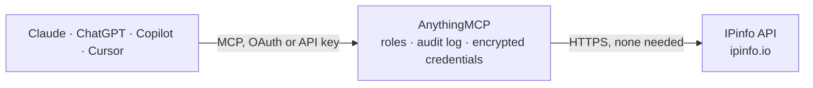

<!-- Generated by scripts/export-github-catalog.mjs in the anythingmcp-website repository. Do not edit by hand. -->

# IPinfo MCP connector

IP address intelligence from IPinfo: geolocation, ASN and owner, privacy and residential proxy detection, company, carrier, abuse contacts, hosted domains, IP ranges and WHOIS, single or batch lookups. The AnythingMCP connector gives Claude, ChatGPT, Microsoft Copilot, Cursor and Gemini 21 MCP tools for IPinfo, all read-only.

**Category:** [Data Enrichment](../enrichment.md) · **Tools:** 21 · **Setup guide:** [anythingmcp.com](https://anythingmcp.com/guides/ipinfo-to-mcp) · [Deutsch](https://anythingmcp.com/de/guides/ipinfo-to-mcp) · [Italiano](https://anythingmcp.com/it/guides/ipinfo-to-mcp) · [Español](https://anythingmcp.com/es/guides/ipinfo-to-mcp) · [日本語](https://anythingmcp.com/ja/guides/ipinfo-to-mcp) · [Русский](https://anythingmcp.com/ru/guides/ipinfo-to-mcp) · [中文](https://anythingmcp.com/zh/guides/ipinfo-to-mcp)

## Start without code

No installation and no terminal: AnythingMCP Cloud runs the IPinfo connector for you, operated by helpcode.ai in Frankfurt, Germany.

1. **Click the button above** and create an account or sign in. The IPinfo connector opens, ready to install.
2. **Nothing to enter:** this connector needs no credentials. Every click is in the [step-by-step guide](https://anythingmcp.com/guides/ipinfo-to-mcp).
3. **Click Install.** AnythingMCP shows the address of your MCP server.
4. **Add that address to your assistant:** [Claude](https://anythingmcp.com/guides/connect-ipinfo-to-claude) · [ChatGPT](https://anythingmcp.com/guides/connect-ipinfo-to-chatgpt) · [Microsoft Copilot](https://anythingmcp.com/guides/connect-ipinfo-to-copilot) · [Cursor](https://anythingmcp.com/guides/connect-ipinfo-to-cursor) · [Gemini CLI](https://anythingmcp.com/guides/connect-ipinfo-to-gemini) · [Meta Muse](https://anythingmcp.com/guides/connect-ipinfo-to-muse).
5. **Ask your first question**, for example: *What's the ASN and country for the customer IP 203.0.113.45 I'm seeing on invoice INV-2026-089?*

Prefer help with the setup? [Talk to us](https://anythingmcp.com/contact).

## How it works

- **The AI client** speaks MCP (Streamable HTTP) to AnythingMCP and only sees tool names, descriptions and results. It never gets the IPinfo credentials.
- **AnythingMCP** checks the client's role, builds the call from the tool definition, adds the credentials (none needed), calls IPinfo, logs the call and returns the result.
- **IPinfo** sees an ordinary API client with the rights of the account the credentials belong to.

## Tools

| Tool | What it does | Access |
|---|---|---|
| [`ipinfo_get_my_ip`](#ipinfo_get_my_ip) | Details of the IP address the request comes from (the AnythingMCP server's public IP): IP, hostname, city, region, country, coordinates, postal code, time… | read |
| [`ipinfo_get_ip_details`](#ipinfo_get_ip_details) | Details of an IP address from the classic IPinfo API: hostname, city, region, country, coordinates (loc, 'lat,lng'), postal code, time zone, AS number and… | read |
| [`ipinfo_get_ip_field`](#ipinfo_get_ip_field) | One field of an IP address as plain text, e.g. only the country code or the city. | read |
| [`ipinfo_lite_lookup`](#ipinfo_lite_lookup) | IPinfo Lite: country, country code, continent and ASN (number, name, domain) of an IP address. | read |
| [`ipinfo_lite_me`](#ipinfo_lite_me) | IPinfo Lite for the IP address the request comes from (the AnythingMCP server): country, continent and ASN. | read |
| [`ipinfo_lookup`](#ipinfo_lookup) | Full lookup on the current IPinfo API (Core, Plus or Max plan): geo (city, region, country, coordinates, time zone, postal code; Plus adds accuracy radius… | read |
| [`ipinfo_get_place`](#ipinfo_get_place) | Building-level place matched to an IP address (Plus or Max plan): the public place's name, category (hotel, airport, university, ...) and coordinates, when… | read |
| [`ipinfo_batch_lite`](#ipinfo_batch_lite) | Look up many IPs in one request with IPinfo Lite (free with any token): country, continent and ASN for up to 1,000 inputs. | read |
| [`ipinfo_batch`](#ipinfo_batch) | Look up many IPs or other IPinfo paths in one request (paid plans): by default each IP gets the full lookup; entries can also be fields (8.8.8.8/country),… | read |
| [`ipinfo_get_token_info`](#ipinfo_get_token_info) | Plan of the IPinfo token and its usage: requests made and remaining this day and month, and which data products (geolocation, ASN, privacy, abuse, company,… | read |
| [`ipinfo_get_asn`](#ipinfo_get_asn) | Details of an autonomous system: name, country, registry, allocation date, domain, type (isp, hosting, business, education), number of IPs, IPv4 and IPv6… | read |
| [`ipinfo_get_ip_ranges`](#ipinfo_get_ip_ranges) | IP ranges (CIDR blocks) owned by the organization behind a domain, with the number of ranges. | read |
| [`ipinfo_get_abuse_contact`](#ipinfo_get_abuse_contact) | Abuse contact of an IP address: name, e-mail, phone, postal address, country and the network it covers. | read |
| [`ipinfo_get_privacy`](#ipinfo_get_privacy) | Privacy detection for an IP address: true or false for vpn, proxy, tor, relay and hosting, and the VPN or proxy service name when known. | read |
| [`ipinfo_get_residential_proxy`](#ipinfo_get_residential_proxy) | Residential proxy detection: whether an IP was seen as an exit of a residential proxy network, which service, when it was last seen and on what share of days. | read |
| [`ipinfo_get_company`](#ipinfo_get_company) | Company behind an IP address: name, domain and type (isp, business, education, hosting, government). | read |
| [`ipinfo_get_carrier`](#ipinfo_get_carrier) | Mobile carrier of an IP address, if it is on a mobile network: carrier name, mobile country code (mcc) and mobile network code (mnc). | read |
| [`ipinfo_get_hosted_domains`](#ipinfo_get_hosted_domains) | Domains hosted on an IP address (reverse IP), with the total count. | read |
| [`ipinfo_whois_net`](#ipinfo_whois_net) | WHOIS network records found by a network id (NET-24-62-0-0-1), an IP or IP range (24.62.0.0/15), an organization domain (comcast.net) or an ASN (AS9541):… | read |
| [`ipinfo_whois_org`](#ipinfo_whois_org) | WHOIS organization records by organization id (e.g. PINEAP): name, address, country, contacts and dates. | read |
| [`ipinfo_whois_poc`](#ipinfo_whois_poc) | WHOIS point-of-contact records by POC id (e.g. CP312-ARIN): name, e-mail, phone, address and dates. | read |

## Tool reference

Every parameter as the AI client sees it in `tools/list`. Source: [`packages/backend/src/adapters/intl/ipinfo.json`](../../../packages/backend/src/adapters/intl/ipinfo.json).

### `ipinfo_get_my_ip`

Details of the IP address the request comes from (the AnythingMCP server's public IP): IP, hostname, city, region, country, coordinates, postal code, time zone and AS organization. Works without a token. Use it to check the connection.

**Access:** read · **Call:** `GET /json`

No parameters.

### `ipinfo_get_ip_details`

Details of an IP address from the classic IPinfo API: hostname, city, region, country, coordinates (loc, 'lat,lng'), postal code, time zone, AS number and organization (org, 'AS15169 Google LLC'), anycast and bogon flags. Paid and legacy plans add asn, company, privacy, abuse and domains blocks. Works without a token at a small daily allowance.

**Access:** read · **Call:** `GET /{ip}/json`

| Parameter | Type | Required | Description |
|---|---|---|---|
| `ip` | string | yes | IPv4 or IPv6 address, e.g. 8.8.8.8 or 2001:4860:4860::8888. |

### `ipinfo_get_ip_field`

One field of an IP address as plain text, e.g. only the country code or the city. The cheapest way to answer a single question about an IP.

**Access:** read · **Call:** `GET /{ip}/{field}`

| Parameter | Type | Required | Description |
|---|---|---|---|
| `ip` | string | yes | IPv4 or IPv6 address, e.g. 8.8.8.8 or 2001:4860:4860::8888. |
| `field` | `ip` \| `hostname` \| `city` \| `region` \| `country` \| `loc` \| `postal` \| `timezone` \| `org` | yes | The field to return. |

### `ipinfo_lite_lookup`

IPinfo Lite: country, country code, continent and ASN (number, name, domain) of an IP address. Free and unlimited with any IPinfo token; no city-level data.

**Access:** read · **Call:** `GET https://api.ipinfo.io/lite/{ip}`

| Parameter | Type | Required | Description |
|---|---|---|---|
| `ip` | string | yes | IPv4 or IPv6 address, e.g. 8.8.8.8 or 2001:4860:4860::8888. |

### `ipinfo_lite_me`

IPinfo Lite for the IP address the request comes from (the AnythingMCP server): country, continent and ASN. Needs a token.

**Access:** read · **Call:** `GET https://api.ipinfo.io/lite/me`

No parameters.

### `ipinfo_lookup`

Full lookup on the current IPinfo API (Core, Plus or Max plan): geo (city, region, country, coordinates, time zone, postal code; Plus adds accuracy radius and geoname id), as (ASN, name, domain, type such as isp or hosting), mobile carrier, anonymous (VPN, proxy, relay, Tor) and the is_anonymous, is_anycast, is_hosting, is_mobile and is_satellite flags. A free token answers 403: use ipinfo_lite_lookup.

**Access:** read · **Call:** `GET https://api.ipinfo.io/lookup/{ip}`

| Parameter | Type | Required | Description |
|---|---|---|---|
| `ip` | string | yes | IPv4 or IPv6 address, e.g. 8.8.8.8 or 2001:4860:4860::8888. |

### `ipinfo_get_place`

Building-level place matched to an IP address (Plus or Max plan): the public place's name, category (hotel, airport, university, ...) and coordinates, when the IP belongs to one.

**Access:** read · **Call:** `GET https://api.ipinfo.io/places/{ip}`

| Parameter | Type | Required | Description |
|---|---|---|---|
| `ip` | string | yes | IPv4 or IPv6 address, e.g. 8.8.8.8 or 2001:4860:4860::8888. |

### `ipinfo_batch_lite`

Look up many IPs in one request with IPinfo Lite (free with any token): country, continent and ASN for up to 1,000 inputs. Returns an object keyed by input. A read, although sent as POST.

**Access:** read · **Call:** `POST https://api.ipinfo.io/batch/lite`

| Parameter | Type | Required | Description |
|---|---|---|---|
| `ips` | string[] | yes | Up to 1,000 IP addresses, or IP/field such as 8.8.8.8/country. |
| `filter` | boolean | no | true leaves out inputs that have no answer (e.g. IPs without a hostname). |

### `ipinfo_batch`

Look up many IPs or other IPinfo paths in one request (paid plans): by default each IP gets the full lookup; entries can also be fields (8.8.8.8/country), ASNs (AS15169), residential proxy checks (resproxy/1.1.1.1) or Lite lookups (lite/8.8.4.4). Up to 1,000 inputs, answer keyed by input. A read, although sent as POST.

**Access:** read · **Call:** `POST https://api.ipinfo.io/batch`

| Parameter | Type | Required | Description |
|---|---|---|---|
| `ips` | string[] | yes | Up to 1,000 inputs. Each is an IP (8.8.8.8), an IP with a field (8.8.8.8/country), or another lookup path (AS15169, resproxy/1.1.1.1, lite/8.8.4.4). |
| `filter` | boolean | no | true leaves out inputs that have no answer (e.g. IPs without a hostname). |

### `ipinfo_get_token_info`

Plan of the IPinfo token and its usage: requests made and remaining this day and month, and which data products (geolocation, ASN, privacy, abuse, company, carrier, domains, ...) the token can use. Needs a token.

**Access:** read · **Call:** `GET /me`

No parameters.

### `ipinfo_get_asn`

Details of an autonomous system: name, country, registry, allocation date, domain, type (isp, hosting, business, education), number of IPs, IPv4 and IPv6 prefixes, peers, upstreams and downstreams. Large ASNs return long prefix lists. Enterprise or ASN API access.

**Access:** read · **Call:** `GET /AS{asn}`

| Parameter | Type | Required | Description |
|---|---|---|---|
| `asn` | integer | yes | AS number without the AS prefix, e.g. 15169. |

### `ipinfo_get_ip_ranges`

IP ranges (CIDR blocks) owned by the organization behind a domain, with the number of ranges. Enterprise or IP Ranges API access.

**Access:** read · **Call:** `GET /ranges/{domain}`

| Parameter | Type | Required | Description |
|---|---|---|---|
| `domain` | string | yes | Organization domain, e.g. nytimes.com. |

### `ipinfo_get_abuse_contact`

Abuse contact of an IP address: name, e-mail, phone, postal address, country and the network it covers. Use it to report malicious activity. Business, enterprise or Abuse API access.

**Access:** read · **Call:** `GET /{ip}/abuse`

| Parameter | Type | Required | Description |
|---|---|---|---|
| `ip` | string | yes | IPv4 or IPv6 address, e.g. 8.8.8.8 or 2001:4860:4860::8888. |

### `ipinfo_get_privacy`

Privacy detection for an IP address: true or false for vpn, proxy, tor, relay and hosting, and the VPN or proxy service name when known. Business, enterprise or Privacy API access.

**Access:** read · **Call:** `GET /{ip}/privacy`

| Parameter | Type | Required | Description |
|---|---|---|---|
| `ip` | string | yes | IPv4 or IPv6 address, e.g. 8.8.8.8 or 2001:4860:4860::8888. |

### `ipinfo_get_residential_proxy`

Residential proxy detection: whether an IP was seen as an exit of a residential proxy network, which service, when it was last seen and on what share of days. Needs the residential proxy add-on.

**Access:** read · **Call:** `GET /resproxy/{ip}`

| Parameter | Type | Required | Description |
|---|---|---|---|
| `ip` | string | yes | IPv4 or IPv6 address, e.g. 8.8.8.8 or 2001:4860:4860::8888. |

### `ipinfo_get_company`

Company behind an IP address: name, domain and type (isp, business, education, hosting, government). Business, enterprise or Company API access.

**Access:** read · **Call:** `GET /{ip}/company`

| Parameter | Type | Required | Description |
|---|---|---|---|
| `ip` | string | yes | IPv4 or IPv6 address, e.g. 8.8.8.8 or 2001:4860:4860::8888. |

### `ipinfo_get_carrier`

Mobile carrier of an IP address, if it is on a mobile network: carrier name, mobile country code (mcc) and mobile network code (mnc). Empty for non-mobile IPs.

**Access:** read · **Call:** `GET /{ip}/carrier`

| Parameter | Type | Required | Description |
|---|---|---|---|
| `ip` | string | yes | IPv4 or IPv6 address, e.g. 8.8.8.8 or 2001:4860:4860::8888. |

### `ipinfo_get_hosted_domains`

Domains hosted on an IP address (reverse IP), with the total count. 100 per page by default, up to 1,000 per page. Business, enterprise or Hosted Domains API access.

**Access:** read · **Call:** `GET /domains/{ip}`

| Parameter | Type | Required | Description |
|---|---|---|---|
| `ip` | string | yes | IPv4 or IPv6 address, e.g. 8.8.8.8 or 2001:4860:4860::8888. |
| `page` | integer | no | Page number, starting at 0. |
| `limit` | integer | no | Domains per page, 1 to 1000 (default 100). |

### `ipinfo_whois_net`

WHOIS network records found by a network id (NET-24-62-0-0-1), an IP or IP range (24.62.0.0/15), an organization domain (comcast.net) or an ASN (AS9541): range, name, organization, country, status, abuse and admin contacts and dates. 50 records per page. Enterprise or Whois API access.

**Access:** read · **Call:** `GET /whois/net/{query}`

| Parameter | Type | Required | Description |
|---|---|---|---|
| `query` | string | yes | Net id, IP, IP range in CIDR notation, domain, or ASN with the AS prefix. |
| `page` | integer | no | Page number, starting at 0. |
| `source` | `arin` \| `ripe` \| `afrinic` \| `apnic` \| `lacnic` | no | Only records from this regional registry. |

### `ipinfo_whois_org`

WHOIS organization records by organization id (e.g. PINEAP): name, address, country, contacts and dates. 50 records per page. Enterprise or Whois API access.

**Access:** read · **Call:** `GET /whois/org/{org_id}`

| Parameter | Type | Required | Description |
|---|---|---|---|
| `org_id` | string | yes | WHOIS organization (ORG) id. |
| `page` | integer | no | Page number, starting at 0. |
| `source` | `arin` \| `ripe` \| `afrinic` \| `apnic` \| `lacnic` | no | Only records from this regional registry. |

### `ipinfo_whois_poc`

WHOIS point-of-contact records by POC id (e.g. CP312-ARIN): name, e-mail, phone, address and dates. 50 records per page. Enterprise or Whois API access.

**Access:** read · **Call:** `GET /whois/poc/{poc_id}`

| Parameter | Type | Required | Description |
|---|---|---|---|
| `poc_id` | string | yes | WHOIS point of contact (POC) id. |
| `page` | integer | no | Page number, starting at 0. |
| `source` | `arin` \| `ripe` \| `afrinic` \| `apnic` \| `lacnic` | no | Only records from this regional registry. |

## Run it yourself

AnythingMCP is open source (AGPL-3.0). [Run it with Docker](../../../README.md#run-it-yourself), open **Connectors → Store**, pick **IPinfo**, then add your MCP server URL to the AI client.

[← Data Enrichment connectors](../enrichment.md) · [All categories](../README.md)
