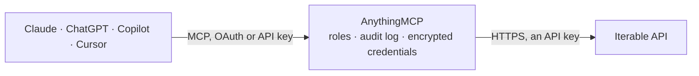

<!-- Generated by scripts/export-github-catalog.mjs in the anythingmcp-website repository. Do not edit by hand. -->

# Iterable MCP connector

Let your AI work with Iterable: look up users, their events and messages, review lists, campaigns and campaign metrics, templates and catalogs, update profiles, track events, manage list membership … The AnythingMCP connector gives Claude, ChatGPT, Microsoft Copilot, Cursor and Gemini 23 MCP tools for Iterable: 16 read and 7 can change data.

**Category:** [Marketing Automation](../marketing-automation.md) · **Tools:** 23 · **Setup guide:** [anythingmcp.com](https://anythingmcp.com/guides/iterable-to-mcp) · [Deutsch](https://anythingmcp.com/de/guides/iterable-to-mcp) · [Italiano](https://anythingmcp.com/it/guides/iterable-to-mcp) · [Español](https://anythingmcp.com/es/guides/iterable-to-mcp) · [日本語](https://anythingmcp.com/ja/guides/iterable-to-mcp) · [Русский](https://anythingmcp.com/ru/guides/iterable-to-mcp) · [中文](https://anythingmcp.com/zh/guides/iterable-to-mcp)

## Start without code

No installation and no terminal: AnythingMCP Cloud runs the Iterable connector for you, operated by helpcode.ai in Frankfurt, Germany.

1. **Click the button above** and create an account or sign in. The Iterable connector opens, ready to install.
2. **Paste the API key or token from your Iterable account.** Every click is in the [step-by-step guide](https://anythingmcp.com/guides/iterable-to-mcp).
3. **Click Install.** AnythingMCP shows the address of your MCP server.
4. **Add that address to your assistant:** [Claude](https://anythingmcp.com/guides/connect-iterable-to-claude) · [ChatGPT](https://anythingmcp.com/guides/connect-iterable-to-chatgpt) · [Microsoft Copilot](https://anythingmcp.com/guides/connect-iterable-to-copilot) · [Cursor](https://anythingmcp.com/guides/connect-iterable-to-cursor) · [Gemini CLI](https://anythingmcp.com/guides/connect-iterable-to-gemini) · [Meta Muse](https://anythingmcp.com/guides/connect-iterable-to-muse).
5. **Ask your first question**, for example: *Show me the Iterable profile for finance@solara-ev.eu — I need their userId and any invoice fields.*

Prefer help with the setup? [Talk to us](https://anythingmcp.com/contact).

## How it works

- **The AI client** speaks MCP (Streamable HTTP) to AnythingMCP and only sees tool names, descriptions and results. It never gets the Iterable credentials.
- **AnythingMCP** checks the client's role, builds the call from the tool definition, adds the credentials (an API key), calls Iterable, logs the call and returns the result.
- **Iterable** sees an ordinary API client with the rights of the account the credentials belong to.

## Tools

| Tool | What it does | Access |
|---|---|---|
| [`iterable_list_lists`](#iterable_list_lists) | List the user lists of the Iterable project: id, name, type (Standard, Dynamic, Suppression, Internal), description and creation time (epoch milliseconds). | read |
| [`iterable_get_list_size`](#iterable_get_list_size) | Count the users in one Iterable list. | read |
| [`iterable_list_list_users`](#iterable_list_list_users) | Get the users of one Iterable list as plain text, one email (or userId) per line. | read |
| [`iterable_get_user_by_email`](#iterable_get_user_by_email) | Get an Iterable user profile by email: email, userId and all dataFields (profile fields, subscription and channel settings, signup date and custom fields). | read |
| [`iterable_get_user_by_id`](#iterable_get_user_by_id) | Get an Iterable user profile by userId: email, userId and all dataFields. | read |
| [`iterable_get_user_events_by_email`](#iterable_get_user_events_by_email) | Get the latest events of an Iterable user by email, newest first: custom events, purchases, email sends, opens, clicks, bounces, unsubscribes, push and… | read |
| [`iterable_get_user_events_by_user_id`](#iterable_get_user_events_by_user_id) | Get the latest events of an Iterable user by userId, newest first: custom events, purchases, message sends, opens, clicks, bounces and unsubscribes with… | read |
| [`iterable_get_sent_messages`](#iterable_get_sent_messages) | List the messages Iterable sent to a user (by email or userId): message id, campaign id, template id and time, optionally filtered by campaign, medium and… | read |
| [`iterable_list_campaigns`](#iterable_list_campaigns) | List the campaigns of the Iterable project, a page at a time: id, name, type (Blast or Triggered), state, message medium, template, lists, labels, created,… | read |
| [`iterable_get_campaign`](#iterable_get_campaign) | Get one Iterable campaign by id: name, type, state, message medium, template id, send size, lists and suppression lists, labels, workflow, created, updated,… | read |
| [`iterable_get_campaign_metrics`](#iterable_get_campaign_metrics) | Get campaign metrics from Iterable as CSV text: one row per campaign with columns such as total sends, deliveries, unique opens and clicks, bounces,… | read |
| [`iterable_list_templates`](#iterable_list_templates) | List the message templates of the Iterable project, a page at a time: template id, name, message type, campaign, creator, created and updated times. | read |
| [`iterable_list_channels`](#iterable_list_channels) | List the message channels of the Iterable project: id, name, channel type (Marketing or Transactional) and medium (Email, Push, SMS). | read |
| [`iterable_list_message_types`](#iterable_list_message_types) | List the message types of the Iterable project: id, name, channel id, subscription policy (opt-in or opt-out), frequency cap and rate limit. | read |
| [`iterable_list_catalogs`](#iterable_list_catalogs) | List the catalog names of the Iterable project (catalogs hold products, articles or other items used for personalization). | read |
| [`iterable_list_catalog_items`](#iterable_list_catalog_items) | List the items of one Iterable catalog, a page at a time: item id, last modified time and the item's fields. | read |
| [`iterable_update_user`](#iterable_update_user) | Create or update an Iterable user profile by email or userId: the dataFields given are merged into the profile, missing fields are kept. | write |
| [`iterable_track_event`](#iterable_track_event) | Record a custom event for an Iterable user (by email or userId), such as a signup, a booking or a page view, with its data. | write |
| [`iterable_subscribe_to_list`](#iterable_subscribe_to_list) | Add users to a static Iterable list (by email or userId), creating profiles that do not exist unless update_existing_users_only is true. | write |
| [`iterable_unsubscribe_from_list`](#iterable_unsubscribe_from_list) | Remove users from a static Iterable list (by email or userId). | write |
| [`iterable_send_email`](#iterable_send_email) | Send the email of a triggered Iterable campaign to one user (by email or userId), now or at send_at, with dataFields for the template. | write |
| [`iterable_delete_user_by_email`](#iterable_delete_user_by_email) | Delete an Iterable user by email, asynchronously (email-based and hybrid projects). | write |
| [`iterable_delete_user_by_user_id`](#iterable_delete_user_by_user_id) | Delete Iterable users by userId, asynchronously; every profile with that userId is removed for good. | write |

## Tool reference

Every parameter as the AI client sees it in `tools/list`. Source: [`packages/backend/src/adapters/intl/iterable.json`](../../../packages/backend/src/adapters/intl/iterable.json).

### `iterable_list_lists`

List the user lists of the Iterable project: id, name, type (Standard, Dynamic, Suppression, Internal), description and creation time (epoch milliseconds). Read-only.

**Access:** read · **Call:** `GET /api/lists`

No parameters.

### `iterable_get_list_size`

Count the users in one Iterable list. Iterable allows only 5 calls a minute per project. Read-only.

**Access:** read · **Call:** `GET /api/lists/{list_id}/size`

| Parameter | Type | Required | Description |
|---|---|---|---|
| `list_id` | integer | yes | List id from iterable_list_lists. |

### `iterable_list_list_users`

Get the users of one Iterable list as plain text, one email (or userId) per line. Large lists are cut at about 100 KB; use iterable_get_list_size first. Iterable allows only 5 calls a minute per project. Read-only.

**Access:** read · **Call:** `GET /api/lists/getUsers`

| Parameter | Type | Required | Description |
|---|---|---|---|
| `list_id` | integer | yes | List id from iterable_list_lists. |
| `prefer_user_id` | boolean | no | In hybrid projects, return the userId instead of the email when a profile has both. |

### `iterable_get_user_by_email`

Get an Iterable user profile by email: email, userId and all dataFields (profile fields, subscription and channel settings, signup date and custom fields). Read-only.

**Access:** read · **Call:** `GET /api/users/getByEmail`

| Parameter | Type | Required | Description |
|---|---|---|---|
| `email` | string | yes | The user's email address. |

### `iterable_get_user_by_id`

Get an Iterable user profile by userId: email, userId and all dataFields. Read-only.

**Access:** read · **Call:** `GET /api/users/byUserId`

| Parameter | Type | Required | Description |
|---|---|---|---|
| `user_id` | string | yes | The user's userId. |

### `iterable_get_user_events_by_email`

Get the latest events of an Iterable user by email, newest first: custom events, purchases, email sends, opens, clicks, bounces, unsubscribes, push and in-app events with their data. Read-only.

**Access:** read · **Call:** `GET /api/events/{email}`

| Parameter | Type | Required | Description |
|---|---|---|---|
| `email` | string | yes | The user's email address. |
| `limit` | integer | no | How many events, up to 200. Default 30. |

### `iterable_get_user_events_by_user_id`

Get the latest events of an Iterable user by userId, newest first: custom events, purchases, message sends, opens, clicks, bounces and unsubscribes with their data. Read-only.

**Access:** read · **Call:** `GET /api/events/byUserId/{user_id}`

| Parameter | Type | Required | Description |
|---|---|---|---|
| `user_id` | string | yes | The user's userId. |
| `limit` | integer | no | How many events, up to 200. Default 30. |

### `iterable_get_sent_messages`

List the messages Iterable sent to a user (by email or userId): message id, campaign id, template id and time, optionally filtered by campaign, medium and date range. Iterable allows 3 calls a second. Read-only.

**Access:** read · **Call:** `GET /api/users/getSentMessages`

| Parameter | Type | Required | Description |
|---|---|---|---|
| `email` | string | no | The user's email address. Give email or user_id (not both), depending on how the project identifies users. |
| `user_id` | string | no | The user's userId. Give email or user_id (not both). |
| `limit` | integer | no | How many messages, up to 1000. Default 10. |
| `campaign_ids` | integer[] | no | Only messages from these campaign ids. |
| `message_medium` | `Email` \| `Push` \| `InApp` \| `SMS` | no | Only this channel. |
| `start_date_time` | string | no | Only messages from this time on, yyyy-MM-dd HH:mm:ss ZZ. |
| `end_date_time` | string | no | Only messages before this time, yyyy-MM-dd HH:mm:ss ZZ. |
| `exclude_blast_campaigns` | boolean | no | Leave out blast (one-time) campaigns. Ignored when campaign_ids is set. |

### `iterable_list_campaigns`

List the campaigns of the Iterable project, a page at a time: id, name, type (Blast or Triggered), state, message medium, template, lists, labels, created, updated, start and end times. Read-only.

**Access:** read · **Call:** `GET /api/campaigns`

| Parameter | Type | Required | Description |
|---|---|---|---|
| `page` | integer | no | Page number, starting at 1. Default 1. |
| `page_size` | integer | no | Campaigns per page, up to 1000. Default 50. |
| `sort` | string | no | Sort field with optional - for descending: id, name, createdAt, updatedAt or startAt, e.g. -createdAt. |
| `campaign_state` | string[] | no | Only campaigns in these states: Draft, Ready, Scheduled, Running, Finished, Starting, Aborted, Recurring, Archived. |

### `iterable_get_campaign`

Get one Iterable campaign by id: name, type, state, message medium, template id, send size, lists and suppression lists, labels, workflow, created, updated, start and end times. Read-only.

**Access:** read · **Call:** `GET /api/campaigns/{campaign_id}`

| Parameter | Type | Required | Description |
|---|---|---|---|
| `campaign_id` | integer | yes | Campaign id from iterable_list_campaigns. |

### `iterable_get_campaign_metrics`

Get campaign metrics from Iterable as CSV text: one row per campaign with columns such as total sends, deliveries, unique opens and clicks, bounces, complaints, unsubscribes, purchases and revenue (the columns depend on the medium). Iterable allows only 10 calls a minute per project. Read-only.

**Access:** read · **Call:** `GET /api/campaigns/metrics`

| Parameter | Type | Required | Description |
|---|---|---|---|
| `campaign_ids` | integer[] | yes | Campaign ids to report on. |
| `start_date_time` | string | no | Only activity from this time on, YYYY-MM-DD or ISO 8601. |
| `end_date_time` | string | no | Only activity before this time, YYYY-MM-DD or ISO 8601. |

### `iterable_list_templates`

List the message templates of the Iterable project, a page at a time: template id, name, message type, campaign, creator, created and updated times. Filter by template type and message medium. Read-only.

**Access:** read · **Call:** `GET /api/templates`

| Parameter | Type | Required | Description |
|---|---|---|---|
| `template_type` | `Base` \| `Blast` \| `Triggered` \| `Workflow` | no | Only this template type. |
| `message_medium` | `Email` \| `Push` \| `InApp` \| `SMS` | no | Only this channel. |
| `start_date_time` | string | no | Templates created at or after this time, yyyy-MM-dd HH:mm:ss. |
| `end_date_time` | string | no | Templates created before this time, yyyy-MM-dd HH:mm:ss. |
| `page` | integer | no | Page number, starting at 1. Default 1. |
| `page_size` | integer | no | Templates per page, up to 1000. Default 50. |
| `sort` | string | no | Sort field with optional - for descending: id, name, createdAt or updatedAt. |

### `iterable_list_channels`

List the message channels of the Iterable project: id, name, channel type (Marketing or Transactional) and medium (Email, Push, SMS). Read-only.

**Access:** read · **Call:** `GET /api/channels`

No parameters.

### `iterable_list_message_types`

List the message types of the Iterable project: id, name, channel id, subscription policy (opt-in or opt-out), frequency cap and rate limit. Users subscribe and unsubscribe per message type. Read-only.

**Access:** read · **Call:** `GET /api/messageTypes`

No parameters.

### `iterable_list_catalogs`

List the catalog names of the Iterable project (catalogs hold products, articles or other items used for personalization). Read-only.

**Access:** read · **Call:** `GET /api/catalogs`

| Parameter | Type | Required | Description |
|---|---|---|---|
| `page` | integer | no | Page number, starting at 1. |
| `page_size` | integer | no | Catalogs per page. Default 10. |

### `iterable_list_catalog_items`

List the items of one Iterable catalog, a page at a time: item id, last modified time and the item's fields. Read-only.

**Access:** read · **Call:** `GET /api/catalogs/{catalog_name}/items`

| Parameter | Type | Required | Description |
|---|---|---|---|
| `catalog_name` | string | yes | Catalog name from iterable_list_catalogs. |
| `page` | integer | no | Page number, starting at 1. |
| `page_size` | integer | no | Items per page. Default 10. |
| `order_by` | string | no | Field to order by (it needs a defined type to sort ascending). |
| `sort_ascending` | boolean | no | Sort ascending instead of descending. |

### `iterable_update_user`

Create or update an Iterable user profile by email or userId: the dataFields given are merged into the profile, missing fields are kept. Changed fields can move the user into dynamic lists and start journeys, so show the user what will be written and confirm before calling.

**Access:** write · **Call:** `POST /api/users/update`

| Parameter | Type | Required | Description |
|---|---|---|---|
| `email` | string | no | The user's email address. Give email or user_id (not both), depending on how the project identifies users. |
| `user_id` | string | no | The user's userId. Give email or user_id (not both). |
| `data_fields` | object | no | Fields to set on the profile, e.g. {"firstName": "Ada", "plan": "pro"}. Types must match the project's existing fields. |
| `prefer_user_id` | boolean | no | With a userId that does not exist yet, create a new user with it. Default false. |
| `merge_nested_objects` | boolean | no | Merge nested objects instead of replacing them. Default false. |

### `iterable_track_event`

Record a custom event for an Iterable user (by email or userId), such as a signup, a booking or a page view, with its data. Events can trigger journeys that send messages, so confirm the event name, the user and the data with the user before calling.

**Access:** write · **Call:** `POST /api/events/track`

| Parameter | Type | Required | Description |
|---|---|---|---|
| `event_name` | string | yes | Name of the event, e.g. trial_started. |
| `email` | string | no | The user's email address. Give email or user_id (not both), depending on how the project identifies users. |
| `user_id` | string | no | The user's userId. Give email or user_id (not both). |
| `data_fields` | object | no | Data of the event; same-named fields must keep the same type across events. |
| `created_at` | integer | no | When it happened, Unix timestamp in seconds. Default: now. |
| `id` | string | no | Optional event id; sending the same id again updates that event instead of adding one. |
| `campaign_id` | integer | no | Campaign the event is attributed to, for conversions. |
| `template_id` | integer | no | Template the event is attributed to. |

### `iterable_subscribe_to_list`

Add users to a static Iterable list (by email or userId), creating profiles that do not exist unless update_existing_users_only is true. Lists drive who receives blast campaigns, so confirm the list and the users with the user before calling.

**Access:** write · **Call:** `POST /api/lists/subscribe`

| Parameter | Type | Required | Description |
|---|---|---|---|
| `list_id` | integer | yes | Id of a Standard list from iterable_list_lists. |
| `subscribers` | object[] | yes | Users to add: [{"email": "ada@example.com", "dataFields": {...}}] or with "userId". |
| `update_existing_users_only` | boolean | no | Skip users that do not exist yet instead of creating them. Default false. |

### `iterable_unsubscribe_from_list`

Remove users from a static Iterable list (by email or userId). With channel_unsubscribe true they are also unsubscribed from the list's channel, which works like a global unsubscribe. Confirm the list, the users and the channel option with the user before calling.

**Access:** write · **Call:** `POST /api/lists/unsubscribe`

| Parameter | Type | Required | Description |
|---|---|---|---|
| `list_id` | integer | yes | Id of a Standard list from iterable_list_lists. |
| `subscribers` | object[] | yes | Users to remove: [{"email": "ada@example.com"}] or [{"userId": "u1"}]. |
| `campaign_id` | integer | no | Campaign to attribute the unsubscribe to. |
| `channel_unsubscribe` | boolean | no | Also unsubscribe them from the list's channel (a global unsubscribe for that channel). Default false. |

### `iterable_send_email`

Send the email of a triggered Iterable campaign to one user (by email or userId), now or at send_at, with dataFields for the template. This sends a real email. Show the user the campaign, the recipient and the data first, and call only after the user confirms. Sending to many people is done with campaigns in Iterable, not with this tool.

**Access:** write · **Call:** `POST /api/email/target`

| Parameter | Type | Required | Description |
|---|---|---|---|
| `campaign_id` | integer | yes | Id of a triggered email campaign from iterable_list_campaigns. |
| `recipient_email` | string | no | Recipient's email. Give this or recipient_user_id. |
| `recipient_user_id` | string | no | Recipient's userId. Give this or recipient_email. |
| `data_fields` | object | no | Values merged into the email template; they override profile fields of the same name. |
| `send_at` | string | no | Schedule for later, YYYY-MM-DD HH:MM:SS in UTC, up to 365 days ahead. Leave out to send now. |
| `allow_repeat_marketing_sends` | boolean | no | Allow sending a marketing message to someone who already got it. Default true. |
| `metadata` | object | no | Data passed back in webhooks, not used for rendering. |

### `iterable_delete_user_by_email`

Delete an Iterable user by email, asynchronously (email-based and hybrid projects). The profile and its data are removed for good, and future data about the user is still collected. Installed switched off: an administrator turns it on deliberately. Show the profile with iterable_get_user_by_email first and only call this after the user confirms the exact address.

**Access:** write · **Call:** `DELETE /api/users/{email}`

| Parameter | Type | Required | Description |
|---|---|---|---|
| `email` | string | yes | Email of the user to delete, exactly as confirmed by the user. |

### `iterable_delete_user_by_user_id`

Delete Iterable users by userId, asynchronously; every profile with that userId is removed for good. Installed switched off: an administrator turns it on deliberately. Show the profile with iterable_get_user_by_id first and only call this after the user confirms the exact userId.

**Access:** write · **Call:** `DELETE /api/users/byUserId/{user_id}`

| Parameter | Type | Required | Description |
|---|---|---|---|
| `user_id` | string | yes | userId of the user to delete, exactly as confirmed by the user. |

## Run it yourself

AnythingMCP is open source (AGPL-3.0). [Run it with Docker](../../../README.md#run-it-yourself), open **Connectors → Store**, pick **Iterable** and enter `ITERABLE_API_URL`, `ITERABLE_API_KEY`, then add your MCP server URL to the AI client.

[← Marketing Automation connectors](../marketing-automation.md) · [All categories](../README.md)
