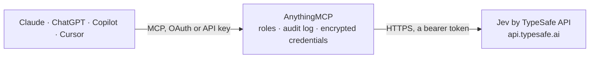

<!-- Generated by scripts/export-github-catalog.mjs in the anythingmcp-website repository. Do not edit by hand. -->

# Jev by TypeSafe MCP connector

Fast, cheap yes/no, classification and rating decisions for AI agents with Jev, TypeSafe's System One model: typed answers with calibrated probabilities in about 300 ms, instead of a paragraph to parse. The AnythingMCP connector gives Claude, ChatGPT, Microsoft Copilot, Cursor and Gemini 6 MCP tools for Jev by TypeSafe, all read-only.

**Category:** [Public Data](../data.md) · **Tools:** 6 · **Setup guide:** [anythingmcp.com](https://anythingmcp.com/guides/jev-to-mcp) · [Deutsch](https://anythingmcp.com/de/guides/jev-to-mcp) · [Italiano](https://anythingmcp.com/it/guides/jev-to-mcp) · [Español](https://anythingmcp.com/es/guides/jev-to-mcp) · [日本語](https://anythingmcp.com/ja/guides/jev-to-mcp) · [Русский](https://anythingmcp.com/ru/guides/jev-to-mcp) · [中文](https://anythingmcp.com/zh/guides/jev-to-mcp)

## Start without code

No installation and no terminal: AnythingMCP Cloud runs the Jev by TypeSafe connector for you, operated by helpcode.ai in Frankfurt, Germany.

1. **Click the button above** and create an account or sign in. The Jev by TypeSafe connector opens, ready to install.
2. **Paste the API key or token from your Jev by TypeSafe account.** Every click is in the [step-by-step guide](https://anythingmcp.com/guides/jev-to-mcp).
3. **Click Install.** AnythingMCP shows the address of your MCP server.
4. **Add that address to your assistant:** [Claude](https://anythingmcp.com/guides/connect-jev-to-claude) · [ChatGPT](https://anythingmcp.com/guides/connect-jev-to-chatgpt) · [Microsoft Copilot](https://anythingmcp.com/guides/connect-jev-to-copilot) · [Cursor](https://anythingmcp.com/guides/connect-jev-to-cursor) · [Gemini CLI](https://anythingmcp.com/guides/connect-jev-to-gemini) · [Meta Muse](https://anythingmcp.com/guides/connect-jev-to-muse).
5. **Ask your first question**, for example: *Is support ticket TKT-2026-045 (customer: Numenix GmbH) urgent? Ticket text: 'API producing 500s for 20 minutes, major customers affected.'*

Prefer help with the setup? [Talk to us](https://anythingmcp.com/contact).

## How it works

- **The AI client** speaks MCP (Streamable HTTP) to AnythingMCP and only sees tool names, descriptions and results. It never gets the Jev by TypeSafe credentials.
- **AnythingMCP** checks the client's role, builds the call from the tool definition, adds the credentials (a bearer token), calls Jev by TypeSafe, logs the call and returns the result.
- **Jev by TypeSafe** sees an ordinary API client with the rights of the account the credentials belong to.

## Tools

| Tool | What it does | Access |
|---|---|---|
| [`jev_playbook`](#jev_playbook) | START HERE: returns, with NO API call, how to use Jev well: which question type to pick, how to structure state, how to write the question, how to read… | read |
| [`jev_yes_no`](#jev_yes_no) | Ask Jev ONE yes/no question about some evidence. | read |
| [`jev_classify`](#jev_classify) | Ask Jev to pick ONE option from a set you define (routing, labelling, intent, triage). | read |
| [`jev_rate`](#jev_rate) | Ask Jev to place the evidence on an ordered scale you define (severity, lead fit, quality, sentiment). | read |
| [`jev_ask`](#jev_ask) | Full Jev API: ask SEVERAL typed questions about the same state in one call (answered in parallel, state billed once). | read |
| [`jev_list_models`](#jev_list_models) | List the Jev model names your API key can use in the `model` field (aliases such as jev-latest and jev-preview, with release dates). | read |

## Tool reference

Every parameter as the AI client sees it in `tools/list`. Source: [`packages/backend/src/adapters/intl/jev.json`](../../../packages/backend/src/adapters/intl/jev.json).

### `jev_playbook`

START HERE: returns, with NO API call, how to use Jev well: which question type to pick, how to structure state, how to write the question, how to read probabilities and confidence, and patterns such as confidence gating and asking many questions in one call.

**Access:** read · **Call:** `static /`

No parameters.

### `jev_yes_no`

Ask Jev ONE yes/no question about some evidence. Returns `noul`: the probability (0 to 1) that the answer is yes; near 0.5 means unsure. Use for checks and guardrails: is this urgent, is this spam, does this reply answer the question, does this document mention X. See jev_playbook.

**Access:** read · **Call:** `POST /v1/systemone`

| Parameter | Type | Required | Description |
|---|---|---|---|
| `state` | any | yes | The evidence to judge: plain text, or a JSON object/array with named fields (preferred). Include the background the judgment depends on; leave out your own verdict. |
| `question` | string | yes | The yes/no question, complete on its own. Name the condition to test, e.g. 'Does `email.body` ask for a refund?'. |
| `yes_means` | string | no | Optional: what counts as yes, to settle boundary cases. |
| `no_means` | string | no | Optional: what counts as no. |
| `model` | string | no | jev-latest (default), jev-preview, or a pinned version such as jev-1.13.0. |

### `jev_classify`

Ask Jev to pick ONE option from a set you define (routing, labelling, intent, triage). Returns `choice`, a probability per option and a 0-1 `confidence` (how concentrated the probabilities are). Up to 255 options; add a catch-all like 'none' when nothing may fit. See jev_playbook.

**Access:** read · **Call:** `POST /v1/systemone`

| Parameter | Type | Required | Description |
|---|---|---|---|
| `state` | any | yes | The evidence to classify: plain text, or a JSON object/array with named fields (preferred). Leave out your own verdict. |
| `question` | string | yes | What to decide, complete on its own, e.g. 'Which team should handle `ticket`?'. |
| `options` | object | yes | Map of option name to a short description of when it applies (or null), e.g. {"billing": "payments, refunds", "technical": "bugs, outages", "none": "nothing above fits"}. 1 to 255 options. |
| `model` | string | no | jev-latest (default), jev-preview, or a pinned version such as jev-1.13.0. |

### `jev_rate`

Ask Jev to place the evidence on an ordered scale you define (severity, lead fit, quality, sentiment). Returns a 0-indexed `score` (N levels score 0 to N-1, can land between levels), a probability per level, a `legend` and a 0-1 `confidence`. 2 to 10 levels, lowest first. See jev_playbook.

**Access:** read · **Call:** `POST /v1/systemone`

| Parameter | Type | Required | Description |
|---|---|---|---|
| `state` | any | yes | The evidence to rate: plain text, or a JSON object/array with named fields (preferred). Leave out your own verdict. |
| `question` | string | yes | What to rate, complete on its own, e.g. 'How severe is the outage described in `incident`?'. |
| `levels` | string[] | yes | Ordered level descriptions, LOWEST first, 2 to 10, each a concrete situation, e.g. ["cosmetic, no user impact", "some users degraded", "core feature down for many users", "full outage or data loss"]. |
| `model` | string | no | jev-latest (default), jev-preview, or a pinned version such as jev-1.13.0. |

### `jev_ask`

Full Jev API: ask SEVERAL typed questions about the same state in one call (answered in parallel, state billed once). Each question is {type, instructions, criteria}: type 'noul' (yes/no; NOT 'bool'; criteria optional {"true": ..., "false": ...}), 'choice' (criteria REQUIRED: object option -> description or null, max 255) or 'score' (criteria REQUIRED: ARRAY of level descriptions, lowest first, 2-10). Answers come back under the same ids. See jev_playbook.

**Access:** read · **Call:** `POST /v1/systemone`

| Parameter | Type | Required | Description |
|---|---|---|---|
| `state` | any | yes | The evidence to judge: plain text, or a JSON object/array with named fields (preferred). Include background (policies, goals) as named fields; leave out your own verdict. |
| `questions` | object | yes | Map of your question id to {"type": "noul"\|"choice"\|"score", "instructions": string or object, "criteria": ...}. Ids are not shown to the model, so each instruction must be complete on its own. Example: {"urgent": {"type": "noul", "instructions": "Does `ticket` report a blocking problem?"}, "team": {"type": "choice", "instructions": "Which team should handle `ticket`?", "criteria": {"billing": null, "technical": null, "none": "nothing fits"}}, "severity": {"type": "score", "instructions": "How severe is it?", "criteria": ["cosmetic", "degraded", "down"]}} |
| `model` | string | no | jev-latest (default), jev-preview, or a pinned version such as jev-1.13.0. |

### `jev_list_models`

List the Jev model names your API key can use in the `model` field (aliases such as jev-latest and jev-preview, with release dates). Pinned versions such as jev-1.13.0 are accepted even when not listed.

**Access:** read · **Call:** `GET /v1/models`

No parameters.

## Run it yourself

AnythingMCP is open source (AGPL-3.0). [Run it with Docker](../../../README.md#run-it-yourself), open **Connectors → Store**, pick **Jev by TypeSafe** and enter `TYPESAFE_API_KEY`, then add your MCP server URL to the AI client.

[← Public Data connectors](../data.md) · [All categories](../README.md)
