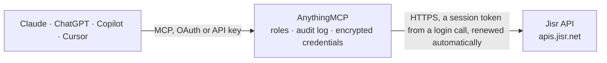

<!-- Generated by scripts/export-github-catalog.mjs in the anythingmcp-website repository. Do not edit by hand. -->

# Jisr MCP connector

Ask about your Jisr HR organization from any AI assistant: employees and their job data, attendance summaries and punches, annual leave balances, departments and locations. The AnythingMCP connector gives Claude, ChatGPT, Microsoft Copilot, Cursor and Gemini 7 MCP tools for Jisr: 6 read and 1 can change data.

**Category:** [HR](../hr.md) · **Tools:** 7 · **Setup guide:** [anythingmcp.com](https://anythingmcp.com/guides/jisr-to-mcp) · [Deutsch](https://anythingmcp.com/de/guides/jisr-to-mcp) · [Italiano](https://anythingmcp.com/it/guides/jisr-to-mcp) · [Español](https://anythingmcp.com/es/guides/jisr-to-mcp) · [日本語](https://anythingmcp.com/ja/guides/jisr-to-mcp) · [Русский](https://anythingmcp.com/ru/guides/jisr-to-mcp) · [中文](https://anythingmcp.com/zh/guides/jisr-to-mcp)

## Start without code

No installation and no terminal: AnythingMCP Cloud runs the Jisr connector for you, operated by helpcode.ai in Frankfurt, Germany.

1. **Click the button above** and create an account or sign in. The Jisr connector opens, ready to install.
2. **Paste the API key or token from your Jisr account.** Every click is in the [step-by-step guide](https://anythingmcp.com/guides/jisr-to-mcp).
3. **Click Install.** AnythingMCP shows the address of your MCP server.
4. **Add that address to your assistant:** [Claude](https://anythingmcp.com/guides/connect-jisr-to-claude) · [ChatGPT](https://anythingmcp.com/guides/connect-jisr-to-chatgpt) · [Microsoft Copilot](https://anythingmcp.com/guides/connect-jisr-to-copilot) · [Cursor](https://anythingmcp.com/guides/connect-jisr-to-cursor) · [Gemini CLI](https://anythingmcp.com/guides/connect-jisr-to-gemini) · [Meta Muse](https://anythingmcp.com/guides/connect-jisr-to-muse).
5. **Ask your first question.**

Prefer help with the setup? [Talk to us](https://anythingmcp.com/contact).

## How it works

- **The AI client** speaks MCP (Streamable HTTP) to AnythingMCP and only sees tool names, descriptions and results. It never gets the Jisr credentials.
- **AnythingMCP** checks the client's role, builds the call from the tool definition, adds the credentials (a session token from a login call, renewed automatically), calls Jisr, logs the call and returns the result.
- **Jisr** sees an ordinary API client with the rights of the account the credentials belong to.

## Tools

| Tool | What it does | Access |
|---|---|---|
| [`jisr_list_employees`](#jisr_list_employees) | List the organization's employees, 1 to 100 per page: for each the public id (UUID), employee code, English and Arabic full name, work and personal e-mail,… | read |
| [`jisr_get_employee`](#jisr_get_employee) | Full basic profile of one employee by public id (UUID from jisr_list_employees or jisr_get_attendance_summary): personal details, address, contact data, job… | read |
| [`jisr_get_attendance_summary`](#jisr_get_attendance_summary) | Attendance totals per employee for a date range (the current month when no dates are given), ordered by employee code: for each employee the public id, code… | read |
| [`jisr_list_attendance_logs`](#jisr_list_attendance_logs) | Individual attendance punches (clock-ins and clock-outs) in a time range, 1 to 100 per page: punch id, employee code, punch time, device serial number… | read |
| [`jisr_create_attendance_logs`](#jisr_create_attendance_logs) | Send up to 100 attendance punches to Jisr, as a time clock or access-control system would. | write |
| [`jisr_get_annual_leave_summary`](#jisr_get_annual_leave_summary) | Annual leave balances per employee: employee code, leave days, opening and previous-year balance, manual adjustments, days used, pending and reserved days,… | read |
| [`jisr_list_lookup`](#jisr_list_lookup) | Reference lists of the organization: departments, locations, employment types, business units, nationalities or outsourcing companies, each entry with its… | read |

## Tool reference

Every parameter as the AI client sees it in `tools/list`. Source: [`packages/backend/src/adapters/intl/jisr.json`](../../../packages/backend/src/adapters/intl/jisr.json).

### `jisr_list_employees`

List the organization's employees, 1 to 100 per page: for each the public id (UUID), employee code, English and Arabic full name, work and personal e-mail, phone, status (active or inactive), job title, department, location, business unit, employment type, nationality, line manager, joining date, date of birth, document and passport numbers, and termination or deletion dates. Custom fields come back only when the API key has that permission. Bank details are removed from the answer. Use the filters to find leavers, joiners or recently created records; use jisr_get_employee for one employee's full profile. Read-only.

**Access:** read · **Call:** `GET /openapi/v1/employees`

| Parameter | Type | Required | Description |
|---|---|---|---|
| `status` | `active` \| `inactive` | no | active or inactive. Leave out for both. |
| `created_from` | string | no | Only employees created on or after this date, YYYY-MM-DD. |
| `joining_from` | string | no | Only employees who joined on or after this date, YYYY-MM-DD. |
| `joining_to` | string | no | Only employees who joined on or before this date, YYYY-MM-DD. |
| `terminated_from` | string | no | Only employees offboarded on or after this date, YYYY-MM-DD. |
| `terminated_to` | string | no | Only employees offboarded on or before this date, YYYY-MM-DD. |
| `deleted_from` | string | no | Only employees deleted from Jisr on or after this date, YYYY-MM-DD. |
| `deleted_to` | string | no | Only employees deleted from Jisr on or before this date, YYYY-MM-DD. |
| `custom_field_ids` | string | no | Comma-separated custom field UUIDs to return (all by default). Ignored without the custom fields permission. |
| `page` | integer | no | Page number, starting at 1 (default 1). Read data.pagination (current_page, next_page, total_pages, total_entries) to see whether more pages exist. |
| `rpp` | integer | no | Records per page, 1 to 100 (default 100). |

### `jisr_get_employee`

Full basic profile of one employee by public id (UUID from jisr_list_employees or jisr_get_attendance_summary): personal details, address, contact data, job title, department, location, line manager, employment type, joining date and custom fields (with that permission). Read-only.

**Access:** read · **Call:** `GET /openapi/v1/employees/basic_info`

| Parameter | Type | Required | Description |
|---|---|---|---|
| `employee_id` | string | yes | Public employee id (UUID), e.g. bab6cd98-7246-4cfc-a576-19bc00391792. Not the numeric employee code. |
| `custom_field_ids` | string | no | Comma-separated custom field UUIDs to return (all by default). |

### `jisr_get_attendance_summary`

Attendance totals per employee for a date range (the current month when no dates are given), ordered by employee code: for each employee the public id, code and name, total working hours (inside and outside shifts), late arrival and early departure time and days (with excused parts), extra working time, approved overtime, absence, days without records, leave days, off days, full-day excuses and business trip days. Use it for monthly attendance reviews or payroll preparation. Read-only.

**Access:** read · **Call:** `GET /openapi/v1/attendance/summary`

| Parameter | Type | Required | Description |
|---|---|---|---|
| `from` | string | no | Start of the period (default: first day of the current month), YYYY-MM-DD. |
| `to` | string | no | End of the period (default: last day of the current month), YYYY-MM-DD. |
| `employee_id` | string | no | Only this employee: public id (UUID). |
| `status` | `active` \| `inactive` | no | Employment status to include: active (default) or inactive. |
| `page` | integer | no | Page number, starting at 1 (default 1). Read data.pagination (current_page, next_page, total_pages, total_entries) to see whether more pages exist. |
| `rpp` | integer | no | Records per page, 1 to 100 (default 100). |

### `jisr_list_attendance_logs`

Individual attendance punches (clock-ins and clock-outs) in a time range, 1 to 100 per page: punch id, employee code, punch time, device serial number (terminal_sn), clocking id, and for failed punches the error Jisr reported. status success lists punches Jisr processed; status failed lists punches it rejected, which is where to look when an employee says a punch is missing. Without from and to the window is the last hour. Read-only.

**Access:** read · **Call:** `GET /openapi/v1/attendance_logs`

| Parameter | Type | Required | Description |
|---|---|---|---|
| `status` | `success` \| `failed` | yes | success for processed punches (default), failed for rejected ones. |
| `from` | string | no | Range start as date-time, e.g. 2026-11-01T00:00:00 (default: one hour ago). |
| `to` | string | no | Range end as date-time, e.g. 2026-11-01T23:59:59 (default: now). |
| `source_type` | `zkt` \| `geofencing` \| `wdms` \| `biotime` \| `open_api` | no | Only punches from this source. |
| `page` | integer | no | Page number, starting at 1 (default 1). Read data.pagination (current_page, next_page, total_pages, total_entries) to see whether more pages exist. |
| `limit` | integer | no | Punches per page, 1 to 100 (default 100). |

### `jisr_create_attendance_logs`

Send up to 100 attendance punches to Jisr, as a time clock or access-control system would. Jisr queues them and processes them in the background: check the outcome afterwards with jisr_list_attendance_logs (status success or failed). Each punch needs the employee code as a string, the punch time, the device serial number and a device-generated punch id. Punches change employees' attendance records: confirm with the user first. Installed switched off.

**Access:** write · **Call:** `POST /openapi/v1/attendance_logs`

| Parameter | Type | Required | Description |
|---|---|---|---|
| `punches` | object[] | yes | The punches to submit (at most 100). |

### `jisr_get_annual_leave_summary`

Annual leave balances per employee: employee code, leave days, opening and previous-year balance, manual adjustments, days used, pending and reserved days, unpaid leave deduction and the year-end balance, for all employees or for up to 100 employee codes. Use it to answer 'how many vacation days does X have left'. Read-only.

**Access:** read · **Call:** `GET /openapi/v1/employee_leaves/summary`

| Parameter | Type | Required | Description |
|---|---|---|---|
| `employee_codes` | string[] | no | Employee codes (not UUIDs), e.g. ["43", "77"]. Leave out for all employees. |
| `page` | integer | no | Page number, starting at 1 (default 1). Read data.pagination (current_page, next_page, total_pages, total_entries) to see whether more pages exist. |
| `limit` | integer | no | Employees per page, 1 to 100 (default 100). |

### `jisr_list_lookup`

Reference lists of the organization: departments, locations, employment types, business units, nationalities or outsourcing companies, each entry with its id and English and Arabic name. Use it to translate ids in employee records or to find a department's id. Only the lookups ticked on the API key are available. Read-only.

**Access:** read · **Call:** `GET /openapi/v1/lookups/{lookup}`

| Parameter | Type | Required | Description |
|---|---|---|---|
| `lookup` | `departments` \| `locations` \| `employment_types` \| `business_units` \| `nationalities` \| `outsourcing_companies` | yes | Which list to read. |
| `page` | integer | no | Page number, starting at 1 (default 1). Read data.pagination (current_page, next_page, total_pages, total_entries) to see whether more pages exist. |
| `rpp` | integer | no | Records per page, 1 to 100 (default 100). |

## Run it yourself

AnythingMCP is open source (AGPL-3.0). [Run it with Docker](../../../README.md#run-it-yourself), open **Connectors → Store**, pick **Jisr** and enter `JISR_SLUG`, `JISR_API_KEY`, `JISR_API_SECRET`, then add your MCP server URL to the AI client.

[← HR connectors](../hr.md) · [All categories](../README.md)
