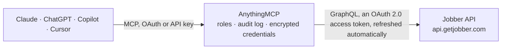

<!-- Generated by scripts/export-github-catalog.mjs in the anythingmcp-website repository. Do not edit by hand. -->

# Jobber MCP connector

Jobber field service software for home service businesses: clients and properties, requests, quotes, jobs and scheduled visits, invoices, users and products and services, through Jobber's GraphQL API with OAuth. The AnythingMCP connector gives Claude, ChatGPT, Microsoft Copilot, Cursor and Gemini 24 MCP tools for Jobber: 15 read and 9 can change data.

**Category:** [Field Service](../field-service.md) · **Tools:** 24 · **Setup guide:** [anythingmcp.com](https://anythingmcp.com/guides/jobber-to-mcp) · [Deutsch](https://anythingmcp.com/de/guides/jobber-to-mcp) · [Italiano](https://anythingmcp.com/it/guides/jobber-to-mcp) · [Español](https://anythingmcp.com/es/guides/jobber-to-mcp) · [日本語](https://anythingmcp.com/ja/guides/jobber-to-mcp) · [Русский](https://anythingmcp.com/ru/guides/jobber-to-mcp) · [中文](https://anythingmcp.com/zh/guides/jobber-to-mcp)

## Start without code

No installation and no terminal: AnythingMCP Cloud runs the Jobber connector for you, operated by helpcode.ai in Frankfurt, Germany.

1. **Click the button above** and create an account or sign in. The Jobber connector opens, ready to install.
2. **Sign in with your Jobber account** when AnythingMCP asks. The first time, an admin creates a small app in the Jobber developer console. Every click is in the [step-by-step guide](https://anythingmcp.com/guides/jobber-to-mcp).
3. **Click Install.** AnythingMCP shows the address of your MCP server.
4. **Add that address to your assistant:** [Claude](https://anythingmcp.com/guides/connect-jobber-to-claude) · [ChatGPT](https://anythingmcp.com/guides/connect-jobber-to-chatgpt) · [Microsoft Copilot](https://anythingmcp.com/guides/connect-jobber-to-copilot) · [Cursor](https://anythingmcp.com/guides/connect-jobber-to-cursor) · [Gemini CLI](https://anythingmcp.com/guides/connect-jobber-to-gemini) · [Meta Muse](https://anythingmcp.com/guides/connect-jobber-to-muse).
5. **Ask your first question**, for example: *Show me invoice INV-2026-178 for client Maple Apartments LLC and its outstanding balance and due date*

Prefer help with the setup? [Talk to us](https://anythingmcp.com/contact).

## How it works

- **The AI client** speaks MCP (Streamable HTTP) to AnythingMCP and only sees tool names, descriptions and results. It never gets the Jobber credentials.
- **AnythingMCP** checks the client's role, builds the call from the tool definition, adds the credentials (an OAuth 2.0 access token, refreshed automatically), calls Jobber, logs the call and returns the result.
- **Jobber** sees an ordinary API client with the rights of the account the credentials belong to.

## Tools

| Tool | What it does | Access |
|---|---|---|
| [`jobber_get_account`](#jobber_get_account) | The connected Jobber account: id and company name. | read |
| [`jobber_list_users`](#jobber_list_users) | Users (team members) of the account: id, full name, email, phone, admin and owner flags, status. | read |
| [`jobber_list_clients`](#jobber_list_clients) | List or search clients (customers and leads): id, name, first and last name, company, isCompany, isLead, isArchived, primary email and phone, balance,… | read |
| [`jobber_get_client`](#jobber_get_client) | One client with emails, phones, billing address, tags, properties (service addresses with ids), the 10 latest jobs and invoices, balance and link to Jobber. | read |
| [`jobber_list_properties`](#jobber_list_properties) | Properties (service addresses where the work happens): id, name, address, whether it is the billing address, the client it belongs to. | read |
| [`jobber_list_requests`](#jobber_list_requests) | Requests (incoming work requests and booking forms): id, title, status, source, contact name, company, email, phone, client and property, created and… | read |
| [`jobber_get_request`](#jobber_get_request) | One request with its assessment visit (time, instructions, completion), contact details, client and property address. | read |
| [`jobber_list_quotes`](#jobber_list_quotes) | Quotes (estimates): id, number, title, status, amounts (subtotal, discount, tax, total, deposit), client, property, created, updated and sent times. | read |
| [`jobber_get_quote`](#jobber_get_quote) | One quote with message, line items (name, description, quantity, unit price, total), amounts, client, property and the jobs it became. | read |
| [`jobber_list_jobs`](#jobber_list_jobs) | List or search jobs (work orders): id, job number, title, status, start and end, completed time, total, client, property address, created and updated times. | read |
| [`jobber_get_job`](#jobber_get_job) | One job with instructions, status, dates, total, client, property address and visit counts (past, scheduled, unscheduled, incomplete). | read |
| [`jobber_list_visits`](#jobber_list_visits) | Visits (scheduled appointments of jobs): id, title, start and end, all-day flag, status, completion, instructions, job with its client, assigned users. | read |
| [`jobber_list_invoices`](#jobber_list_invoices) | Invoices: id, number, status, issued and due dates, amounts (total, balance, payments), client, the job it bills. | read |
| [`jobber_get_invoice`](#jobber_get_invoice) | One invoice with message, line items (name, description, quantity, unit price, total), amounts, client and jobs. | read |
| [`jobber_list_products`](#jobber_list_products) | Products and services of the price list: id, name, description, category, default unit price, internal unit cost, markup, taxable, visible, duration in minutes. | read |
| [`jobber_create_client`](#jobber_create_client) | Create a client. | write |
| [`jobber_update_client`](#jobber_update_client) | Change a client. | write |
| [`jobber_archive_client`](#jobber_archive_client) | Archive a client so it no longer shows in active lists. | write |
| [`jobber_create_job`](#jobber_create_job) | Create a job at a property (take the property id from jobber_get_client or jobber_list_properties). | write |
| [`jobber_update_job`](#jobber_update_job) | Change the title or instructions of a job. | write |
| [`jobber_close_job`](#jobber_close_job) | Close a job. | write |
| [`jobber_create_quote`](#jobber_create_quote) | Create a draft quote. | write |
| [`jobber_create_invoice`](#jobber_create_invoice) | Create a draft invoice. | write |
| [`jobber_mark_invoice_sent`](#jobber_mark_invoice_sent) | Mark an invoice as sent (for invoices delivered outside Jobber). | write |

## Tool reference

Every parameter as the AI client sees it in `tools/list`. Source: [`packages/backend/src/adapters/intl/jobber.json`](../../../packages/backend/src/adapters/intl/jobber.json).

### `jobber_get_account`

The connected Jobber account: id and company name. Use it to check the connection.

**Access:** read · **Call:** `query query Account { account { id name } }`

No parameters.

### `jobber_list_users`

Users (team members) of the account: id, full name, email, phone, admin and owner flags, status. Use the ids when you need to know who is assigned to a visit.

**Access:** read · **Call:** `query query ListUsers($first: Int, $after: String) { users(first: $first, after: $after) { nodes { id name { full } email { raw } phone { friendly } isAccountAdmin isAccountOwner status } pageInfo { hasNextPage endCursor } totalCount } }`

| Parameter | Type | Required | Description |
|---|---|---|---|
| `first` | integer | no | Items per page, 1 to 100 (20 by default). Big pages cost more query points. |
| `after` | string | no | Cursor from pageInfo.endCursor of the previous page. |

### `jobber_list_clients`

List or search clients (customers and leads): id, name, first and last name, company, isCompany, isLead, isArchived, primary email and phone, balance, created and updated times, link to Jobber.

**Access:** read · **Call:** `query query ListClients($first: Int, $after: String, $searchTerm: String, $filter: ClientFilterAttributes) { clients(first: $first, after: $after, searchTerm: $searchTerm, filter: $filter) { nodes { id name firstName lastName companyName isCompany isLead isArchived email phone balance createdAt updatedAt jobberWebUri } pageInfo { hasNextPage endCursor } totalCount } }`

| Parameter | Type | Required | Description |
|---|---|---|---|
| `search_term` | string | no | Free text search (names, numbers, addresses, titles). |
| `filter` | object | no | ClientFilterAttributes, e.g. {"isLead": true} or {"isArchived": false}. Ask jobber_graphql_query with __type(name: "ClientFilterAttributes") for every key. |
| `first` | integer | no | Items per page, 1 to 100 (20 by default). Big pages cost more query points. |
| `after` | string | no | Cursor from pageInfo.endCursor of the previous page. |

### `jobber_get_client`

One client with emails, phones, billing address, tags, properties (service addresses with ids), the 10 latest jobs and invoices, balance and link to Jobber.

**Access:** read · **Call:** `query query GetClient($id: EncodedId!) { client(id: $id) { id name firstName lastName companyName isCompany isLead isArchived balance email phone emails { id address primary description } phones { id number primary description smsAllowed } billingAddress { street1 street2 city province postalCode country } tags { nodes { label } } properties { id address { street1 street2 city province postalCode country } } jobs(first: 10) { nodes { id jobNumber title jobStatus createdAt } } invoices(first: 10) { nodes { id invoiceNumber invoiceStatus issuedDate dueDate amounts { total invoiceBalance } } } createdAt updatedAt jobberWebUri } }`

| Parameter | Type | Required | Description |
|---|---|---|---|
| `id` | string | yes | Client id (an encoded id string from a list). |

### `jobber_list_properties`

Properties (service addresses where the work happens): id, name, address, whether it is the billing address, the client it belongs to. Jobs and quotes need a property id.

**Access:** read · **Call:** `query query ListProperties($first: Int, $after: String) { properties(first: $first, after: $after) { nodes { id name isBillingAddress address { street1 street2 city province postalCode country } client { id name } jobberWebUri } pageInfo { hasNextPage endCursor } totalCount } }`

| Parameter | Type | Required | Description |
|---|---|---|---|
| `first` | integer | no | Items per page, 1 to 100 (20 by default). Big pages cost more query points. |
| `after` | string | no | Cursor from pageInfo.endCursor of the previous page. |

### `jobber_list_requests`

Requests (incoming work requests and booking forms): id, title, status, source, contact name, company, email, phone, client and property, created and updated times.

**Access:** read · **Call:** `query query ListRequests($first: Int, $after: String, $searchTerm: String, $filter: RequestFilterAttributes) { requests(first: $first, after: $after, searchTerm: $searchTerm, filter: $filter) { nodes { id title requestStatus source contactName companyName email phone createdAt updatedAt jobberWebUri client { id name } property { id } } pageInfo { hasNextPage endCursor } totalCount } }`

| Parameter | Type | Required | Description |
|---|---|---|---|
| `search_term` | string | no | Free text search (names, numbers, addresses, titles). |
| `filter` | object | no | RequestFilterAttributes, e.g. {"updatedAt": {"after": "2026-10-01T00:00:00Z"}} (ranges are { after, before } with ISO 8601 times). |
| `first` | integer | no | Items per page, 1 to 100 (20 by default). Big pages cost more query points. |
| `after` | string | no | Cursor from pageInfo.endCursor of the previous page. |

### `jobber_get_request`

One request with its assessment visit (time, instructions, completion), contact details, client and property address.

**Access:** read · **Call:** `query query GetRequest($id: EncodedId!) { request(id: $id) { id title requestStatus source contactName companyName email phone createdAt updatedAt jobberWebUri client { id name } property { id address { street1 street2 city province postalCode country } } assessment { id title instructions startAt endAt allDay isComplete completedAt } } }`

| Parameter | Type | Required | Description |
|---|---|---|---|
| `id` | string | yes | Request id (an encoded id string from a list). |

### `jobber_list_quotes`

Quotes (estimates): id, number, title, status, amounts (subtotal, discount, tax, total, deposit), client, property, created, updated and sent times.

**Access:** read · **Call:** `query query ListQuotes($first: Int, $after: String, $searchTerm: String, $filter: QuoteFilterAttributes) { quotes(first: $first, after: $after, searchTerm: $searchTerm, filter: $filter) { nodes { id quoteNumber title quoteStatus createdAt updatedAt sentAt amounts { subtotal discountAmount taxAmount total depositAmount } client { id name } property { id } jobberWebUri } pageInfo { hasNextPage endCursor } totalCount } }`

| Parameter | Type | Required | Description |
|---|---|---|---|
| `search_term` | string | no | Free text search (names, numbers, addresses, titles). |
| `filter` | object | no | QuoteFilterAttributes, e.g. {"status": "awaiting_response"} or {"clientId": "..."}. Status values: draft, awaiting_response, archived, approved, converted, changes_requested. |
| `first` | integer | no | Items per page, 1 to 100 (20 by default). Big pages cost more query points. |
| `after` | string | no | Cursor from pageInfo.endCursor of the previous page. |

### `jobber_get_quote`

One quote with message, line items (name, description, quantity, unit price, total), amounts, client, property and the jobs it became.

**Access:** read · **Call:** `query query GetQuote($id: EncodedId!) { quote(id: $id) { id quoteNumber title quoteStatus message createdAt updatedAt sentAt jobberWebUri client { id name } property { id address { street1 street2 city province postalCode country } } lineItems { nodes { id name description quantity unitPrice totalPrice } } amounts { subtotal discountAmount taxAmount total depositAmount } jobs { nodes { id jobNumber title } } } }`

| Parameter | Type | Required | Description |
|---|---|---|---|
| `id` | string | yes | Quote id (an encoded id string from a list). |

### `jobber_list_jobs`

List or search jobs (work orders): id, job number, title, status, start and end, completed time, total, client, property address, created and updated times.

**Access:** read · **Call:** `query query ListJobs($first: Int, $after: String, $searchTerm: String, $filter: JobFilterAttributes) { jobs(first: $first, after: $after, searchTerm: $searchTerm, filter: $filter) { nodes { id jobNumber title jobStatus startAt endAt completedAt total createdAt updatedAt jobberWebUri client { id name } property { id address { street1 street2 city province postalCode country } } } pageInfo { hasNextPage endCursor } totalCount } }`

| Parameter | Type | Required | Description |
|---|---|---|---|
| `search_term` | string | no | Free text search (names, numbers, addresses, titles). |
| `filter` | object | no | JobFilterAttributes, e.g. {"status": "requires_invoicing"} or {"createdAt": {"after": "2026-10-01T00:00:00Z"}}. Status values: requires_invoicing, archived, late, today, upcoming, action_required, on_hold, unscheduled, active, expiring_within_30_days. |
| `first` | integer | no | Items per page, 1 to 100 (20 by default). Big pages cost more query points. |
| `after` | string | no | Cursor from pageInfo.endCursor of the previous page. |

### `jobber_get_job`

One job with instructions, status, dates, total, client, property address and visit counts (past, scheduled, unscheduled, incomplete).

**Access:** read · **Call:** `query query GetJob($id: EncodedId!) { job(id: $id) { id jobNumber title jobStatus instructions startAt endAt completedAt total createdAt updatedAt jobberWebUri client { id name } property { id address { street1 street2 city province postalCode country } } visitsInfo { futureCount incompleteTotal pastCount scheduledCount unscheduledCount } } }`

| Parameter | Type | Required | Description |
|---|---|---|---|
| `id` | string | yes | Job id (an encoded id string from a list). |

### `jobber_list_visits`

Visits (scheduled appointments of jobs): id, title, start and end, all-day flag, status, completion, instructions, job with its client, assigned users. Filter by start time to read a schedule.

**Access:** read · **Call:** `query query ListVisits($first: Int, $after: String, $filter: VisitFilterAttributes, $sort: [VisitsSortInput!]) { visits(first: $first, after: $after, filter: $filter, sort: $sort) { nodes { id title startAt endAt allDay visitStatus isComplete instructions job { id jobNumber title client { id name } } assignedUsers(first: 10) { nodes { id name { full } } } } pageInfo { hasNextPage endCursor } totalCount } }`

| Parameter | Type | Required | Description |
|---|---|---|---|
| `filter` | object | no | VisitFilterAttributes, e.g. {"startAt": {"after": "2026-11-02T00:00:00Z", "before": "2026-11-09T00:00:00Z"}} (ranges are { after, before } with ISO 8601 times). |
| `sort` | object[] | no | Sort keys, e.g. [{"key": "START_AT", "direction": "ASCENDING"}]. |
| `first` | integer | no | Items per page, 1 to 100 (20 by default). Big pages cost more query points. |
| `after` | string | no | Cursor from pageInfo.endCursor of the previous page. |

### `jobber_list_invoices`

Invoices: id, number, status, issued and due dates, amounts (total, balance, payments), client, the job it bills.

**Access:** read · **Call:** `query query ListInvoices($first: Int, $after: String, $filter: InvoiceFilterAttributes, $sort: [InvoiceSortInput!]) { invoices(first: $first, after: $after, filter: $filter, sort: $sort) { nodes { id invoiceNumber subject invoiceStatus issuedDate dueDate createdAt updatedAt jobberWebUri amounts { subtotal taxAmount total paymentsTotal invoiceBalance } client { id name } jobs(first: 1) { nodes { id jobNumber title } } } pageInfo { hasNextPage endCursor } totalCount } }`

| Parameter | Type | Required | Description |
|---|---|---|---|
| `filter` | object | no | InvoiceFilterAttributes, e.g. {"status": "past_due"}. Status values: draft, awaiting_payment, paid, past_due, bad_debt, sent_not_due, voided. |
| `sort` | object[] | no | Sort keys, e.g. [{"key": "DUE_DATE", "direction": "DESCENDING"}]. |
| `first` | integer | no | Items per page, 1 to 100 (20 by default). Big pages cost more query points. |
| `after` | string | no | Cursor from pageInfo.endCursor of the previous page. |

### `jobber_get_invoice`

One invoice with message, line items (name, description, quantity, unit price, total), amounts, client and jobs.

**Access:** read · **Call:** `query query GetInvoice($id: EncodedId!) { invoice(id: $id) { id invoiceNumber subject invoiceStatus message issuedDate dueDate createdAt updatedAt jobberWebUri client { id name email } jobs { nodes { id jobNumber title } } lineItems { nodes { id name description quantity unitPrice totalPrice } } amounts { subtotal discountAmount taxAmount paymentsTotal invoiceBalance total } } }`

| Parameter | Type | Required | Description |
|---|---|---|---|
| `id` | string | yes | Invoice id (an encoded id string from a list). |

### `jobber_list_products`

Products and services of the price list: id, name, description, category, default unit price, internal unit cost, markup, taxable, visible, duration in minutes.

**Access:** read · **Call:** `query query ListProducts($first: Int, $after: String) { products(first: $first, after: $after) { nodes { id name description category defaultUnitCost internalUnitCost markup taxable visible durationMinutes } pageInfo { hasNextPage endCursor } totalCount } }`

| Parameter | Type | Required | Description |
|---|---|---|---|
| `first` | integer | no | Items per page, 1 to 100 (20 by default). Big pages cost more query points. |
| `after` | string | no | Cursor from pageInfo.endCursor of the previous page. |

### `jobber_create_client`

Create a client. Pass the ClientCreateInput object: firstName, lastName, companyName, emails [{address, primary, description}], phones [{number, primary, smsAllowed}]. Answers the new client id, or userErrors.

**Access:** write · **Call:** `mutation mutation CreateClient($input: ClientCreateInput!) { clientCreate(input: $input) { client { id name firstName lastName companyName email phone jobberWebUri } userErrors { message path } } }`

| Parameter | Type | Required | Description |
|---|---|---|---|
| `client` | object | yes | ClientCreateInput, e.g. {"firstName": "Ana", "lastName": "Lopez", "emails": [{"address": "ana@example.com", "primary": true}], "phones": [{"number": "555-0100", "primary": true}]}. |

### `jobber_update_client`

Change a client. Pass the ClientEditInput object: firstName, lastName, companyName; emails and phones change by list: emailsToAdd, emailsToEdit (each with the email's own id from jobber_get_client), emailsToDelete, and the same for phones. Answers the client or userErrors.

**Access:** write · **Call:** `mutation mutation EditClient($clientId: EncodedId!, $input: ClientEditInput!) { clientEdit(clientId: $clientId, input: $input) { client { id name firstName lastName companyName email phone } userErrors { message path } } }`

| Parameter | Type | Required | Description |
|---|---|---|---|
| `client_id` | string | yes | Client id. |
| `changes` | object | yes | ClientEditInput, e.g. {"companyName": "Lopez Landscaping", "emailsToEdit": [{"id": "...", "address": "new@example.com"}]}. |

### `jobber_archive_client`

Archive a client so it no longer shows in active lists. Nothing is deleted; Jobber can unarchive it.

**Access:** write · **Call:** `mutation mutation ArchiveClient($clientId: EncodedId!) { clientArchive(clientId: $clientId) { client { id name isArchived } userErrors { message path } } }`

| Parameter | Type | Required | Description |
|---|---|---|---|
| `client_id` | string | yes | Client id. |

### `jobber_create_job`

Create a job at a property (take the property id from jobber_get_client or jobber_list_properties). invoicing_type FIXED_PRICE or VISIT_BASED, invoicing_schedule ON_COMPLETION, PERIODIC, PER_VISIT or NEVER. Visits are scheduled in Jobber. Answers the new job or userErrors.

**Access:** write · **Call:** `mutation mutation CreateJob($propertyId: EncodedId!, $title: String, $instructions: String, $invoicingType: BillingStrategy!, $invoicingSchedule: BillingFrequencyEnum!) { jobCreate(input: { propertyId: $propertyId, title: $title, instructions: $instructions, invoicing: { invoicingType: $invoicingType, invoicingSchedule: $invoicingSchedule } }) { job { id jobNumber title jobStatus jobberWebUri client { id name } } userErrors { message path } } }`

| Parameter | Type | Required | Description |
|---|---|---|---|
| `property_id` | string | yes | Property id. |
| `title` | string | no | Job title. |
| `instructions` | string | no | Instructions for the team. |
| `invoicing_type` | `FIXED_PRICE` \| `VISIT_BASED` | no | How the job is priced. |
| `invoicing_schedule` | `ON_COMPLETION` \| `PERIODIC` \| `PER_VISIT` \| `NEVER` | no | When the job is billed. |

### `jobber_update_job`

Change the title or instructions of a job. Status changes happen through jobber_close_job or in Jobber.

**Access:** write · **Call:** `mutation mutation EditJob($jobId: EncodedId!, $title: String, $instructions: String) { jobEdit(jobId: $jobId, input: { title: $title, instructions: $instructions }) { job { id jobNumber title jobStatus } userErrors { message path } } }`

| Parameter | Type | Required | Description |
|---|---|---|---|
| `job_id` | string | yes | Job id. |
| `title` | string | no | New title. |
| `instructions` | string | no | New instructions. |

### `jobber_close_job`

Close a job. incomplete_visits decides what happens to visits not done yet: DESTROY_ALL deletes every incomplete visit, COMPLETE_PAST_DESTROY_FUTURE completes past ones and deletes future ones. Deleted visits cannot be restored. Switched off at install.

**Access:** write · **Call:** `mutation mutation CloseJob($jobId: EncodedId!, $modifyIncompleteVisitsBy: IncompleteVisitDecisionEnum!) { jobClose(jobId: $jobId, input: { modifyIncompleteVisitsBy: $modifyIncompleteVisitsBy }) { job { id jobNumber title jobStatus completedAt } userErrors { message path } } }`

| Parameter | Type | Required | Description |
|---|---|---|---|
| `job_id` | string | yes | Job id. |
| `incomplete_visits` | `DESTROY_ALL` \| `COMPLETE_PAST_DESTROY_FUTURE` | yes | What to do with incomplete visits. |

### `jobber_create_quote`

Create a draft quote. Pass the QuoteCreateAttributes object: clientId, propertyId, title, message and lineItems [{name, description, quantity, unitPrice, saveToProductsAndServices: false}] (at least one). Jobber's API cannot send or approve quotes: the user sends it from Jobber.

**Access:** write · **Call:** `mutation mutation CreateQuote($attributes: QuoteCreateAttributes!) { quoteCreate(attributes: $attributes) { quote { id quoteNumber title quoteStatus amounts { total } jobberWebUri } userErrors { message path } } }`

| Parameter | Type | Required | Description |
|---|---|---|---|
| `quote` | object | yes | QuoteCreateAttributes, e.g. {"clientId": "...", "propertyId": "...", "title": "Spring cleanup", "lineItems": [{"name": "Mulching", "quantity": 3, "unitPrice": 45, "saveToProductsAndServices": false}]}. |

### `jobber_create_invoice`

Create a draft invoice. Pass the InvoiceCreateInput object: clientId, jobId (optional), subject, dueDetails {dueDate (YYYY-MM-DD) or invoiceNet (days)}, tax {taxCalculationMethod: EXCLUSIVE or INCLUSIVE}, lineItems [{name, description, quantity, unitPrice}] (at least one).

**Access:** write · **Call:** `mutation mutation CreateInvoice($input: InvoiceCreateInput!) { invoiceCreate(input: $input) { invoice { id invoiceNumber subject invoiceStatus amounts { total } jobberWebUri } userErrors { message path } } }`

| Parameter | Type | Required | Description |
|---|---|---|---|
| `invoice` | object | yes | InvoiceCreateInput, e.g. {"clientId": "...", "subject": "October service", "dueDetails": {"invoiceNet": 30}, "tax": {"taxCalculationMethod": "EXCLUSIVE"}, "lineItems": [{"name": "Lawn care", "quantity": 4, "unitPrice": 60}]}. |

### `jobber_mark_invoice_sent`

Mark an invoice as sent (for invoices delivered outside Jobber). It only changes the status; nothing is emailed.

**Access:** write · **Call:** `mutation mutation MarkInvoiceSent($id: EncodedId!) { invoiceMarkAsSent(id: $id) { invoice { id invoiceNumber invoiceStatus } userErrors { message path } } }`

| Parameter | Type | Required | Description |
|---|---|---|---|
| `id` | string | yes | Invoice id. |

## Run it yourself

AnythingMCP is open source (AGPL-3.0). [Run it with Docker](../../../README.md#run-it-yourself), open **Connectors → Store**, pick **Jobber** and enter `JOBBER_CLIENT_ID`, `JOBBER_CLIENT_SECRET`, then add your MCP server URL to the AI client.

[← Field Service connectors](../field-service.md) · [All categories](../README.md)
