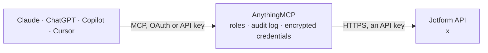

<!-- Generated by scripts/export-github-catalog.mjs in the anythingmcp-website repository. Do not edit by hand. -->

# Jotform MCP connector

Let your AI work with Jotform: list forms, read their questions and settings, search and read submissions, reports, folders and labels, and check account usage; with your confirmation add or edit a … The AnythingMCP connector gives Claude, ChatGPT, Microsoft Copilot, Cursor and Gemini 19 MCP tools for Jotform: 15 read and 4 can change data.

**Category:** [Forms & Surveys](../forms.md) · **Tools:** 19 · **Setup guide:** [anythingmcp.com](https://anythingmcp.com/guides/jotform-to-mcp) · [Deutsch](https://anythingmcp.com/de/guides/jotform-to-mcp) · [Italiano](https://anythingmcp.com/it/guides/jotform-to-mcp) · [Español](https://anythingmcp.com/es/guides/jotform-to-mcp) · [日本語](https://anythingmcp.com/ja/guides/jotform-to-mcp) · [Русский](https://anythingmcp.com/ru/guides/jotform-to-mcp) · [中文](https://anythingmcp.com/zh/guides/jotform-to-mcp)

## Start without code

No installation and no terminal: AnythingMCP Cloud runs the Jotform connector for you, operated by helpcode.ai in Frankfurt, Germany.

1. **Click the button above** and create an account or sign in. The Jotform connector opens, ready to install.
2. **Paste the API key or token from your Jotform account.** Every click is in the [step-by-step guide](https://anythingmcp.com/guides/jotform-to-mcp).
3. **Click Install.** AnythingMCP shows the address of your MCP server.
4. **Add that address to your assistant:** [Claude](https://anythingmcp.com/guides/connect-jotform-to-claude) · [ChatGPT](https://anythingmcp.com/guides/connect-jotform-to-chatgpt) · [Microsoft Copilot](https://anythingmcp.com/guides/connect-jotform-to-copilot) · [Cursor](https://anythingmcp.com/guides/connect-jotform-to-cursor) · [Gemini CLI](https://anythingmcp.com/guides/connect-jotform-to-gemini) · [Meta Muse](https://anythingmcp.com/guides/connect-jotform-to-muse).
5. **Ask your first question**, for example: *Open submission 298765432109876543 from the 'Commercial Quote Request' form, I need the customer's email and requested system size.*

Prefer help with the setup? [Talk to us](https://anythingmcp.com/contact).

## How it works

- **The AI client** speaks MCP (Streamable HTTP) to AnythingMCP and only sees tool names, descriptions and results. It never gets the Jotform credentials.
- **AnythingMCP** checks the client's role, builds the call from the tool definition, adds the credentials (an API key), calls Jotform, logs the call and returns the result.
- **Jotform** sees an ordinary API client with the rights of the account the credentials belong to.

## Tools

| Tool | What it does | Access |
|---|---|---|
| [`jotform_get_user`](#jotform_get_user) | Read the Jotform account the API key belongs to: username, name, email, plan (account_type), status, time zone and creation date. | read |
| [`jotform_get_usage`](#jotform_get_usage) | Read this month's usage of the Jotform account: submissions, SSL submissions, payments, uploads in bytes, form views and API calls. | read |
| [`jotform_list_forms`](#jotform_list_forms) | List the forms of the Jotform account with id, title, status (ENABLED, DISABLED, DELETED), number of submissions (count) and unread ones (new), last… | read |
| [`jotform_get_form`](#jotform_get_form) | Read one Jotform form: title, status, URL, height, submission counts (count, new), dates and type (LEGACY or CARD). | read |
| [`jotform_get_form_questions`](#jotform_get_form_questions) | List the questions (fields) of a form, keyed by question id (qid): name, text (the label people see), type (control_textbox, control_email,… | read |
| [`jotform_get_form_question`](#jotform_get_form_question) | Read one question of a form by its question id (qid): label, type, options, sub-fields and validation. | read |
| [`jotform_get_form_properties`](#jotform_get_form_properties) | Read the settings of a form: thank-you page and redirect, email notifications, submission limits, expiry date, uniqueness checks, styles and more. | read |
| [`jotform_get_form_property`](#jotform_get_form_property) | Read one setting of a form by its key, e.g. thanktext, activeRedirect, limitSubmission, expireDate, unique, formWidth or emails. | read |
| [`jotform_list_form_submissions`](#jotform_list_form_submissions) | List the submissions (responses) of one form with id, dates, status, new (unread), flag, notes and answers keyed by question id: each answer has the… | read |
| [`jotform_list_submissions`](#jotform_list_submissions) | Search the submissions across all forms of the account, or several forms at once, with the same fields as jotform_list_form_submissions. | read |
| [`jotform_get_submission`](#jotform_get_submission) | Read one submission by id: dates, status, new, flag, notes and every answer keyed by question id (question text, type, answer, prettyFormat). | read |
| [`jotform_list_form_reports`](#jotform_list_form_reports) | List the reports of a form (Excel, CSV, grid, table, visual and RSS reports) with id, title, type (list_type), the fields they include, whether they are… | read |
| [`jotform_list_folders`](#jotform_list_folders) | List the folders of the Jotform account as a tree: id, name, path, parent, color and subfolders. | read |
| [`jotform_get_folder`](#jotform_get_folder) | Read one folder: name, path, parent, color, subfolders and the forms it contains (keyed by form id). | read |
| [`jotform_list_labels`](#jotform_list_labels) | List the labels the account uses to organise forms (the successor of folders), optionally with the forms and other resources on each label. | read |
| [`jotform_create_submission`](#jotform_create_submission) | Add a submission to a form, as if someone had filled it in. | write |
| [`jotform_edit_submission`](#jotform_edit_submission) | Change answers of an existing submission, or mark it read, unread or flagged. | write |
| [`jotform_delete_submission`](#jotform_delete_submission) | Delete one submission for good. | write |
| [`jotform_clone_form`](#jotform_clone_form) | Make a copy of a form (questions and settings, no submissions) in the same account. | write |

## Tool reference

Every parameter as the AI client sees it in `tools/list`. Source: [`packages/backend/src/adapters/intl/jotform.json`](../../../packages/backend/src/adapters/intl/jotform.json).

### `jotform_get_user`

Read the Jotform account the API key belongs to: username, name, email, plan (account_type), status, time zone and creation date. Free check that the key works; call it first.

**Access:** read · **Call:** `GET /user`

No parameters.

### `jotform_get_usage`

Read this month's usage of the Jotform account: submissions, SSL submissions, payments, uploads in bytes, form views and API calls. Compare with the plan limits on the user's Jotform plan page.

**Access:** read · **Call:** `GET /user/usage`

No parameters.

### `jotform_list_forms`

List the forms of the Jotform account with id, title, status (ENABLED, DISABLED, DELETED), number of submissions (count) and unread ones (new), last submission date and public URL. Filter and sort to find a form by name or date. More: call again with offset raised by limit while resultSet.count equals limit.

**Access:** read · **Call:** `GET /user/forms`

| Parameter | Type | Required | Description |
|---|---|---|---|
| `offset` | integer | no | Number of items to skip, for the next page (offset + limit). |
| `limit` | integer | no | Items per page (default 20, at most 1000). Keep it small when answers are long. |
| `filter` | string | no | Optional filter as JSON text. Fields: id, title, status, created_at, updated_at, new; add :gt, :lt or :ne for greater than, less than, not equal. Examples: {"status":"ENABLED"}, {"created_at:gt":"2026-01-01 00:00:00"}. Title matching is exact; for a partial name list the forms and look. |
| `orderby` | `id` \| `username` \| `title` \| `status` \| `created_at` \| `updated_at` \| `new` \| `count` \| `slug` | no | Sort by this field, e.g. created_at or count (most submissions). |

### `jotform_get_form`

Read one Jotform form: title, status, URL, height, submission counts (count, new), dates and type (LEGACY or CARD). For the fields use jotform_get_form_questions.

**Access:** read · **Call:** `GET /form/{formId}`

| Parameter | Type | Required | Description |
|---|---|---|---|
| `formId` | string | yes | Form id, the long number in the form's address, e.g. 241234567890123. Find it with jotform_list_forms. |

### `jotform_get_form_questions`

List the questions (fields) of a form, keyed by question id (qid): name, text (the label people see), type (control_textbox, control_email, control_fullname, control_dropdown, ...), order, required, options and sub-fields. Needed to read answers and to fill in a submission.

**Access:** read · **Call:** `GET /form/{formId}/questions`

| Parameter | Type | Required | Description |
|---|---|---|---|
| `formId` | string | yes | Form id, the long number in the form's address, e.g. 241234567890123. Find it with jotform_list_forms. |

### `jotform_get_form_question`

Read one question of a form by its question id (qid): label, type, options, sub-fields and validation.

**Access:** read · **Call:** `GET /form/{formId}/question/{qid}`

| Parameter | Type | Required | Description |
|---|---|---|---|
| `formId` | string | yes | Form id, the long number in the form's address, e.g. 241234567890123. Find it with jotform_list_forms. |
| `qid` | string | yes | Question id, a small number such as 3, from jotform_get_form_questions. |

### `jotform_get_form_properties`

Read the settings of a form: thank-you page and redirect, email notifications, submission limits, expiry date, uniqueness checks, styles and more. Large; for a single setting use jotform_get_form_property.

**Access:** read · **Call:** `GET /form/{formId}/properties`

| Parameter | Type | Required | Description |
|---|---|---|---|
| `formId` | string | yes | Form id, the long number in the form's address, e.g. 241234567890123. Find it with jotform_list_forms. |

### `jotform_get_form_property`

Read one setting of a form by its key, e.g. thanktext, activeRedirect, limitSubmission, expireDate, unique, formWidth or emails.

**Access:** read · **Call:** `GET /form/{formId}/properties/{key}`

| Parameter | Type | Required | Description |
|---|---|---|---|
| `formId` | string | yes | Form id, the long number in the form's address, e.g. 241234567890123. Find it with jotform_list_forms. |
| `key` | string | yes | Property key, e.g. thanktext, limitSubmission, expireDate, emails. |

### `jotform_list_form_submissions`

List the submissions (responses) of one form with id, dates, status, new (unread), flag, notes and answers keyed by question id: each answer has the question text, type, answer and prettyFormat. The submitter's IP address is left out. Submissions are personal data: show only what the user needs. More: call again with offset raised by limit while resultSet.count equals limit.

**Access:** read · **Call:** `GET /form/{formId}/submissions`

| Parameter | Type | Required | Description |
|---|---|---|---|
| `formId` | string | yes | Form id, the long number in the form's address, e.g. 241234567890123. Find it with jotform_list_forms. |
| `offset` | integer | no | Number of items to skip, for the next page (offset + limit). |
| `limit` | integer | no | Items per page (default 20, at most 1000). Keep it small when answers are long. |
| `filter` | string | no | Optional filter as JSON text. Fields: id, form_id, created_at, updated_at, status, new, flag, workflowStatus; add :gt, :lt or :ne to a field for greater than, less than, not equal. Dates as YYYY-MM-DD HH:MM:SS. Example: {"created_at:gt":"2026-01-01 00:00:00","status:ne":"DELETED"}. |
| `orderby` | `id` \| `form_id` \| `created_at` \| `status` \| `new` \| `flag` \| `updated_at` | no | Sort by this field (newest first is Jotform's usual order). Default created_at. |

### `jotform_list_submissions`

Search the submissions across all forms of the account, or several forms at once, with the same fields as jotform_list_form_submissions. The filter also takes formIDs (a list of form ids) and fullText (words in the answers). Personal data: show only what the user needs. More: raise offset by limit while resultSet.count equals limit.

**Access:** read · **Call:** `GET /user/submissions`

| Parameter | Type | Required | Description |
|---|---|---|---|
| `offset` | integer | no | Number of items to skip, for the next page (offset + limit). |
| `limit` | integer | no | Items per page (default 20, at most 1000). Keep it small when answers are long. |
| `filter` | string | no | Optional filter as JSON text, e.g. {"formIDs":["241234567890123","241234567890124"]}, {"fullText":"Jane Smith"} or {"created_at:gt":"2026-01-01 00:00:00"}. Also id, form_id, status, new, flag, updated_at with :gt, :lt or :ne. |
| `orderby` | `id` \| `form_id` \| `created_at` \| `status` \| `new` \| `flag` \| `updated_at` | no | Sort by this field (newest first is Jotform's usual order). Default created_at. |

### `jotform_get_submission`

Read one submission by id: dates, status, new, flag, notes and every answer keyed by question id (question text, type, answer, prettyFormat). The IP address is left out. Personal data.

**Access:** read · **Call:** `GET /submission/{submissionId}`

| Parameter | Type | Required | Description |
|---|---|---|---|
| `submissionId` | string | yes | Submission id, e.g. 5912345678901234567. Find it with jotform_list_form_submissions. |

### `jotform_list_form_reports`

List the reports of a form (Excel, CSV, grid, table, visual and RSS reports) with id, title, type (list_type), the fields they include, whether they are password protected, and their URL. A report URL can show submissions to anyone who has it: share it only with care.

**Access:** read · **Call:** `GET /form/{formId}/reports`

| Parameter | Type | Required | Description |
|---|---|---|---|
| `formId` | string | yes | Form id, the long number in the form's address, e.g. 241234567890123. Find it with jotform_list_forms. |

### `jotform_list_folders`

List the folders of the Jotform account as a tree: id, name, path, parent, color and subfolders. The forms inside each folder are left out to keep the answer small; read one folder with jotform_get_folder. Jotform marks folders as deprecated in favour of labels (jotform_list_labels): newer accounts may organise forms with labels instead.

**Access:** read · **Call:** `GET /user/folders`

No parameters.

### `jotform_get_folder`

Read one folder: name, path, parent, color, subfolders and the forms it contains (keyed by form id).

**Access:** read · **Call:** `GET /folder/{folderId}`

| Parameter | Type | Required | Description |
|---|---|---|---|
| `folderId` | string | yes | Folder id from jotform_list_folders. |

### `jotform_list_labels`

List the labels the account uses to organise forms (the successor of folders), optionally with the forms and other resources on each label.

**Access:** read · **Call:** `GET /user/labels`

| Parameter | Type | Required | Description |
|---|---|---|---|
| `addResources` | boolean | no | true also lists the forms and other resources on each label. |

### `jotform_create_submission`

Add a submission to a form, as if someone had filled it in. Confirm with the user first: show the form and every answer, and wait for their yes. Notifications and autoresponder emails of the form may go out. Read the question ids with jotform_get_form_questions first. Returns the new submissionID.

**Access:** write · **Call:** `POST /form/{formId}/submissions`

| Parameter | Type | Required | Description |
|---|---|---|---|
| `formId` | string | yes | Form id, the long number in the form's address, e.g. 241234567890123. Find it with jotform_list_forms. |
| `submission` | object | yes | Answers keyed by question id. A simple field: {"3": "jane@example.com"}. A field with parts, such as a full name or an address, takes an object of its parts: {"2": {"first": "Jane", "last": "Smith"}}. Part names are in the question's sublabels. |

### `jotform_edit_submission`

Change answers of an existing submission, or mark it read, unread or flagged. Only the answers given change. Confirm with the user first: show the submission and the exact changes, and wait for their yes. Personal data.

**Access:** write · **Call:** `POST /submission/{submissionId}`

| Parameter | Type | Required | Description |
|---|---|---|---|
| `submissionId` | string | yes | Submission id, e.g. 5912345678901234567. Find it with jotform_list_form_submissions. |
| `answers` | object | no | Answers to change, keyed by question id, same shape as in jotform_create_submission: {"3": "new@example.com"} or {"2": {"first": "Jane", "last": "Doe"}}. |
| `new` | `0` \| `1` | no | 1 marks the submission unread, 0 read. |
| `flag` | `0` \| `1` | no | 1 flags the submission, 0 removes the flag. |

### `jotform_delete_submission`

Delete one submission for good. Installed switched off. Only when the user asks to delete that exact submission: show it, confirm with the user first, and wait for their yes. It cannot be undone through the API.

**Access:** write · **Call:** `DELETE /submission/{submissionId}`

| Parameter | Type | Required | Description |
|---|---|---|---|
| `submissionId` | string | yes | Submission id, e.g. 5912345678901234567. Find it with jotform_list_form_submissions. |

### `jotform_clone_form`

Make a copy of a form (questions and settings, no submissions) in the same account. Confirm with the user first: name the form to copy and wait for their yes. Returns the new form's id, title and URL; the copy is live and public like any other form.

**Access:** write · **Call:** `POST /form/{formId}/clone`

| Parameter | Type | Required | Description |
|---|---|---|---|
| `formId` | string | yes | Form id, the long number in the form's address, e.g. 241234567890123. Find it with jotform_list_forms. |

## Run it yourself

AnythingMCP is open source (AGPL-3.0). [Run it with Docker](../../../README.md#run-it-yourself), open **Connectors → Store**, pick **Jotform** and enter `JOTFORM_API_HOST`, `JOTFORM_API_KEY`, then add your MCP server URL to the AI client.

[← Forms & Surveys connectors](../forms.md) · [All categories](../README.md)
