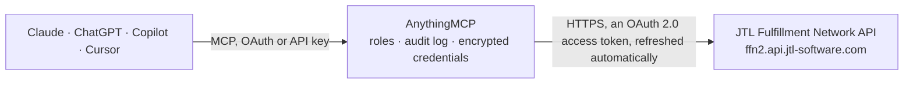

<!-- Generated by scripts/export-github-catalog.mjs in the anythingmcp-website repository. Do not edit by hand. -->

# JTL Fulfillment Network MCP connector

JTL Fulfillment Network (JTL-FFN) for merchants: products, stock per warehouse, outbound orders with shipping status and tracking, inbound deliveries, returns, warehouses and shipping methods of your fulfillers. The AnythingMCP connector gives Claude, ChatGPT, Microsoft Copilot, Cursor and Gemini 22 MCP tools for JTL Fulfillment Network: 19 read and 3 can change data.

**Category:** [Logistics](../logistics.md) · **Tools:** 22 · **Setup guide:** [anythingmcp.com](https://anythingmcp.com/guides/jtl-ffn-to-mcp) · [Deutsch](https://anythingmcp.com/de/guides/jtl-ffn-to-mcp) · [Italiano](https://anythingmcp.com/it/guides/jtl-ffn-to-mcp) · [Español](https://anythingmcp.com/es/guides/jtl-ffn-to-mcp) · [日本語](https://anythingmcp.com/ja/guides/jtl-ffn-to-mcp) · [Русский](https://anythingmcp.com/ru/guides/jtl-ffn-to-mcp) · [中文](https://anythingmcp.com/zh/guides/jtl-ffn-to-mcp)

## Start without code

No installation and no terminal: AnythingMCP Cloud runs the JTL Fulfillment Network connector for you, operated by helpcode.ai in Frankfurt, Germany.

1. **Click the button above** and create an account or sign in. The JTL Fulfillment Network connector opens, ready to install.
2. **Sign in with your JTL Fulfillment Network account** when AnythingMCP asks. The first time, an admin creates a small app in the JTL Fulfillment Network developer console. Every click is in the [step-by-step guide](https://anythingmcp.com/guides/jtl-ffn-to-mcp).
3. **Click Install.** AnythingMCP shows the address of your MCP server.
4. **Add that address to your assistant:** [Claude](https://anythingmcp.com/guides/connect-jtl-ffn-to-claude) · [ChatGPT](https://anythingmcp.com/guides/connect-jtl-ffn-to-chatgpt) · [Microsoft Copilot](https://anythingmcp.com/guides/connect-jtl-ffn-to-copilot) · [Cursor](https://anythingmcp.com/guides/connect-jtl-ffn-to-cursor) · [Gemini CLI](https://anythingmcp.com/guides/connect-jtl-ffn-to-gemini) · [Meta Muse](https://anythingmcp.com/guides/connect-jtl-ffn-to-muse).
5. **Ask your first question**, for example: *What's the status and shipped items for outbound O-2026-113 for customer Berliner Möbelfabrik?*

Prefer help with the setup? [Talk to us](https://anythingmcp.com/contact).

## How it works

- **The AI client** speaks MCP (Streamable HTTP) to AnythingMCP and only sees tool names, descriptions and results. It never gets the JTL Fulfillment Network credentials.
- **AnythingMCP** checks the client's role, builds the call from the tool definition, adds the credentials (an OAuth 2.0 access token, refreshed automatically), calls JTL Fulfillment Network, logs the call and returns the result.
- **JTL Fulfillment Network** sees an ordinary API client with the rights of the account the credentials belong to.

## Tools

| Tool | What it does | Access |
|---|---|---|
| [`jtl_ffn_get_current_user`](#jtl_ffn_get_current_user) | Return the JTL-FFN user behind the authorization: user id (your 4-character merchant id), address and roles. | read |
| [`jtl_ffn_list_warehouses`](#jtl_ffn_list_warehouses) | List the fulfiller warehouses authorized for this merchant, with warehouseId, fulfillerId, name, address and the shippingMethodIds each warehouse offers. | read |
| [`jtl_ffn_list_fulfillers`](#jtl_ffn_list_fulfillers) | List the fulfillment providers this merchant works with: 4-character userId (the fulfillerId used elsewhere), active flag and address. | read |
| [`jtl_ffn_list_shipping_methods`](#jtl_ffn_list_shipping_methods) | List the shipping methods the fulfillers allow this merchant to use: shippingMethodId, name, carrierName, carrierCode, shippingType, cutoffTime and the… | read |
| [`jtl_ffn_list_products`](#jtl_ffn_list_products) | List the merchant's products in JTL-FFN with jfsku, merchantSku, name, identifiers (EAN, ASIN, MPN), dimensions, weight and attributes. | read |
| [`jtl_ffn_get_product`](#jtl_ffn_get_product) | Get one product by its jfsku with all master data: name, merchantSku, identifiers, specifications (batch, best-before, serial number, bill of materials),… | read |
| [`jtl_ffn_list_stock_levels`](#jtl_ffn_list_stock_levels) | List stock for all products across all warehouses: per jfsku the available stockLevel, stockLevelReserved (held by outbounds), stockLevelAnnounced (expected… | read |
| [`jtl_ffn_get_product_stock`](#jtl_ffn_get_product_stock) | Get the stock of one product by jfsku: available, reserved, announced and blocked quantities, split by warehouse and fulfiller, by batch and best-before… | read |
| [`jtl_ffn_list_warehouse_stock`](#jtl_ffn_list_warehouse_stock) | List the stock of all products in one warehouse: per jfsku and merchantSku the available, reserved, announced and blocked quantities. | read |
| [`jtl_ffn_list_outbounds`](#jtl_ffn_list_outbounds) | List outbound orders (shipments the fulfiller sends to customers) with outboundId, merchantOutboundNumber, status (Preparation, Pending, Acknowledged,… | read |
| [`jtl_ffn_get_outbound`](#jtl_ffn_get_outbound) | Get one outbound order with its status, status timestamps, shipping address, items with open quantities, shipping method, notes and cancel reason. | read |
| [`jtl_ffn_list_outbound_shipping_notifications`](#jtl_ffn_list_outbound_shipping_notifications) | Get the shipping notifications the fulfiller posted for an outbound: shipped items with batch and serial numbers, and the packages with tracking numbers… | read |
| [`jtl_ffn_list_outbound_changes`](#jtl_ffn_list_outbound_changes) | Change feed of outbounds modified within a time window (status changes, shipments, cancellations). | read |
| [`jtl_ffn_list_inbounds`](#jtl_ffn_list_inbounds) | List inbound deliveries announced to the fulfillers' warehouses with inboundId, merchantInboundNumber, status (Preparation, Pending, PartiallyReceipted,… | read |
| [`jtl_ffn_get_inbound`](#jtl_ffn_get_inbound) | Get one inbound delivery with its status, warehouse, supplier, purchase order number, note and items with announced quantities. | read |
| [`jtl_ffn_list_inbound_shipping_notifications`](#jtl_ffn_list_inbound_shipping_notifications) | Get the shipping notifications of an inbound delivery, i.e. what is on its way to the warehouse: packages with tracking identifiers, carrier, trackingUrl,… | read |
| [`jtl_ffn_list_returns`](#jtl_ffn_list_returns) | List customer returns with returnId, merchantReturnNumber, state (Announced, Arrived, Completed), warehouse, customer address, returned items with… | read |
| [`jtl_ffn_get_return`](#jtl_ffn_get_return) | Get one customer return by returnId with its state, items (condition, linked outbound), labels and notes. | read |
| [`jtl_ffn_list_cancel_reasons`](#jtl_ffn_list_cancel_reasons) | List the standard cancel reasons of JTL-FFN (code and name). | read |
| [`jtl_ffn_create_outbound`](#jtl_ffn_create_outbound) | Create a new outbound order: the fulfiller will pick, pack and ship these items to the address, which costs money and cannot be undone once shipped. | write |
| [`jtl_ffn_cancel_outbound`](#jtl_ffn_cancel_outbound) | Cancel an outbound order by setting its status to Canceled. | write |
| [`jtl_ffn_create_inbound`](#jtl_ffn_create_inbound) | Announce an inbound delivery (Anlieferung, e.g. new stock from a supplier or production) to the fulfiller's warehouse, so the fulfiller can receive and book it. | write |

## Tool reference

Every parameter as the AI client sees it in `tools/list`. Source: [`packages/backend/src/adapters/de/jtl-ffn.json`](../../../packages/backend/src/adapters/de/jtl-ffn.json).

### `jtl_ffn_get_current_user`

Return the JTL-FFN user behind the authorization: user id (your 4-character merchant id), address and roles. Use it to confirm the connection and that the account has the Merchant role.

**Access:** read · **Call:** `GET /v1/users/current`

No parameters.

### `jtl_ffn_list_warehouses`

List the fulfiller warehouses authorized for this merchant, with warehouseId, fulfillerId, name, address and the shippingMethodIds each warehouse offers. Filterable fields: warehouseId, fulfillerId, name, address/company, address/city.

**Access:** read · **Call:** `GET /v1/merchant/warehouses`

| Parameter | Type | Required | Description |
|---|---|---|---|
| `filter` | string | no | OData-style filter, e.g. fulfillerId eq 'FULF'. |
| `order_by` | string | no | Field to sort by, e.g. name. |
| `limit` | integer | no | Results per page, default 50. |
| `offset` | integer | no | Number of results to skip. |

### `jtl_ffn_list_fulfillers`

List the fulfillment providers this merchant works with: 4-character userId (the fulfillerId used elsewhere), active flag and address. Filterable fields: userId, address/company, address/city, address/email.

**Access:** read · **Call:** `GET /v1/merchant/fulfillers`

| Parameter | Type | Required | Description |
|---|---|---|---|
| `filter` | string | no | OData-style filter, e.g. userId eq 'FULF'. |
| `limit` | integer | no | Results per page, default 50. |
| `offset` | integer | no | Number of results to skip. |

### `jtl_ffn_list_shipping_methods`

List the shipping methods the fulfillers allow this merchant to use: shippingMethodId, name, carrierName, carrierCode, shippingType, cutoffTime and the tracking URL schema. Filterable fields: shippingMethodId, fulfillerId, name, carrierCode, carrierName, shippingType.

**Access:** read · **Call:** `GET /v1/merchant/shippingmethods`

| Parameter | Type | Required | Description |
|---|---|---|---|
| `filter` | string | no | OData-style filter, e.g. fulfillerId eq 'FULF'. |
| `limit` | integer | no | Results per page, default 50. |
| `offset` | integer | no | Number of results to skip. |

### `jtl_ffn_list_products`

List the merchant's products in JTL-FFN with jfsku, merchantSku, name, identifiers (EAN, ASIN, MPN), dimensions, weight and attributes. Use a filter to find a product by your own SKU or EAN, e.g. merchantSku eq 'ABC-1' or identifier/ean eq '4006381333931'. Other filterable fields include name, productGroup, manufacturer and condition.

**Access:** read · **Call:** `GET /v1/merchant/products`

| Parameter | Type | Required | Description |
|---|---|---|---|
| `filter` | string | no | OData-style filter on merchantSku, name, identifier/ean, identifier/asin, productGroup, manufacturer and similar fields. |
| `order_by` | string | no | Field to sort by, e.g. name. |
| `referenced_warehouse` | string | no | Only products referenced by this warehouseId. |
| `referenced_fulfiller` | string | no | Only products referenced by this 4-character fulfillerId. |
| `limit` | integer | no | Results per page, default 50. |
| `offset` | integer | no | Number of results to skip. |

### `jtl_ffn_get_product`

Get one product by its jfsku with all master data: name, merchantSku, identifiers, specifications (batch, best-before, serial number, bill of materials), dimensions, weight, bundles, pictures and attributes.

**Access:** read · **Call:** `GET /v1/merchant/products/{jfsku}`

| Parameter | Type | Required | Description |
|---|---|---|---|
| `jfsku` | string | yes | JTL product id, 11 characters such as MERC01PRDCT. Not your own SKU: look that up with jtl_ffn_list_products. |

### `jtl_ffn_list_stock_levels`

List stock for all products across all warehouses: per jfsku the available stockLevel, stockLevelReserved (held by outbounds), stockLevelAnnounced (expected from inbounds) and stockLevelBlocked, with a breakdown per warehouse and fulfiller. Filter e.g. stockLevel eq 0 to find products out of stock.

**Access:** read · **Call:** `GET /v1/merchant/stocks`

| Parameter | Type | Required | Description |
|---|---|---|---|
| `filter` | string | no | OData-style filter on stockLevel, stockLevelReserved, stockLevelAnnounced, stockLevelBlocked, warehouses/warehouseId, fulfiller/fulfillerId and similar fields. |
| `limit` | integer | no | Results per page, default 50. |
| `offset` | integer | no | Number of results to skip. |

### `jtl_ffn_get_product_stock`

Get the stock of one product by jfsku: available, reserved, announced and blocked quantities, split by warehouse and fulfiller, by batch and best-before date, and which outbounds reserve or inbounds announce how much.

**Access:** read · **Call:** `GET /v1/merchant/stocks/{jfsku}`

| Parameter | Type | Required | Description |
|---|---|---|---|
| `jfsku` | string | yes | JTL product id, 11 characters such as MERC01PRDCT. |

### `jtl_ffn_list_warehouse_stock`

List the stock of all products in one warehouse: per jfsku and merchantSku the available, reserved, announced and blocked quantities. Get warehouse ids from jtl_ffn_list_warehouses.

**Access:** read · **Call:** `GET /v1/merchant/stocks/warehouse/{warehouse_id}`

| Parameter | Type | Required | Description |
|---|---|---|---|
| `warehouse_id` | string | yes | warehouseId from jtl_ffn_list_warehouses. |
| `filter` | string | no | OData-style filter on stockLevel, stockLevelReserved, stockLevelAnnounced, stockLevelBlocked or fulfillerId. |
| `limit` | integer | no | Results per page, default 50. |
| `offset` | integer | no | Number of results to skip. |

### `jtl_ffn_list_outbounds`

List outbound orders (shipments the fulfiller sends to customers) with outboundId, merchantOutboundNumber, status (Preparation, Pending, Acknowledged, Pickprocess, Locked, PartiallyShipped, Shipped, PartiallyCanceled, Canceled), warehouse, items and status timestamps. Filter e.g. status eq 'Pending' or merchantOutboundNumber eq 'SO-1001'.

**Access:** read · **Call:** `GET /v1/merchant/outbounds`

| Parameter | Type | Required | Description |
|---|---|---|---|
| `filter` | string | no | OData-style filter on status, merchantOutboundNumber, outboundId, externalNumber, warehouseId, fulfillerId, shippingAddress/lastname, shippingAddress/email, items/jfsku, statusTimestamp/shipped and similar fields. |
| `order_by` | string | no | Field to sort by, e.g. modificationInfo/createdAt. |
| `limit` | integer | no | Results per page, default 50. |
| `offset` | integer | no | Number of results to skip. |

### `jtl_ffn_get_outbound`

Get one outbound order with its status, status timestamps, shipping address, items with open quantities, shipping method, notes and cancel reason. Accepts the FFN outboundId or your own merchantOutboundNumber.

**Access:** read · **Call:** `GET /v1/merchant/outbounds/{outbound_id}`

| Parameter | Type | Required | Description |
|---|---|---|---|
| `outbound_id` | string | yes | FFN outboundId or your merchantOutboundNumber (your order number). |

### `jtl_ffn_list_outbound_shipping_notifications`

Get the shipping notifications the fulfiller posted for an outbound: shipped items with batch and serial numbers, and the packages with tracking numbers (identifier), trackingUrl, shipping date, estimated delivery date and shipping method. Use it to answer where an order is.

**Access:** read · **Call:** `GET /v1/merchant/outbounds/{outbound_id}/shipping-notifications`

| Parameter | Type | Required | Description |
|---|---|---|---|
| `outbound_id` | string | yes | FFN outboundId or your merchantOutboundNumber. |

### `jtl_ffn_list_outbound_changes`

Change feed of outbounds modified within a time window (status changes, shipments, cancellations). Returns data (full outbounds), from, to and moreDataAvailable; while moreDataAvailable is true, call again with page + 1.

**Access:** read · **Call:** `GET /v1/merchant/outbounds/updates`

| Parameter | Type | Required | Description |
|---|---|---|---|
| `from_date` | string | no | Start of the window, ISO 8601, e.g. 2026-10-01T00:00:00Z. |
| `to_date` | string | no | End of the window, ISO 8601. |
| `page` | integer | no | Page number, starting at 1. |

### `jtl_ffn_list_inbounds`

List inbound deliveries announced to the fulfillers' warehouses with inboundId, merchantInboundNumber, status (Preparation, Pending, PartiallyReceipted, Receipted, Closed), warehouse, purchase order number and items. Filter e.g. status eq 'Pending'.

**Access:** read · **Call:** `GET /v1/merchant/inbounds`

| Parameter | Type | Required | Description |
|---|---|---|---|
| `filter` | string | no | OData-style filter on status, merchantInboundNumber, inboundId, warehouseId, fulfillerId, purchaseOrderNumber, items/jfsku and similar fields. |
| `order_by` | string | no | Field to sort by. |
| `limit` | integer | no | Results per page, default 50. |
| `offset` | integer | no | Number of results to skip. |

### `jtl_ffn_get_inbound`

Get one inbound delivery with its status, warehouse, supplier, purchase order number, note and items with announced quantities. Accepts the FFN inboundId or your merchantInboundNumber.

**Access:** read · **Call:** `GET /v1/merchant/inbounds/{inbound_id}`

| Parameter | Type | Required | Description |
|---|---|---|---|
| `inbound_id` | string | yes | FFN inboundId or your merchantInboundNumber. |

### `jtl_ffn_list_inbound_shipping_notifications`

Get the shipping notifications of an inbound delivery, i.e. what is on its way to the warehouse: packages with tracking identifiers, carrier, trackingUrl, shipping date and estimated delivery date, and the items with quantities, batch and best-before dates.

**Access:** read · **Call:** `GET /v1/merchant/inbounds/{inbound_id}/shipping-notifications`

| Parameter | Type | Required | Description |
|---|---|---|---|
| `inbound_id` | string | yes | FFN inboundId or your merchantInboundNumber. |

### `jtl_ffn_list_returns`

List customer returns with returnId, merchantReturnNumber, state (Announced, Arrived, Completed), warehouse, customer address, returned items with condition, and return labels with tracking numbers. Filter e.g. state eq 'Arrived' or items/outboundId eq '...'.

**Access:** read · **Call:** `GET /v1/merchant/returns`

| Parameter | Type | Required | Description |
|---|---|---|---|
| `filter` | string | no | OData-style filter on state, returnId, merchantReturnNumber, warehouseId, fulfillerId, items/jfsku, items/outboundId, labels/trackingNumber and similar fields. |
| `limit` | integer | no | Results per page, default 50. |
| `offset` | integer | no | Number of results to skip. |

### `jtl_ffn_get_return`

Get one customer return by returnId with its state, items (condition, linked outbound), labels and notes.

**Access:** read · **Call:** `GET /v1/merchant/returns/{return_id}`

| Parameter | Type | Required | Description |
|---|---|---|---|
| `return_id` | string | yes | returnId from jtl_ffn_list_returns. |

### `jtl_ffn_list_cancel_reasons`

List the standard cancel reasons of JTL-FFN (code and name). Use a code as cancel_reason_code in jtl_ffn_cancel_outbound.

**Access:** read · **Call:** `GET /v1/cancelreasons`

No parameters.

### `jtl_ffn_create_outbound`

Create a new outbound order: the fulfiller will pick, pack and ship these items to the address, which costs money and cannot be undone once shipped. Before calling, show the user the warehouse, address, items and shipping method and get an explicit yes. Answers 400 when stock is insufficient, a product or shipping method is unknown, or an active outbound already uses this merchant_outbound_number.

**Access:** write · **Call:** `POST /v1/merchant/outbounds`

| Parameter | Type | Required | Description |
|---|---|---|---|
| `merchant_outbound_number` | string | yes | Your own unique order number, e.g. SO-1001. |
| `warehouse_id` | string | yes | warehouseId from jtl_ffn_list_warehouses. |
| `currency` | string | yes | ISO 4217 code, e.g. EUR. |
| `shipping_address` | object | yes | Recipient. street, city, zip and country (ISO 3166 alpha-2, e.g. DE) are required, plus lastname or company. |
| `items` | object[] | yes | Order lines. outboundItemId is your own line id (e.g. 1, 2, 3); jfsku from jtl_ffn_list_products. |
| `shipping_method_id` | string | no | shippingMethodId from jtl_ffn_list_shipping_methods. Give either this or shipping_type, not both. |
| `shipping_type` | `Standard` \| `Expedited` \| `NextDay` \| `SecondDay` \| `SameDay` | no | Generic shipping speed; JTL picks an authorized method. Give either this or shipping_method_id, not both. |
| `external_note` | string | no | Note that may be shown to the recipient. |
| `internal_note` | string | no | Note for the fulfiller only. |
| `desired_delivery_date` | string | no | ISO 8601 date-time. |
| `order_value` | number | no | Total order value. |
| `shipping_fee` | number | no | Shipping fee charged to the customer. |
| `sales_channel` | string | no | Sales channel name, e.g. Shopify. |

### `jtl_ffn_cancel_outbound`

Cancel an outbound order by setting its status to Canceled. Only possible while the fulfiller has not shipped it; JTL answers 403 when the current status does not allow it. Confirm the order number and the reason with the user before calling.

**Access:** write · **Call:** `PUT /v1/merchant/outbounds/{outbound_id}/status`

| Parameter | Type | Required | Description |
|---|---|---|---|
| `outbound_id` | string | yes | FFN outboundId or your merchantOutboundNumber. |
| `cancel_reason` | string | no | Free-text reason for the cancellation. |
| `cancel_reason_code` | string | no | Optional code from jtl_ffn_list_cancel_reasons. |

### `jtl_ffn_create_inbound`

Announce an inbound delivery (Anlieferung, e.g. new stock from a supplier or production) to the fulfiller's warehouse, so the fulfiller can receive and book it. The fulfiller sees it at once. Before calling, show the user the warehouse, the products and quantities and get an explicit yes. Answers 400 when a product is unknown in that warehouse or the merchant_inbound_number is already in use. Follow its status with jtl_ffn_get_inbound.

**Access:** write · **Call:** `POST /v1/merchant/inbounds`

| Parameter | Type | Required | Description |
|---|---|---|---|
| `merchant_inbound_number` | string | yes | Your own unique number for this delivery, e.g. IN-2026-001. |
| `warehouse_id` | string | yes | warehouseId from jtl_ffn_list_warehouses. |
| `items` | object[] | yes | Products arriving. inboundItemId is your own line id (1, 2, 3...); give jfsku or merchantSku for each line. |
| `purchase_order_number` | string | no | Your purchase order number for this delivery. |
| `external_inbound_number` | string | no | Another reference, e.g. the supplier's delivery note number. |
| `supplier` | object | no | The supplier sending the goods. |
| `note` | string | no | Note on the delivery for the fulfiller, e.g. pallets or time slot. |

## Run it yourself

AnythingMCP is open source (AGPL-3.0). [Run it with Docker](../../../README.md#run-it-yourself), open **Connectors → Store**, pick **JTL Fulfillment Network** and enter `JTL_FFN_CLIENT_ID`, `JTL_FFN_CLIENT_SECRET`, then add your MCP server URL to the AI client.

[← Logistics connectors](../logistics.md) · [All categories](../README.md)
