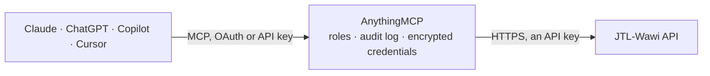

<!-- Generated by scripts/export-github-catalog.mjs in the anythingmcp-website repository. Do not edit by hand. -->

# JTL-Wawi MCP connector

JTL-Wawi — the e-commerce ERP behind a large share of German online retail. The AnythingMCP connector gives Claude, ChatGPT, Microsoft Copilot, Cursor and Gemini 10 MCP tools for JTL-Wawi, all read-only.

**Category:** [ERP](../erp.md) · **Tools:** 10 · **Setup guide:** [anythingmcp.com](https://anythingmcp.com/guides/jtl-wawi-to-mcp) · [Deutsch](https://anythingmcp.com/de/guides/jtl-wawi-to-mcp) · [Italiano](https://anythingmcp.com/it/guides/jtl-wawi-to-mcp) · [Español](https://anythingmcp.com/es/guides/jtl-wawi-to-mcp) · [日本語](https://anythingmcp.com/ja/guides/jtl-wawi-to-mcp) · [Русский](https://anythingmcp.com/ru/guides/jtl-wawi-to-mcp) · [中文](https://anythingmcp.com/zh/guides/jtl-wawi-to-mcp)

## Start without code

No installation and no terminal: AnythingMCP Cloud runs the JTL-Wawi connector for you, operated by helpcode.ai in Frankfurt, Germany.

1. **Click the button above** and create an account or sign in. The JTL-Wawi connector opens, ready to install.
2. **Paste the API key or token from your JTL-Wawi account.** Every click is in the [step-by-step guide](https://anythingmcp.com/guides/jtl-wawi-to-mcp).
3. **Click Install.** AnythingMCP shows the address of your MCP server.
4. **Add that address to your assistant:** [Claude](https://anythingmcp.com/guides/connect-jtl-wawi-to-claude) · [ChatGPT](https://anythingmcp.com/guides/connect-jtl-wawi-to-chatgpt) · [Microsoft Copilot](https://anythingmcp.com/guides/connect-jtl-wawi-to-copilot) · [Cursor](https://anythingmcp.com/guides/connect-jtl-wawi-to-cursor) · [Gemini CLI](https://anythingmcp.com/guides/connect-jtl-wawi-to-gemini) · [Meta Muse](https://anythingmcp.com/guides/connect-jtl-wawi-to-muse).
5. **Ask your first question**, for example: *Show the customer record for customer number KND-2026-88 (Müller Gartenbau GmbH).*

Prefer help with the setup? [Talk to us](https://anythingmcp.com/contact).

## How it works

- **The AI client** speaks MCP (Streamable HTTP) to AnythingMCP and only sees tool names, descriptions and results. It never gets the JTL-Wawi credentials.
- **AnythingMCP** checks the client's role, builds the call from the tool definition, adds the credentials (an API key), calls JTL-Wawi, logs the call and returns the result.
- **JTL-Wawi** sees an ordinary API client with the rights of the account the credentials belong to.

## Tools

| Tool | What it does | Access |
|---|---|---|
| [`jtl_wawi_list_warehouses`](#jtl_wawi_list_warehouses) | List the warehouses (Lager) configured in JTL-Wawi with their id, name and type. | read |
| [`jtl_wawi_list_items`](#jtl_wawi_list_items) | List articles from the item master with their SKU, name, prices, EAN and manufacturer. | read |
| [`jtl_wawi_get_item`](#jtl_wawi_get_item) | Read one article in full: its SKU, descriptions, dimensions, prices, categories and supplier links. | read |
| [`jtl_wawi_get_item_stock`](#jtl_wawi_get_item_stock) | Read the stock of one article per warehouse and storage location: total quantity and the quantity locked for shipment. | read |
| [`jtl_wawi_list_customers`](#jtl_wawi_list_customers) | List customers with their customer number, company, contact name, address and customer group. | read |
| [`jtl_wawi_get_customer`](#jtl_wawi_get_customer) | Read one customer in full: billing and delivery addresses, payment and shipping defaults, and the customer group they belong to. | read |
| [`jtl_wawi_list_sales_orders`](#jtl_wawi_list_sales_orders) | List sales orders with their order number, customer, date, addresses, payment and shipping details. | read |
| [`jtl_wawi_get_sales_order`](#jtl_wawi_get_sales_order) | Read the header of one sales order: addresses, customer, order date, payment and shipping details, cancellation state. | read |
| [`jtl_wawi_list_sales_order_line_items`](#jtl_wawi_list_sales_order_line_items) | Read the line items of one sales order: SKU, name, quantity ordered, delivered and returned, net and gross price, discount and tax rate. | read |
| [`jtl_wawi_list_shipments`](#jtl_wawi_list_shipments) | List delivery notes (Lieferscheine) with their number, date and packages; each package carries its tracking id, tracking URL and shipped date. | read |

## Tool reference

Every parameter as the AI client sees it in `tools/list`. Source: [`packages/backend/src/adapters/de/jtl-wawi.json`](../../../packages/backend/src/adapters/de/jtl-wawi.json).

### `jtl_wawi_list_warehouses`

List the warehouses (Lager) configured in JTL-Wawi with their id, name and type. No parameters — the quickest check that the API server and the app key line up.

**Access:** read · **Call:** `GET /warehouses`

No parameters.

### `jtl_wawi_list_items`

List articles from the item master with their SKU, name, prices, EAN and manufacturer. Use a search fragment to find one article before asking about its stock.

**Access:** read · **Call:** `GET /items`

| Parameter | Type | Required | Description |
|---|---|---|---|
| `searchKeyWord` | string | no | Search fragment matched against SKU, name and EAN. |
| `pageNumber` | number | no | Page number, starting at 1. |
| `pageSize` | number | no | Rows per page. |

### `jtl_wawi_get_item`

Read one article in full: its SKU, descriptions, dimensions, prices, categories and supplier links.

**Access:** read · **Call:** `GET /items/{itemId}`

| Parameter | Type | Required | Description |
|---|---|---|---|
| `itemId` | number | yes | Numeric JTL item id (kArtikel). |

### `jtl_wawi_get_item_stock`

Read the stock of one article per warehouse and storage location: total quantity and the quantity locked for shipment. This — not the item master — is what an availability question needs.

**Access:** read · **Call:** `GET /stocks`

| Parameter | Type | Required | Description |
|---|---|---|---|
| `itemId` | number | yes | Numeric JTL item id (kArtikel). |
| `warehouseId` | number | no | Restrict to one warehouse, from jtl_wawi_list_warehouses. |
| `pageNumber` | number | no | Page number, starting at 1. |
| `pageSize` | number | no | Rows per page. |

### `jtl_wawi_list_customers`

List customers with their customer number, company, contact name, address and customer group.

**Access:** read · **Call:** `GET /customers`

| Parameter | Type | Required | Description |
|---|---|---|---|
| `searchKeyWord` | string | no | Search fragment matched against name, company and customer number. |
| `pageNumber` | number | no | Page number, starting at 1. |
| `pageSize` | number | no | Rows per page. |

### `jtl_wawi_get_customer`

Read one customer in full: billing and delivery addresses, payment and shipping defaults, and the customer group they belong to.

**Access:** read · **Call:** `GET /customers/{customerId}`

| Parameter | Type | Required | Description |
|---|---|---|---|
| `customerId` | number | yes | Numeric JTL customer id (kKunde). |

### `jtl_wawi_list_sales_orders`

List sales orders with their order number, customer, date, addresses, payment and shipping details. Filter by order number, customer or creation date; there is no free-text search on this endpoint.

**Access:** read · **Call:** `GET /salesOrders`

| Parameter | Type | Required | Description |
|---|---|---|---|
| `salesOrderNumber` | string | no | Wawi order number (Auftragsnummer). |
| `externalOrderNumber` | string | no | Order number from the sales channel, e.g. the shop or marketplace order id. |
| `customerId` | number | no | Numeric JTL customer id (kKunde). |
| `createdSince` | string | no | Only orders created after this ISO 8601 date-time. |
| `createdUntil` | string | no | Only orders created before this ISO 8601 date-time. |
| `pageNumber` | number | no | Page number, starting at 1. |
| `pageSize` | number | no | Rows per page. |

### `jtl_wawi_get_sales_order`

Read the header of one sales order: addresses, customer, order date, payment and shipping details, cancellation state. Line items are not part of it; use jtl_wawi_list_sales_order_line_items.

**Access:** read · **Call:** `GET /salesOrders/{salesOrderId}`

| Parameter | Type | Required | Description |
|---|---|---|---|
| `salesOrderId` | number | yes | Numeric JTL sales order id (kBestellung). |

### `jtl_wawi_list_sales_order_line_items`

Read the line items of one sales order: SKU, name, quantity ordered, delivered and returned, net and gross price, discount and tax rate.

**Access:** read · **Call:** `GET /salesOrders/{salesOrderId}/lineitems`

| Parameter | Type | Required | Description |
|---|---|---|---|
| `salesOrderId` | number | yes | Numeric JTL sales order id, from jtl_wawi_list_sales_orders. |

### `jtl_wawi_list_shipments`

List delivery notes (Lieferscheine) with their number, date and packages; each package carries its tracking id, tracking URL and shipped date. Filter by order number or customer — the answer to 'has it gone out yet'.

**Access:** read · **Call:** `GET /deliveryNotes`

| Parameter | Type | Required | Description |
|---|---|---|---|
| `salesOrderNumber` | string | no | Wawi order number the delivery notes belong to. |
| `customerId` | number | no | Numeric JTL customer id (kKunde). |
| `pageNumber` | number | no | Page number, starting at 1. |
| `pageSize` | number | no | Rows per page. |

## Run it yourself

AnythingMCP is open source (AGPL-3.0). [Run it with Docker](../../../README.md#run-it-yourself), open **Connectors → Store**, pick **JTL-Wawi** and enter `JTL_WAWI_URL`, `JTL_WAWI_API_KEY`, `JTL_WAWI_APP_ID`, `JTL_WAWI_APP_VERSION`, then add your MCP server URL to the AI client.

[← ERP connectors](../erp.md) · [All categories](../README.md)
