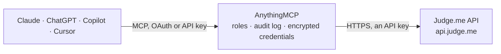

<!-- Generated by scripts/export-github-catalog.mjs in the anythingmcp-website repository. Do not edit by hand. -->

# Judge.me MCP connector

Let your AI read your Judge.me product and store reviews: list and filter reviews by product or rating, find reviewers and products, get average ratings and review counts, widget settings and webhooks. The AnythingMCP connector gives Claude, ChatGPT, Microsoft Copilot, Cursor and Gemini 16 MCP tools for Judge.me: 13 read and 3 can change data.

**Category:** [E-commerce](../e-commerce.md) · **Tools:** 16 · **Setup guide:** [anythingmcp.com](https://anythingmcp.com/guides/judge-me-to-mcp) · [Deutsch](https://anythingmcp.com/de/guides/judge-me-to-mcp) · [Italiano](https://anythingmcp.com/it/guides/judge-me-to-mcp) · [Español](https://anythingmcp.com/es/guides/judge-me-to-mcp) · [日本語](https://anythingmcp.com/ja/guides/judge-me-to-mcp) · [Русский](https://anythingmcp.com/ru/guides/judge-me-to-mcp) · [中文](https://anythingmcp.com/zh/guides/judge-me-to-mcp)

## Start without code

No installation and no terminal: AnythingMCP Cloud runs the Judge.me connector for you, operated by helpcode.ai in Frankfurt, Germany.

1. **Click the button above** and create an account or sign in. The Judge.me connector opens, ready to install.
2. **Paste the API key or token from your Judge.me account.** Every click is in the [step-by-step guide](https://anythingmcp.com/guides/judge-me-to-mcp).
3. **Click Install.** AnythingMCP shows the address of your MCP server.
4. **Add that address to your assistant:** [Claude](https://anythingmcp.com/guides/connect-judge-me-to-claude) · [ChatGPT](https://anythingmcp.com/guides/connect-judge-me-to-chatgpt) · [Microsoft Copilot](https://anythingmcp.com/guides/connect-judge-me-to-copilot) · [Cursor](https://anythingmcp.com/guides/connect-judge-me-to-cursor) · [Gemini CLI](https://anythingmcp.com/guides/connect-judge-me-to-gemini) · [Meta Muse](https://anythingmcp.com/guides/connect-judge-me-to-muse).
5. **Ask your first question**, for example: *Do we have a Judge.me profile for maria.kask@norhome.ee and does she accept marketing?*

Prefer help with the setup? [Talk to us](https://anythingmcp.com/contact).

## How it works

- **The AI client** speaks MCP (Streamable HTTP) to AnythingMCP and only sees tool names, descriptions and results. It never gets the Judge.me credentials.
- **AnythingMCP** checks the client's role, builds the call from the tool definition, adds the credentials (an API key), calls Judge.me, logs the call and returns the result.
- **Judge.me** sees an ordinary API client with the rights of the account the credentials belong to.

## Tools

| Tool | What it does | Access |
|---|---|---|
| [`judge_me_get_shop`](#judge_me_get_shop) | Read the store as Judge.me knows it: name, domain, custom domain, platform, plan (free or awesome), currency, country, timezone and widget version. | read |
| [`judge_me_list_reviews`](#judge_me_list_reviews) | List reviews, newest first: id, title, body, rating, reviewer (name, email), product_title, product_handle, product_external_id, source, curated (ok, spam,… | read |
| [`judge_me_count_reviews`](#judge_me_count_reviews) | Count reviews, optionally for one product, one reviewer or one star rating. | read |
| [`judge_me_get_review`](#judge_me_get_review) | Read one review by its Judge.me id, with reviewer, product, pictures and curation state. | read |
| [`judge_me_get_reviewer`](#judge_me_get_reviewer) | Find a reviewer by e-mail or by customer id in the shop platform: Judge.me id, name, email, phone, tags, accepts_marketing. | read |
| [`judge_me_get_product`](#judge_me_get_product) | Find a product in Judge.me by handle or Shopify product id and get its Judge.me id, which judge_me_list_reviews and judge_me_count_reviews filter by. | read |
| [`judge_me_get_product_rating`](#judge_me_get_product_rating) | Average rating and review count of one product, from its preview badge: the answer is the badge HTML, whose data-average-rating and data-number-of-reviews… | read |
| [`judge_me_get_product_reviews_widget`](#judge_me_get_product_reviews_widget) | The product review widget of one product as Judge.me renders it (HTML inside JSON, a page at a time), including reviews with their replies, which… | read |
| [`judge_me_get_store_rating`](#judge_me_get_store_rating) | Average rating of all reviews of the store (product and store reviews together), as Judge.me shows it in its badges. | read |
| [`judge_me_get_store_review_count`](#judge_me_get_store_review_count) | Total number of published reviews of the store, product and store reviews together. | read |
| [`judge_me_get_shop_reviews_rating`](#judge_me_get_shop_reviews_rating) | Average rating of store-level reviews only (reviews of the shop, not of a product). | read |
| [`judge_me_get_settings`](#judge_me_get_settings) | Read Judge.me settings of the store by key, e.g. widget_primary_color, widget_star_color or review request settings. | read |
| [`judge_me_list_webhooks`](#judge_me_list_webhooks) | List the webhooks registered for the store: key (event such as review/created), url and failure count. | read |
| [`judge_me_curate_review`](#judge_me_curate_review) | Publish or hide a review: curated ok publishes it, spam (or hidden true) hides it from the store. | write |
| [`judge_me_reply_to_review`](#judge_me_reply_to_review) | Post a public reply under a review; by default Judge.me also e-mails it to the reviewer. | write |
| [`judge_me_send_private_reply`](#judge_me_send_private_reply) | Send a private e-mail reply to a reviewer about their review (not shown publicly). | write |

## Tool reference

Every parameter as the AI client sees it in `tools/list`. Source: [`packages/backend/src/adapters/intl/judge-me.json`](../../../packages/backend/src/adapters/intl/judge-me.json).

### `judge_me_get_shop`

Read the store as Judge.me knows it: name, domain, custom domain, platform, plan (free or awesome), currency, country, timezone and widget version. Checks the token. Read-only.

**Access:** read · **Call:** `GET /shops/info`

No parameters.

### `judge_me_list_reviews`

List reviews, newest first: id, title, body, rating, reviewer (name, email), product_title, product_handle, product_external_id, source, curated (ok, spam, not-yet), hidden, verified, pictures, created_at. Filter by product, reviewer or star rating. Read-only.

**Access:** read · **Call:** `GET /reviews`

| Parameter | Type | Required | Description |
|---|---|---|---|
| `page` | integer | no | Page, from 1. |
| `per_page` | integer | no | Reviews per page, at most 100. Default 20. |
| `product_id` | integer | no | Judge.me product id (from judge_me_get_product), not the Shopify id. |
| `reviewer_id` | integer | no | Judge.me reviewer id. |
| `rating` | integer | no | Only reviews with this many stars. |

### `judge_me_count_reviews`

Count reviews, optionally for one product, one reviewer or one star rating. Read-only.

**Access:** read · **Call:** `GET /reviews/count`

| Parameter | Type | Required | Description |
|---|---|---|---|
| `product_id` | integer | no | Judge.me product id. |
| `reviewer_id` | integer | no | Judge.me reviewer id. |
| `rating` | integer | no | Star rating. |

### `judge_me_get_review`

Read one review by its Judge.me id, with reviewer, product, pictures and curation state. Read-only.

**Access:** read · **Call:** `GET /reviews/{review_id}`

| Parameter | Type | Required | Description |
|---|---|---|---|
| `review_id` | integer | yes | Review id from judge_me_list_reviews. |

### `judge_me_get_reviewer`

Find a reviewer by e-mail or by customer id in the shop platform: Judge.me id, name, email, phone, tags, accepts_marketing. Read-only.

**Access:** read · **Call:** `GET /reviewers/-1`

| Parameter | Type | Required | Description |
|---|---|---|---|
| `email` | string | no | Reviewer e-mail. |
| `external_id` | string | no | Customer id in the shop platform. |

### `judge_me_get_product`

Find a product in Judge.me by handle or Shopify product id and get its Judge.me id, which judge_me_list_reviews and judge_me_count_reviews filter by. Read-only.

**Access:** read · **Call:** `GET /products/-1`

| Parameter | Type | Required | Description |
|---|---|---|---|
| `handle` | string | no | Product handle (the last part of the product URL, e.g. blue-shirt). |
| `external_id` | string | no | Product id in the shop platform (Shopify product id). |

### `judge_me_get_product_rating`

Average rating and review count of one product, from its preview badge: the answer is the badge HTML, whose data-average-rating and data-number-of-reviews attributes carry the numbers. Read-only.

**Access:** read · **Call:** `GET /widgets/preview_badge`

| Parameter | Type | Required | Description |
|---|---|---|---|
| `handle` | string | no | Product handle (the last part of the product URL, e.g. blue-shirt). |
| `external_id` | string | no | Product id in the shop platform (Shopify product id). |
| `id` | integer | no | Judge.me's own product id. |

### `judge_me_get_product_reviews_widget`

The product review widget of one product as Judge.me renders it (HTML inside JSON, a page at a time), including reviews with their replies, which judge_me_list_reviews does not return. Read-only.

**Access:** read · **Call:** `GET /widgets/product_review`

| Parameter | Type | Required | Description |
|---|---|---|---|
| `handle` | string | no | Product handle (the last part of the product URL, e.g. blue-shirt). |
| `external_id` | string | no | Product id in the shop platform (Shopify product id). |
| `id` | integer | no | Judge.me's own product id. |
| `page` | integer | no | Page, from 1. |
| `per_page` | integer | no | Reviews per page, default 5. |

### `judge_me_get_store_rating`

Average rating of all reviews of the store (product and store reviews together), as Judge.me shows it in its badges. Read-only.

**Access:** read · **Call:** `GET /widgets/all_reviews_rating`

No parameters.

### `judge_me_get_store_review_count`

Total number of published reviews of the store, product and store reviews together. Read-only.

**Access:** read · **Call:** `GET /widgets/all_reviews_count`

No parameters.

### `judge_me_get_shop_reviews_rating`

Average rating of store-level reviews only (reviews of the shop, not of a product). Read-only.

**Access:** read · **Call:** `GET /widgets/shop_reviews_rating`

No parameters.

### `judge_me_get_settings`

Read Judge.me settings of the store by key, e.g. widget_primary_color, widget_star_color or review request settings. Read-only.

**Access:** read · **Call:** `GET /settings`

| Parameter | Type | Required | Description |
|---|---|---|---|
| `setting_keys` | string[] | yes | Setting keys to read, e.g. ["widget_primary_color","widget_star_color"]. |

### `judge_me_list_webhooks`

List the webhooks registered for the store: key (event such as review/created), url and failure count. Read-only.

**Access:** read · **Call:** `GET /webhooks`

No parameters.

### `judge_me_curate_review`

Publish or hide a review: curated ok publishes it, spam (or hidden true) hides it from the store. Review text cannot be edited. Changes what shoppers see. Installed switched off. Confirm with the user first.

**Access:** write · **Call:** `PUT /reviews/{review_id}`

| Parameter | Type | Required | Description |
|---|---|---|---|
| `review_id` | integer | yes | Review id. |
| `curated` | `ok` \| `spam` | no | ok to publish, spam to hide. |
| `hidden` | boolean | no | true hides the review (and marks it spam); do not combine with curated ok. |

### `judge_me_reply_to_review`

Post a public reply under a review; by default Judge.me also e-mails it to the reviewer. Installed switched off. Show the reply and confirm with the user first.

**Access:** write · **Call:** `POST /replies`

| Parameter | Type | Required | Description |
|---|---|---|---|
| `review_id` | integer | yes | Review id. |
| `content` | string | yes | Reply text, shown publicly under the review. |
| `send_reply_email` | boolean | no | E-mail the reply to the reviewer. Default true. |

### `judge_me_send_private_reply`

Send a private e-mail reply to a reviewer about their review (not shown publicly). Installed switched off. Show the e-mail and confirm with the user first.

**Access:** write · **Call:** `POST /private_replies`

| Parameter | Type | Required | Description |
|---|---|---|---|
| `review_id` | integer | yes | Review id. |
| `email_subject` | string | yes | E-mail subject. |
| `email_body` | string | yes | E-mail text. |

## Run it yourself

AnythingMCP is open source (AGPL-3.0). [Run it with Docker](../../../README.md#run-it-yourself), open **Connectors → Store**, pick **Judge.me** and enter `JUDGEME_SHOP_DOMAIN`, `JUDGEME_API_TOKEN`, then add your MCP server URL to the AI client.

[← E-commerce connectors](../e-commerce.md) · [All categories](../README.md)
