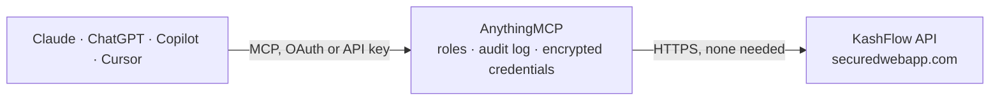

<!-- Generated by scripts/export-github-catalog.mjs in the anythingmcp-website repository. Do not edit by hand. -->

# KashFlow MCP connector

Manage KashFlow (UK accounting) customers, suppliers, invoices, receipts, products via SOAP envelope from any AI agent. 8 tools, embedded-auth. The AnythingMCP connector gives Claude, ChatGPT, Microsoft Copilot, Cursor and Gemini 8 MCP tools for KashFlow: 6 read and 2 can change data.

**Category:** [Accounting](../accounting.md) · **Tools:** 8 · **Setup guide:** [anythingmcp.com](https://anythingmcp.com/guides/kashflow-to-mcp) · [Deutsch](https://anythingmcp.com/de/guides/kashflow-to-mcp) · [Italiano](https://anythingmcp.com/it/guides/kashflow-to-mcp) · [Español](https://anythingmcp.com/es/guides/kashflow-to-mcp) · [日本語](https://anythingmcp.com/ja/guides/kashflow-to-mcp) · [Русский](https://anythingmcp.com/ru/guides/kashflow-to-mcp) · [中文](https://anythingmcp.com/zh/guides/kashflow-to-mcp)

## Start without code

No installation and no terminal: AnythingMCP Cloud runs the KashFlow connector for you, operated by helpcode.ai in Frankfurt, Germany.

1. **Click the button above** and create an account or sign in. The KashFlow connector opens, ready to install.
2. **Nothing to enter:** this connector needs no credentials. Every click is in the [step-by-step guide](https://anythingmcp.com/guides/kashflow-to-mcp).
3. **Click Install.** AnythingMCP shows the address of your MCP server.
4. **Add that address to your assistant:** [Claude](https://anythingmcp.com/guides/connect-kashflow-to-claude) · [ChatGPT](https://anythingmcp.com/guides/connect-kashflow-to-chatgpt) · [Microsoft Copilot](https://anythingmcp.com/guides/connect-kashflow-to-copilot) · [Cursor](https://anythingmcp.com/guides/connect-kashflow-to-cursor) · [Gemini CLI](https://anythingmcp.com/guides/connect-kashflow-to-gemini) · [Meta Muse](https://anythingmcp.com/guides/connect-kashflow-to-muse).
5. **Ask your first question**, for example: *Show me the customer record for BrightWave Ltd, company number BR-2026-09, please.*

Prefer help with the setup? [Talk to us](https://anythingmcp.com/contact).

## How it works

- **The AI client** speaks MCP (Streamable HTTP) to AnythingMCP and only sees tool names, descriptions and results. It never gets the KashFlow credentials.
- **AnythingMCP** checks the client's role, builds the call from the tool definition, adds the credentials (none needed), calls KashFlow, logs the call and returns the result.
- **KashFlow** sees an ordinary API client with the rights of the account the credentials belong to.

## Tools

| Tool | What it does | Access |
|---|---|---|
| [`kashflow_list_customers`](#kashflow_list_customers) | List customers. | read |
| [`kashflow_get_customer`](#kashflow_get_customer) | Get one customer by KashFlow CustomerID. | read |
| [`kashflow_create_customer`](#kashflow_create_customer) | Create a customer. | write |
| [`kashflow_list_suppliers`](#kashflow_list_suppliers) | List suppliers. | read |
| [`kashflow_list_invoices`](#kashflow_list_invoices) | List sales invoices. | read |
| [`kashflow_get_invoice`](#kashflow_get_invoice) | Get a single invoice with line items. | read |
| [`kashflow_create_invoice`](#kashflow_create_invoice) | Create a sales invoice. | write |
| [`kashflow_list_products`](#kashflow_list_products) | List products / services. | read |

## Tool reference

Every parameter as the AI client sees it in `tools/list`. Source: [`packages/backend/src/adapters/intl/kashflow.json`](../../../packages/backend/src/adapters/intl/kashflow.json).

### `kashflow_list_customers`

List customers.

**Access:** read · **Call:** `GET /{KASHFLOW_USERNAME}/{KASHFLOW_PASSWORD}/customers`

No parameters.

### `kashflow_get_customer`

Get one customer by KashFlow CustomerID.

**Access:** read · **Call:** `GET /{KASHFLOW_USERNAME}/{KASHFLOW_PASSWORD}/customers/{customer_id}`

| Parameter | Type | Required | Description |
|---|---|---|---|
| `customer_id` | integer | yes | CustomerID. |

### `kashflow_create_customer`

Create a customer.

**Access:** write · **Call:** `POST /{KASHFLOW_USERNAME}/{KASHFLOW_PASSWORD}/customers`

| Parameter | Type | Required | Description |
|---|---|---|---|
| `Name` | string | yes | Display name. |
| `Code` | string | no | Internal code. |
| `Email` | string | no | Email. |
| `Telephone` | string | no | Phone. |
| `Address1` | string | no | Address line 1. |
| `Address2` | string | no | Address line 2. |
| `Address3` | string | no | Town. |
| `Address4` | string | no | County. |
| `Postcode` | string | no | Postcode. |
| `CountryCode` | string | no | ISO 3166-1 alpha-2. |

### `kashflow_list_suppliers`

List suppliers.

**Access:** read · **Call:** `GET /{KASHFLOW_USERNAME}/{KASHFLOW_PASSWORD}/suppliers`

No parameters.

### `kashflow_list_invoices`

List sales invoices.

**Access:** read · **Call:** `GET /{KASHFLOW_USERNAME}/{KASHFLOW_PASSWORD}/invoices`

No parameters.

### `kashflow_get_invoice`

Get a single invoice with line items.

**Access:** read · **Call:** `GET /{KASHFLOW_USERNAME}/{KASHFLOW_PASSWORD}/invoices/{invoice_id}`

| Parameter | Type | Required | Description |
|---|---|---|---|
| `invoice_id` | integer | yes | InvoiceID. |

### `kashflow_create_invoice`

Create a sales invoice. `Lines` is an array of {Quantity, Description, Rate, ChargeType, VatRate, VatAmount, ProductID}.

**Access:** write · **Call:** `POST /{KASHFLOW_USERNAME}/{KASHFLOW_PASSWORD}/invoices`

| Parameter | Type | Required | Description |
|---|---|---|---|
| `CustomerID` | integer | yes | Customer ID. |
| `InvoiceDate` | string | yes | ISO 8601 date. |
| `DueDate` | string | no | ISO 8601 date. |
| `InvoiceNumber` | integer | no | Invoice number (set 0 to auto-allocate). |
| `Lines` | any[] | yes | Line items. |
| `CustomerReference` | string | no | Customer PO ref. |
| `ProjectID` | integer | no | Project ID (optional). |

### `kashflow_list_products`

List products / services.

**Access:** read · **Call:** `GET /{KASHFLOW_USERNAME}/{KASHFLOW_PASSWORD}/products`

No parameters.

## Run it yourself

AnythingMCP is open source (AGPL-3.0). [Run it with Docker](../../../README.md#run-it-yourself), open **Connectors → Store**, pick **KashFlow** and enter `KASHFLOW_USERNAME`, `KASHFLOW_PASSWORD`, then add your MCP server URL to the AI client.

[← Accounting connectors](../accounting.md) · [All categories](../README.md)
